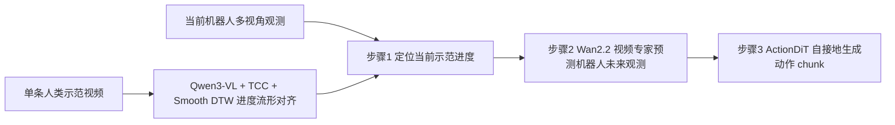
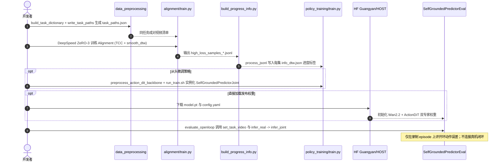

# HOST：单条人类视频秒级习得操作

**HOST**（*Human-to-robot One-Shot Skill AcquisiTion*，*Robots Acquire Manipulation Skills in Seconds from a Single Human Video*，[arXiv:2607.20033v4](https://arxiv.org/abs/2607.20033)，[项目页](https://host-site.host-robotics.workers.dev/)，[代码](https://github.com/CGuangyan-BIT/HOST)，[权重](https://huggingface.co/Guangyan/HOST)）由 **北京理工大学（BIT）**、**自变量机器人（X Square Robot）** 与 **清华大学（Tsinghua）** 提出：把新技能从「再采遥操作再微调」改成 **推理时一条人类视频驱动的自接地预测**。

## 一句话定义

**不改权重，用一条人类视频在约半分钟内指定新操作：先把人/机进度对齐到同一流形以耦合预测目标，再按「定位示范进度 → 预测机器人自己的未来观测 → 生成动作」自接地级联执行。**

## 英文缩写速查

| 缩写 | 英文全称 | 简要说明 |
|------|----------|----------|
| HOST | Human-to-robot One-Shot Skill AcquisiTion | 本文框架：推理时单视频零梯度技能习得 |
| ICL | In-Context Learning | 权重冻结、依靠上下文视频指定任务 |
| TCC | Temporal Cycle Consistency | 对齐模块用于学习进度表征的循环一致损失 |
| DTW | Dynamic Time Warping | Smooth DTW 将人/机轨迹映射到共享进度流形 |
| MoT | Mixture-of-Transformers | Wan2.2 视频专家与 ActionDiT 动作专家共享注意力架构 |
| WAM | World-Action Model | 先生成机器人未来视觉观测再推导动作的范式 |
| SFT | Supervised Fine-Tuning | 对照的「10/20/50 条遥操作再训」微调基线 |

## 为什么重要

- **打断训练时环：** 新任务不再默认消耗 50 条专家遥操作 + 数小时微调，也不必因参数覆盖而损伤已掌握技能。
- **可核对的开源 one-shot 方案：** 对照完全闭源的 [GEN-1.5](./generalist-gen15-one-shot.md) / [S1](./skild-s1.md)，HOST 公布完整对齐与策略代码及 HF `model.pt` 权重和逐项实验数值。
- **评测轴与 Imitator Game 互补：** [Imitator Game](./paper-imitator-game.md) 检验「意图是否跨过 L3 功能替代」；HOST 检验「单条人类视频能否在秒级变成可执行技能且不发生灾难性遗忘」。
- **机制上避免像素直接回归动作：** 相对简单把人手视频前缀硬塞入动作网络，HOST 显式做 **进度对应 + 自接地机器人未来观测预测**。

## 核心信息

| 项 | 内容 |
|----|------|
| **机构** | 北京理工大学（BIT）；自变量机器人（X Square Robot）；清华大学（Tsinghua） |
| **出处** | arXiv:2607.20033（v4，2026-08-20） |
| **平台** | 双臂 **ARX R5** + 平行夹爪；双腕 + 第三人称三路 RGB；双臂动作 **20 维** |
| **预训练** | Stage 1：193,462 条机器人轨迹 / 229 任务；Stage 2：5,847 条自采人视频配对 |
| **评测** | 50 个未见操作任务 × 20 trial；八任务精细对照组平均 62% |
| **开源** | **代码与 HF 权重已开源**（`CGuangyan-BIT/HOST` + `Guangyan/HOST` MIT 模型卡）；论文真机 193k 轨迹未随仓发布 |

## 流程总览

两阶段预训练范式：Stage 1 用同任务机器人–机器人配对（193,462 条）让策略学会「追踪示范未来进展并自接地出动作」；Stage 2 用少量自采人–机配对（5,847 条）将条件视频无缝迁移至真人视频。

## 核心原理

### 1. 把预测目标耦到示范进度，而不是物理时钟

人类示范与机器人执行的绝对速度往往不同步。若按固定时间偏移切监督目标，机器人在停顿或加快时会跟丢示范意图。HOST 在 `alignment/` 模块中以 `Qwen3-VL-Embedding-8B` 提取逐帧嵌入，结合 TCC（Temporal Cycle Consistency）与 `smooth_dtw` 构建共享 **任务进度流形**（产出 `info_dtw.json`），将人/机帧对齐后按 **示范即将推进的相对进度** 重写每步预测目标。

### 2. 自接地因果级联，避免跨本体视觉直接回归动作

人类演示存在手部构造、第三人称视角与背景差异，直接映射低维关节动作容易退化。HOST 通过单模型内的因果级联解决状态差异：
1. **进度定位：** 定位当前机器人观测在演示进度流形中所处的相对位置；
2. **机器人未来观测生成：** 将示范接下来的视觉进度「翻译」成机器人自身视角与本体外观下的未来图像（由初始化自 **Wan2.2-TI2V-5B** 的视频专家生成）；
3. **动作推导：** 动作专家 `ActionDiT` 通过 `SelfGroundedPredictorJoint` 的 MoT（Mixture-of-Transformers）掩码关注全部视频潜 token 与任务进度信号，输出双臂 20 维动作块。实现底座继承自 Fast-WAM（[arXiv:2603.16666](https://arxiv.org/abs/2603.16666)）。

### 3. 技能停留在外部视频提示，零梯度避免遗忘

因为推理阶段无需更新神经网络权重 $\theta$，新技能由检索或实时录制的一条人类视频通过上下文条件提供；模型在持续接纳新技能时，原参数完全冻结，因此作者测得在已掌握七项任务上维持约 **99%** 的原有性能留存，避免了 SFT 的灾难性遗忘。

## 实验与评测

| 设定 | 核心量化结果 |
|------|--------------|
| **50 任务广度验证** | 50 个未见操作任务（每任务 20 trial）均能从单条人视频获取可执行技能（总时间含录视频平均 **~29 s**） |
| **八任务平均 SR** | HOST **62%** vs Vid2Robot **16%** / AWDA **19%** / $\pi_{0.5}$ **11%** / Wall-OSS **17%** / HOST-base（纯语言）**4%** |
| **相对最强基线提升** | 相对最强 one-shot 视觉模仿基线 **+43 pt**；相对最强零样本基线（摘要口径）**+45 pt** |
| **数据与时间效率** | 相对 50 条遥操作 SFT：示范少 **50×**，技能习得快约 **507×**（~29 s vs $\pi_{0.5}$+SFT-50 约 4 h）；Wall-OSS+SFT-50 仅 **56%** |
| **七任务技能留存** | 不改权重的 HOST 保留约 **99%**；50 demo SFT 预算下 $\pi_{0.5}$ 仅保留约 **22%**（Wall-OSS 最高仅约 **43%**） |
| **部署扰动（相对 62%）** | 光照变化 **61%**（−1）、OOD 物体 **58%**（−4）、更换场景 **56%**（−6）、执行中人为干扰 **53%**（−9） |

数字核自 [arXiv:2607.20033v4](../../sources/papers/host_arxiv_2607_20033.md) 与 [项目页 Results](../../sources/sites/host-robotics.md)；八任务精细平均不可混作 50 任务全表均值。

## 结论

**HOST 证明「跨具身单视频 one-shot 习得」可以通过共享进度流形对齐与机器人自接地未来帧预测在零梯度下实时完成，但其公开数据壁垒与双臂 ARX 单一平台边界仍需清醒评估。**

- **进度耦合解决速度差异**：用 TCC + Smooth DTW 生成 `info_dtw.json` 对齐人/机进度流形，是示范驱动预测的前提。
- **自接地先想像自己再输出动作**：Wan2.2 视频专家先生成机器人的未来帧，再由 `ActionDiT`（`SelfGroundedPredictorJoint`）读全视频 token 导出动作，隔离了外观形态差异。
- **大模型规模基座依赖大真机数据**：Stage 1 的 **193,462** 条机器人配对奠定了轨迹跟随能力，Stage 2 仅用 **5,847** 条人类视频即完成跨具身转换。
- **开源复现限于管线与权重验证**：公共仓库释放全部代码且 HF 提供 `Guangyan/HOST` 权重，但训练全集未随仓公开，且随仓评测仅为离线开环 `evaluate_openloop.py`。
- **平台绑定风险尚存**：实验集中在双臂 ARX R5，跨至人形全身或异构多指灵巧手的迁移尚未实测。

## 源码运行时序图

官方仓库 [CGuangyan-BIT/HOST](https://github.com/CGuangyan-BIT/HOST) 按数据契约、表征对齐、进度标签与双专家扩散策略拆分为四个模块，各自运行如下：

- **核心代码路径：** `alignment/train.py`（`Alignment`）、`coupling/progress_alignment/build_progress_info.py`（`process_jsonl`）、`policy_training/scripts/train.py` → `self_grounded_prediction/runtime.py::create_self_grounded_predictor` → `SelfGroundedPredictorJoint`、`policy_training/eval/real_openloop/evaluate_openloop.py` → `SelfGroundedPredictorEval`。

## 工程实践

| 项 | 实践要点 |
|----|----------|
| **双 Conda 环境隔离** | 必须分别创建 `HOST_Alignment`（PyTorch 2.4 + CUDA 12.4）与 `HOST_Policy`（PyTorch 2.6 + CUDA 12.4 + `pip install -e ./policy_training --no-deps`），切勿混用 |
| **数据目录契约** | 每个 episode 须按 `data_preprocessing/README.md` 配备 `episode_001.json`、相机图像/视频及 `instruction.txt`/`instruction.pt`，经 `build_task_dictionary.py` 分组 |
| **集群路径与权重** | 仓内 `OPEN_SOURCE_PATH_TODOS.md` 列出默认 `configs/data/custom*.yaml` 含内部路径占位，实际跑通前需替换为本地数据路径并设置 `DIFFSYNTH_MODEL_BASE_PATH` |
| **许可协议注意** | HF 模型卡标注 MIT，`policy_training/LICENSE` 继承 Fast-WAM，但仓库根目录缺少统一 LICENSE，且 Wan2.2 / Qwen3-VL / SigLIP / DINOv2 须遵循原许可证 |
| **闭环与开环区分** | `scripts/eval_openloop.sh` 只对录制数据集算 MAE/RMSE，不控制真机硬件 |

## 局限与风险

- **单平台外推未知：** 全套真机主结论仅在一台双臂 ARX R5 上测得，尚未验证跨越大幅几何差异本体（如双足人形或灵巧手）的开箱迁移。
- **八任务 vs 五十任务口径：** 62% 精细对照来自 8 任务子集；50 任务广度试验验证可形成有效策略但未提供全量横向对比均值。
- **大规模预训练数据闭源：** Stage 1 的 193k 条真机轨迹与 Stage 2 的 5.8k 条人视频配对未发布，第三方无法原样从零复现预训练底座。
- **人为干扰下掉点仍明显：** 执行中遭人工移动目标时成功率掉 9 pt 至 53%，高频瞬态纠偏与物理接触顺应仍非专长。

## 与其他工作对比

| 对照 | 核心范式差异 | 与 HOST 对比 |
|------|--------------|--------------|
| **[GEN-1.5](./generalist-gen15-one-shot.md)** | 闭源大规模通用基础模型涌现 ICL（3–12 s prompt） | HOST 完全依赖显式进度对齐与自接地级联，代码权重可查但双平台对比任务集不同 |
| **[S1（Skild）](./skild-s1.md)** | 闭源长程视频 ICL（宣称最长约 10 min） | HOST 专攻桌面双臂秒级快速习得与零遗忘，工程模块透明 |
| **[Zero-WAM](./paper-zero-wam.md)** | 合成人视频作 WAM 任务规格 | HOST 直接消费真人实拍视频 + 共享进度流形对齐，且已有公开权重 |
| **[WAM-TTT](./paper-wam-ttt-human-video-test-time-steering.md)** | 测试时执行 fast-weights 在线微调 | HOST 彻底零梯度更新，新技能仅存于外部视频上下文 |
| **[Imitator Game](./paper-imitator-game.md)** | L0–L3 人类视频意图理解评测基准 | 衡量意图迁移深度；HOST 主打「秒级生成可执行策略 + 99% 旧技能不遗忘」 |
| **Vid2Robot / AWDA** | 视频/动作条件基线 | 同一八任务评测下 HOST `62%` 远超 Vid2Robot `16%` 与 AWDA `19%` |

## 关联页面

- [机器人 In-Context Learning](../concepts/robot-in-context-learning.md)
- [World Action Models](../concepts/world-action-models.md)
- [Imitation Learning](../methods/imitation-learning.md)
- [Generative World Models](../methods/generative-world-models.md)
- [Manipulation](../tasks/manipulation.md)
- [Bimanual Manipulation](../tasks/bimanual-manipulation.md)
- [The Imitator Game](./paper-imitator-game.md)
- [GEN-1.5](./generalist-gen15-one-shot.md)
- [S1（Skild）](./skild-s1.md)
- [Zero-WAM](./paper-zero-wam.md)
- [WAM-TTT](./paper-wam-ttt-human-video-test-time-steering.md)
- [具身 ICL 四路线对比](../comparisons/wam-ttt-robottt-stellavla-zero-wam-embodied-icl.md)
- [跨具身迁移枢纽](../overview/hub-cross-embodiment.md)
- [具身上下文学习（ICL）纵深路线](../../roadmap/depth-icl.md)

## 参考来源

- [arXiv 论文全文精读笔记（2607.20033v4）](../../sources/papers/host_arxiv_2607_20033.md)
- [HOST 项目页归档](../../sources/sites/host-robotics.md)
- [HOST 仓库源码归档（CGuangyan-BIT/HOST）](../../sources/repos/host.md)

## 推荐继续阅读

- 论文：<https://arxiv.org/abs/2607.20033>
- 项目页：<https://host-site.host-robotics.workers.dev/>
- GitHub 源码：<https://github.com/CGuangyan-BIT/HOST>
- Hugging Face 权重：<https://huggingface.co/Guangyan/HOST>
- Fast-WAM（策略底座）：<https://arxiv.org/abs/2603.16666>
