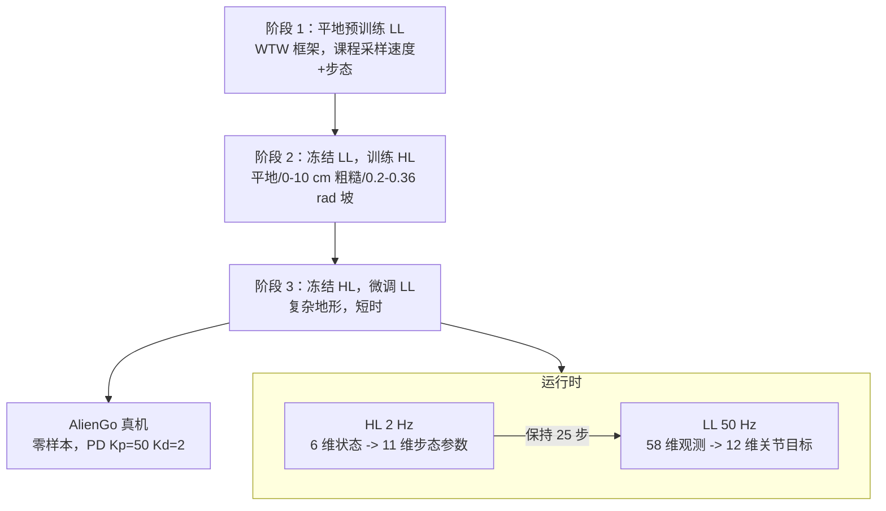

# 分层强化学习节能步态适配（四足多地形）

**论文：** *Energy-Efficient Gait Adaptation via Hierarchical Reinforcement Learning for Quadrupedal Locomotion Across Diverse Terrains*（[arXiv:2610.10297](https://arxiv.org/abs/2610.10297)，cs.RO/cs.LG，2026-10-07，投稿 ICRA 2027）。作者 Issa、Singh、Tsaritsin、Kolyubin；周报标注为 ITMO 大学、BE2R 实验室（arXiv 页面未列机构）。

## 一句话定义

**把四足控制拆成 50 Hz 的稳健关节控制器和 2 Hz 的“步态参数选择器”，后者以运输成本（CoT）为导向、在复杂地形上训练，使机器人在 pace/四拍/trot 之间自适应而不用手写切换规则，并零样本迁移到 AlienGo 真机。**

## 英文缩写速查

| 缩写 | 英文全称 | 简要说明 |
|------|----------|----------|
| HRL | Hierarchical Reinforcement Learning | 高层选步态参数，低层执行关节控制 |
| CoT | Cost of Transport | Σ\|τ·q̇\| / (m·g·\|vx\|)，越低越省能 |
| HL / LL | High-Level / Low-Level policy | 2 Hz / 50 Hz 两个策略 |
| WTW / MoB | Walk These Ways / Multiplicity of Behavior | 低层沿用的步态可调框架 |
| AER | Adaptive Energy Regularization | 对比基线（α=1），端到端能耗正则 |
| F&E | Fast & Efficient | 对比基线，CoT 在低速很高 |
| PD | Proportional-Derivative | 关节位置目标跟踪（真机 Kp=50, Kd=2） |

## 为什么重要

- **固定步态的能耗问题：** 全程 trot 的 WTW 基线在 (0.5,1.0] m/s 的 CoT 为 0.688，而本文 0.421。
- **端到端能耗惩罚的稳定性风险：** 论文报告 α=0.5 的 AER 策略在 AlienGo 上因关节力过低出现不稳定蹲姿；分层设计让稳定性由低层承担。
- **步态自适应无需规则：** 同一高层策略在低速出现 pace、中速四拍行走、高速 trot。

## 核心信息

| 项 | 内容 |
|----|------|
| **机构** | 周报标注 ITMO / BE2R；arXiv 页面未列 |
| **平台** | 仿真 Isaac Gym（PPO，4096 环境）：Go1 做基线对比，AlienGo 做消融；真机 Unitree AlienGo |
| **控制频率** | LL 50 Hz，HL 2 Hz（H=25 个 LL 步） |
| **开源** | **未发布**：arXiv 页面无代码/项目页（截至 2026-10-12） |

## 方法栈与流程总览

## 方法

- **LL 策略：** 58 维观测（投影重力、指令速度与步态参数、关节偏移、关节速度、上一动作 12 维、4 路相位时钟，5 步历史）；输出 12 维关节位置目标，经 PD 跟踪。
- **HL 策略：** 状态 6 维（窗口平均 vx、vy、偏航率 + 窗口末机体系重力）；非对称 actor-critic，critic 额外读到指令步态参数。动作 11 维：腿间相位偏移 θ1–θ3、步频、机身高度、横滚/俯仰、步幅与步宽、摆动高度、支撑占比。
- **HL 奖励：** r_HL = r_energy − 0.1‖g_k − g_{k−1}‖² + 0.002 Σ r_LL；r_energy = exp(−Σ|P| / (σ_x|v̄x| + σ_z|ω̄z|))，P=τ·q̇（σ 原文未给）。第二项抑制步态参数抖动，第三项保留低层任务回报。
- **三阶段：** 见流程图；阶段 2 关闭速度课程、HL 更新频率低于 LL；阶段 3 把 LL 在复杂地形上微调以适应高层步态输出。迭代数与墙钟时间未报告。

## 实验与评测

- **基线（Go1，平地，CoT，Table III）：**

| 速度区间 (m/s) | HRL（本文） | AER α=1 | WTW-Trotting | F&E |
|---|---|---|---|---|
| (0,0.5] | 0.762 | **0.572** | 0.962 | 3.560 |
| (0.5,1.0] | **0.421** | 0.618 | 0.688 | 1.663 |
| (1.0,1.5] | **0.384** | 0.681 | 0.680 | 1.240 |
| (1.5,2.0] | **0.438** | 0.757 | 0.711 | 1.057 |
| (2.0,2.5] | **0.495** | 0.831 | 0.719 | 0.966 |

  论文总结平均 CoT 降幅：对 AER 27.7%、对 WTW 33.5%、对 F&E 70.5%；最低速 AER 更优。
- **跌倒率（Table II，每格 500 次，摩擦/恢复系数在 [0,1] 随机）：** 平地 0%；粗糙地面仅 1.5–2.0 m/s 为 0.6%；坡面最高 2.4%（0–0.5 m/s）。
- **AlienGo 消融（Table IV）：** 去掉 HL 能耗项后 CoT 剧增（平地 (0.5,1.0] 区间 0.734 → 8.539）；仅在平地训练 HL，粗糙地面最低速 CoT 为 5.029，复杂地形训练为 1.846。
- **阶段 3 微调：** 速度跟踪 RMSE 平地 0.165 → 0.039 m/s，粗糙地面 0.182 → 0.047 m/s，增益在 1.0 m/s 以上最大。
- **真机：** AlienGo 零样本，平地/斜坡（到 20°，即训练最大坡度）/不平粗糙地形各类共 10 次试验无摔倒；步态-速度关系与仿真一致。未给真机 CoT 数值。

## 源码运行时序图

**不适用**：截至 2026-10-12 论文无官方代码/项目页。低层沿用的 [Walk These Ways](./paper-walk-these-ways-quadruped-mob.md) 有开源实现，但本文的高层策略与训练脚本未发布。

## 工程实践

| 项 | 建议 |
|----|------|
| 先低后高 | 先做好可调步态的 LL，再冻结 LL 训 HL，最后小步微调 LL |
| 分频因子 | H=25（2 Hz）；论文自述对 H 敏感 |
| 地形 | HL 必须在复杂地形训练，仅平地训练会让粗糙地面最低速 CoT 从 1.846 恶化到 5.029 |
| 能耗项 | 保留 r_energy，去掉后 CoT 暴增 |
| 部署 | 关节 PD Kp=50、Kd=2；用 Unitree SDK |

## 结论

**把“怎么走”与“走得省不省”分层，让高层只在低频选步态参数，是在不牺牲稳定性的前提下获得节能步态的可行路径；但证据来自仿真基线加少量真机试验。**

1. **CoT 随速度的优势在 ≥0.5 m/s 区间稳定** — 0.384–0.495 对 AER 的 0.618–0.831。
2. **低速并不占优** — (0,0.5] m/s 时 AER 的 0.572 优于 0.762。
3. **HL 能耗项不可省** — 消融 CoT 高出一个数量级。
4. **HL 要在复杂地形训练** — 否则泛化到粗糙地面时能耗劣化数倍。
5. **LL 微调很值** — 速度跟踪 RMSE 降到约 0.04–0.05 m/s。
6. **复现受限** — 缺少代码、σ 参数、机器人质量与迭代数。

## 与其他工作对比

| 对照 | 差异读法 |
|------|----------|
| [Walk These Ways](./paper-walk-these-ways-quadruped-mob.md) | WTW 靠人工调步态；本文用 HL 自动选择，并沿用它做 LL |
| [执行器约束高速四足 RL](./paper-actuator-constrained-rl-high-speed-quadruped-locomotion.md) | 后者侧重执行器极限下的速度；本文侧重能耗/CoT |
| [分层强化学习](../methods/hierarchical-reinforcement-learning.md) | 本文属于“低频参数 + 高频控制”分层 |
| AER / F&E | 端到端能耗正则（AER）在低速更省但稳定性风险；F&E 低速 CoT 很高 |

## 局限与风险

- **开源状态：** 无代码、无权重。
- **感知：** 仅本体感知；视觉可能进一步增加能耗（作者展望）。
- **响应速度：** HL 2 Hz 难以应对快速地形突变；LL 误差会沿层级传播。
- **对比不统一：** 基线对比用 Go1、消融和真机用 AlienGo，且两者基线条件不同。
- **统计：** 真机仅 10 次无摔倒，未报告真机能耗。

## 关联页面

- [人形/四足前沿周报（2026-10-05~10-09）](../overview/frontier-humanoid-quadruped-2026-10-05-10-09.md)
- [运动控制任务页](../tasks/locomotion.md)
- [分层强化学习](../methods/hierarchical-reinforcement-learning.md)
- [步态生成](../concepts/gait-generation.md)
- [Walk These Ways](./paper-walk-these-ways-quadruped-mob.md)
- [Isaac Gym](./isaac-gym.md)

## 参考来源

- [hrl_gait_adaptation_arxiv_2610_10297.md](../../sources/papers/hrl_gait_adaptation_arxiv_2610_10297.md) — 论文摘录与开源核查
- [周报来源归档](../../sources/blogs/frontier_humanoid_quadruped_2026_10_05_10_09.md)
- [arXiv:2610.10297](https://arxiv.org/abs/2610.10297) — 原文

## 推荐继续阅读

- [arXiv HTML 全文](https://arxiv.org/html/2610.10297v1)
- [Walk These Ways 项目页](https://gmargo11.github.io/walk-these-ways/)
