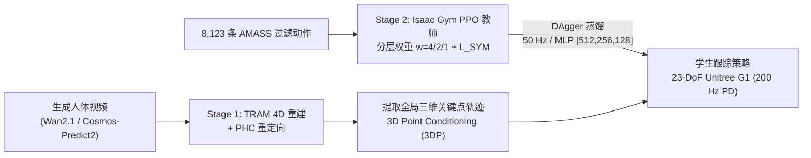

---

type: entity
tags: [paper, humanoid, rl, motion-control, body-system-stack, jku, nyu, berkeley, video-to-motion, unitree-g1]
status: complete
updated: 2026-11-20
arxiv: "2512.05094"
venue: "arXiv"
summary: "GenMimic（arXiv:2512.05094，Berkeley/NYU/JKU）：从生成人体视频经 TRAM 4D 重建与 PHC 重定向提取 3D 关键点（3DP），在 Isaac Gym 8,123 条 AMASS 动作上用部位加权奖励（w_end-eff=4/w_upper=2/w_lower=1）与双边对称正则训练 PPO 教师→DAgger 学生跟踪器，428 条 GenMimicBench 基准教师达 86.77%/学生 29.78% 并真机验证 G1。"
related:
  - ../overview/humanoid-motion-cerebellum-technology-map.md
  - ../overview/motion-cerebellum-category-03-data-pipeline.md
  - ../overview/humanoid-rl-motion-control-body-system-stack.md
  - ../overview/humanoid-amp-motion-prior-survey.md
  - ../queries/hmi-opensource-projects-coverage.md
  - ../methods/deepmimic.md
  - ../methods/motion-retargeting-gmr.md
  - ./unitree-g1.md
sources:
  - ../../sources/papers/genmimic_arxiv_2512_05094.md
  - ../../sources/sites/genmimic.md
  - ../../sources/papers/humanoid_rl_stack_04_from_generated_human_videos_to_physically_plausi.md
  - ../../sources/papers/humanoid_rl_stack_42_catalog.md
  - ../../sources/blogs/wechat_embodied_ai_lab_humanoid_rl_motion_survey.md
  - ../../sources/papers/motion_cerebellum_64_catalog.md
  - ../../sources/blogs/wechat_embodied_ai_lab_humanoid_motion_cerebellum_survey.md
original:
  - ../../sources/papers/genmimic_arxiv_2512_05094.md
  - ../../sources/sites/genmimic.md
---

# GenMimic：From Generated Human Videos to Physically Plausible Robot Trajectories

**GenMimic**（*From Generated Human Videos to Physically Plausible Robot Trajectories*，[arXiv:2512.05094v2](https://arxiv.org/abs/2512.05094)，James Ni 等 · UC Berkeley / NYU / JKU，[项目页](https://genmimic.github.io/)）收录于 [具身智能研究室 · 42 篇 humanoid RL 运动控制长文](https://mp.weixin.qq.com/s/hz9JXtJeUPRfUGzfD-pZuA) **第 04/42** 篇（**01 数据 · 重定向 · 遥操作**），直面核心工程问题：**视觉上看似合理的生成人体视频往往暗含脚滑、透视尺度畸变与穿模，机器人物理跟踪器如何直接从中稳定提取可执行技能？**

## 一句话定义

通过 **TRAM 4D 视频重建 + PHC 重定向** 提取仅含全局三维关键点的轻量条件（**`3DP`**），再配合 **末端高权重分层奖励（`w_end-eff=4, w_upper=2, w_lower=1`）** 与 **左右双边对称正则（`L_SYM`）** 在 Isaac Gym 训练 PPO 教师并 DAgger 蒸馏学生，使人形机器人能够无视视频中的局部伪影，物理可行地跟随生成视频语义。

## 英文缩写速查

| 缩写 | 英文全称 | 简要说明 |
|------|----------|----------|
| RL | Reinforcement Learning | 通过物理仿真与环境交互最大化回报来学习运动跟踪策略 |
| 3DP | 3D Point Conditioning | 仅输入全局关键点坐标的条件接口，刻意规避脆性关节参考 |
| TRAM | Trajectory Reconstruction and Human Motion Recovery | 阶段 1 中将单目生成视频提升为 4D 人体轨迹的工具 |
| PHC | Perpetual Humanoid Control | 阶段 1 中将人体重建动作映射/滤洗至参考骨架的模块 |
| VSR | Visual Success Rate | 真机/视频基准中语义和物理执行均成功动作的比例 |
| AMP | Adversarial Motion Prior | 对抗运动先验（本文以仿真模仿跟踪与对称损失为主） |

## 为什么重要

- **在 [人形 RL 身体系统栈](../overview/humanoid-rl-motion-control-body-system-stack.md) 中属于 01 数据 · 重定向 · 遥操作（#04/42）**，揭示参考质量上限早于 RL 策略决定。
- **不硬追「全关节角精确复现」**：生成视频（Wan2.1 / Cosmos-Predict2）常出现比例波动与下肢飘移；只取关键末端与关键点 **`3DP` 位置条件** + 对下肢放宽跟踪权重（`w_lower=1` vs 末端 `4`），把重心与步态稳定交给物理策略自己补全。
- **可独立验证的视频→动作评测基准**：开源 `wlin21at/GenMimicBench`（428 条生成视频）暴露了已有通才跟踪器（如 GMT `4.29%`、TWIST `7.52%`）面对视频噪点时的脆弱性，实证 GenMimic 学生策略（`29.78%`）的鲁棒优势。

## 流程总览

## 核心原理（方法机制）

| 核心模块 | 原文（`arXiv:2512.05094v2`）设计与作用 |
|----------|------------------------------------------|
| **Stage 1：视频→关键点条件** | 对 Wan2.1 / Cosmos-Predict2 等模型生成的人类动作视频用 **TRAM** 恢复相机+世界 4D 人体，经 **PHC** 重定向后抽取出干净三维关键点轨迹（`3DP`） |
| **3DP 鲁棒条件化** | 与同时输入高维关节角/根线速度的完整参考不同，`3DP` 剥离了最易受视频畸变污染的下肢旋转与脚滑噪声，专注对齐核心意图关键点 |
| **部位分层加权奖励** | 按 $w_{\text{end-eff}}=4$、$w_{\text{upper}}=2$、$w_{\text{lower}}=1$ 分配跟踪奖励权重——严格约束手/头等语义末端位置，允许下肢自主调节迈步以保平衡 |
| **双边对称损失 (`L_SYM`)** | 在策略优化中加入左右动作对称约束，防止策略因视频拍摄角度偏置而学会倾斜步态 |
| **教师–学生蒸馏栈** | 在 Isaac Gym 中以特权信息（`8,123` 条过滤 AMASS 动作）训练 PPO 教师，再通过 **DAgger** 蒸馏到纯本体+`3DP` 的 `MLP [512, 256, 128]` 学生网络（`50 Hz` 控制 / `200 Hz` PD） |

## 工程实践与开源状态

| 项 | 核查结论（2026-11-20 复核） |
|----|----------------------------|
| **开源状态** | **评测基准已开源 / 策略源码仍未发布** — HuggingFace 已上线数据集 [`wlin21at/GenMimicBench`](https://huggingface.co/datasets/wlin21at/GenMimicBench)（428 条视频）；项目页 Code 仍标注 coming soon |
| **硬件控制栈** | 目标平台为 **23-DoF Unitree G1**，策略以 **50 Hz** 运行（底层 PD 驱动频率 **200 Hz**）；学生骨干为紧凑 `MLP [512, 256, 128]` |
| **源码运行时序图** | **不适用**（见下一节） |

## 源码运行时序图

**不适用：截至 2026-11-20 复核，官方仅发布 `GenMimicBench` 评测数据集与项目页视频，TRAM→PHC 预处理与 PPO/DAgger 训练部署源码尚未开源，暂无可核验的代码运行入口。**

## 实验与评测

- **GenMimicBench 基准（428 条生成视频：217 条 Wan2.1 NTU + 211 条 Cosmos-Predict2 PennAction）：**
  - **教师策略（特权观测）** 成功率达 **86.77%**；
  - **学生策略（真机可部署观测）** 成功率 **29.78%**，在含显著重建抖动与透视畸变的生成视频下大幅高于同步对比的 **GMT（4.29%）** 与 **TWIST（7.52%）**。
- **23-DoF Unitree G1 真机吊架测试（43 条动作）：** 原地动作视觉成功率 **VSR = 1.0**（完全跟上并稳定）；涉及大步幅**移步或转身**动作时 VSR 降至 **~0.40**，暴露仅靠无下肢参考的 `3DP` 在动态足底切换上仍存在明显 sim-to-real 落差。

## 与其他工作对比

| 路线 | 视频输入与重建 | 跟踪条件与奖励特点 | 仿真 / 真机证据边界 |
|------|----------------|--------------------|----------------------|
| **GenMimic（本文）** | Wan2.1 / Cosmos-Predict2 -> TRAM + PHC | 全局 **3DP 关键点** + 末端 4:2:1 分层权 + `L_SYM` | GenMimicBench 教师 `86.77%` / 学生 `29.78%`；G1 原地 `VSR 1.0`、移步/转身 `~0.40` |
| [Synthetic Video Tasks](./paper-synthetic-video-humanoid-tasks.md) | Veo 3.1 -> ViT SMPL-X + GMR + stitching | 全关节/轨迹 DeepMimic 式模仿，逐任务训练 PPO | 50 任务仅仿真验证（MAE `0.04–0.07 m`），无真机部署 |
| [GMT](./paper-gmt.md) / TWIST | MoCap / 遥操全身轨迹 | 完整全身参考状态跟踪 | GenMimicBench 噪点视频下成功率仅 `4.29%` / `7.52%` |

## 结论

**GenMimic 证实「视频生成只是人形动作创意来源，而非控制接口」：通过将生成视频压成低噪 `3DP` 条件、放宽下肢奖励并经仿真 RL 教师–学生滤波，可在仿真中越过 86% 教师与 29.78% 学生门槛，但真机动态转向迁移仍远未闭环。**

1. **只传关键三维点（3DP）胜过全参考硬追** — 剔除视频重建中的下肢透视伪影，使学生策略在 GenMimicBench 相对 GMT（4.29%）和 TWIST（7.52%）高出数倍。
2. **分层奖励（`4:2:1`）赋予下肢自主平衡权** — 保证末端轨迹语义对齐的同时让 RL 自由调整重心与跨步。
3. **教师–学生鸿沟（86.77% → 29.78%）揭示感知缺口** — 在没有特权地面接触与全局物理状态时，噪声关键点条件下策略极易失稳。
4. **真机呈现清晰能力台阶** — G1 原地上半身/原地动作 VSR `1.0`，移步/转身滑落至 `~0.40`，不能把生成视频管线视作全能全身遥操替代品。

## 局限与风险

1. **重定向与数据前置决定上限（误区纠正）：** 预处理（TRAM+PHC）及 AMASS 基础策略涵盖域早于 RL 微调决定可达能力；只看 `VSR 1.0` 易忽略移步/转身 `~0.40` 的大幅衰减。
2. **师生性能掉差显著：** `86.77%`（特权教师）→ `29.78%`（学生）说明纯三维关键点观测尚不足以支持复杂动态平衡重建。
3. **代码仍待释放：** 仅 `GenMimicBench` 数据公开，训练与 G1 真机脚本尚未放出。

## 关联页面

- 总框架：[humanoid-rl-motion-control-body-system-stack.md](../overview/humanoid-rl-motion-control-body-system-stack.md)（#04/42）
- 同簇生成视频参考对照：[Learning Diverse Humanoid Tasks via Synthetic Video](./paper-synthetic-video-humanoid-tasks.md)（Veo 3.1 + stitching + 逐任务 DeepMimic）
- 运动小脑数据管线：[motion-cerebellum-category-03-data-pipeline.md](../overview/motion-cerebellum-category-03-data-pipeline.md)
- AMP 姊妹篇：[humanoid-amp-motion-prior-survey.md](../overview/humanoid-amp-motion-prior-survey.md)
- [Unitree G1](./unitree-g1.md) · [DeepMimic](../methods/deepmimic.md) · [GMR](../methods/motion-retargeting-gmr.md)
- HMI 开源主表索引：[HMI 开源项目主表覆盖索引](../queries/hmi-opensource-projects-coverage.md)

## 参考来源

- [genmimic_arxiv_2512_05094.md](../../sources/papers/genmimic_arxiv_2512_05094.md) — `arXiv:2512.05094v2` 全文精读与实验指标归档
- [sources/sites/genmimic.md](../../sources/sites/genmimic.md) — 项目页、`GenMimicBench` 数据集与开源状态核查
- [humanoid_rl_stack_04_from_generated_human_videos_to_physically_plausi.md](../../sources/papers/humanoid_rl_stack_04_from_generated_human_videos_to_physically_plausi.md) — 42 篇栈策展摘录
- [humanoid_rl_stack_42_catalog.md](../../sources/papers/humanoid_rl_stack_42_catalog.md) — 总表
- [wechat_embodied_ai_lab_humanoid_rl_motion_survey.md](../../sources/blogs/wechat_embodied_ai_lab_humanoid_rl_motion_survey.md) — 微信公众号编译导读
- 原始抓取：[wechat_humanoid_rl_42_survey_2026-05-26.md](../../sources/raw/wechat_humanoid_rl_42_survey_2026-05-26.md)

## 推荐继续阅读

- [arXiv:2512.05094（GenMimic 论文）](https://arxiv.org/abs/2512.05094)
- [GenMimic 官方项目页](https://genmimic.github.io/) · [GenMimicBench（Hugging Face）](https://huggingface.co/datasets/wlin21at/GenMimicBench)
- [42 篇 RL 运动控制（微信公众号）](https://mp.weixin.qq.com/s/hz9JXtJeUPRfUGzfD-pZuA)
