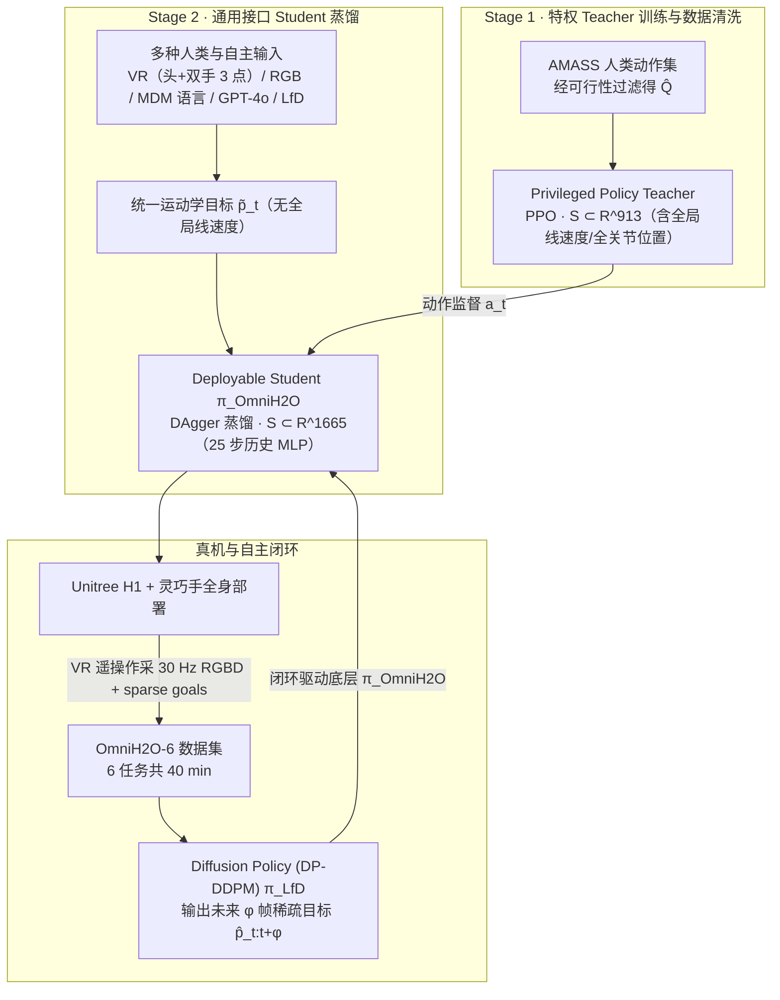
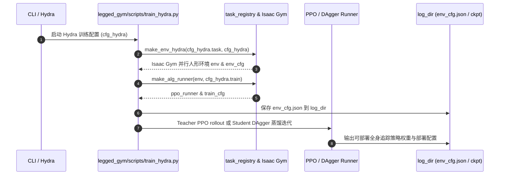

# OmniH2O

**OmniH2O**（*OmniH2O: Universal and Dexterous Human-to-Humanoid Whole-Body Teleoperation and Learning*，arXiv:[2406.08858](https://arxiv.org/abs/2406.08858)，CoRL 2024，[项目页](https://omni.human2humanoid.com/)，[代码](https://github.com/LeCAR-Lab/human2humanoid)）由 CMU / LeCAR 与上海交通大学团队提出，收录于人形 RL 身体系统栈 **第 08/42** 篇（**01 数据 · 重定向 · 遥操作**）。

## 一句话定义

把**运动学姿态（尤其是头部与双手 3 点稀疏目标）**立成全人形全身遥操作与自主控制的**通用身体接口**，用特权 Teacher + 25 步历史 Student（DAgger 蒸馏）让 Unitree H1 兼顾双足平衡与灵巧手操作。

## 英文缩写速查

| 缩写 | 英文全称 | 简要说明 |
|------|----------|----------|
| RL | Reinforcement Learning | 通过与环境交互最大化长期回报来学习策略的范式 |
| PPO | Proximal Policy Optimization | 本作 Stage-1 特权全状态 Teacher 的训练算法 |
| DAgger | Dataset Aggregation | 本作将特权 Teacher 蒸馏至 25 步历史稀疏目标 Student 的在线模仿方法 |
| MPJPE | Mean Per-Joint Position Error | 全身关节平均位置误差（论文报告 global `E_g-mpjpe` 与 root-relative `E_mpjpe`，单位 mm） |
| LfD | Learning from Demonstrations | 从遥操作采得的 OmniH2O-6 演示训练 Diffusion Policy 自主策略 |
| AMP | Adversarial Motion Prior | 对抗运动先验；对照姐妹综述见 [19 篇 AMP 专题](../overview/humanoid-amp-motion-prior-survey.md) |

## 为什么重要

- 在 [人形 RL 身体系统栈](../overview/humanoid-rl-motion-control-body-system-stack.md) 中属于 **01 数据 · 重定向 · 遥操作**（#08/42）。
- **把 H2O 从单一路线做成通用接口：** H2O 验证了实时全身遥操作可行，OmniH2O 进一步将 **kinematic pose** 设为统一中间接口——上层可接 VR 头显/手柄（仅 3 点稀疏姿态）、RGB 摄像头、文本生成动作模型（MDM）、VLM（GPT-4o）乃至自主 Diffusion Policy，底层统一由单个 Sim-to-Real 全身策略执行。
- **工程取舍验证：** 显式发现真机 VIO 全局线速度噪声极大且会导致真机测试跌倒，因此 **刻意去掉线速度观测** 而改用 **25 步本体历史 + DAgger**，反而在真机达到比 H2O 更低的跟踪误差并撑起户外抗扰行走。

## 核心信息

| 字段 | 内容 |
|------|------|
| 编号 | 08/42 |
| 系统栈层 | 01 数据 · 重定向 · 遥操作 |
| 机构 | CMU；上海交通大学 |
| 出处 | CoRL 2024 / arXiv:[2406.08858](https://arxiv.org/abs/2406.08858) |
| 平台 | Unitree H1 + Dexterous Hands |
| 代码 | <https://github.com/LeCAR-Lab/human2humanoid> |
| 项目页 | <https://omni.human2humanoid.com/> |

## 核心原理与流程总览

- **Teacher（Privileged Imitation Policy，$S \subset \mathbb{R}^{913}$）：** 仅在仿真可见全局线速度与全身参考关节信息，经 PPO 在过滤后 AMASS 子集 $\hat{Q}$ 上学习高跟踪上限。
- **Student（Sim-to-Real Imitation Policy，$S \subset \mathbb{R}^{1665}$）：** 面向真机遥操作仅提供头部与双手 **3 点位置参考** $\tilde{p}_t$（去掉难估计旋转与全局线速度，规避 VIO 漂移），叠加 **25 步历史本体观测** 由 MLP 编码，并通过 **DAgger** 在 Student 自采状态分布上向 Teacher 对齐。
- **OmniH2O-6 与自主闭环：** VR 遥操作采集 6 个任务共 **40 min（30 Hz）** RGBD、头部/双手目标与关节目标；上层 Diffusion Policy $\pi_{\text{LfD}}$ 仅输出稀疏运动目标序列，交由已训好的 $\pi_{\text{OmniH2O}}$ 完成全身平衡与手腿协同。

## 源码运行时序图

图依据：基于 `LeCAR-Lab/human2humanoid` 仓库 `legged_gym/legged_gym/scripts/train_hydra.py` 与 `README.md` 训练流程核实（OmniH2O 与 H2O 共用 `human2humanoid` 主仓）。

## 工程实践

- **观测与历史窗口取舍：** 真机测试中显式接入 ZED SDK VIO 线速度会导致机器人跌倒（Table 2a `N/A`），MLP/GRU 速度估计也弱于直接移除线速度 + 25 步历史（`47.94 mm` vs `49.75 mm`）；真机上 25 步 history MLP 优于 `History50` 与 `LSTM`。
- **必须用 DAgger 而非直接用 RL 训历史策略：** Table 1(a) 显示去掉 DAgger 直接 RL 训练 25 步历史策略，仿真成功率从 **94.10%** 骤降至 **47.11%**。
- **高层自主延迟解耦：** 接入 GPT-4o 时响应较慢，工程上采用让 GPT-4o **离散选择预定义动作原语** 而非逐帧生成稀疏姿态；做视觉模仿学习（Diffusion Policy）时必须采用 **序列动作预测（`Se-O-Se-A` 或 `Si-O-Se-A`）**，单步 ResNet BC 成功率仅 `1/10`。
- **共享代码仓说明：** `LeCAR-Lab/human2humanoid` 汇总 H2O 与 OmniH2O 核心训练栈，基于 Isaac Gym 与 Hydra（`train_hydra.py`）。

## 实验与评测

- **仿真运动模仿（Table 1，数据集 $\hat{Q}$）：**
  - 特权 Teacher：$S \subset \mathbb{R}^{913}$，成功率 **94.77%**；Train / Test `E_g-mpjpe` 为 `126.51 / 122.71 mm`。
  - **OmniH2O（ours，3-points + 25 步历史）：** 成功率 **94.10%**，大幅高于 **H2O** 的 **87.52%**；去掉 DAgger 跌至 `47.11%`；`LSTM` 为 `91.03%`，`GRU` 为 `92.85%`。
  - 稀疏度消融：3 点（头+双手）成功率 **94.10%**，甚至略高于 22 点全身追踪的 `93.56%`（全局误差更少累计）。
- **真机 20 段动作追踪（Table 2）：**
  - **OmniH2O：** `E_g-mpjpe` = **47.94 mm**，`E_mpjpe` = **41.87 mm**，`E_acc` = **1.84**，`E_vel` = **2.20**；显著优于 **H2O**（`87.33 mm / 53.32 mm / 6.03 / 5.87`）以及 `History0`（`83.26 mm`）和 `LSTM`（`87.00 mm`）。
- **OmniH2O-6 自主模仿学习（Table 3，4 任务 × 10 次均值）：**
  - 任务涵盖 Catch-Release、Squat、Rock-Paper-Scissors（正文拼作 Rope-Paper-Scissors）、Hammer-Catch、Boxing、Basket-Pick-Place。
  - **DP-DDPM：** 100% 数据成功率 **8/10**（`Se-O-Se-A` 序列输入输出达 **8.75/10**），远胜 **DP-DDIM**（`7.75/10`）与 **ResNet BC**（`1/10`）；数据量从 25%→50%→100%，成功率依次为 `4/10 -> 6.5/10 -> 8/10`。

## 结论

**OmniH2O 证明以「头部+双手 3 点稀疏运动学姿态 + 25 步历史 DAgger 策略」作为人形统一身体接口，不仅真机跟踪误差近乎较 H2O 减半（47.94 vs 87.33 mm），还能无缝对接 VR、RGB、文本、GPT-4o 与 Diffusion Policy。**

1. **去掉有噪 VIO、用历史替代显式速度** — 避开硬件状态估计失效链条，真机实测比 MLP/GRU 速度估计更稳。
2. **DAgger 是历史 Student 收敛的必需项** — 直接 RL 训 25 步历史会塌缩至 47.11%，先特权 PPO 再 DAgger 才可稳定到 94.10%。
3. **分层 LfD 大幅降低真机演示需求** — Diffusion Policy 只需预测未来一段稀疏末端参考帧，平衡与全身协调全由底层 $\pi_{\text{OmniH2O}}$ 兜底。

## 局限与风险

1. **依赖根部里程计转换坐标系：** VR/相机接口得到的世界系目标仍需机器人根部里程计转入机身坐标系，VIO 漂移或跳变会直接污染控制目标。
2. **缺少极端 OOD 动作安全校验：** 对大幅不连续参考或极端外扰尚无形式化安全护栏。
3. **稀疏上肢输入难以自然支撑跨楼梯：** 仅靠头部与双手 3 点稀疏目标在上下楼梯等需精确落脚的任务上仍受限。
4. **高层感知单一：** OmniH2O-6 仍主要依赖头部 RGBD，作者指出后续需融合腕部相机、LiDAR 与触觉传感。

## 关联页面

- 总框架：[humanoid-rl-motion-control-body-system-stack.md](../overview/humanoid-rl-motion-control-body-system-stack.md)
- AMP 姊妹篇：[humanoid-amp-motion-prior-survey.md](../overview/humanoid-amp-motion-prior-survey.md)
- 交互与接触扩展：[HDMI](./paper-hrl-stack-06-hdmi.md)
- 任务专题：[Teleoperation](../tasks/teleoperation.md)

## 参考来源

- [humanoid_rl_stack_08_omnih2o_universal_and_dexterous_human_to_humanoi.md](../../sources/papers/humanoid_rl_stack_08_omnih2o_universal_and_dexterous_human_to_humanoi.md) — `arXiv:2406.08858` 一手通读与 42 篇栈编译
- [human2humanoid.md](../../sources/repos/human2humanoid.md) — `LeCAR-Lab/human2humanoid` 代码仓归档
- [humanoid_rl_stack_42_catalog.md](../../sources/papers/humanoid_rl_stack_42_catalog.md) — 总表
- [wechat_embodied_ai_lab_humanoid_rl_motion_survey.md](../../sources/blogs/wechat_embodied_ai_lab_humanoid_rl_motion_survey.md) — 微信公众号编译导读
- 论文原文：<https://arxiv.org/abs/2406.08858>

## 推荐继续阅读

- [项目主页（含视频与 OmniH2O-6 说明）](https://omni.human2humanoid.com/)
- [机器人论文阅读笔记：OmniH2O Universal Whole-Body Teleoperation](https://imchong.github.io/Robot_Learning_Paper_Notebooks/papers/03_High_Impact_Selection/OmniH2O_Universal_Whole-Body_Teleoperation/OmniH2O_Universal_Whole-Body_Teleoperation.html)
- [42 篇 RL 运动控制（微信公众号）](https://mp.weixin.qq.com/s/hz9JXtJeUPRfUGzfD-pZuA)
