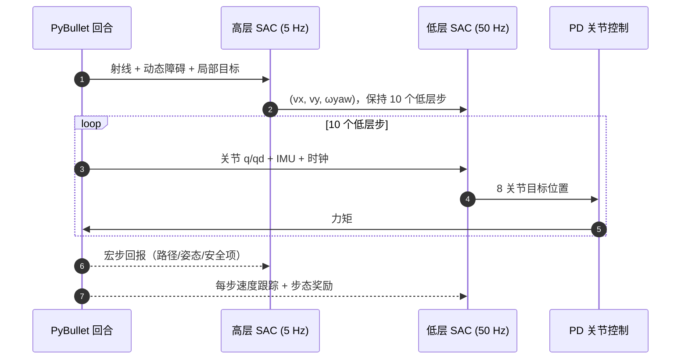

---

type: entity
project_id: hrl-underactuated-biped-collision-free
tags: [paper, locomotion, reinforcement-learning, hierarchical-rl, sac, biped, obstacle-avoidance, navigation, pybullet, simulation-only, iit-mandi]
status: complete
updated: 2026-10-12
arxiv: "2610.05855"
project: https://jaggu2606.github.io/biped-hrl-locomotion
summary: "分层 SAC：高层读 36 射线与动态障碍状态输出 (vx,vy,ωyaw)，低层 50 Hz 输出 8 个腿关节目标，两层联合训练；PyBullet 100 次随机试验静态 98%/动态 88% 到达，对 A*/RRT*/APF + 同一冻结步态最高 78%/68%；纯仿真、代码未发布。"
related:
  - ../overview/frontier-humanoid-quadruped-2026-10-05-10-09.md
  - ../methods/hierarchical-reinforcement-learning.md
  - ../methods/sac.md
  - ../tasks/humanoid-locomotion.md
  - ../tasks/locomotion.md
  - ../tasks/stair-obstacle-perceptive-locomotion.md
  - ./paper-notebook-a-hierarchical-framework-for-humanoid-locomotion.md
sources:
  - ../../sources/papers/hrl_underactuated_biped_arxiv_2610_05855.md
  - ../../sources/sites/biped-hrl-locomotion.md
  - ../../sources/blogs/frontier_humanoid_quadruped_2026_10_05_10_09.md
---

# 欠驱动双足分层 RL 无碰撞运动

**Hierarchical RL for Collision-Free Locomotion of an Underactuated Biped**（[arXiv:2610.05855](https://arxiv.org/abs/2610.05855)，Sahoo 等，署名 IIT Mandi）用 **高层 SAC 导航策略 + 低层 SAC 步态策略** 在 PyBullet 中联合训练一台 8 个腿关节主动、无髋/踝 roll 的欠驱动双足：高层按局部射线与动态障碍状态发布平面速度指令，低层负责把指令变成稳定的关节目标；100 次随机试验中静态 98.0%、动态 88.0% 到达目标。

## 英文缩写速查

| 缩写 | 英文全称 | 简要说明 |
|------|----------|----------|
| HRL | Hierarchical Reinforcement Learning | 高层决策、低层执行的分层强化学习 |
| SAC | Soft Actor-Critic | 最大熵 off-policy 算法，两层均使用 |
| HL / LL | High-Level / Low-Level policy | 5 Hz 速度指令层 / 50 Hz 关节目标层 |
| TTC | Time To Collision | 高层安全奖励中的碰撞时间惩罚（时域 1.5 s） |
| APF | Artificial Potential Field | 人工势场，作为对照的反应式避障基线 |
| RRT* | Rapidly-exploring Random Tree Star | 采样式渐近最优规划，对照基线 |

## 为什么重要

- **欠驱动意味着避障与平衡耦合**：浮动基座无法直接指令，每次转向都扰动平衡；论文把「走到哪」和「怎么不摔」放进两层策略并联合训练，而非把规划器输出硬塞给固定步态。
- **控制变量式对照**：A*、RRT*、APF 基线都复用 **同一个冻结 LL 步态**，只换指令生成器，所以成功率差异可以归因到指令层。
- **给出了可复核的奖励结构与 SAC 超参**（见下），但 HL 权重未公开、代码未发布，价值更多在设计思路而非复现。

## 流程总览

## 方法

- **本体与仿真**：8 个主动腿关节（每腿髋 yaw、髋 pitch、膝 pitch、踝 pitch），大/小腿约 99.45 mm，身高 542 mm，基座 IMU；PyBullet，单张 RTX A4000 训练。
- **高层观测与动作**：基座位置/朝向、180° 内 36 条射线（截断 3.0 m）、最近 5 个动态障碍位置与速度、机器人系局部目标；动作 (vx, vy, ωyaw)，tanh 压缩到指令盒并保持 10 步（约 5 Hz）。射线和障碍状态是仿真特权量，用来替代激光雷达和目标跟踪器。
- **低层观测与动作**：8 关节位置/速度、IMU 姿态与角速度、时钟 [sin ωt, cos ωt]、当前指令；**不含障碍或目标信息**。输出相对半蹲姿态的 8 个关节目标位置，经 PD 跟踪，50 Hz。
- **奖励**：LL 含速度/偏航跟踪与步态项（接触时序、姿态、动作变化率、力矩）；HL 含路径进度、姿态（参考高度 0.45 m）、安全（d_safe = 0.55 m、TTC 1.5 s）、防卡住与时间惩罚；shaping 总和截断到 −15，终止项碰撞 −50、跌倒 −50、到达 +30。HL 权重 w1–w15 手调，原文未给数值。
- **训练**：两层 SAC（γ=0.99，lr 1e-4，回放 1e6，batch 256，自动熵温度，τ=0.005，2×256 MLP）按双时间尺度在同一回合里联合更新；每回合随机化布局、障碍、起终点。总步数原文未报告，训练曲线仅单种子。

## 源码运行时序图

不适用：截至 2026-10-12 项目页的 Code Repository / Dataset 按钮均为 `#` 占位，页面仅声明 “Paper and Simulation Code will be fully released upon publication”，没有可对照的仓库目录或脚本。下图是依据论文描述的 **算法级** 交互（非仓库入口）：

## 工程实践

- **开源状态（2026-10-12 核查）**：arXiv 页面未列代码；项目页（[归档](../../sources/sites/biped-hrl-locomotion.md)）按钮为占位，无视频文件地址，仅承诺发表后释放。因此 **没有官方仓库**，复现需要自行重写环境与奖励。
- **可借鉴的工程点**：把 LL 设计成「不看障碍、只看指令」的纯速度跟踪步态，HL 才看感知，职责边界清晰，便于换 HL 后替换规划器做对照；shaping 截断（−15）在消融中是训练稳定的关键。
- **感知差距**：特权射线/动态障碍替代真实传感，真实部署需要处理噪声与高低层延迟（论文自述为未来工作）。

## 实验与评测

设定：未见随机布局，起终点距离 ≥ 6.0 m，10 个布局 × 10 次 = 每方法每条件 100 次；动态障碍 0.10–0.30 m/s，最多 5 个，含交叉与迎面。路径/时间只对成功回合平均。

| 方法 | 静态 成功/碰撞 (%) | 静态路径 (m)/时间 (s) | 动态 成功/碰撞 (%) | 动态路径 (m)/时间 (s) |
|------|------|------|------|------|
| SAC+A* | 76.0 / 2.0 | 7.64 / 13.25 | 68.0 / 20.0 | 7.76 / 13.55 |
| SAC+RRT* | 78.0 / 22.0 | 7.98 / 13.95 | 68.0 / 32.0 | 7.27 / 12.72 |
| SAC+APF | 63.0 / 37.0 | 6.87 / 14.27 | 55.0 / 45.0 | 6.80 / 13.12 |
| HRL（本文） | **98.0 / 2.0** | 7.92 / 13.74 | **88.0 / 12.0** | 7.90 / 13.48 |

- 路径长度与 A* 参考相差 4% 以内；剩余失败为跌倒或超时。
- 消融（多数只在图中）：去掉动态障碍速度/位置通道、去掉 TTC 或距离惩罚都会明显退化；去掉姿态项使失败转向跌倒；去掉 shaping 截断训练不稳（静态 90.0% 跌倒或超时）。其余数值原文未以表格给出。

## 结论

**把避障决策放进与步态联合训练的高层 SAC，比「规划器 + 冻结步态」在欠驱动双足上更稳，但证据仅限单种子、特权感知的仿真。**

1. **成功率提升主要来自指令层** — 同一冻结 LL 下，HRL 静态 98.0% vs 最佳基线 78.0%，动态 88.0% vs 68.0%。
2. **碰撞与路径代价** — 动态碰撞率 12.0%，低于 RRT*（32.0%）和 APF（45.0%），但高于 A* 在静态下的 2.0%；路径仅比 A* 多 4% 以内。
3. **动态障碍速度通道必不可少** — 去掉后静/动态均严重退化，部署时需要可靠的障碍速度估计。
4. **shaping 截断是训练稳定器** — 去掉后静态 90.0% 失败。
5. **别读成已可部署** — 无 sim-to-real、射线为特权量、单种子；真实机器人需补感知与延迟处理。
6. **无代码** — 当前只能借鉴结构，不能复现数字。

## 与其他工作对比

| 对照 | 差异读法 |
|------|----------|
| [分层人形运动框架笔记](./paper-notebook-a-hierarchical-framework-for-humanoid-locomotion.md) | 同为分层思路；本文聚焦欠驱动小型双足的避障，并给出与经典规划器的同步态对照 |
| [Cassie 双足多样运动 RL](./paper-cassie-biped-versatile-locomotion-rl.md) | 侧重 sim2real 多步态；本文不涉及真机 |
| [阶梯/障碍感知运动](../tasks/stair-obstacle-perceptive-locomotion.md) | 那里用地形感知跨越障碍；本文是平面避障与导航 |
| 本周同类 | 见 [人形/四足周报汇总](../overview/frontier-humanoid-quadruped-2026-10-05-10-09.md) |

## 局限与风险

- **适用边界**：仅仿真；射线与障碍状态为特权；基线假设已知静态地图；仅腿关节主动，不处理上身或多接触避障。
- **统计风险**：训练曲线单种子，方差未量化；基线使用与 HL 联合训练过的冻结步态，可能对基线指令跟踪不够忠实。
- **开源状态**：截至 2026-10-12 未发布代码或数据，HL 奖励权重原文也未给出。

## 关联页面

- [人形/四足周报汇总（2026-10-05 至 10-09）](../overview/frontier-humanoid-quadruped-2026-10-05-10-09.md)
- [分层强化学习](../methods/hierarchical-reinforcement-learning.md)
- [SAC](../methods/sac.md)
- [人形运动任务](../tasks/humanoid-locomotion.md)
- [运动控制任务](../tasks/locomotion.md)

## 参考来源

- [hrl_underactuated_biped_arxiv_2610_05855.md](../../sources/papers/hrl_underactuated_biped_arxiv_2610_05855.md) — 论文来源归档
- [biped-hrl-locomotion.md](../../sources/sites/biped-hrl-locomotion.md) — 项目页核查
- [frontier_humanoid_quadruped_2026_10_05_10_09.md](../../sources/blogs/frontier_humanoid_quadruped_2026_10_05_10_09.md) — 周报线索
- 论文：<https://arxiv.org/abs/2610.05855>

## 推荐继续阅读

- [论文 HTML 全文](https://arxiv.org/html/2610.05855v1)
- [项目页](https://jaggu2606.github.io/biped-hrl-locomotion)
- [Soft Actor-Critic（Haarnoja 等，arXiv:1801.01290）](https://arxiv.org/abs/1801.01290)
