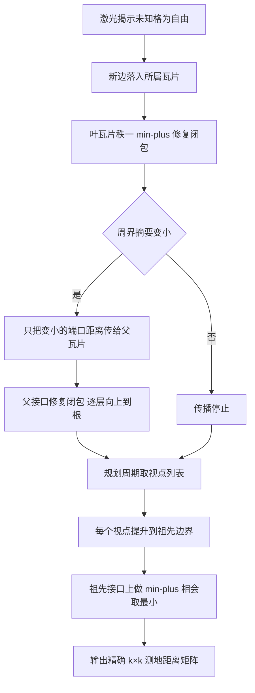

# H-TRIP: Exact Many-to-Many Distance Index for Multi-Robot Exploration

## 一句话定义

**H-TRIP**（Hierarchical Tropical Rank-one Incremental Propagation，[arXiv:2611.08139](https://arxiv.org/abs/2611.08139)，Özaslan 与 Özaslan，土耳其 Kastamonu 大学与 Ankara Yıldırım Beyazıt 大学，v1 于 2026-11-05）是一个**经典算法**（非强化学习）：在只增不减的二维占据栅格上，用固定边界端口的分层瓦片和 min-plus 代数的秩一更新，维护精确的测地距离索引，并一次批量查询得到机器人位姿与前沿视点之间的 k×k 距离矩阵。

## 英文缩写速查

| 缩写 | 英文全称 | 简要说明 |
|------|----------|----------|
| H-TRIP | Hierarchical Tropical Rank-one Incremental Propagation | 本文的分层增量距离索引 |
| BFS | Breadth-First Search | 无权图最短路搜索，文中基线 k×BFS 为逐源一次 |
| APSP | All-Pairs Shortest Paths | 全点对最短路 |
| min-plus | min-plus semiring | 加法取 min、乘法取 +，最短路的代数形式（又称 tropical） |
| Kleene star | Kleene star（闭包） | 邻接矩阵的 min-plus 幂和 A*，即全点对最短距离 |
| 端口 | boundary port | 瓦片周界上的格，层级间只交换这些格的距离 |
| FUEL / TARE / RACER | 探索规划器 | 文中引用的 tour 式探索规划器 [2][3][4] |

## 为什么重要

- 作者自述（§I）：前沿式多机器人探索的 tour 规划器要消费完整的两两测地距离矩阵，逐源搜索随地图和候选集增长而变贵；只刷新新前沿的缓存可能在新通路打通后保留过时距离（定义 1 的 surviving-pair shortcut）。
- 它是**距离后端**而非规划器（§I、§II）：不取代分配或 tour 层，只提供并保持距离矩阵精确。
- 与机器人强化学习的关系（本页判断）：论文不含学习、奖励或策略。若有人把它当作强化学习工作引用，不符合原文；它至多可作为导航或探索类强化学习环境里「精确测地距离」的一种计算后端，论文本身未讨论这一用途。

## 核心原理

### 流程总览

### 方法栈

- **固定边界分层（§V-A）：** 栅格切成边长 b 的叶瓦片，每 g×g 个子瓦片聚成一个超级瓦片，深度 H=⌈log_g(n/b)⌉。端口按几何位置固定，不随可通行性变化，所以开洞只改存储的数值，不改矩阵尺寸或索引映射。叶存 b² 点上的闭包，超级瓦片只存子瓦片端口拼成的接口上的闭包。
- **更新（§V-B，算法 1）：** 新自由格产生边降权，C'(i,j)=min(C(i,j), C(i,a)+w+C(b,j), C(i,b)+w+C(a,j))，批量时对端点集做受限枢轴扫描，叶上 O(|Π|·b⁴)，替代立方的 O(b⁶)。只有边界摘要里变小的条目才向上传。
- **查询（§V-C，算法 2）：** 先取到叶边界的距离，逐层提升，在公共祖先的接口闭包上相会；同叶点对还需与叶内闭包取最小，因为最短路可能离开叶再回来。
- **精确性（§V-D）：** 引理 1、定理 1、定理 2 分别保证秩一更新、单调更新后闭包、批量查询结果均精确。论文把证明写成 Justification 段落，要点是「旧最短路的前后缀 + 新边」与「真实路径可压缩成接口上的等长游走」。

## 关键结果（作者报告，均为仿真）

| 场景 | 结果 | 出处 |
|------|------|------|
| 精确性 | 178,708 个矩阵条目对比 BFS / Dijkstra，零不一致 | §VI-A |
| 完全揭示地图，k=25 | 对 k×BFS 加速 7.28×–11.5×（M1、M2、M4、M5、M6），迷宫 M3 达 82.6× | 表 II |
| 16 机器人探索中查询 | 对配对 k×BFS 加速 2.21×–8.59×，地图边长 256/512/1024 | 表 V、摘要 |
| 构建与内存 | 完整构建 0.71 s（M1）至 79.9 s（M2），索引 87 MB 至 3175 MB | 表 II |
| 单格开口更新 | M1 同叶 m=1：0.042 ms，对比 k×BFS 重填 34.6 ms | 表 IV |
| 批量开口更新 | M1 同叶 m=16 为 74.8 ms，高于 k×BFS 重填 33.3 ms；M1 多叶 m=64 为 242 ms，对比 36.2 ms | 表 IV |

## 工程实践

- **适用条件：** 栅格只增不减，机器人与前沿点数 k 为数十且空间分散，地图规模较大。作者（§VI-B）称收益与工作负载相关，视点分散时才能复用提升。
- **何时不划算（表 III，§V-C）：** 孤立点对查询可能慢于单次 BFS。街道图上 k=2 时 M5、M6 约为 0.1× 量级（0.12×、0.10×），k=256 时优势缩小到 1.8×–2.6×（街道图 M2/M5/M6）。
- **参数：** b 与 g 因图而异（表 I：b 取 8、16、32，g 均为 2）。§VI-D 称 M5 上更大的叶使加速比下降（4.20× 对 3.35×）。
- **实现细节（§VI-A）：** 双缓冲让更新不阻塞查询，距离存 uint16（INF=60000），AVX2 内核。仓库为 C++20 库（README 自述，未运行未核对源码）。
- **与规划器的衔接（§I、§III-B）：** 分配读 D 的机器人-前沿块，tour 读前沿-前沿块；非单位权或运动学项由规划器另加，非单位权时基线改 Dijkstra（§III-A）。

## 结论

**H-TRIP 是一个在「单调增长二维栅格 + 数十个分散视点」条件下有效的精确距离后端，证据全部来自仿真的距离矩阵填充耗时，不是探索效果的证明。**

1. 先看精确性：178,708 个条目与 BFS / Dijkstra 零不一致（§VI-A）；这是它相对近似层次索引（HPA*）的核心卖点。
2. 加速幅度要分地图读：街道图约 7×–25×，迷宫 M3 才到 82.6×–235×（表 II、III）；探索中查询为 2.21×–8.59×（表 V）。
3. 次要成本不可忽略：索引最高 3175 MB、构建 79.9 s、回本需 158 批（表 II）；批量开口更新可能慢于 k×BFS 重填（表 IV）。
4. k 很小或孤立点对查询时不划算（表 III，k=2 约 0.1×）；用前先估计自己规划周期里的 k 与视点分布。
5. 部署读法：只支持插入式变化（自由变障碍需重建）；对探索完成时间、路径长度的影响论文未量化，需在自己的规划器里端到端测。

## 局限

作者自述（§VI-C、§VII 与 §V-B）：

- 更新代价随工作负载变化，传播过多层的开口可超过 BFS 重填；自由变障碍（距离变大）要重建受影响的叶和祖先，不在方法范围内。
- 仅二维占据栅格、插入式变化；未来工作含非单调更新、更低内存表示、真实多机器人验证。

本页读到的未验证之处（判断，非作者所述）：

- **只有仿真：** 全部结果来自 MovingAI 地图与激光雷达仿真，无真实机器人。
- **缺端到端效果：** 表 V 只比较距离矩阵填充耗时，未报告探索完成时间、路径长度或分配质量，也未与 FUEL 等规划器自带的缓存做端到端对比，因此「过时缓存造成多少探索损失」未量化（推测：影响取决于规划器与地图）。
- **基线较单一：** 主基线是标量单线程 k×BFS，H-TRIP 用 AVX2；文中另给了成对 A* 对照（k=25 时慢 7.3×–9.9×，§VI-A），未与多线程 BFS、其他动态 APSP 或层次索引（如 HPA*、HiTi）做实验比较。
- **内存与构建成本：** M2 索引 3175 MB、构建 79.9 s，回本需 158 批（表 II），较大地图或嵌入式机器人上的可行性未讨论。
- **更新慢的情形不少：** 表 IV 中 m=16、m=64 的批量开口更新都慢于重填 k×BFS（M1），探索中此类批次占比只在图 5 以更新时间对揭示格数的散点呈现，未给出总耗时分解。
- **证明：** 定理 1/2 的论证简短，本页未独立验证。
- **加速幅度写法：** 摘要的「最多两个数量级」主要来自迷宫 M3 的 82.6×–235×（表 II、III），街道图上为约 7×–25×（表 II、III）。

## 与其他工作对比

| 对照 | 读法 |
|------|------|
| HPA*（[9]）与 HiTi（[10]） | 作者（§II）称 HPA* 返回近似最优路径，HiTi 最接近，但 H-TRIP 在线几何固定端口并用秩一更新 |
| D* Lite、LPA*（[7][8]） | 单源增量重规划，每个源要一份搜索状态；H-TRIP 维护一个共享层次度量 |
| Demetrescu 与 Italiano（[18]） | 完全动态精确 APSP；H-TRIP 只做插入，查询为批量 k×k |
| 道路网络多对多（[16][17]） | 拓扑已知，H-TRIP 针对拓扑在线增长 |

## 关联页面

- [A* 搜索](../methods/a-star.md)
- [机器人路径规划五范式分类](../comparisons/robot-path-planning-five-paradigms-taxonomy.md)
- [人形与多机协同](../concepts/humanoid-multi-robot-coordination.md)
- [GPU 常驻多机器人检查](./paper-gpu-resident-multi-robot-inspection.md)
- [腿式机器人情境感知前沿搜救](./paper-situation-aware-frontier-quadruped-sar.md)
- [Robot Explorer](./robot-explorer.md)

## 参考来源

- [htrip-distance-index_arxiv_2611_08139.md](../../sources/papers/htrip-distance-index_arxiv_2611_08139.md)（原文通读归档）
- [arXiv:2611.08139](https://arxiv.org/abs/2611.08139)
- 代码：[ozaslan/htrip](https://github.com/ozaslan/htrip)（README 已读，源码未核对）

## 继续阅读

- [arXiv PDF v1](https://arxiv.org/pdf/2611.08139v1)
- [A* 搜索](../methods/a-star.md)
- [机器人路径规划五范式分类](../comparisons/robot-path-planning-five-paradigms-taxonomy.md)
