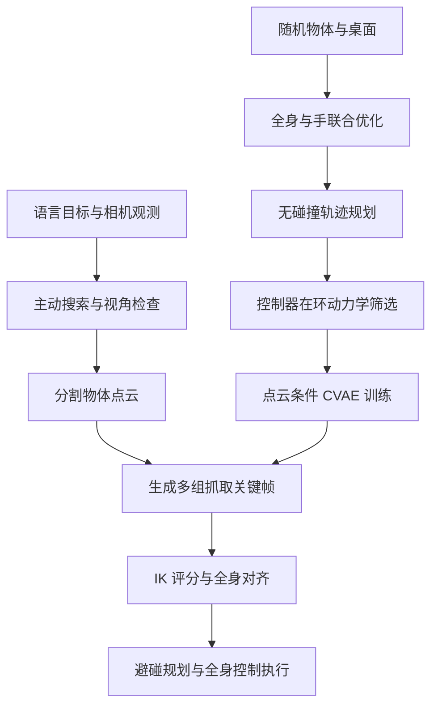

# HuG: Learning Humanoid Whole-Body Affordance-Aware Grasping with Active Perception（主动感知的人形全身可供性抓取）

## 一句话定义

HuG 用主动感知寻找目标，以控制器在环筛选的仿真轨迹训练点云抓取策略，并协调全身对齐和抓取。

## 英文缩写速查

| 缩写 | 英文全称 | 简要说明 |
|---|---|---|
| IK | Inverse Kinematics | 根据目标位姿求关节配置；上身全身 IK 输出上身关节目标 |
| WB-IK | Whole-Body Inverse Kinematics | 全身逆运动学，用于候选抓取的预抓取排序与执行 |
| CVAE | Conditional Variational Autoencoder | 以点云为条件，生成多样的三阶段抓取关键帧 |
| PointNet | PointNet point-cloud encoder | 将单视角物体点云编码为条件特征 |
| SAM | Segment Anything Model | 在检查阶段将目标分割为仅含物体的点云 |
| OOD | Out-of-Distribution | 训练时未见（留出）的物体，用于测试泛化 |

## 为什么重要

人形机器人在家庭和实验室中取物时，目标常被遮挡，且需要通过身体姿态（转头、弯腰、下蹲）保持目标可见、可达并维持平衡。已有方法通常只把头部或相机当作独立模块，或依赖遥操作示范，覆盖范围受限。HuG 的价值在于两点：一是把视角选择当作显式的全身运动决策；二是在浮动基座上，用实际部署控制器筛除"运动学可行但动力学不可行"的抓取数据，使训练出的可供性（affordance）可执行。论文在零真机示范条件下取得 87.5% 的真机成功率，为无示范的人形全身抓取提供了一条可复现的技术路线（论文报告的指标依赖其自建协议，见下文可比性提醒）。

## 流程总览

## 核心原理

**输入：** 语言目标（如 "red cup"）与机载相机观测；推理时输入为分割后的单视角物体点云 $\mathbf{P}\in\mathbb{R}^{N\times 3}$。

**关键机制：**

1. **主动感知：** 在相机偏航与高度网格上维护目标存在概率 $p(i,j)$，按视锥内的检测置信度做贝叶斯式乘法更新：

$$
p_{t+1}(i,j) \propto \lambda_t(i,j)\, p_t(i,j), \qquad \sum_{i,j} p_{t+1}(i,j)=1
$$

   命中时视锥内网格权重放大，未命中时衰减（$\lambda_t = 1-\gamma$）；视角评分以检测概率（PoD）减去相机运动代价。

2. **动力学筛选的数据：** 对每条"预抓取→抓取→抓后"轨迹，先做全身–手联合优化与无碰撞规划，再在 50 Hz 的部署控制栈（WB-IK + RL 下身）中回放；仅保留物体被抬起至少 5 cm 并握持、无摔倒且姿态有界、末端跟踪误差在阈值内的样本。

3. **点云条件 CVAE：** PointNet 编码点云，CVAE 解码器输出三阶段末端位姿（位置、四元数）与 6 维手关节目标；推理时丢弃编码器，从标准正态采样 $K$ 个隐变量得到多组候选。

4. **全身对齐：** 对 $K$ 个候选求 IK 质量并惩罚关节重构代价，选择最易执行者；规划失败则依次尝试下一候选。

**输出：** 上身关节目标（经全身 IK）与下身速度/高度命令（交给 RL 下身控制器），驱动机器人完成搜索、接近、抓取与抬起。

**直觉：** 论文的核心假设是，浮动基座上"可达"不等于"可执行"。用控制器在环数据训练，使策略的候选本身偏向可执行的全身配置，而不是只依赖几何相似性。

## 工程实践

- **系统组成：** Unitree G1（3-DOF 主动头部、ZED Mini、Inspire 灵巧手），推理在外部 RTX 5090 桌面机上完成，指令经以太网发送至机载计算机；上身为全身 IK，下身为 SONIC RL 控制器，部署控制 50 Hz。
- **数据规模：** 生成约 60 万条仿真轨迹，约需 700 GPU 小时（可并行）；CVAE 训练约 1 小时（单卡）。论文一次剖析运行中，5.08 亿（508M）候选经抓取优化、IK 与碰撞检查后剩 1240 万（12.4M）→ 29.8 万（298K）通过无碰撞规划 → 8.07 万（80.7K）通过动力学仿真 → 最终 1.8 万（18K）训练抓取（图 3c）；论文称运动学有效轨迹中 73% 被动力学筛除。
- **仿真设置：** 训练桌高 0.40–0.90 m，物体质量在 0.1–0.5 kg 之间随机；在 ManiSkill3 中回放（论文附录 B）。
- **部署耗时（RTX 5090）：** DINO + SAM 感知约 148 ms，CVAE 推理约 0.4 ms，运动规划约 200 ms，批量 WB-IK 约 1 ms；主动搜索视角约 8 秒（10–15 次更新），单次端到端抓取约 15–40 秒。
- **调试指标：** 按 Det.（目标定位成功率）与 Gr|Det（检测后抓取成功率）分阶段统计，便于区分感知瓶颈与操作瓶颈。
- **骨盆补偿器：** 利用双足接触下的正运动学估计骨盆实际位姿，对 IK 目标做 $SE(3)$ 低通补偿，以修正 IK 假定与实际骨盆姿态的偏差（附录 A）。
- **源码运行时序图：** **不适用**（项目页的 "code" 按钮目前仍为占位链接 `#`，未找到官方训练、推理或部署仓库，无法绘制可核对的运行时序；核实后需补充）。
- **开源状态（截至 2026-11-06 核查）：** 项目页 https://xuanbinpeng.com/hug 现已可访问，但 "code" 链接为占位符，未列 GitHub 仓库；页面中未见模型权重或数据集链接（未核实）。论文 arXiv 摘要页仅链接项目页。判定为 **宣称 / 待发布（尚无可用代码）**，不能据此复现。

## 实验与评测

- **真机全流程（Task 1）：** 多层货架，10 个 YCB 物体（5 ID / 5 OOD），40 次试验，成功率 87.5%（35/40，ID/OOD 为 90/85%）；检测成功率 Det. 92.5%，Gr|Det 94.6%。去除主动感知、全身运动、对齐、动力学筛选后的成功率分别为 50%、20%、62.5%、62.5%。
- **真机高度测试（Task 2）：** 使用 oracle 感知，10 个物体、5 个高度（0.50–0.85 m）、150 次试验；各高度成功率 73%–97%，ID/OOD 为 85.3% / 84.0%。这是 oracle 感知下的结果，不能与完整自主感知流程混为一谈。
- **真机数据规模实验（附录 E.4）：** 以 oracle 感知，SR 随合成轨迹量从 5k 的 9.2% 升至 400k 的 89.2%，600k 时 88.3%；OOD 从 5.0% 升至 90.0%。该协议与 Task 2 分开，数值不可直接比较。
- **仿真外推（Task 3）：** 训练桌高 0.40–0.90 m，在 0.10–0.35 m 范围，YCB 与 RoboCasa 的成功率分别为 81.1% 和 71.4%；训练范围内为 87.4% 与 79.8%。这是仿真结果，不是低于训练高度的真机量化结果。
- **消融的失效区间：** 去除动力学筛选后，训练范围内 YCB 为 64.4%，外推区间骤降至 2.8%；去除全身运动（仅臂部）在 0.65 m 以下接近 0，外推区间为 0.0%。

## 与其他工作对比

- **对比 [ACT](./paper-act.md)、[ViA](./paper-notebook-vision-in-action-learning-active-perception-from.md)（端到端模仿）：** 二者用 ID 物体的遥操作示范训练（Task 1 每物体 70 条，Task 2 仅 H2、H4 两个高度），ViA 改适配浮动基座；HuG 零真机示范，仅用 60 万条仿真轨迹。Task 1 中 ViA 为 50%（ID/OOD 85/15），HuG 为 87.5%（90/85）（§4.1–4.2、图 3a）。
- **对比 GraspNet + WB-IK（[GraspNet-1Billion](./painode-218-graspnet1billion.md)）：** 预训练平行夹爪位姿映射为灵巧手预抓取，复用 HuG 的全身 IK；加入 HuG 主动感知后 Det. 由 50% 升至 90%，Gr | Det 仍为 45.0%→44.4%，论文归因于夹爪位姿不适合人形手且易与环境碰撞（§4.2）。
- **对比 Dex1B（adapted）+ WB-IK + AP：** 与 HuG 共享 PointNet + CVAE 结构和手型，但数据只做手臂 IK 优化，无全身–手联合优化、动力学筛选和对齐。Det. 同为 92.5%，Gr | Det 仅 56.8%，低于 HuG 的 94.6% 和 –Dyn. Filter 的 69.4%（§4.1、§4.3.1）。
- **相关工作定位：** 论文认为 [VIRAL](./paper-viral-humanoid-visual-sim2real.md) 等视觉 sim2real 方法把感知交给数据规模，[Choice Policy](./paper-notebook-coordinated-humanoid-manipulation-with-choice-po.md) 只调节主动头部而身体被动；HuG 将视角搜索作为全身运动问题（§2.1、§2.3）。二者未进入实验对比。
- **可比性提醒：** 上述基线均为作者在自家 Task 1 协议（40 次、10 个 YCB 物体、多层货架）下复现或适配的版本，不能与 ACT、ViA、Dex1B 原论文指标直接比较；GraspNet 行未拆分 ID/OOD。

## 结论

**HuG 的实验支持把主动视角、控制器可执行性和全身抓取联合设计，但主要增益来自对协议与数据的控制，应按作者自建的协议理解其数字。**

1. **分阶段统计：** 遮挡场景应分别统计目标检测率（Det.）与检测后的抓取率（Gr|Det），论文显示瓶颈主要在发现目标而非抓取。
2. **控制器在环筛选：** 浮动基座上应以实际部署控制器筛选训练轨迹，而非只检查 IK 和碰撞；论文中此步骤剔除 73% 的运动学有效样本。
3. **全身运动不可省：** 深蹲或远距抓取需同时关注骨盆漂移与姿态补偿；仅臂部方案在低高度基本失效。
4. **迁移需重新核对：** 硬件、控制器和场景条件变化后应重新验证，论文指标来自特定测试协议，且仿真指标比真机协议更严格。

## 局限与风险

- **高层决策主要开环：** 严重遮挡、反光表面以及工作空间边缘的碰撞仍会导致失败；论文报告约 12.5% 的真机失败主要来自开放词汇检测（DINO + SAM）误识别。
- **不迈步：** 当前真机实验为双足支撑且不迈步；超出手臂加身体倾斜范围的目标需先重新站位。论文指出控制器接口已暴露速度命令，扩展到迈步是后续方向。
- **数据重算成本：** 合成数据约 700 GPU 小时；控制器或策略架构变化后需要重新生成。
- **仿真与真机差异：** 仿真成功判据包含更严格的滑移与平衡约束，但仿真外推结果仍需真机验证；论文未提供低于 0.40 m 的真机量化结果。
- **复现风险：** 项目页目前无可用代码、权重或数据，只能依据论文描述，骨盆补偿等细节以附录为准。
- **常见误区：** 把 Task 2（oracle 感知）的 85% 左右结果与 Task 1 的 87.5% 或仿真外推结果混用，会高估系统在完全自主条件下的单一指标。

## 关联页面

- [机器人操作](../tasks/manipulation.md)
- [全身控制](../concepts/whole-body-control.md)
- [SONIC 运动跟踪](../methods/sonic-motion-tracking.md)
- [机器人视觉感知栈选型闭环（知识链）](../queries/robot-perception-stack-selection-loop.md)

## 参考来源

- [论文归档](../../sources/papers/hug_arxiv_2611_01659.md)
- [项目主页归档](../../sources/sites/hug-project.md)
- 论文原文：arXiv:2611.01659v1（2026-11-01），正文及附录 A–E 已通读

## 推荐继续阅读

- [论文全文及附录（arXiv HTML）](https://arxiv.org/html/2611.01659v1)
- [论文 PDF](https://arxiv.org/pdf/2611.01659)
- [项目主页](https://xuanbinpeng.com/hug)
