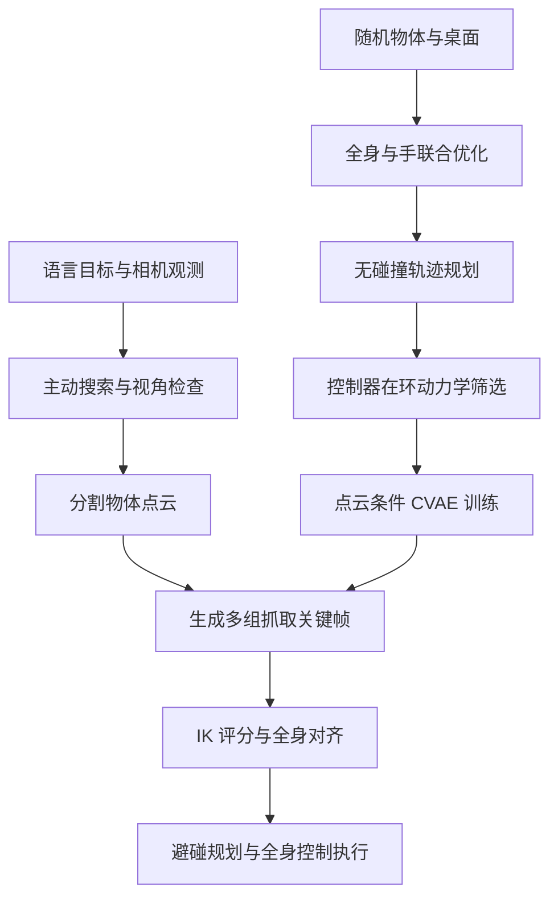

# HuG: Learning Humanoid Whole-Body Affordance-Aware Grasping with Active Perception（主动感知的人形全身可供性抓取）

## 一句话定义

HuG 用主动感知寻找目标，以控制器在环筛选的仿真轨迹训练点云抓取策略，并协调全身对齐和抓取。

## 英文缩写速查

| 缩写 | 英文全称 | 简要说明 |
|---|---|---|
| IK | Inverse Kinematics | 根据目标位姿求关节配置 |
| CVAE | Conditional Variational Autoencoder | 根据点云生成多样抓取候选 |
| WBC | Whole-Body Control | 协调浮动基座与上肢控制 |
| OOD | Out-of-Distribution | 训练时未见的物体 |

## 核心信息

| 项 | 内容 |
|---|---|
| 机构 | 加州大学圣地亚哥分校（UC San Diego） |
| 论文 | [arXiv:2611.01659v1](https://arxiv.org/html/2611.01659v1)，CoRL 2026 |
| 真机 | Unitree G1、主动头部、ZED Mini、Inspire 灵巧手；外部 RTX 5090 推理 |
| 控制 | 上身全身 IK + SONIC 下身 RL；部署控制 50 Hz |
| 发布状态 | 项目页本次无法访问，代码、权重及数据开放情况待核查 |

## 项目流程

## 方法

- **主动感知：** Grounding DINO 依语言目标检测，搜索阶段在相机偏航与高度网格上更新目标可见性 belief；检查阶段依点云质量精化视角，随后由 SAM 分割目标。
- **数据生成：** 随机场景中联合优化手与身体姿态，规划抓前、抓取和抓后动作，再在 ManiSkill3 中使用部署控制器回放，筛除未抬起、失稳或跟踪误差过大的轨迹。论文一次分析中，运动学有效轨迹的 73% 被动力学筛除；完整训练集汇总 60 万条轨迹。
- **策略与执行：** PointNet 编码单视角物体点云，CVAE 采样多个三阶段末端位姿与手关节目标；按 IK 质量与重配置代价排序，规划失败时尝试下一候选。
- **控制接口：** 高层 IK 输出上身关节目标和下身命令；低层 RL 稳定跟踪。骨盆补偿器利用双足接触下的正运动学估计，修正 IK 假定与实际骨盆姿态的偏差。

## 源码运行时序图

暂不适用：项目主页访问失败，尚未核实可运行官方实现及入口；核实后需补充源码时序图。

## 实验与评测

- **真机全流程：** 多层货架、10 个物体、40 次试验，成功率 87.5%（35/40）；检测成功率 92.5%。去除主动感知、全身运动、对齐、动力学筛选后的成功率分别为 50%、20%、62.5%、62.5%。
- **真机高度测试：** 使用 oracle 感知，10 个物体、5 个高度、150 次试验；各高度成功率 73%–97%。不能与完整自主感知流程混为一谈。
- **仿真外推：** 训练桌高 0.40–0.90 m，在 0.10–0.35 m 范围，YCB 与 RoboCasa 的成功率分别为 81.1% 和 71.4%；这不是低于训练高度的真机量化结果。

## 结论

HuG 的实验支持将主动视角、控制器可执行性和全身抓取联合设计。

1. 遮挡场景应分别统计目标检测率与检测后的抓取率。
2. 浮动基座上应以实际部署控制器筛选轨迹，而非只检查 IK 和碰撞。
3. 深蹲或远距抓取需关注骨盆漂移和姿态补偿。
4. 迁移时应重新核对硬件、控制器和场景条件，论文指标来自特定测试协议。

## 局限与工程实践

- 高层决策主要开环；严重遮挡、反光及工作空间边缘的碰撞仍会导致失败。
- 当前真机实验为双足支撑且不迈步；超出手臂与身体倾斜范围的目标需先重新站位。
- 论文报告 60 万条轨迹生成约需 700 GPU 小时；搜索视角约 8 秒，单次抓取约 15–40 秒。
- 项目主页无法访问，开放状态和复现入口待核实，当前无法据此判断是否开源。

## 关联页面

- [机器人操作](../tasks/manipulation.md)
- [全身控制](../concepts/whole-body-control.md)
- [SONIC 运动跟踪](../methods/sonic-motion-tracking.md)

## 参考来源

- [论文归档](../../sources/papers/hug_arxiv_2611_01659.md)
- [项目主页归档](../../sources/sites/hug-project.md)

## 推荐继续阅读

- [论文全文及附录](https://arxiv.org/html/2611.01659v1)
