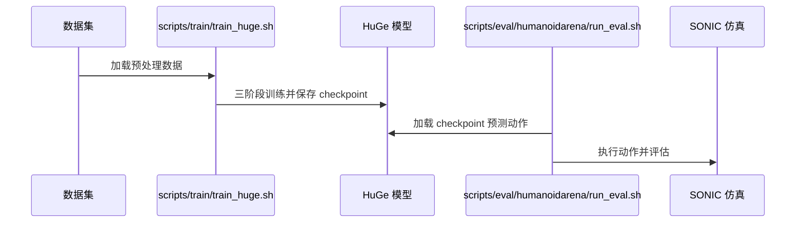

# HuGe: Scaling Humanoid Generalist Vision-Language-Action Models with Egocentric Experience

**一句话定义：** 超过 2000 小时第一视角人类及机器人数据经人称预训练、人形适配、下游微调三个阶段处理；仿真回放构造伪本体感觉，微调时重渲染手臂外观。VLA 输出运动 token 与手部控制信号，由预训练全身控制器执行。

## 英文缩写速查

| 缩写 | 英文全称 | 简要说明 |
|------|----------|----------|
| VLA | Vision-Language-Action | 以视觉和语言条件生成动作的模型 |
| G1 | Unitree G1 | 人形机器人平台 |
| Sim2Real | Simulation to Real | 从仿真迁移到真实机器人 |

## 为什么重要

超过 2000 小时第一视角人类及机器人数据经人称预训练、人形适配、下游微调三个阶段处理；仿真回放构造伪本体感觉，微调时重渲染手臂外观。VLA 输出运动 token 与手部控制信号，由预训练全身控制器执行。

## 方法与核心原理

超过 2000 小时第一视角人类及机器人数据经人称预训练、人形适配、下游微调三个阶段处理；仿真回放构造伪本体感觉，微调时重渲染手臂外观。VLA 输出运动 token 与手部控制信号，由预训练全身控制器执行。

## 源码运行时序图

README 提供 scripts/train/train_huge.sh 三阶段训练与 scripts/eval/humanoidarena/run_eval.sh 仿真评测入口；代码公开，数据和权重请依 README 分别准备。

## 工程实践

复现时先对齐训练数据、具身接口和评测设置；记录数据来源及运行环境。

## 评测与结果

作者报告 HumanoidArena 仿真达到当时最佳结果；G1 真机 pick-and-drop 中视觉适配的人称数据提升成功率。

## 结论

**工程判断应结合论文的训练和评测条件。**

- 人类视频要转移到人形控制，还需解决缺失本体状态与手臂外观差异。
- 运动 token 依赖预训练全身控制器，不等于直接输出关节控制。
- 评估时分别比较人称数据与视觉适配的作用。

## 局限与风险

结果依赖指定控制器、任务和数据；论文的 G1 结果不能直接推广到所有机型。

## 与其他工作对比

与 [MimicAll](./paper-mimicall.md) 的跨机体运动跟踪相比，本工作关注不同层面的数据、动作表示或任务生成。

## 关联页面

- [MimicAll](./paper-mimicall.md)
- [操作任务](../tasks/manipulation.md)

## 参考来源

- [来源归档](../../sources/papers/huge-humanoid-vla.md)
- [来源归档](../../sources/sites/huge-humanoid-vla.md)
- [来源归档](../../sources/repos/huge-humanoid-vla.md)

## 推荐继续阅读

- [论文原文](https://arxiv.org/abs/2610.34186)
