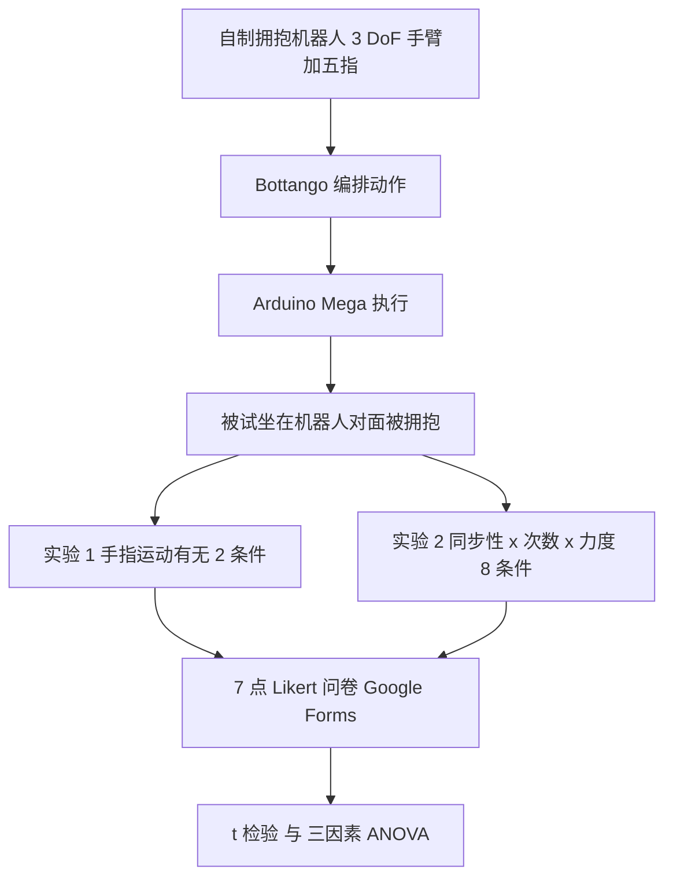

# 人形拥抱机器人手指运动效果研究（arXiv:2611.02517）

**论文：** *A Study on the Effects of Finger Movements on a Humanoid Hugging Robot*，Daigo Suhara、Tomoko Yonezawa（日本关西大学），[arXiv:2611.02517v1](https://arxiv.org/abs/2611.02517v1)，2026-11-02，cs.RO。TBSA 第二届研讨会（与 HAI 2026 同期）4 页短文。归档见 [sources/papers](../../sources/papers/hugging-robot-finger-movements_arxiv_2611_02517.md)。

## 一句话定义

**一项人机交互用户研究：作者自制一台带五根独立驱动手指的半人形拥抱机器人，用 7 点 Likert 问卷考察「手指运动的有无 / 同步性 / 次数」与「拥抱力度」如何改变 20 名被试对被拥抱的心理印象。** 本文没有训练任何策略，不属于强化学习或运动控制方法论文。

## 英文缩写速查

| 缩写 | 英文全称 | 简要说明 |
|------|----------|----------|
| HAI | Human-Agent Interaction（会议名） | 论文所属研讨会的同期会议 |
| TBSA | Trust and Blame in Multi-Person Multi-Agent Societies | 论文所投研讨会（第二届） |
| HRI | Human-Robot Interaction | 人机交互 |
| DoF | Degree of Freedom | 自由度；本机手臂为 3 DoF |
| ANOVA | Analysis of Variance | 方差分析；实验 2 用三因素被试内 ANOVA |
| PLA | Polylactic Acid | 3D 打印材料；外壳用 PLA Silk，受力支架用碳纤维增强 PLA |

## 为什么重要

- 机器人进入医疗、福祉、教育等需要身体接触的场景，除安全可靠外还需考虑用户心理与情感（§1）。
- 既有拥抱机器人多研究手臂、躯干、整体柔软度与尺寸，对手指动作关注不足（§1，引用 [1,4,10,11]）。本文给出一个小样本的初步证据：手指动作模式会改变用户感受到的「被需要」程度（实验 2 Q4）。
- 对本仓库读者的位置：它属于「人形机器人交互与社交触觉」，与强化学习、全身控制主线关系很远，适合作为「人形平台并非只做运控」的旁证，不应当作 RL 方法引用。

## 核心原理

### 流程总览

### 系统（§2）

- 半人形：三自由度手臂 + 五指独立驱动的手；不带脸，以避免恐怖谷（§2）。
- 材料：框架与外壳 PLA Silk，高负载舵机支架用碳纤维增强 PLA。
- 手指两种驱动方式：五指同步开合（Fig. 3a）与单指独立运动（Fig. 3b）。
- 动作用 Bottango 创作，经 Arduino Mega 上的 Bottango bootloader 执行。

## 实验设计与结果

### 实验设计

| 项 | 实验 1（§3.2） | 实验 2（§3.3） |
|----|----------------|----------------|
| 设计 | 被试内，单因素两水平 | 被试内，三因素 2×2×2，共 8 条件 |
| 因素 | A 手指运动：A1 有 / A2 无 | A 同步性（A1 同步 / A2 异步）；B 次数（B1 一次 / B2 多次）；C 力度（C1 弱 / C2 强） |
| 题项 | Q1 体贴；Q2 强烈需求；Q3 被触碰不适 | Q1 孩童感；Q2 安心；Q3 不愿被触碰；Q4 感到强烈被寻求；Q5 体贴 |
| 统计 | t 检验，α=0.05 | 三因素 ANOVA，α=0.05 |

被试 20 人（15 男 5 女，20–27 岁，均值 22.05、标准差 1.356）；所有评价通过 Google Forms 以 7 点 Likert 量表完成，流程中没有拥抱前后的情境铺垫（§3.1）。

### 结果（论文数字，Table 1–3）

- **实验 1：** Q1 t=−1.898、p=.073（不显著）；Q2 t=−5.176、p<.001；Q3 t=−0.400、p=.694。
- **实验 2 主效应：** A 仅 Q4 显著（F=5.318、p=.033）；B 仅 Q4 显著（F=4.498、p=.047）；C 仅 Q1 显著（F=5.373、p=.032）。Q5（体贴）的 A 与 C 主效应分别为 p=.074、p=.058，**未达显著**。
- **交互：** 仅 A×B 对 Q2（安心）显著（F=12.459、p=.002）；其余交互均不显著（Table 3）。
- **无差异：** 各因素对 Q3（抵触被机器人触碰）均无显著差异（Table 1、2）。

### 作者自述与本页判断分开

- **作者自述（§4–5）：** 手指运动是补充机器人意图的非语言信息；重复运动（放开 / 抓握）被理解为情感表达，异步运动给人「冲动想接触」的印象，同步运动被视为理性、体贴；强拥抱像孩童式情感表达，弱拥抱像体贴。
- **本页判断：** 「同步 + 轻柔更易被关怀」在论文里只是趋势（Q5 主效应 p=.074 / .058，摘要用 tended to），不是显著结论；「重复 / 异步增强被需要感」有 Q4 的 p=.047 / .033 支撑，但边际且样本小。

## 结论

**手指运动的效果在这项 N=20 的小研究里只有少数显著项：它主要改变用户感到的「机器人在寻求自己」（Q4），而「同步 + 轻柔更显体贴」只是不显著的趋势。**

1. **最有支撑的结论**：实验 1 Q2（强烈需求）t=−5.176、p<.001；实验 2 Q4 的同步性与次数主效应 p=.033 / .047（Table 1–2），但后两者属边际显著，且条件标注方向存疑（见局限）。
2. **不显著的不要当结论用**：Q5（体贴）的 A、C 主效应 p=.074 / .058；论文摘要也只用 tended to。
3. **用户抵触没有变化**：各因素对 Q3（不愿 / 不适被触碰）均无显著差异，手指动作并未增加对触碰的抵触。
4. **统计证据偏弱**：30 次检验未做多重比较校正，未报告效应量与条件平衡化（判断）。
5. **工程读法**：这是交互设计的初步信号，不是可复现的控制方案；做产品前需补充力 / 接触测量、目标人群（儿童、老人、照护场景）与更大样本。

## 与其他工作对比

论文 §1 把既有拥抱 / 触觉机器人研究概括为主要关注手臂、躯干、整体柔软度与尺寸（引用 [1,4,10,11]；参考文献中包括 Block 等 *The Six Hug Commandments* 与 Onishi 等 Moffuly-II，见「推荐继续阅读」）；本文的差异在于只操纵**手指运动**这一变量。论文没有与这些系统做同条件实验对比，也没有真人拥抱或无拥抱基线。

本 wiki 中相近的人形社交交互页面有 [Social Humanoid](./paper-social-humanoid.md) 与 [EmoPose](./paper-emopose-emotion-gesture.md)，它们关注的是社交响应与情绪手势，而非身体接触中的手指动作；论文未引用或比较它们，此处仅作阅读定位。

## 工程实践

- **复现门槛低：** 全部为 3D 打印件 + 舵机 + Arduino Mega + 免费动作编排软件 Bottango（§2），但论文**未给**舵机型号、手指自由度细节、关节力矩、拥抱「弱 / 强」的具体力或角度数值、动作时序参数，也没有代码或项目页，无法按论文直接复现实验刺激。
- **可借用的做法（本页判断，非论文结论）：** 先用 Bottango 一类关键帧工具快速构造多种手指动作，再用被试内问卷筛选；需要定量化时应补测力 / 接触传感器，并参考 [触觉感知](../concepts/tactile-sensing.md)。
- 作者提到的设计含义（§4）：未来可能需要有意限制交互深度，并让机器人具备拒绝不当拥抱的自我保护行为。

## 局限

**论文自己承认或提出的：**

- 讨论节指出深层情感互动带来的伦理问题：机器人意图、道德地位、责任归属、对儿童的过度依赖，以及过度亲密 / 性暗示的风险（§4）。

**本页观察到的未验证之处（判断，非作者自述）：**

- **样本小且同质：** N=20，年龄 20–27，15 男 5 女；无儿童、老年或照护场景用户，而 §1 的动机恰是医疗 / 福祉 / 教育。
- **测量是单题项自评：** 没有触觉 / 力传感器读数，也没有生理指标；论文测的是「心理印象」，并不是「触觉体验」本身。
- **多重比较：** 实验 2 对 5 个题项做 3 个主效应与 3 个交互，共 30 次检验，显著项只有 4 个（Q4 的 A 与 B、Q1 的 C、Q2 的 A×B），其中 3 个 p 在 .03–.05 之间，论文未提及校正。
- **实验 1 图文方向存疑：** Fig. 4 中 Q2 的 A1 柱约 3、A2 柱约 5（按图读数，非论文给出的数值），且 t 为负；而 §3.2 把 A1 定义为「有手指运动」、§4 又说手指运动提高被需要感。图例或条件标注与讨论方向不一致，论文未解释，须等作者澄清。
- **实验细节缺失：** 8 个条件的呈现顺序 / 平衡化、每条件重复次数、「弱 / 强」拥抱的物理定义、统计前提检查与效应量均未报告；Likert 数据直接用 t 检验 / ANOVA。
- **「人形」较弱：** 论文称 semi-humanoid，有三自由度手臂和五指，无脸；论文没有说明机器人是单臂还是双臂的拥抱结构，仅从 Fig. 1–2 的文字描述不能确定。
- **研讨会短文：** 4 页，没有对比条件之外的基线（如真人拥抱、无拥抱），也没有重复实验。

## 与周报说法的核对

对照「具身运控lab」周报对本文的转述（二手资料，不列入 `original`）：

| 周报说法 | 核对结果 |
|----------|----------|
| 机构：日本关西大学 | 与论文首页一致（Kansai University，Takatsuki, Osaka） |
| 问题：拥抱机器人通常只控制手臂压力，尚不清楚手指运动如何影响触觉体验与情感评价 | 论文 §1 的说法是既有研究多关注手臂、躯干或整体柔软度与尺寸、对手指关注不足；没有「只控制手臂压力」一说，且论文测的是心理印象，不是触觉体验 |
| 创新点：系统比较同步、异步和重复手指运动 | 大体对：实验 2 比较同步 / 异步、一次 / 多次、弱 / 强拥抱；另有实验 1 的有 / 无对比。「系统」二字偏强，规模为 N=20 的两个小实验 |
| 重复或异步运动增强触觉感受 | 论文原话是增强用户感到的「机器人在寻求自己」的感受（Q4：A p=.033，B p=.047），并非「触觉感受」 |
| 同步手指运动配合轻柔拥抱更容易产生被关怀感 | 仅为趋势：Q5 主效应 A p=.074、C p=.058 均不显著，摘要也用 tended to |

## 关联页面

- [Social Humanoid：可社交响应的人–人形交互](../entities/paper-social-humanoid.md)
- [EmoPose：情绪手势](../entities/paper-emopose-emotion-gesture.md)
- [动态多模态 HRI 数据集 U1](../entities/paper-dynamic-multimodal-hri-dataset-u1.md)
- [人形机器人](../entities/humanoid-robot.md)
- [触觉感知](../concepts/tactile-sensing.md)
- [人形手臂构型](../concepts/humanoid-arm-configuration.md)

## 参考来源

- [sources/papers/hugging-robot-finger-movements_arxiv_2611_02517.md](../../sources/papers/hugging-robot-finger-movements_arxiv_2611_02517.md)
- [arXiv:2611.02517v1](https://arxiv.org/abs/2611.02517v1)

## 推荐继续阅读

- 论文引用的 Block 等《The Six Hug Commandments》（HRI 2021，doi:10.1145/3434073.3444656）：人体尺寸拥抱机器人的设计与评价。
- 论文引用的 Onishi 等《Moffuly-II: A Robot that Hugs and Rubs Heads》（Int. J. Social Robotics，doi:10.1007/s12369-023-01070-5）。
- [arXiv PDF v1](https://arxiv.org/pdf/2611.02517v1)
