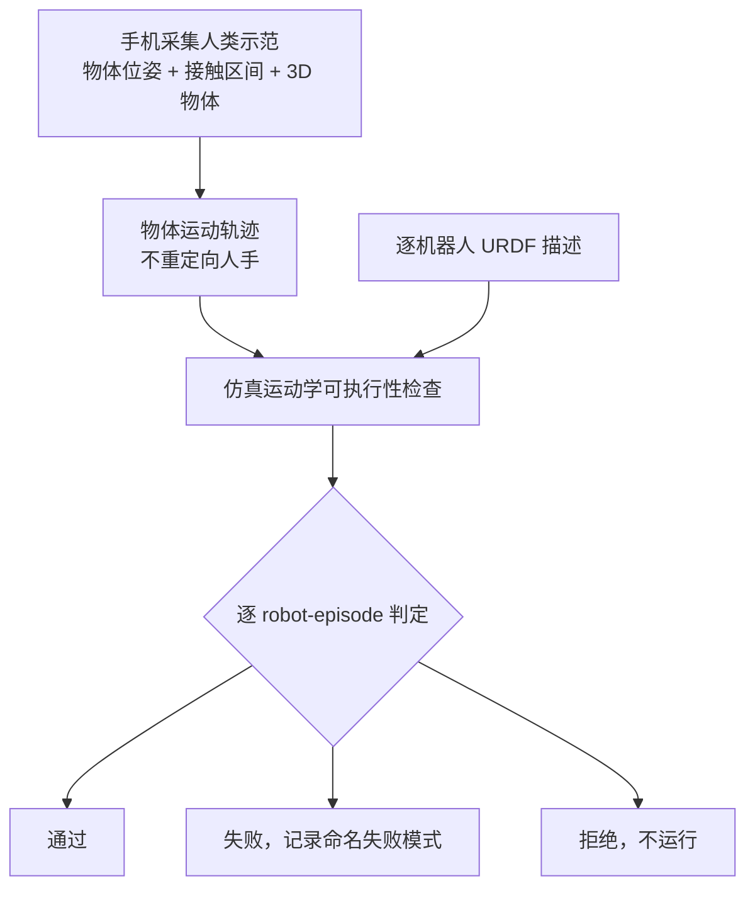

# 人类示范：重定向物体而非人手

**Human Demonstrations as Post-Training Data for Any Robot Body: Retargeting the Object, Not the Hand**（[arXiv:2610.20351](https://arxiv.org/abs/2610.20351)，[项目页](https://playground.dxtr.co/)）提出用物体中心的示范记录替代人手中心的重定向：人类示范只记录物体怎么动，再逐机器人判断能否执行，并把每一次判定记录为通过、失败模式或拒绝。

## 英文缩写速查

| 缩写 | 英文全称 | 简要说明 |
|------|----------|----------|
| URDF | Unified Robot Description Format | 机器人运动学描述文件；本文仅凭它预测执行结果 |
| mesh | Polygon Mesh | 物体与机器人的三维网格模型，用于仿真检查 |
| capture | — | 论文中一次手机采集的人类示范记录 |
| robot-episode | — | 本文的判定单元：一个 capture 与一台 URDF 机器人的组合 |

## 为什么重要

- **数据可以跨本体复用：** 人手中心的重定向依赖具体手型，换机器人就要重做；物体运动不依赖人体结构，理论上能服务不同本体。
- **拒绝比硬执行更有价值：** 论文表明，被拒绝的组合若强行执行，全部失败，支持「先判定再执行」的流程。
- **证据边界要读清：** 当前只做仿真运动学筛选，尚未用这些数据训练策略，真机迁移未测试。

## 核心信息

| 项 | 内容 |
|----|------|
| **机构** | 未核实（页面未列机构） |
| **作者** | Nagasrikanth Kallakuri（单作者） |
| **数据 / 平台** | 手机采集的人类示范（42 个 capture）；8 台 URDF 机器人；157 个 robot-episode 组合 |
| **开源** | **未开源**（截至 2026-10-15，arXiv 与项目页均未给代码或数据仓库；项目页提供 URDF 提交的服务入口） |

## 核心原理

### 流程总览

### 机制要点

- **记录内容：** 每次 capture 保存物体随时间的位姿、接触区间与重建的三维物体，不保存人手关节。
- **逐机器人判定：** 运动前即给出判定，拒绝先于执行；失败需要命名原因，便于归因。
- **预测能力的反面：** 仅凭 URDF 描述预测结果，效果几乎不优于随机猜测，因此必须逐组合检查，不能靠机器人参数表推断。

## 工程实践

| 项 | 建议 |
|----|------|
| 采集 | 只需手机与物体即可采集，记录物体位姿与接触时间段 |
| 目标本体 | 提供 URDF 与 mesh 即可进入检查流程；需要确认 mesh 质量与关节限位 |
| 结果读法 | 通过率约 31%，失败与拒绝合计约 66%，应按失败模式做数据筛选而非整体丢弃 |
| 下游训练 | 论文未训练策略；若用于 post-training，需额外验证接触与控制质量 |
| 源码运行时序图 | **不适用**（论文未发布代码，项目页无可运行仓库） |

## 实验与评测

- **样本：** 42 个 capture，8 台机器人，157 个 robot-episode 组合。
- **结果：** 通过约 31%，失败约 52%，拒绝约 14%，不可审计约 2.5%。
- **拒绝校验：** 13 个被拒绝但强行运行的组合全部失败。
- **URDF 预测力：** 仅凭机器人描述预测结果，几乎与随机猜测相当。
- **真机：** 未进行，论文明确说明真机迁移未测试。

## 结论

**一句总判：物体中心的示范记录把「能不能用到某个机器人上」变成可检查的问题，但目前只是可执行性筛选，不是策略效果证明。**

1. **重定向对象更易跨本体** — 记录的是物体运动，不绑定人手结构，这是方法的核心前提。
2. **大部分组合会失败** — 157 组中仅约三成通过，说明跨本体复用不能假设成功。
3. **拒绝机制有实证支持** — 被拒绝组合强行执行全部失败，应把拒绝视为有效信号。
4. **不要用 URDF 参数预测可行性** — 作者的结果显示参数表几乎无预测力，需要运行检查。
5. **训练与真机结论尚缺** — 没有策略训练和真机迁移，任何 post-training 收益目前都只能是假设。

## 与其他工作对比

| 对照 | 差异读法 |
|------|----------|
| [运动重定向](../concepts/motion-retargeting.md) | 传统路线重定向人体运动到机器人；本文重定向的是物体，对象不同 |
| [SPIDER 灵巧重定向](../methods/spider-physics-informed-dexterous-retargeting.md) | 同样做物理可行性，但 SPIDER 面向灵巧手的人手重定向，本文面向任意本体的物体运动 |
| [具身数据采集四层分类](../concepts/embodied-data-collection-four-layers-taxonomy.md) | 本文属于低成本人类示范采集层，缺少策略训练与真机验证 |

## 局限与风险

- **仅仿真运动学筛选：** 动力学、接触稳定性与控制可行性未覆盖。
- **样本量小：** 42 个 capture 与 8 台机器人，统计结论需谨慎。
- **单作者、无代码：** 结果无法独立复现。
- **拒绝的边界未知：** 拒绝规则的阈值与误拒率未在摘录中给出，需以论文正文核对。

## 关联页面

- [运动重定向](../concepts/motion-retargeting.md) — 人体运动到机器人的传统路线
- [具身数据采集四层分类](../concepts/embodied-data-collection-four-layers-taxonomy.md) — 本文所在的数据层次
- [SPIDER 灵巧重定向](../methods/spider-physics-informed-dexterous-retargeting.md) — 物理约束重定向的对照
- [具身数据清洗](../concepts/embodied-data-cleaning.md) — 判定与筛选思路的相关背景

## 参考来源

- [human_demos_object_retargeting_arxiv_2610_20351.md](../../sources/papers/human_demos_object_retargeting_arxiv_2610_20351.md) — 论文摘录与开源核查
- [arXiv:2610.20351](https://arxiv.org/abs/2610.20351) — 原文（v1，2026-10-14）

## 推荐继续阅读

- [项目页（示范子集与逐机器人结果）](https://playground.dxtr.co/) — 结果展示与 URDF 提交入口
- [arXiv HTML v1](https://arxiv.org/html/2610.20351v1) — 方法与实验细节
