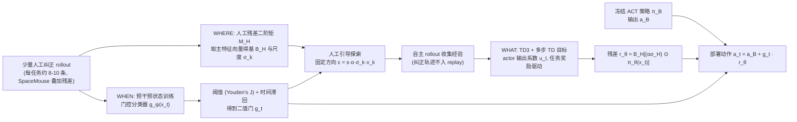

# Human-Guided Adaptive Residual Correction（arXiv:2610.37547）

**Human-Guided Adaptive Residual Correction**（*When, Where, and What to Correct: Human-Guided Adaptive Residual Correction for Robot Policies*，[arXiv:2610.37547](https://arxiv.org/abs/2610.37547)，[项目页](https://anonymous.4open.science/w/arc-6DD5/)）来自 [具身智能小站 2026-10-28 盘点](../../sources/blogs/wechat_embodied_station_59_papers_human_video_to_robot_experience_2026-10-28.md)，属「VLA 与策略后训练」组。

## 一句话定义

**冻结原策略，用少量人工纠正确定残差控制的激活位置与探索子空间，再由任务奖励优化动作。**

## 英文缩写速查

| 缩写 | 英文全称 | 简要说明 |
|------|----------|----------|
| Human-Guided Adaptive Residual Correction | When, Where, and What to Correct: Human-Guided Adaptive Residual Correction for Robot Policies | 本文方法 / 基准的简称 |

## 为什么重要

- 只修正策略最容易失手的局部。在真机精细操作中验证，适合关注末端精度与低成本后训练的读者。
- 开源结论：**项目页未列 GitHub**（步骤 2.5，2026-10-28）。项目页为 anonymous.4open.science 匿名链接，curl 返回 HTTP 400，无法核查代码。
- 同期同组工作见 [潜在动作、免渲染事件仿真与机器人评测：具身智能小站 10-28 期 59 篇阅读坐标](../overview/embodied-station-2026-10-28-59-papers-technology-map.md)。

## 流程总览

图依据：论文 §3.1-3.4 / Fig.1

## 核心机制

| 项 | 内容 |
|----|------|
| **arXiv** | [2610.37547](https://arxiv.org/abs/2610.37547) |
| **开源** | **项目页未列 GitHub** |
| **要点** | 冻结原策略，用少量人工纠正确定残差控制的激活位置与探索子空间，再由任务奖励优化动作。 |
| **文内指标** | 公众号转述：在真机精细操作中验证，适合关注末端精度与低成本后训练的读者。 |

## 源码运行时序图

**不适用（项目页未列 GitHub）** — 项目页为 anonymous.4open.science 匿名链接，curl 返回 HTTP 400，无法核查代码。 不编造运行脚本；代码公开后再补。

## 实验与评测

- 公众号转述：在真机精细操作中验证，适合关注末端精度与低成本后训练的读者。
- **读法：** 本页为索引级摘要，依据公众号转述的官方摘要与仓库信息整理；逐项数字与 baseline 以原文 PDF 为准。

## 与其他工作对比

- 横向索引见 [潜在动作、免渲染事件仿真与机器人评测：具身智能小站 10-28 期 59 篇阅读坐标](../overview/embodied-station-2026-10-28-59-papers-technology-map.md)；同 arXiv 不重复造页。

## 结论

**只修正策略最容易失手的局部：在真机精细操作中验证，适合关注末端精度与低成本后训练的读者。**

1. 开源边界：**项目页未列 GitHub** — 项目页为 anonymous.4open.science 匿名链接，curl 返回 HTTP 400，无法核查代码。
2. 核心机制：冻结原策略，用少量人工纠正确定残差控制的激活位置与探索子空间，再由任务奖励优化动作。
3. 复现与选型前核对任务协议、硬件与基准口径，勿直接横比公众号摘录数字。

## 关联页面

- [vla](../methods/vla.md)
- [imitation-learning](../methods/imitation-learning.md)
- [reinforcement-learning](../methods/reinforcement-learning.md)
- [diffusion-policy](../methods/diffusion-policy.md)
- [embodied-station-2026-10-28-59-papers-technology-map](../overview/embodied-station-2026-10-28-59-papers-technology-map.md)

## 参考来源

- [human_guided_adaptive_residual_correction_arxiv_2610_37547.md](../../sources/papers/human_guided_adaptive_residual_correction_arxiv_2610_37547.md)
- [wechat_embodied_station_59_papers_human_video_to_robot_experience_2026-10-28.md](../../sources/blogs/wechat_embodied_station_59_papers_human_video_to_robot_experience_2026-10-28.md)
- [arXiv:2610.37547](https://arxiv.org/abs/2610.37547)
- [arXiv PDF](https://arxiv.org/pdf/2610.37547)：已通读方法部分（实验与附录以略读为准）：摘要、§1、§3（问题设定、WHEN、WHERE、WHAT）、§4.1 实验设定

## 推荐继续阅读

- [arXiv PDF](https://arxiv.org/pdf/2610.37547)
- [项目页](https://anonymous.4open.science/w/arc-6DD5/)
