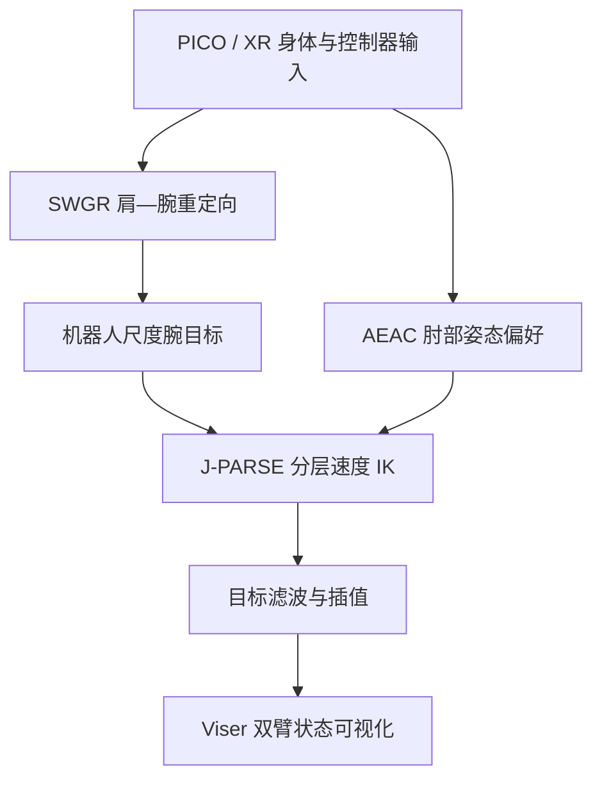
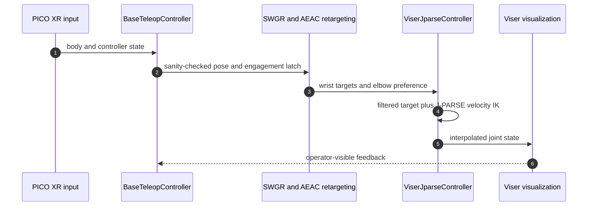

# Human-Like Redundancy Resolution：双臂遥操作的类人冗余解析

论文提出面向实时双臂人形遥操作的冗余解析方法：从人的肩—腕几何构造机器人尺度的末端目标，再用肘部偏好引导冗余自由度；层级速度 IK 优先满足腕部跟踪，只在其零空间调整肘姿态，避免姿态偏好破坏主任务。

## 英文缩写速查

| 缩写 | 英文全称 | 简要说明 |
|------|----------|----------|
| IK | Inverse Kinematics | 将末端任务映射为机器人关节运动 |
| DoF | Degree of Freedom | 关节或任务自由度 |
| XR | Extended Reality | 项目使用 PICO 头显采集控制输入 |
| Viser | Viser visualization | 机器人状态与目标的交互式可视化工具 |
| AEAC | Adaptive Elbow-Angle Constraint | 论文提出的自适应肘部姿态偏好 |

## 方法流程

1. **肩—腕几何重定向（SWGR）**：由人体肩部与腕部相对关系生成适配机器人尺度的腕目标，避免直接照搬绝对人体坐标。
2. **自适应肘部偏好（AEAC）**：肘偏移方向作为姿态引导，大小控制引导强度；当人体手臂接近伸直时减弱或关闭，避免偏好不适定或过度干预。
3. **层级速度 IK（J-PARSE）**：主任务为腕部跟踪，采用奇异鲁棒求解；肘部引导投影至腕部任务零空间，使末端跟踪优先级更高。
4. **双臂遥操作**：左右臂分别求解并协调目标，经滤波和插值送入可视化/执行栈。

## 源码运行时序图

原用户链接的仓库已转移至 [IAIE-PhysicalAI/Bimanual-Teleoperation](https://github.com/IAIE-PhysicalAI/Bimanual-Teleoperation)。README 运行入口为 `scripts/simulation/teleop_jaka_k1.py`；它读取 XR 输入、计算重定向目标与 J-PARSE IK，并在 Viser 中呈现。README 未列物理仿真后端或真实硬件输出路径。

## 实验与结果

论文报告静态姿势、动态序列、固定腕目标消融、工作空间边界压力测试和双臂任务：

| 评测 | 报告结果 | 解读边界 |
|------|----------|----------|
| 固定腕目标消融 | 肘方向平均误差下降 **54.4%** | 衡量肘部偏好，不代表完整任务成功率提升 |
| 工作空间边界压力测试 | 峰值原始关节速度需求降低 **97.9%** | 特定边界测试，不等同能耗或所有动作速度均降低 |
| 静态标定 | 腕位置误差均值 **2.87 mm**；手臂平面角误差 **2.42°** | 静态精度与动态遥操作表现不同 |

这些数值来自不同评测，不能合并成统一的成功率或总体增益。

## 工程实践与复现边界

README 给出的环境为 Python 3.10/3.11；安装 `bash setup_conda.sh --install`，运行 `python scripts/simulation/teleop_jaka_k1.py`，测试 `python -m unittest discover tests`。控制逻辑约 60 Hz，开启插值时输出约 200 Hz，Viser 更新约 30 Hz。

**重要范围差异：** 可运行示例针对 PICO XR + JAKA K1 模型并通过 Viser 展示；仓库没有物理仿真后端或真实机器人下发路径。它是方法相关参考实现/演示，不应描述为完整的人形双臂真机遥操作系统。

## 结论

**总判：** 该方法把人类肘部姿态作为次级目标，并通过零空间投影避免其挤占腕部主任务；自适应减弱机制针对伸直姿态和工作空间边界下的冗余稳定性。

- 对照应分别报告腕部跟踪误差、肘方向一致性与关节速度峰值，三者不可互相代替。
- 在腕任务零空间优化偏好，是保留末端任务优先级的关键；缺少优先级投影的实现不等价。
- 54.4% 与 97.9% 是特定消融/压力测试结果，不应外推为所有任务的平均收益。
- 公开代码演示为 JAKA K1 可视化管线；论文中人形/双臂实验不代表此仓库已有真机部署。
- 迁移到其他机器人时需重新核对雅可比、关节限制、阻尼、人体追踪尺度与安全限幅。

## 关联页面

- [Teleoperation](../tasks/teleoperation.md)
- [Bimanual Manipulation](../tasks/bimanual-manipulation.md)
- [Inverse Kinematics](../formalizations/inverse-kinematics.md)

## 推荐继续阅读

- [项目页](https://chaotan2003.github.io/human-like-redundancy/)
- [代码仓库](https://github.com/IAIE-PhysicalAI/Bimanual-Teleoperation)
- [论文 PDF](https://github.com/chaotan2003/human-like-redundancy/blob/main/paper.pdf)

## 参考来源

- [论文归档](../../sources/papers/human-like-redundancy-resolution.md)
- [项目页归档](../../sources/sites/human-like-redundancy.md)
- [代码归档](../../sources/repos/bimanual-teleoperation.md)
