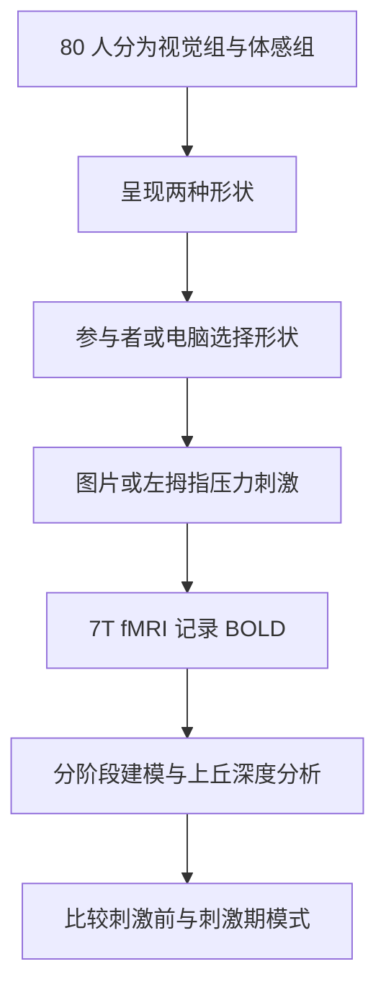
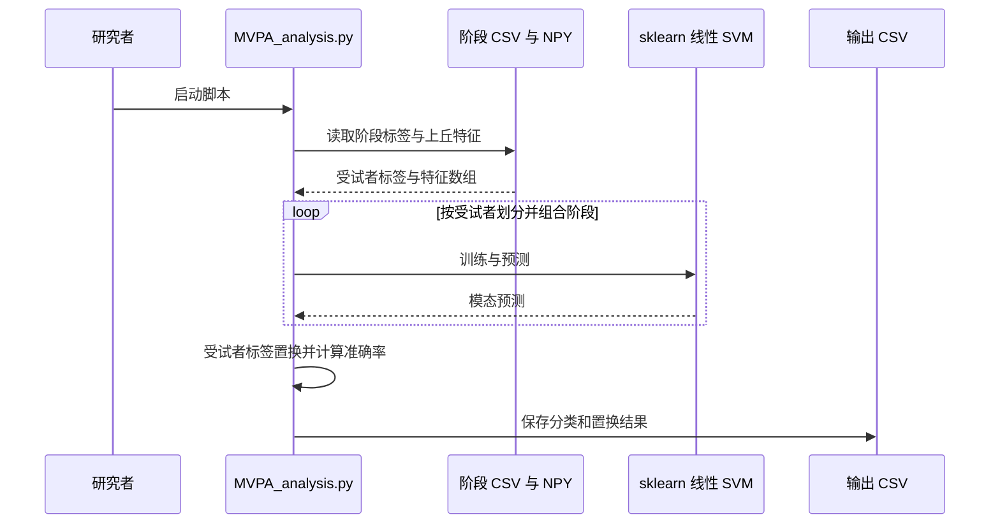

# 人类上丘中模态特异性的反应与预测响应

**Modality-specific reactive and predictive responses in the human superior colliculus**（[Nature Neuroscience, 2026](https://doi.org/10.1038/s41593-026-02480-0)）使用 7T fMRI 研究人类上丘对预期和实际视觉、体感刺激的响应。

## 一句话定义

在感觉刺激到来前，受试者上丘的 BOLD 空间模式已随预期感觉模态和体素深度变化。

## 英文缩写速查

| 缩写 | 英文全称 | 简要说明 |
|------|----------|----------|
| SC | Superior Colliculus | 上丘，中脑结构 |
| fMRI | Functional Magnetic Resonance Imaging | 功能磁共振成像 |
| BOLD | Blood Oxygen Level Dependent | 血氧水平依赖信号，神经活动的间接指标 |
| MVPA | Multivariate Pattern Analysis | 多变量模式分析 |
| SVM | Support Vector Machine | 支持向量机分类器 |

## 阅读状态

**草稿：** 已核对论文可获取的主要方法、结果和局限片段及部分分析源码；完整正文和必要补充材料尚未通读。以下为已核实内容，待核读后完善。

## 实验流程

每人只参与一种感觉模态，每组 40 人；刺激可以是中性或厌恶性。选择与结果概率关联，研究对形状呈现、刺激前决策和感觉刺激三个阶段分别建模。

## 实验与评测

- 7T 成像体素分辨率为 1.1 mm 各向同性；上丘 ROI 对齐后按体素深度分析。
- 刺激期间视觉响应的浅层高于深层，体感响应的深层高于浅层；刺激前决策期的模态与深度交互显著。视觉组在刺激前的浅深差异本身未达显著。
- 跨阶段分类中，决策期训练、刺激期测试的准确率为 73.35%；反向为 60.16%，均高于机会水平。形状呈现期对照不支持简单的前一试次残留解释。

## 结论

该研究为人类上丘参与预期感觉事件提供了 BOLD 证据，结论受实验设计和测量方式限制。

1. 注意这是组间模态比较，每名受试者只接收一种模态。
2. fMRI 是血氧变化的间接指标，不能由此直接确定单神经元机制或信号来源。
3. 扫描期间未记录眼动，不能完全排除视线差异；邻近结构的部分容积效应和体感刺激引起的被动运动也需考虑。
4. 研究是人类神经科学实验，对机器人控制的应用属于可能的研究启发，尚无机器人实验验证。

## 源码运行时序图

以下仅描述已检查的 `MVPA/MVPA_analysis.py` 独立分析路径；并非完整复现管线。

脚本依赖预先准备的数据文件；其生成方法、路径配置及整体复现尚待核实。源码同时包括 GLM、配准及 ROI 信号提取脚本，见[代码归档](../../sources/repos/superior_colliculus_prediction_7t.md)。

## 关联页面

- [果蝇启发的人形循环控制器](./paper-humanoid-fly-inspired-rnn.md)：另一项神经科学与控制交叉研究。
- [强化学习](../methods/reinforcement-learning.md)：本实验的形状选择采用概率回避学习任务；本文未训练机器人策略。

## 参考来源

- [论文资料归档](../../sources/papers/human_superior_colliculus_predictive_7t_2026.md)
- [代码资料归档](../../sources/repos/superior_colliculus_prediction_7t.md)

## 推荐继续阅读

- [期刊原文及补充材料](https://www.nature.com/articles/s41593-026-02480-0)
- [OpenNeuro 数据集](https://openneuro.org/datasets/ds008447/versions/1.1.0)
