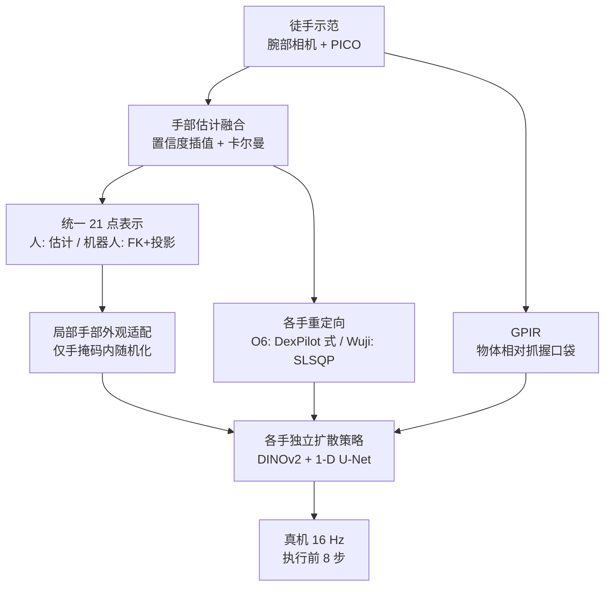
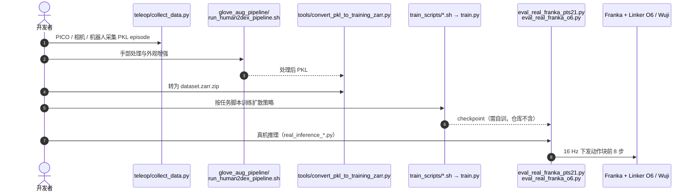

# Human2Dex：腕部视角人类示范驱动多只灵巧手

**Human2Dex**（[arXiv:2610.13119](https://arxiv.org/abs/2610.13119)，[项目页](https://human2dex.pages.dev/)，[代码](https://github.com/zgates2/Human2Dex_)）由北京智源人工智能研究院（BAAI）的 Jiachen Zhang、Yuanyuan Li、Shaqi Luo 提出：把人手示范里“与本体无关的观测和动作含义”与“各手执行细节”分开，让**一批自然徒手示范**可以训练不同灵巧手的策略。

## 一句话定义

**用腕部相机采集徒手示范，经统一 21 点手部表示对齐人机观测、按各手重定向生成可执行监督，并以抓握口袋（grasp pocket）坐标描述物体，分别训练各手的扩散策略。**

## 英文缩写速查

| 缩写 | 英文全称 | 简要说明 |
|------|----------|----------|
| GPIR | Grasp-Pocket Interaction Representation | 物体相对手中心抓握区域的几何描述，含质心偏移、对数面积比等 |
| FGP | Functional Grasp Pocket | 图像空间拇指与食指指尖中点 |
| DP | Diffusion Policy | 动作头采用 1-D U-Net 扩散策略目标 |
| MANO | hand Model with Articulated and Non-rigid defOrmations | 参数化人手模型，用于腕部 RGB 手部估计分支 |
| DDIM | Denoising Diffusion Implicit Models | 推理采样（16 步） |
| SLSQP | Sequential Least Squares Programming | Wuji 重定向的优化求解器 |

## 为什么重要

- **数据复用：** 灵巧手形态各异，每换一只重采示范成本高；该工作验证了“人手示范 + 各手重定向”的接口可行性（两只手、六个任务）。
- **观测对齐是主要增益来源：** 同一批数据仅从 Human-Raw 到完整配置，两只手合计成功率从 26.3% 到 85.8%。
- **物体表示的经验：** 以抓握口袋为参照的物体表示对抓握中心任务有帮助，对依赖局部结构的任务无益。

## 核心信息

| 项 | 内容 |
|----|------|
| **机构** | 北京智源人工智能研究院（BAAI） |
| **目标手** | Linker O6（6 主动关节）、Wuji（20 DoF）；各配标定腕部鱼眼相机 |
| **数据** | 1,899 条基础 episode、556,624 帧、6 任务；每条另渲染 3 个外观变体 |
| **开源** | 部分：GitHub 仓库含采集/处理/训练/真机推理代码，不含权重/数据（截至 2026-10-12） |

## 方法栈 / 流程总览

## 方法

**输入 / 输出：** 输入腕部相机图像、21 点手部表示与 GPIR；输出 9+d_r 维动作（O6 的 d_r=6，Wuji 为 20）的 16 步序列。

1. **手部估计：** PICO 追踪与腕部 RGB 手部模型（DINO 编码器，3D MANO 分支 + 2D 关键点分支）按置信度加权插值，再用自适应卡尔曼平滑。
2. **观测对齐：** 外观随机化只在手部掩码内，物体和背景不动；人与机器人共用同一关键点拓扑、配色和坐标约定，机器人关键点通过正运动学与固定手眼标定投影得到。
3. **重定向：** Linker O6 使用 DexPilot 风格目标（15 条几何向量，解 6 个主动关节）；Wuji 使用扩展目标，SLSQP 求解 20 DoF 配置。
4. **GPIR：** 以拇指-食指指尖中点为 pocket（指尖轨迹经因果三帧中值滤波），对每个被跟踪物体给出 pocket 相对质心偏移、对数面积比、跟踪置信度与记忆有效标志；训练期另有 masked Smooth-L1 辅助损失。
5. **策略：** DINOv2 ViT-B/14（Reg4）+ 1-D U-Net（256/512/1024），AdamW lr 3e-4，batch 32，一帧历史，50 训练步、16 DDIM 推理步；动作标签、归一化、检查点均按手区分。

## 实验与评测

六项真机任务，每任务每手 20 次（成功次数）：

| 配置 | Wuji | Linker O6 | 合计 |
|------|------|-----------|------|
| Human-Raw | 19/120（15.8%） | 44/120（36.7%） | 63/240（26.3%） |
| Human-Visual | 65/120 | 79/120 | 144/240（60.0%） |
| Human-Structured | 74/120 | 89/120 | 163/240（67.9%） |
| Human2Dex | 97/120（80.8%） | 109/120（90.8%） | 206/240（85.8%） |

- Wilson 95% 区间：Wuji 72.9–86.9%，O6 84.3–94.8%。
- **视角：** O6-Croissant（Human-Visual）腕部视角 6/20、头部视角 0/20；单手单任务诊断。
- **参考系：** O6 上 Croissant Human-Absolute 17/20 对 Human2Dex 18/20；Cup 9/20 对 16/20。
- **任务差异：** 增益集中在 Sponge/Croissant/Cup/Bottle；Egg Carton 与 Open Drawer 增益小或无。
- 论文自述逐级配置比较不能分离单个组件的因果效应。

## 源码运行时序图

官方仓库 [zgates2/Human2Dex_](https://github.com/zgates2/Human2Dex_)（归档：[sources/repos/human2dex.md](../../sources/repos/human2dex.md)）：

## 工程实践

- **开源核查（2026-10-12）：** 项目页链接了 GitHub，仓库真实存在，含约 1,000 个文件；运行数据、checkpoint、Zarr、SAM3 权重被 .gitignore 排除，配置含机器特定路径，必须自行改写；项目页称模型链接待定。未发现公开 checkpoint 或数据集。
- 硬件依赖较重：PICO 追踪、腕部鱼眼相机、Franka 加 Linker O6 / Wuji；标定脚本在 `scripts_real/`。
- 复用建议：先复现 Human-Visual 与 Human-Structured 的数据处理，再引入 GPIR，便于分项归因。

## 结论

**人手示范能否复用，主要取决于观测对齐与动作监督是否按本体处理，而不是用同一批原始人手图像直接训练。**

1. **Human-Raw 不够：** 未对齐的人手示范两只手合计仅 26.3%，完整配置 85.8%。
2. **各手单独训练：** 动作标签、归一化和策略都按手区分，共享的是示范与观测接口。
3. **腕部视角对此任务更有用：** O6-Croissant 单例诊断中头部视角 0/20。
4. **GPIR 适合抓握中心任务**，对依赖盖沿、把手的任务无增益。
5. **结论强度有限：** 两只手、六任务，无机器人示范基线，不能外推到任意形态。
6. **复现需自备数据与硬件**，仓库不含权重。

## 局限与风险

- 作者自述：仅两只标定拟人手与六任务；GPIR 依赖指定物体与可靠图像跟踪；视角对比只有单手单任务。
- 每任务示范数、逐任务数据量原文未报告。
- 开源状态为部分开源，无权重。

## 与其他工作对比

- **DexUMI：** 用外骨骼让人手采集贴近机器人手，见 [DexUMI](./paper-notebook-dexumi-using-human-hand-as-the-universal-manipul.md)；Human2Dex 则用徒手加观测对齐与重定向。仓库 README 亦说明其采集部分来自 DexUMI 代码线。
- **EgoDex：** 大规模第一视角灵巧操作数据，见 [EgoDex](./paper-notebook-egodex-learning-dexterous-manipulation-from-larg.md)；Human2Dex 的数据规模小得多（1,899 条）但直接服务具体机器人手。
- 重定向背景见 [运动重定向概念](../concepts/motion-retargeting.md)。

## 关联页面

- [34 篇空间落地技术地图（汇总页）](../overview/embodied-station-34-papers-spatial-grounding-technology-map.md)
- [操作任务](../tasks/manipulation.md)
- [遥操作](../tasks/teleoperation.md)
- [运动重定向](../concepts/motion-retargeting.md)
- [Diffusion Policy 方法](../methods/diffusion-policy.md)

## 参考来源

- [具身智能小站 34 篇盘点（2026-10-12）](../../sources/blogs/wechat_embodied_station_34_papers_spatial_grounding_2026-10-12.md)
- [Human2Dex 论文来源归档](../../sources/papers/human2dex_arxiv_2610_13119.md)
- [Human2Dex 项目页核查](../../sources/sites/human2dex-pages-dev.md)
- [Human2Dex 仓库归档](../../sources/repos/human2dex.md)

## 推荐继续阅读

- [Human2Dex arXiv 原文](https://arxiv.org/abs/2610.13119)
- [Human2Dex 项目页](https://human2dex.pages.dev/)
- [Human2Dex 官方仓库](https://github.com/zgates2/Human2Dex_)
