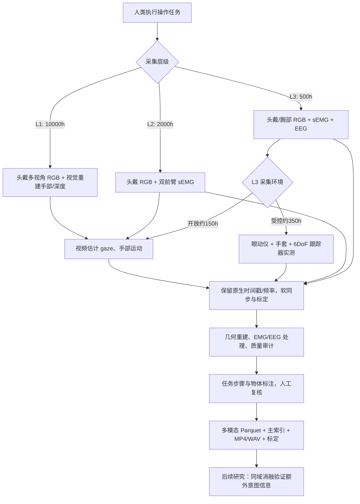
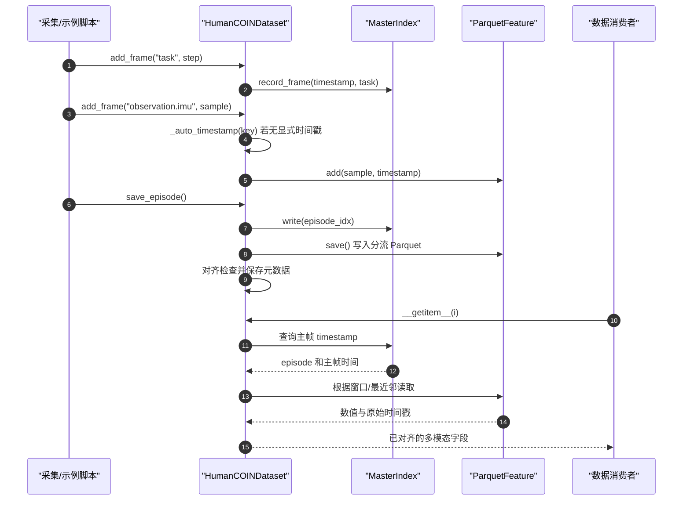

# HumanCOIN：12,500 小时第一视角操作意图代理 / Human Intent in Egocentric Manipulation

## 一句话定义

**HumanCOIN**（[arXiv:2611.26434v1](https://arxiv.org/html/2611.26434)）由**北京智源人工智能研究院（Beijing Academy of Artificial Intelligence，BAAI）**牵头，将第一视角操作中的注视（Gaze）、前臂表面肌电（sEMG）和脑电（EEG）按采集深度组织为 **12,500 小时**数据，用有时间戳的生理代理研究视觉—动作间的潜在意图；**并非所有 12,500 小时都同步实测三种传感器**。

## 英文缩写速查

| 缩写 | 英文全称 | 简要说明 |
|------|----------|----------|
| Ego | Egocentric | 第一人称头戴/腕部视频 |
| Gaze | Visual Gaze | 注视位置：大部分是视频模型预测 |
| sEMG | Surface Electromyography | 前臂表面肌电：L2、L3 实测 |
| EEG | Electroencephalography | 头皮脑电：仅 L3 实测 |
| 6-DoF | Six Degrees of Freedom | 头和腕部三维位置与姿态 |
| RGB-D | Red, Green, Blue, and Depth | 视觉颜色与深度 |
| VLA | Vision-Language-Action | 潜在的下游机器人策略方向 |
| ICA | Independent Component Analysis | EEG 降噪处理中的独立成分分析 |

## 核心信息

| 维度 | 论文/官方一手报告 |
|------|------------------|
| 论文 | [arXiv:2611.26434v1](https://arxiv.org/abs/2611.26434)，2026-11-19，预印本 |
| 机构 | 北京智源人工智能研究院（BAAI，牵头）、北京大学、清华大学等联合团队 |
| 规模 | 12,500 h、约 1.35B 主帧、6 个采集点、38 类场景、99 个任务动词、635 类物体 |
| 代码 | [FlagOpen/HumanCOIN](https://github.com/FlagOpen/HumanCOIN)，Apache-2.0 |
| 数据入口 | [HumanCOIN 数据组织](https://huggingface.co/HumanCOIN)、[数据门户](https://flagopen.github.io/HumanCOIN-DataManager/)；多数子仓 gated |
| 数据许可 | CC BY-NC 4.0，非商业使用 |
| 重定向就绪度 | 未验证：以人类手部/头部状态及生理代理为主，若用于目标机器人策略，需要核验坐标系、动作定义、骨架及具身约束，不能直接视为可部署控制轨迹 |
| 信息边界 | 论文是数据论文，尚未给出意图模态增强的机器人策略训练成功率/真机基准 |

## 为什么重要

普通 Ego 视频看到的是场景 `o` 与人手动作 `a`，看不清动作产生前的注意方向、肌肉负荷与皮层准备。HumanCOIN 将它们分别记录为 `m_gaze`、`m_emg`、`m_eeg`，用来检验在 `o` 之外是否对 `a` 有新增预测价值。**潜在意图 `z` 并没有被直接观测；生理信号与模型估计不是 `z` 的真值。** 论文建议比较 `p(a|o,m)` 与 `p(a|o)`，但明确**还未完成此项策略验证**。

## 三层模态构成（不要把累计读法当成独立时长）

| 采集层级 | 独立时长 | 全库占比 | Gaze | sEMG | EEG | 条件 |
|---|---:|---:|---|---|---|---|
| **L1 注意层** | **10,000 h** | 80% | 视频估计 | 无 | 无 | 自由场景、无脚本 |
| **L2 用力层** | **2,000 h** | 16% | 视频估计 | 双前臂实测 | 无 | 任务单、开放采集 |
| **L3 认知层** | **500 h** | 4% | 受控组实测、开放组估计 | 双前臂实测 | 实测 | ≈350 h 受控 + ≈150 h 开放 |

由此实际的**肌电覆盖 = 2,000 + 500 = 2,500 h（20%）**；**脑电覆盖 = 500 h（4%）**；**眼动仪直接测注视仅受控 L3 约 350 h（2.8%）**。不同层级的设备配置递增，**不是同一批 10,000 小时录像逐次加上传感器**；不同层的场景/任务/姿态也不保持同分布（L1/L2/L3 场景数为 38/21/9）。

## 流程总览

依据论文 §3–5、附录设备/存储布局绘制的是**采集–处理–组织流程**，不是“已经学出了意图控制策略”的训练流程。

图中的 L3 分支需要受控/开放条件区分；EMG/EEG 预处理不会将原始脑信号变成精确“想法标签”。

## 核心原理

### 1. 注意与用力是间接可见的信号，不等于物理力真值

- L1/L2/开放 L3 的 gaze 用基于 EgoM2P 的视觉模型估计（30 Hz）；受控 L3 的眼动仪数据为约 200 Hz，二者需按各自像素域与标定变换映射后比较。
- EMG 为每臂 8 通道、2 kHz 生理电活动（并发布滤波/包络）；其变化与肌肉激活有关，**不是直接测出抓取力或物体接触力**。
- EEG 开放配置为低密度 8 通道，受控配置可为 32/128 通道（250Hz/1kHz），清洗过后仍存在运动伪迹；L3 受控准备/想象/执行阶段有事件标记。
- 视频重建深度、双手姿态和点云与受控 L3 直接传感不同，跨层时需把“预测/实测”身份作为元数据。

### 2. 多频原样保存：统一查询时间轴，不假装传感器同频

- 各路保留原生频率与时间戳，通过 host 到达偏移、标定与事件标记进行**软同步**，不是所有传感器硬件锁相。
- 图像按 raw/rectified 两套保留、立体深度与手部运动由模型重建；电生理原始及清洗版本并存。
- 读数据时围绕 `master_index.parquet` 主帧查询各路时间戳，可选最近邻、窗口聚合、插值，避免预先强制降采样。

## 源码运行时序图

已核对官方 `src/humancoin/dataset.py`、`index.py`、`parquet.py`、`examples/01read_simple.py` 和官方 README。以下**仅是实际数据读写 SDK 调用**，不是作者生理信号推断模型的训练过程。

官方示例：`pip install -U "humancoin>=0.1.1"`，在克隆源码目录中先 `python -m examples.01write_simple`，再 `python -m examples.01read_simple`；或对已下载真实数据使用 `humancoin-visualize-web <task-directory>`。数据仓库多数需要申请权限。

## 实验与评测（论文实际报告）

- **覆盖/标注**：12,500 h，约 1.35B 主帧，38 场景（五个功能区+残差类）、99 任务动词、46 运动动词、635 物体类别；L3 只有 9 类场景，不能把所有层级当均匀覆盖。
- **验证参考**：受控 L3 的直接 gaze/手部追踪是估计的误差测量参考，但不是 `z` 的真实标签。
- **同步审计**：附录报告部分运动姿态存在重复时间戳、摄像头容器与时间戳表帧数不一致，数据消费者应以 timestamp 表为准。
- **尚缺**：没有执行 `p(a|o,m)` 与 `p(a|o)` 同域策略消融，没有真机成功率提升结论，没有跨采集地点的稳健策略验证。

## 与其他工作对比

| 对照数据路线 | 核心差异 | 实际使用边界 |
|---|---|---|
| [EgoVerse](./paper-egoverse.md) | 人类第一视角示教与跨具身共训侧重手/头位姿和任务覆盖；HumanCOIN 重点增加分层的注意、肌肉和脑电代理 | 两者的时长及标注/真实传感覆盖口径不同，不能直接比较“机器人可用动作小时数” |
| [HumanNet](./humannet.md) | 大规模第一、第三人称混合人中心语料；HumanCOIN 强调有时间戳的多频生理信号 | HumanNet 总视频规模不等于相同模态的实测规模 |
| [OpenTouch](./dataset-opentouch.md) | 全手触觉提供手–物接触观测；HumanCOIN 的 EMG 反映前臂肌肉活动 | EMG 不能替代触觉或接触力标定；二者是互补测量而非同一种标签 |

## 结论

**HumanCOIN 的贡献是把“谁注意哪里、如何准备出力、何时出现皮层准备”变成可对齐和消融的多模态数据问题，而不是已实现的人类意图解码器。**

1. 所有结果必须标注模态覆盖：Gaze 大多预测；EMG 仅 2,500h；EEG 仅 500h。
2. 实测 gaze/手部运动主要来自 350h 受控 L3；不能用 L1 预测字段充当眼动仪真值。
3. 比较模态价值时控制任务/场景/操作者分布，否则 L1→L3 的提升或退化混有分布变化。
4. 下载前确认子仓是否 gated、数据协议与 `ds.meta.features`，代码 Apache-2.0 并不解除数据非商用约束。
5. 研究应先做同域动作预测/提前量基线和数据质量审计，再考虑人–机映射与策略训练；论文没有证明下游增益。

## 工程实践

- **抽样审计**：按 L1/L2/L3 及受控/开放子层分层取样，记录 `gaze` 的 `estimated/measured`、各生理流 channel、Hz、空窗、事件标记和时间对齐误差。
- **训练前置**：从受控 L3 的眼动仪/跟踪器监督估计器误差，再对齐 L1/L2；同时测量 EMG 包络提前于动作的时间窗与任务依赖性。
- **格式边界**：数据流分 Parquet 保存且可在读时按窗口采样；若对接 LeRobot 或 VLA 训练，务必区分 **人类手姿态** 与 **机器人可执行动作空间**。
- **可运行入口**：官方有读写、下载、浏览器可视化工具，**不是官方已开源完整意图条件机器人策略训练基准**；源码核对见 [SDK 归档](../../sources/repos/humancoin-dataset-sdk.md)。
- **开放性**：代码 Apache-2.0，数据 CC BY-NC 4.0 且多数子数据仓库 gated； [项目发布核对](../../sources/sites/humancoin-official-project.md) 说明项目首页读取限制。
- **论文/README 差异**：论文将额外腕视角列在 L3 仪器集，README 表格在 L2 行也列腕视角；**按所选下载数据的 `meta/features` 实际字段核验**，不统一假设。

## 局限与风险

- 代理信号 `m` 只是不完整且含噪的意图线索，不能反演 `z`；EMG 并不直接提供物体真实接触力/所需机器人力矩。
- 层级间环境、对象、姿态、脚本和硬件不同；L3 仅 4% 时长且偏受控，存在分布与代表性限制。
- 开放场景 EEG 运动伪迹难完全去除；相机异构、对齐审计中的时间戳问题需研究者自行判别。
- 缺少证明意图代理确实增强策略/真实机器人部署的基准；论文将其定位为研究假设。

## 关联页面

- [Ego 数据采集专题](../overview/ego-category-01-data-collection.md) — 第一人称多模态采集与人类示教谱系
- [机器人数据监督类型分流](../concepts/robot-data-supervision-signal-types.md) — 不能把意图代理、手部轨迹和机器人动作标签混作一种监督
- [EgoVerse](./paper-egoverse.md) / [HumanNet](./humannet.md) — 人类演示语料与跨本体监督路线比较
- [OpenTouch](./dataset-opentouch.md) — 触觉实测与肌电代理的差异
- [Imitation Learning](../methods/imitation-learning.md) — 加入生理代理前需要解决输入/动作空间的具身对齐
- [Auto-labeling Pipelines](../methods/auto-labeling-pipelines.md) — 对照数据集的动作/任务标签自动生成与人工复核步骤
- [Manipulation 机器人操作任务](../tasks/manipulation.md) — 人类第一视角操作的观测、动作与接触约束需经过任务和本体映射
- [具身数据纵深 Stage 1](../../roadmap/depth-embodied-data.md) — 数据采集传感模态选型

## 参考来源

- [论文 v1 逐节原文归档](../../sources/papers/humancoin_human_intent_egocentric_manipulation_arxiv_2611_26434.md)
- [官方项目、数据门户与许可核对](../../sources/sites/humancoin-official-project.md)
- [官方 SDK README/关键源码核对](../../sources/repos/humancoin-dataset-sdk.md)
- [原论文 HTML](https://arxiv.org/html/2611.26434)
- [官方 GitHub](https://github.com/FlagOpen/HumanCOIN)

## 推荐继续阅读

- [HumanCOIN 官方文档](https://flagopen.github.io/HumanCOIN-Doc/)
- [HumanCOIN 数据门户](https://flagopen.github.io/HumanCOIN-DataManager/)
- [HumanCOIN 论文 PDF](https://arxiv.org/pdf/2611.26434)
- [HumanCOIN 发布仓库](https://github.com/FlagOpen/HumanCOIN)
