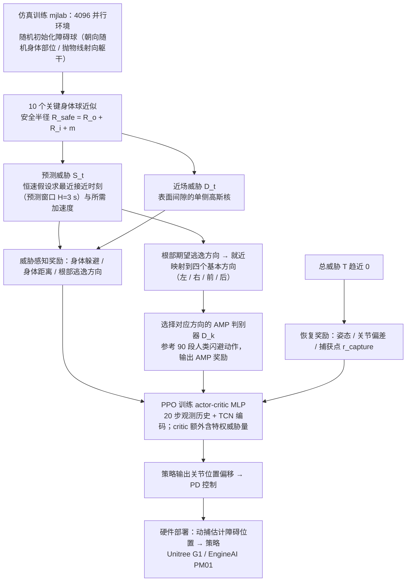

# Humanoid Dodgeball：人形躲避球：快速动态障碍规避动作学习

**Humanoid Dodgeball**（*Humanoid Dodgeball: Learning Fast Dynamic Obstacle Avoidance Motions for Humanoids*，[arXiv:2610.40003](https://arxiv.org/abs/2610.40003)）收录于 senlanke「具身运控lab」10-26–10-30 前沿论文动态（人形/四足）。本页依据**周报条目 + arXiv 摘要页**整理，未逐页核对正文 PDF；指标与结论以论文为准。

## 一句话定义

**Humanoid Dodgeball：人形躲避球：快速动态障碍规避动作学习——使用威胁感知奖励训练反应式 RL 策略，并用多个方向特定的对抗动作先验约束闪避动作；在 EngineAI PM01 上验证跨速度、跨发射距离的前跨和后跳闪避。**

## 英文缩写速查

| 缩写 | 英文全称 | 简要说明 |
|------|----------|----------|
| RL | Reinforcement Learning | 强化学习 |
| WBC | Whole-Body Control | 全身控制 |

## 为什么重要

- 周报所述待解决的问题：面对快速飞来的物体，人形机器人必须在很短时间内完成全身闪避，同时保持平衡和动作自然性。

## 流程总览

图依据：论文 §III-A–D / Fig. 2。

## 核心机制

| 项 | 内容 |
|----|------|
| **arXiv** | [2610.40003](https://arxiv.org/abs/2610.40003) · [PDF](https://arxiv.org/pdf/2610.40003) |
| **作者（arXiv）** | Zhang, Aoqian, Wang, Chunzheng, Chen, Haoran, Tang, Annan, Xiang, Cheng, Shi, Fan, Ge, Shuzhi Sam |
| **机构（周报所述，未逐条核实）** | 新加坡国立大学、众擎机器人、大连理工大学 |
| **arXiv 评论栏** | （无） |
| **开源** | arXiv 摘要页与评论未见代码或项目页链接（仅核对 arXiv 摘要页，不代表未发布）（2026-11-02） |
| **周报所述创新点** | 使用威胁感知奖励训练反应式 RL 策略，并用多个方向特定的对抗动作先验约束闪避动作；在 EngineAI PM01 上验证跨速度、跨发射距离的前跨和后跳闪避。 |

### arXiv 摘要节选（英文原文）

> Humanoids have become increasingly agile and capable in real-world environments. To operate safely in dynamic scenarios, they must rapidly evade fast-moving obstacles while maintaining stability and physically feasible whole-body motion.

## 源码运行时序图

**不适用**：arXiv 摘要页与评论未见代码或项目页链接（仅核对 arXiv 摘要页，不代表未发布），无可对齐的官方代码流程。

## 实验与评测

- 周报与摘要给出的数字/场景已写入上表「创新点」与摘要节选；其余实验细节、基线与成功率定义请回到论文正文。
- 读法：先对齐任务设定、传感器与成功定义（仿真/真机），再解读 headline 数字，勿跨论文直接比较。

## 与其他工作对比

| 维度 | 读法 |
|------|------|
| **同周对照** | 见 [人形/四足周报技术地图](../overview/senlanke-weekly-2026-10-26-30-humanoid-quadruped-technology-map.md)，按方向浏览同期论文 |
| **开源状态** | arXiv 摘要页与评论未见代码或项目页链接（仅核对 arXiv 摘要页，不代表未发布） |

## 结论

**Humanoid Dodgeball：人形躲避球：快速动态障碍规避动作学习。**

1. 本页是入库级摘要，复现前请核对论文正文、附录与代码仓库。
2. 指标须连同实验条件解读。
3. 关注 arXiv 版本更新与代码发布。

## 关联页面

- [senlanke-weekly-2026-10-26-30-humanoid-quadruped-technology-map](../overview/senlanke-weekly-2026-10-26-30-humanoid-quadruped-technology-map.md)
- [humanoid-locomotion](../tasks/humanoid-locomotion.md)
- [reinforcement-learning](../methods/reinforcement-learning.md)

## 参考来源

- [humanoid-dodgeball-dynamic-obstacle-avoidance_arxiv_2610_40003.md](../../sources/papers/humanoid-dodgeball-dynamic-obstacle-avoidance_arxiv_2610_40003.md)
- [wechat_senlanke_weekly_humanoid_quadruped_2026-10-26_30.md](../../sources/blogs/wechat_senlanke_weekly_humanoid_quadruped_2026-10-26_30.md)
- [arXiv:2610.40003](https://arxiv.org/abs/2610.40003)
- [arXiv PDF](https://arxiv.org/pdf/2610.40003)：已通读全文：方法 §III（威胁感知奖励、方向特定 AMP、训练细节）与 Fig. 2；仿真与硬件实验设定

## 推荐继续阅读

- [arXiv PDF](https://arxiv.org/pdf/2610.40003)
