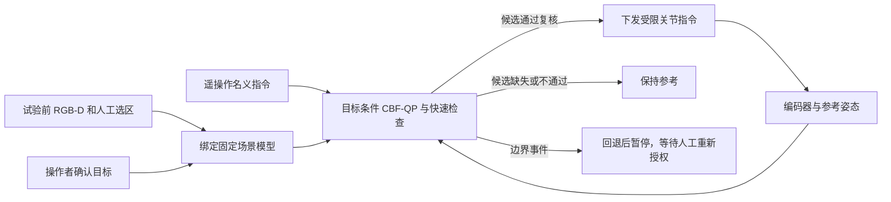

# 人形机器人电气开关遥操作：感知辅助的运行时约束滤波 / Humanoid Robots for Safety-Critical Electrical Switching: A Perception-Informed Runtime Constraint Filter

## 一句话定义

在操作者的名义手臂指令和机器人执行之间加一道目标条件 CBF-QP，尽量保留原指令，同时限制腕部工具接近非目标设备或墙面；论文验证的是断电实验架。

## 英文缩写速查

| 缩写 | 英文全称 | 简要说明 |
| --- | --- | --- |
| CBF | Control Barrier Function | 用工具与环境的模型间距定义允许的运动 |
| QP | Quadratic Program | 在约束下找最接近操作者意图的指令 |
| VR | Virtual Reality | 操作者发出手臂动作的接口 |
| RGB-D | Red, Green, Blue and Depth | 试验前提供彩色图和深度以建立场景模型 |
| KKT | Karush–Kuhn–Tucker | 论文用于复核快速候选解的最优性条件 |

## 为什么重要

遥操作完成目标动作和避免碰到旁边设备是两种指标。在空间拥挤时，只统计目标操作成功会漏掉误触；只报求解器速度也会漏掉感知误差、姿态跟踪滞后和控制保持。

| 项 | 内容 |
| --- | --- |
| 机构 | 佛罗里达大学、北卡罗来纳大学夏洛特分校、宾夕法尼亚州立大学 |
| 文献状态 | arXiv:2611.27845v1，预印本 |
| 真机与仿真 | Unitree G1 断电台架使用刚性腕部工具；仿真使用三指手与真值几何 |

## 核心原理

1. **目标条件场景模型。** 在每个站位预先采集头部 RGB-D，根据人工选取区域拟合定向包围盒；操作者指定目标，真机滤波将整个目标组件从本项环境限制中移除，保留非目标组件与墙面。控制周期使用固定模型，不做逐帧场景重建。
2. **最小修改与异步检查。** CBF-QP 用工具头相对几何和原生关节限制约束关节速度。先检查名义指令和快速候选；后台结果不能直接作为新指令，仍要以当前问题复核。下发前重验预测的下一姿态，求解或几何检查未给出可接受候选则保持。
3. **保持与回退不是同一状态。** 约束保持复用上一参考；边界回退是独立路径，完成后仍暂停，须由操作者重新授权。仿真另加部件级接触权限和按任务阶段变化的方向限制，真机没有验证这两项扩展。

### 流程总览

## 工程实践

- 作为仿真或断电测试台的验收思路，分别记录任务完成、非目标接触、实测与参考姿态偏差、控制周期超时、保持时长及恢复方式；不能用单个成功率代替。
- **源码运行时序图：不适用。** 未核实到本项目可运行代码仓或配套开源数据，流程图来自论文本身；数据声明为按请求提供，未做运行复现。

## 评测

| 设置 | 论文报告 | 口径 |
| --- | --- | --- |
| 真机断电台架 | **10/12** 完成；固定目标 **10/10**；12 次均无非目标动作或意外接触 | 两站位各六轮；两次未完成都是改选另一开关的轮次，另有 11/12 自动回退 |
| 三指手仿真 | 完整滤波 **9/9**，原始遥操作 **5/9** 安全完成 | 三布局 × 三输入，各方法用相同初态和输入；还要求撤回、无未授权接触、无超时或不稳定 |
| 真机运行时 | QP 平均约 **0.5 ms**；主循环工作最大 **36.8 ms** | 50 Hz 为名义频率，并非延时保证；最长保持 **61.38 s** 是几何检查阻塞，不是 QP 耗时 |

## 对比与消融

仿真中只放行整个目标组件和删去方向限制的两组均为 **6/9** 安全完成，失败方式却不同：前者能完成动作但出现未授权接触，后者有些轮次未完成。两项扩展使用仿真真值和三指手，不能将收益归给真机刚性工具实验。

## 局限与风险

- 真机只在断电、壁挂式通用开关台架测试，未验证变电站设备、带电工况、弧闪或电磁环境，也不替代现场资格、目标辨识和安全程序。
- 50 mm 是几何模型里的参考边界，不是实物净距承诺。编码器位姿计算出的模型间距最小为 **49.04 mm**；场景估计误差和执行滞后还会影响实际间距。
- 固定模型的时效、可达性和异常保持恢复均有限：论文的长保持需人工返回，说明低求解时延不能证明故障恢复可靠。

## 结论

**这篇论文验证了对人类指令加独立几何约束的可行性，而不是验证人形机器人可以进行带电作业。**

- 真机任务完成和非目标接触应分别报告，改选目标的失败不能从总分母删除。
- 真实调试应区分参考姿态、编码器模型估计与实际接触证据。
- 运行时性能同时看求解、循环截止时间和故障恢复，不能只看平均 QP 时间。

## 关联页面

- [遥操作](../tasks/teleoperation.md) · [机器人操作](../tasks/manipulation.md)
- [控制屏障函数](../concepts/control-barrier-function.md) · [安全滤波器](../concepts/safety-filter.md)
- [安全控制纵深路线](../../roadmap/depth-safe-control.md)

## 参考来源

- [预印本全文与实验口径核对归档](../../sources/papers/humanoid_electrical_switching_arxiv_2611_27845.md)

## 推荐继续阅读

- [论文原始 HTML（含原图）](https://arxiv.org/html/2611.27845v1) · [论文 PDF](https://arxiv.org/pdf/2611.27845v1)
- [Control Barrier Functions: Theory and Applications](https://arxiv.org/abs/1903.11199)
