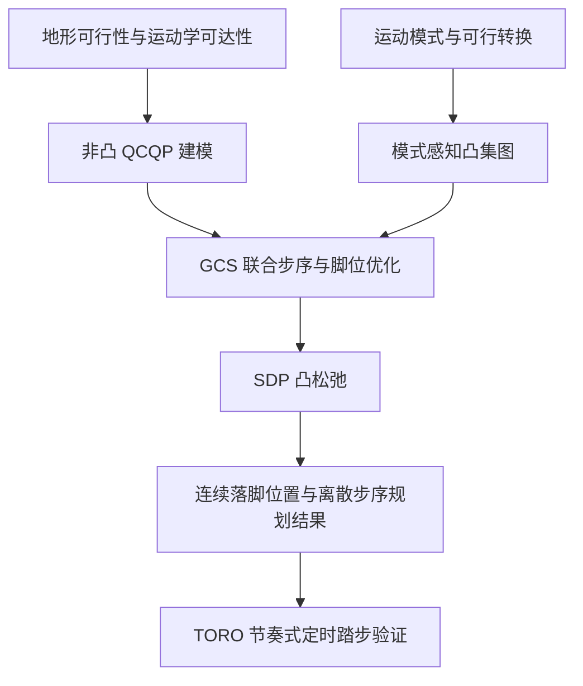

# Humanoid Footstep Planning using Graphs of Convex Sets / 基于凸集图的人形机器人步位规划

## 一句话定义

**把“下一步迈哪只脚、采用何种可行转换”和“脚具体落在哪里”放进同一个 Graphs of Convex Sets（GCS）规划框架，通过凸松弛寻找符合地形与运动学限制的步位序列。** 这篇论文发表于 IEEE RA-L 2026，作者为 Hyunseok Kim、George Mesesan、Robert Schuller、Jinoh Lee、Hae-Won Park（[DOI](https://doi.org/10.1109/LRA.2026.3746865)）。

> **阅读状态：草稿。** 截至 2026-11-10 仅核对论文书目信息和公开摘要；未获得可通读的论文全文，官方项目与源码链接也未核实。下列方法图为**摘要级逻辑整理**，不代表论文正式架构图或源码执行顺序。

## 英文缩写速查

| 缩写 | 英文全称 | 简要说明 |
|------|----------|----------|
| GCS | Graphs of Convex Sets | 以凸集节点与可行转换边组织离散、连续决策的规划表述 |
| QCQP | Quadratically Constrained Quadratic Program | 表达地形可行性与运动学可达性的非凸约束优化问题 |
| SDP | Semidefinite Programming | 论文使用的凸松弛技术 |
| RA-L | IEEE Robotics and Automation Letters | 发表期刊 |

## 为什么重要

传统离散步点搜索需要枚举落脚候选；纯连续位置优化又需要处理迈步模式等离散决策。本文把二者连起来：将候选运动模式编码为图上的可行转换，并让每个模式下的脚位置仍可在连续凸域内优化。摘要明确强调在时间预算内求解与真实人形机器人的验证，因而与 [Footstep Planning](../concepts/footstep-planning.md) 的在线落脚问题直接相关。

## 核心信息

| 项目 | 内容 |
|------|------|
| 论文 | *Humanoid Footstep Planning using Graphs of Convex Sets* |
| 作者 | Hyunseok Kim；George Mesesan；Robert Schuller；Jinoh Lee；Hae-Won Park |
| 机构 | 韩国科学技术院（KAIST）Dynamic Robot Control and Design Laboratory；其他作者归属待全文核对 |
| 出版 | IEEE Robotics and Automation Letters，2026；DOI: 10.1109/LRA.2026.3746865 |
| 规划变量 | 离散步序／运动模式与连续落脚位置（由摘要确认） |
| 真机平台 | 力矩控制人形机器人 TORO；节奏式定时踏步任务 |
| 开源状态 | **待核实**：用户给出的项目页及源码 URL 被截断；未验证可运行仓库 |

## 核心原理

### 1. QCQP 约束建模

公开摘要表述为先建立**非凸 QCQP**，编码可落脚地形区域和人形机器人的运动学可达性。由此可将规划问题理解为“落脚点必须安全且从当前支撑配置能够达到”，但**具体优化变量、二次型矩阵及约束数量尚未全文核实**。

### 2. 带运动模式语义的凸集图

图中每个节点代表绑定某一 locomotion mode 的运动学可行凸区域；相邻节点之间的边表示可行模式转换。因此，**选择边／节点路径**与**优化凸区域内部的连续脚位置**可以放在同一个框架中处理，而不必预设一条离散步序。

### 3. GCS 与 SDP 松弛

作者将 QCQP 和模式感知图组织为 GCS 问题，并应用 SDP 获取凸松弛。摘要声称不要求事先给定离散路径或连续变量初始值。**尚不可推断**松弛必然是精确解、求解过程全局最优，或具体采用的路径恢复与后处理算法。

## 流程总览

以下仅将公开摘要所明确的先后关系绘制为 Mermaid；没有全文支持的系统接口不纳入图中。

## 源码运行时序图

**不适用（当前无法核验代码入口）。** 原始介绍附有截断的 GitHub 链接，但无法确认具体仓库地址、README、训练／求解入口、模块调用关系，因此不绘制臆造的 `sequenceDiagram`。取得官方源代码后需要补读具体求解与 TORO 执行接口。

## 工程实践

| 复现问题 | 当前可确认内容 / 尚待核对内容 |
|----------|----------------------------|
| 地形输入 | 需可行落脚区域；地形表达、凸分解和不确定性处理未知 |
| 运动学 | 需满足步间可达性；约束参数与机器人配置未知 |
| 图构造 | 节点为带模式的可行凸区域，边为可行转换；具体枚举规模未知 |
| 求解器 | 使用 SDP 凸松弛；软件实现、后处理和数值容差未知 |
| 时序 | 摘要报告在严格时间预算内规划；具体毫秒数不可核实 |
| 上机 | 在 TORO 节奏式踏步验证；控制周期、执行接口和感知闭环细节未知 |

## 实验与评测

- **数值基准**：论文介绍称包含 numerical benchmarks，但目前没有通读论文表格，不记录领先幅度、最优性间隙或耗时指标。
- **硬件实验**：公开摘要报告力矩控制人形机器人 TORO 上的节奏式定时踏步。这里只能确认存在硬件验证，不能推论对未知粗糙地形的泛化或实际长期稳定性。
- **在线能力**：摘要给出满足 real-time budgets 的定性结论；用户原文提到高效重规划，但具体重规划触发机制与频率仍待核对。

## 与其他工作对比

| 方法 | 离散决定 | 连续落脚 | 本文可确认的区别 |
|------|----------|----------|------------------|
| 传统离散步点搜索 | 在候选落脚点间搜索 | 候选集限制位置精度 | GCS 在凸区域内保留连续变量 |
| 一般连续轨迹优化 | 通常需固定模式或处理混合决策 | 直接连续优化 | GCS 图显式表达运动模式转换 |
| **本文 GCS + SDP** | 凸集图上的可行转换 | 每个凸区域中的脚位置 | 摘要声明可不预设路径与连续初值 |
| [FastStair](./paper-faststair-humanoid-stair-ascent.md) | DCM 离散搜索提供落脚监督 | RL 策略执行 | FastStair 主要用于训练期落脚引导，而本研究是显式在线优化框架 |

**注意：** 上表是规划范式的概念对照，**不是论文原始性能基准或优劣排名**。

## 结论

**摘要支持 GCS 将人形落脚的离散序列与连续位置优化统一建模，并已在 TORO 上做真实硬件验证；完整性能判断仍依赖原文。**

1. **选择路径和位置不能拆开评估**：应同时检查模式转换可行性与足端工作空间约束。
2. **凸松弛不是精确性的保证**：复现时应检查松弛间隙、路径恢复后的约束可行性。
3. **实时结论必须看分布**：需要逐场景比较规划耗时分位数、失败率和截止时间违约情况。
4. **真机验证不等于全地形泛化**：TORO 节奏踏步任务的条件边界待全文明确。
5. **源码入口尚未确定**：不能将通用 GCS 库视作本文官方实现。

## 局限与风险

- **全文未通读**：具体数学式、实验参数、统计指标、消融和作者自身局限未核实；本文节点保持 `status: draft`。
- **官方资源 URL 截断**：未找到可可靠归属的项目页与源码仓，无法判断是否开源或复现许可；不将“无法验证”写为“确认未开源”。
- **模型边界**：摘要只证实地形与运动学可达性，不能凭此断言全面考虑接触力、动力学稳定、碰撞或感知不确定性。
- **数值边界**：没有来自全文的耗时、任务成功率、求解器与消融表，禁止虚构对比百分比。

## 关联页面

- [Footstep Planning](../concepts/footstep-planning.md) — 步位规划任务与其他路线的总览
- [Capture Point / DCM](../concepts/capture-point-dcm.md) — 反应式落脚与稳定性的对照
- [Terrain Adaptation](../concepts/terrain-adaptation.md) — 地形可行区域的上游输入
- [Model Predictive Control](../methods/model-predictive-control.md) — 另一类在线预测优化框架
- [Humanoid Locomotion](../tasks/humanoid-locomotion.md) — 下游步行控制任务

## 参考来源

- [本论文来源归档](../../sources/papers/humanoid-footstep-planning-gcs-ral-2026.md) — 标明仅摘要级核查与未完成项
- [论文 DOI（IEEE RA-L）](https://doi.org/10.1109/LRA.2026.3746865) — 论文原始出版入口（全文目前不可读）
- [DRCD Lab 官方网站](https://www.dynamicrobot.kaist.ac.kr/) — KAIST 实验室主页

## 推荐继续阅读

- [论文 DOI](https://doi.org/10.1109/LRA.2026.3746865) — 后续获取全文和补核公式、实验的主入口
- [Footstep planning on uneven terrain with mixed-integer convex optimization（MIT）](https://dspace.mit.edu/entities/publication/394a432f-d7f2-4061-b8ca-86c4996110d6) — 离散与连续混合规划的经典对照
