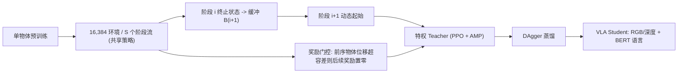

---

type: entity
tags: [paper, humanoid, loco-manipulation, rl, long-horizon, dagger, vla, amp, university-of-manchester, ustc, x-humanoid, warwick, newcastle]
status: complete
updated: 2026-10-14
arxiv: "2610.08320"
project_id: humanoid-horizon-long-horizon-loco-manipulation
project: https://haozhuo-zhang.github.io/Humanoid-Horizon-project-page/
related:
  - ../overview/frontier-humanoid-quadruped-2026-10-05-10-09.md
  - ../tasks/loco-manipulation.md
  - ./paper-bfm-38-tokenhsi.md
  - ./paper-bfm-15-intermimic.md
  - ../methods/dagger.md
  - ../methods/teacher-student-dagger-training.md
  - ../methods/vla.md
  - ../overview/embodied-station-2026-10-13-34-papers-technology-map.md
sources:
  - ../../sources/papers/humanoid_horizon_arxiv_2610_08320.md
  - ../../sources/sites/humanoid_horizon_project.md
  - ../../sources/blogs/frontier_humanoid_quadruped_2026_10_05_10_09.md
  - ../../sources/blogs/wechat_embodied_station_34_papers_mulligan_2026-10-13.md
summary: "Humanoid Horizon（arXiv:2610.08320）：曼彻斯特大学/中科大/X-Humanoid 等用并行阶段流、动态起始与奖励门控训练多物体搬运单策略，LHM-Humanoid 两物体 SuccAll 80.4%（LHM-Humanoid 71.1%），五物体 60.2%（18.1%）；DAgger 蒸馏出 RGB/深度+语言 Student；项目页无代码。"
---

# Humanoid Horizon：用并行训练、动态起始与奖励门控扩展全身移动操作时域

**Humanoid Horizon**（[arXiv:2610.08320](https://arxiv.org/abs/2610.08320)，[项目页](https://haozhuo-zhang.github.io/Humanoid-Horizon-project-page/)）面向「在杂乱室内连续搬运多个物体、中间不重置」的人形 loco-manipulation：把多物体任务拆成共享参数的阶段流并行训练，用上游终止状态给下游初始化，并以奖励门控防止后期学习破坏已放置物体；最后用 DAgger 把特权 RL Teacher 蒸馏成只用视觉和语言的 Student。

## 一句话定义

**让一个策略的每个阶段都持续拿到梯度（并行训练），让后阶段从真实的前阶段终态起步（动态起始），并在已放置物体被碰动时切断后续奖励（奖励门控）。**

## 英文缩写速查

| 缩写 | 英文全称 | 简要说明 |
|------|----------|----------|
| HH | Humanoid Horizon | 本文方法 |
| LHM | Long-Horizon Manipulation（基准名 LHM-Humanoid） | 多物体取-搬-放基准 |
| AMP | Adversarial Motion Priors | 判别器奖励，权重 1.0 |
| DAgger | Dataset Aggregation | Teacher→Student 蒸馏算法 |
| VLA | Vision-Language-Action | Student 形式：视觉+语言→动作 |
| PPO | Proximal Policy Optimization | Teacher 训练算法 |
| DS / RG | Dynamic Starting / Reward Gating | 消融对象 |

## 为什么重要

- 一般 RL 在长序列中会偏向前期易得奖励并遗忘后期；该文把「时域」直接当作可扩展的训练变量。
- 去掉任一机制，五物体 SuccAll 从 60.2% 掉到 49.8%（无动态起始）或 38.9%（无门控），说明两者互补。
- 给出从特权 Teacher 到 RGB/深度+语言 Student 的完整路径，但仅限仿真。

## 核心信息

| 项 | 内容 |
|----|------|
| 机构 | 曼彻斯特大学；中国科学技术大学；X-Humanoid；华威大学；纽卡斯尔大学 |
| 平台 | 15 刚体 28 DoF 人形，IsaacGym，30 Hz 控制，2×A100 80GB |
| 基准 | LHM-Humanoid：350 场景 + 66 未见场景，79 类物体 |
| 开源 | 项目页**未列**代码（截至 2026-10-12） |

## 流程总览

## 方法

- **并行训练：** 16,384 环境均分给 S 个阶段流，共享参数；第 1 流用原始初态，其余流从缓冲 B_i 取初态。
- **动态起始：** 每 epoch 末以阶段 i 的终态覆盖 B_{i+1}（Eq. 1–2），使下游覆盖真实的阶段边界状态。
- **奖励门控：** 阶段 i>1 中，若前一物体离目标超过 ε，其后奖励清零（Eq. 3，ε 数值未在读取到的正文中给出）。
- **奖励：** 八项塑形项（接近速度/位置各 0.1、抓取接近 0.1、抬升 0.1、搬运速度 0.2、路点距离 0.2、目标接近 0.1、目标朝向 0.1）+ AMP 判别器奖励 1.0。
- **Teacher：** 250 维特权状态 + 200 点基点集；actor/critic MLP 1024-1024-512；PPO lr 5e-5、γ 0.98、最多 16,000 epoch。
- **Student：** 223 维本体感知 + 256×256 RGB/深度 + 冻结 BERT-base 语言（768 维）+ 上一步动作，EfficientNet-B0，输出 28 维；DAgger 30,000 epoch，MSE 对齐 Teacher。

## 实验与评测

| 设置 | HH | 对比 |
|------|----|------|
| 350 训练场景 SuccAll | 80.4% | LHM-Humanoid 71.1；Curriculum RL 47.2；HumanVLA 29.9；TokenHSI 27.6；InterMimic 7.5 |
| 66 未见场景 SuccAll | 78.0% | LHM-Humanoid 61.6；Curriculum RL 39.5 |
| 五物体 SuccAll | 60.2% | LHM-Humanoid 18.1（五教师 25.8）；无动态起始 49.8；无门控 38.9；Curriculum RL 3.2 |
| VLA Student SuccAll | RGB 75.6% / 深度 73.7% | LHM-Humanoid 63.7；无动态起始 51.4；无门控 58.6 |

- 距离指标：350 场景 Dist1/Dist2 为 0.06/0.38 m（LHM-Humanoid 0.28/0.50）。
- 单物体阶段成功率 Succ1：96.6%（训练）/97.1%（未见）。
- 种子方差（训练期指标）：SuccAll 87.6±0.3%；训练阈值 0.1 m 比评测 0.2 m 严格，不可与评测数字直接比较。

## 源码运行时序图

不适用：项目页与论文均未提供代码仓库，截至 2026-10-12 无可对齐的目录或脚本。

## 工程实践

| 项 | 建议 |
|----|------|
| 长序列 RL | 先单阶段预训练，再按阶段流并行；用缓冲存放上游终态 |
| 防遗忘 | 对前序物体设位移容差并清零后续奖励 |
| 蒸馏 | DAgger β 0.998 起指数衰减，558 环境、回放 100k |
| 复现 | 无官方代码；基准 LHM-Humanoid 来自前作，需自行获取 |

## 结论

**对长时域人形搬运，训练分布设计（并行阶段 + 真实边界初态 + 奖励门控）比增加专家数更能拉住后期成功率。**

1. **并行阶段流是核心：** 五物体 60.2% 对 Curriculum RL 3.2%。
2. **动态起始对长链条更关键：** 去掉后五物体 49.8%。
3. **奖励门控保护已放置物体：** 去掉后 38.9%，两物体影响较小（69.6 对 80.4）。
4. **泛化尚可：** 未见场景 78.0%，高于 LHM-Humanoid 61.6%。
5. **VLA Student 可复现大部分 Teacher 能力：** 75.6%（RGB），但仅仿真。
6. **读数留意基线适配与阈值差异。**

## 与其他工作对比

| 对照 | 差异读法 |
|------|----------|
| [TokenHSI](./paper-bfm-38-tokenhsi.md) | 本文报告其 SuccAll 仅 27.6%（作者适配的基线） |
| [InterMimic](./paper-bfm-15-intermimic.md) | 本文基线 SuccAll 7.5% |
| [DAgger](../methods/dagger.md) | 本文蒸馏所用算法 |
| LHM-Humanoid（前作基准与方法） | 多教师路线；本文为单策略 |

## 局限与风险

- **开源状态：** 截至 2026-10-12 项目页无代码链接，Videos 栏空。
- 仅仿真；VLA 部分为探索性；真机为未来工作。
- 基线由作者适配（HumanVLA 拆 700 子任务；Hierarchical RL 用特权 FSM）。
- 失败模式：Succ1→Succ2 差距、冻结动作式抓取失败；成功率随物体数下降。
- 本页未读到附录 C/D。

## 关联页面

- [人形/四足前沿周报 2026-10-05~10-09](../overview/frontier-humanoid-quadruped-2026-10-05-10-09.md)
- [Loco-manipulation 任务页](../tasks/loco-manipulation.md)
- [Teacher-Student 蒸馏训练](../methods/teacher-student-dagger-training.md)
- [VLA 方法页](../methods/vla.md)

## 参考来源

- [humanoid_horizon_arxiv_2610_08320.md](../../sources/papers/humanoid_horizon_arxiv_2610_08320.md) — 论文来源归档
- [humanoid_horizon_project.md](../../sources/sites/humanoid_horizon_project.md) — 项目页核查
- [人形/四足周报来源](../../sources/blogs/frontier_humanoid_quadruped_2026_10_05_10_09.md)
- [arXiv:2610.08320](https://arxiv.org/abs/2610.08320)

## 推荐继续阅读

- [项目页](https://haozhuo-zhang.github.io/Humanoid-Horizon-project-page/)
- [arXiv HTML 全文](https://arxiv.org/html/2610.08320v1)
