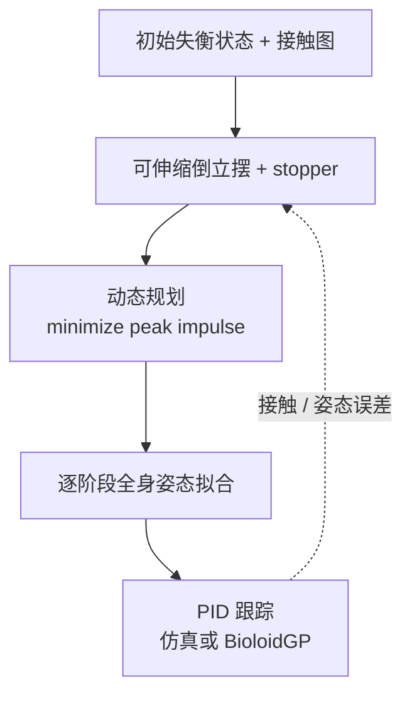

# 多接触规划：降低人形机器人跌倒损伤

**Multiple Contact Planning for Minimizing Damage of Humanoid Falls** 是 Ha 与 Liu 在 IROS 2015 发表的工作：机器人已经无法恢复平衡时，规划身体各部位的连续触地顺序，把一次大冲击拆成多次较小冲击。

## 一句话定义

**用可伸缩倒立摆近似全身跌倒过程，在接触图允许的动作序列中通过动态规划最小化最大垂直冲量。**

## 英文缩写速查

| 缩写 | 英文全称 | 简要说明 |
|------|----------|----------|
| IROS | IEEE/RSJ International Conference on Intelligent Robots and Systems | 本文发表的机器人会议 |
| COM | Center of Mass | 抽象摆的质心，代表机器人整体质量中心 |
| COP | Center of Pressure | 倒立摆支点，近似机器人当前支撑压力中心 |
| DOF | Degree of Freedom | 机器人可独立运动的自由度 |

## 为什么重要

- **从动作模板走向统一规划：** 单步、膝手支撑、tripod 与滚翻可视为同一接触序列搜索问题；所需策略由初始状态与机器人允许的接触图决定。
- **损伤目标可解释：** 优化的是全程最大瞬时垂直冲量，而不是把所有冲量相加。机器人需要消散初始动量，规划试图避免它集中在一次最重撞击上。
- **提供一个清晰的工程分层：** 低维模型搜索接触策略，全身逆问题拟合阶段姿态，再由 PID 跟踪；这让离线策略规划与全身控制的职责可分开讨论。
- 与现在的 [SafeFall](./paper-hrl-stack-41-safefall.md) 对照：本文直接计划多接触动作来降低峰值冲击；SafeFall 的重点是检测不可避免的跌倒后触发学习到的保护控制策略。

## 核心信息

| 字段 | 内容 |
|------|------|
| 作者 | Sehoon Ha；C. Karen Liu |
| 机构 | 佐治亚理工学院（Georgia Institute of Technology） |
| 发表 | IEEE/RSJ IROS 2015，pp. 2761–2767 |
| DOI | [10.1109/IROS.2015.7353756](https://doi.org/10.1109/IROS.2015.7353756) |
| 全文 PDF | [Internet Archive 备份（7 页）](https://web.archive.org/web/20180819224104/http://sehoonha.com/projects/ha2015mcs/2015_falling.pdf) |
| 项目页 | [作者项目页](https://faculty.cc.gatech.edu/~sha9/projects/ha2015mcs/) |
| 视频 | [YouTube 演示](https://youtu.be/gvKRlgc9pJI) |
| 代码 | 未找到项目页公布的官方代码仓库；不视为已开源 |

## 核心原理

### 1. 用峰值冲量表示单次碰撞风险

论文把时间离散为步长 $h$，第 $n$ 步的垂直冲量近似为 $j_n = h f_y(h_n)$。其中 $f_y$ 是所有地面接触的垂直力之和。目标函数为：

$$
\min_{\text{contact plan}} \max_{n\in T} j_n
$$

$T$ 是各次接触建立的时刻集合。由于最终必须耗散初始动量，目标不是让总冲量消失，而是避免某一次冲击承担过大比例。

### 2. 抽象模型把触点动作转为 stopper

标准模型是以 COP 为支点、以 COM 为质心的可伸缩倒立摆；论文再加入无质量可伸缩杆 stopper，代表机器人下一次准备触地的身体部位。控制摆长和 stopper 几何关系，可估计下一次触地的冲量。摆的角度没有被直接驱动，模型的执行控制主要通过摆长速度和触点选择实现。

这是一种规划抽象，不是机器人的精确全身动力学模型。每次 stopper 碰撞后，当前触点成为下一个抽象摆的支点，当前 COM 状态传给下一阶段，从而把跌倒表示成多个连续接触阶段。

### 3. 接触图限定可用的身体部位与顺序

接触图 $G=(V_c,E_c)$ 中，节点是允许使用的触点，边 $c_1\to c_2$ 表示从当前支撑点 $c_1$ 后可转到触点 $c_2$。图由机器人结构与可行策略设定：算法只在这些有向边上选序列。这样同一个优化框架可以覆盖单步、手膝支撑和滚翻等行为，同时避免搜索不可达或不允许的触点组合。

### 4. 动态规划求解 min-max 序列

状态包含当前触点、碰撞时间、摆角、摆长及其角速度/伸缩速度；动作选择下一个触点、触点几何位置、两次碰撞间隔和摆长期望速度。每一步比较当前冲量 $g(x,a)$ 与后续最优代价 $v(f(x,a))$ 的较大者，再选择使该最大值最小的动作。跌倒过程中摆角/角速度单调变化，允许用动态规划缓存相近状态的 cost-to-go，减少重复递归搜索。

可行触点采用两级筛选：先用关节限位内 10,000 个随机构型预生成的三维查找表过滤触点几何，再根据触点最大运动速度检查它能否在剩余时间内到位。作者认为后一个角度近似会偏保守。

### 5. 从抽象接触计划到全身动作

规划得到每段的摆状态和下一触点之后，优化阶段关节构型，使当前接触、COM 与下一接触位置分别匹配抽象模型中的支点、质心和 stopper 端点。随后对各段目标姿态使用 PID 跟踪。抽象模型负责“怎么分配接触”，全身姿态拟合负责“机器人如何摆出这些触点”。

## 流程总览

## 工程实践

| 阶段 | 论文中的做法 | 工程读法 |
|------|-------------|----------|
| 定义安全指标 | 最小化碰撞建立时的峰值垂直冲量 | 冲量是硬接触冲击的代理指标，不等于齿轮、传感器或结构件的直接寿命测量 |
| 约束策略 | 为机器人定义有向接触图 | 触点顺序需符合机器人运动学、硬件脆弱性及环境可用空间 |
| 离线搜索 | 抽象模型 + 动态规划 + 相近状态缓存 | 规划耗时 1–10 秒；论文提出预计算计划集供在线选取 |
| 策略执行 | 分阶段全身姿态优化 + PID | 需要检查 COM 轨迹跟踪误差；长接触序列的误差会累积 |
| 跌倒后处理 | 本文不要求站直 | 若任务需要恢复，应串接起身/静态平衡控制器并单独验证 |

论文用 DART（0.0005 s 仿真步长）评估 16-DOF、34.6 cm、1.6 kg 的 BioloidGP 及 28-DOF、188 cm、150 kg 的 Atlas。BioloidGP 多接触计划把最大冲量降到无规划基线的 23.2%–48.4%；Atlas 为 10.4%–70.8%，取决于姿态、方向与推力大小。实机头部最大加速度约为无规划动作的 68%。这些数值来自 2015 年特定模型和场景，不能直接当作现代全尺寸人形或任意跌倒的损伤保证。

### 源码运行时序图

**不适用：** 作者项目页未公开代码仓库或可运行训练/推理/部署入口。论文描述的是规划算法与实机流程，不代表可下载复现实现。

## 局限与风险

- **离线规划而非实时反应：** 每次计算 1–10 秒，无法直接接管快速发生的意外跌倒；预计算计划集只是论文提出的后续工程方向。
- **只覆盖平面运动：** 模型与目标限制在二维平面，非平面跌倒与身体转向策略不在其能力范围。
- **低维模型和全身执行存在落差：** 8 N BioloidGP 序列出现累积误差；触点近似和预处理查表也可能漏掉本来可行的候选。
- **优化终点不是站立恢复：** 最后触地时动量接近耗散，但机器人可能没有直立平衡姿态；恢复要另接控制器。
- **冲量是代理指标：** 论文优化最大垂直冲量，并以头部加速度评实机，不是对硬件损伤概率或修复成本的直接量化。

## 实验与评测

| 平台 | 设定 | 结果摘要 |
|------|------|---------|
| BioloidGP 仿真 | 0.5–8 N 前向推扰；基线保持初始姿态 | 规划/基线峰值冲量比 23.2%、40.9%、41.7%、48.4%；策略从迈步发展为 tripod 与滚翻 |
| Atlas 仿真 | 6 种前/后向推扰；单脚/双脚起始 | 规划/基线峰值冲量比 10.4%–70.8%；策略会按扰动改变触点数 |
| BioloidGP 实机 | 静态失衡、0.5 N 线性执行器推扰与强手推 | 两种可对照测试的头部最大加速度约为无规划动作的 68%；强手推滚翻测试未设无规划对照 |

## 结论

**这篇工作的主要贡献是把人形机器人安全跌倒统一成「受机器人接触可行性约束的峰值冲量 min-max 规划」，并让接触数与策略随失衡程度变化。**

- 对接触规划而言，接触图是任务知识与硬件可行性的显式入口；修改接触图会改变可生成的保护动作。
- 关键优化指标是单次最大垂直冲量，实验另外用头部最大加速度作实机代理；两者都不是直接的硬件损伤率。
- BioloidGP 与 Atlas 仿真显示了接触从迈步、膝手支撑到滚翻的自适应变化；不同初始状态的改善幅度差异很大，不能只引用最好的一行。
- 方法计算耗时 1–10 秒且只建模平面运动，适合作为离线规划思路或预计算策略基础，不是现成实时保护控制器。
- 全文和视频可直接查看，但作者项目页没有公开代码；想复现需自行实现抽象模型、查表筛选、动态规划及全身姿态跟踪。

## 关联页面

- [SafeFall：学习式人形跌倒保护控制](./paper-hrl-stack-41-safefall.md) — 触发式保护策略，可对照解析规划方法。
- [Unified Humanoid Fall-Safety Policy from a Few Demonstrations](./paper-notebook-unified-humanoid-fall-safety-policy-from-a-few-d.md) — 少量演示驱动的安全跌倒策略。
- [Trajectory Optimization](../methods/trajectory-optimization.md) — 全身姿态与运动约束优化背景。

## 参考来源

- [Ha & Liu 2015 论文全文来源摘录](../../sources/papers/multiple_contact_planning_humanoid_falls_ha_liu_2015.md)
- [作者项目页核查](../../sources/sites/ha-liu-multiple-contact-humanoid-falls-2015.md)
- [官方演示视频归档](../../sources/videos/youtube_humanoid_multiple_contact_fall_gvKRlgc9pJI.md)

## 推荐继续阅读

- [作者项目页](https://faculty.cc.gatech.edu/~sha9/projects/ha2015mcs/)（含摘要与演示视频）
- [SafeFall 项目页](https://safefall.github.io)（现代人形保护控制工作，可与本文做解析规划/学习控制对照）
