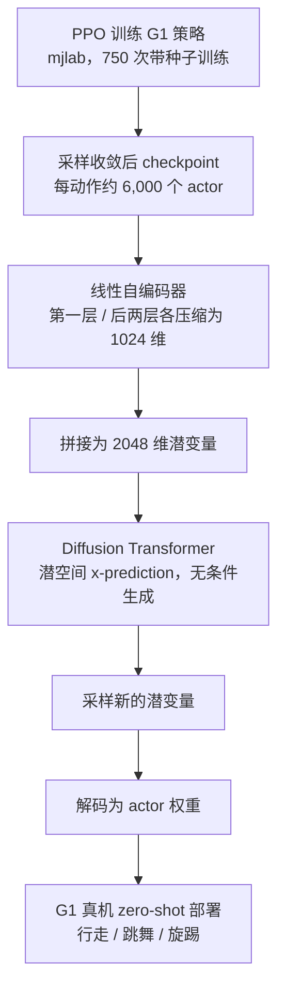

# 人形策略权重扩散：直接生成可执行的策略网络

**Modeling and Understanding Neural Weights of Humanoid Policies with Diffusion**（[arXiv:2610.20606](https://arxiv.org/abs/2610.20606)，[项目页](https://humanoid-weight-diffusion.github.io/)）把人形控制策略的 actor 网络视作可学习的数据对象：在权重空间中训练生成模型，直接采样出新的可部署网络，并分析权重空间的结构。

## 英文缩写速查

| 缩写 | 英文全称 | 简要说明 |
|------|----------|----------|
| DiT | Diffusion Transformer | 在潜空间中建模 actor 权重分布的生成器 |
| PPO | Proximal Policy Optimization | 产生训练数据（actor 网络）的强化学习算法 |
| MLP | Multi-Layer Perceptron | actor 网络结构：三层、隐藏维 [128,128]、ELU |
| IL | Imitation Learning | 本文对照组：用 RL 教师蒸馏出的模仿网络 |
| G1 | Unitree G1 | 评测所用人形机器人平台 |

## 为什么重要

- **换一个视角看策略：** 通常把策略当作输出动作的函数；本文把它当作可被生成的参数对象，为「策略库」或「按需生成网络」提供了一条思路。
- **权重空间的可解释线索：** 第一层权重呈现与机器人运动学相关的结构，且在 RL 与 IL 下都出现，提示它可能反映本体而非训练方法。
- **边界很清楚：** 每个动作单独建模，作者也明确尚不能推断任意新技能的生成能力。

## 核心信息

| 项 | 内容 |
|----|------|
| **机构** | 加州大学伯克利分校（UC Berkeley），据项目页作者列表 |
| **作者** | Huixuan Cheng, Bike Zhang, Shankar Sastry, Koushil Sreenath（通讯） |
| **平台 / 数据** | Unitree G1；mjlab 中 PPO 训练的 actor 网络；每动作约 6,000 个 actor |
| **任务** | 行走（速度指令）、跳舞、旋踢（动作跟踪） |
| **开源** | **待发布**（截至 2026-10-15，项目页标注 "Code · coming soon"，未列仓库） |

## 核心原理

### 流程总览

### 机制要点

- **权重切分：** 第一层 (w1,b1) 与后两层 (w2,b2,w3,b3) 分别压缩，避免两类参数尺度混杂。
- **线性自编码器：** 无偏置、无激活的单层线性编解码，每个动作单独训练，保证潜空间与权重之间是可逆的线性映射。
- **生成：** DiT 的唯一条件是扩散时间步（adaLN-Zero），生成过程不指定目标技能；每个动作一个模型。

## 工程实践

| 项 | 建议 |
|----|------|
| 复现入口 | 代码未发布；需等待作者公开 |
| 数据量 | 每动作需要大量 RL 训练结果（750 次训练 × 8 个 checkpoint 的筛选） |
| 评测指标 | 同时看成功率与跟踪误差，并与「同距离噪声扰动」基线对比，排除记忆化 |
| 训练方式 | RL 教师可直接用于生成；IL 蒸馏网络的成功率略低（0.992–0.998） |
| 源码运行时序图 | **不适用**（截至 2026-10-15 代码标注为待发布，无可运行仓库） |

## 实验与评测

- **仿真（DiT 生成网络均值 vs 数据集）：**

| 动作 | 成功率（生成 / 数据集） | 跟踪误差（生成） |
|------|------------------------|------------------|
| 行走 | 0.999 / 0.999 | 0.162 |
| 跳舞 | 0.998（数据集未列入摘录） | 0.037 |
| 旋踢 | 0.997（数据集未列入摘录） | 0.046 |

- **记忆化检验：** 扩散生成的网络成功率高于同距离噪声扰动网络（行走 0.993 vs 0.914，跳舞 0.941 vs 0.865，旋踢 0.943 vs 0.783）。
- **IL vs RL：** 行走 0.9979 vs 0.9994，跳舞 0.9948 vs 0.9973，旋踢 0.9919 vs 0.9972。
- **真机：** 三个动作 zero-shot 部署，未找到定量指标。
- **嵌入消融：** 潜空间进度指标 行走 0.997、跳舞 0.965、旋踢 0.969（摘录）。

数值来自 arXiv HTML v1 摘录，未逐表复核。

## 结论

**一句总判：权重扩散在这组单一本体、三个动作上可复现「生成可用网络」，但它证明的是参数空间里的插值与采样，不是任意技能的生成。**

1. **生成网络与数据集几乎一致** — 行走成功率 0.999 对 0.999，说明潜空间建模没有明显损失性能。
2. **优于噪声扰动是关键对照** — 只要与噪声扰动网络比较，扩散采样的优势才可见，应当在复现时保留这一基线。
3. **RL 教师优于 IL 蒸馏** — 差距小但一致，选择训练方式时仍应先用 RL。
4. **结构发现先于性能收益** — 第一层的运动学结构是分析性结论，作者也承认尚未转化为更好的策略。
5. **泛化边界明确** — 每个动作单独训练，只研究一个本体与三个动作；条件生成（行为、轨迹或文本）仍是未来工作。

## 与其他工作对比

| 对照 | 差异读法 |
|------|----------|
| [Diffusion Policy](../methods/diffusion-policy.md) | 扩散生成动作序列；本文扩散生成的是策略网络参数 |
| [Diffusion Transformer](../concepts/diffusion-transformer.md) | 同一骨干，作用对象从图像/动作换成 actor 权重潜变量 |
| [人形策略网络结构](../concepts/humanoid-policy-network-architecture.md) | 本文的 actor 是小 MLP；结构选择直接决定权重空间的维度 |

## 局限与风险

- **仅研究第一层结构：** 深层权重与域随机化的影响尚不清楚。
- **单一本体、少量动作：** 对其他人形平台的外推未验证。
- **真机证据薄：** 只给出 zero-shot 部署的定性结果。
- **可解释性尚未变现：** 作者承认结构分析还没带来更好的性能。

## 关联页面

- [Diffusion Transformer](../concepts/diffusion-transformer.md) — 生成骨干
- [Diffusion Model](../concepts/diffusion-model.md) — 基础概念
- [人形策略网络结构](../concepts/humanoid-policy-network-architecture.md) — actor 网络设计背景
- [Diffusion Policy](../methods/diffusion-policy.md) — 动作层面的扩散策略对照
- [mjlab](./mjlab.md) — 训练所用的仿真与 RL 栈

## 参考来源

- [humanoid_weight_diffusion_arxiv_2610_20606.md](../../sources/papers/humanoid_weight_diffusion_arxiv_2610_20606.md) — 论文摘录与开源核查
- [arXiv:2610.20606](https://arxiv.org/abs/2610.20606) — 原文（v1，2026-10-14）

## 推荐继续阅读

- [项目页（视频与结果）](https://humanoid-weight-diffusion.github.io/) — 演示与补充图
- [arXiv HTML v1](https://arxiv.org/html/2610.20606v1) — 方法与实验细节
