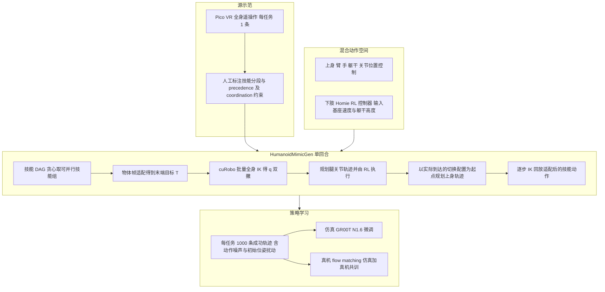

# HumanoidMimicGen

## 一句话定义

**HumanoidMimicGen**（Lin, Mandlekar, Garrett 等，NVIDIA 与 UT Austin，arXiv:2605.27724）是一种**人形（Unitree G1）loco-manipulation 示范自动生成方法**：把 MimicGen 系的 object-centric 技能片段适配，与「RL 腿控制器 + 全身 IK + 碰撞感知运动规划」交织，从每任务一条 VR 遥操作示范生成 1000 条成功轨迹，并配套 9 任务 G1 仿真基准与真机 sim-and-real co-training 验证（摘要、§1、§6）。

## 英文缩写速查

| 缩写 | 英文全称 | 简要说明 |
|------|----------|----------|
| VLA | Vision-Language-Action | 视觉–语言–动作策略，本文微调 GR00T N1.6（§6.1） |
| BC | Behavior Cloning | 从示范监督学习策略（§3） |
| IK | Inverse Kinematics | 由末端位姿目标反解关节配置，本文用 cuRobo 批量求解（附录 C） |
| DAG | Directed Acyclic Graph | 技能 precedence 约束构成的有向无环图（§4.2） |
| PSR | Policy Success Rate | 策略 rollout 成功率，论文主指标（§6.2） |
| OSC | Operational-Space Control | 任务空间末端控制，既有 MimicGen 系的动作空间假设（§4） |
| TAMP | Task and Motion Planning | 任务与运动规划，需规划模型，论文认为难用于接触丰富任务（§2） |
| Loco-Manip | Loco-Manipulation | 行走与操作耦合的全身任务 |

## 为什么重要

- **作者自述的动机**：VLA 需要大规模操作数据，人形 loco-manipulation 遥操作更贵，大规模数据集缺乏（§1）；既有 MimicGen / DexMimicGen / SkillGen / MoMaGen 假设每个肢体都有稳定独立的末端控制，不适用于需全身平衡的有腿人形（§2、§4）。
- **论文给出的证据**：同一条源示范生成 1000 条后，9 任务平均 PSR 0.89，对比 DexMimicGen+ 0.33、100 条真人示范 0.48、1 条真人示范 0.26（Table 1）。
- **真机**：与仅真机数据相比，sim-and-real co-training 平均 0.51→0.71（Fig. 5，每策略 20 回合，附录 I）。
- **我的判断**：它是 MimicGen 谱系在人形上的一个可对照的系统基线，并附可复现的 9 任务基准；但对照组 DexMimicGen+ 是作者自行构造的弱化版本（见「局限」）。

## 核心原理与流程总览

### 技能适配（§3）

- 源示范切成 object-centric 技能 $\psi=\langle e,f,d^\psi\rangle$（末端 $e$、物体帧 $f$、子序列 $d^\psi$）。适配公式 $a'[e]=s'[f]\,{s^\psi_0[f]}^{-1}a^\psi[e]$：把末端目标相对技能起点物体位姿的变换，套到当前物体位姿上。
- 双手任务用 precedence 对 $\mathcal{P}$ 与 concurrent 对 $\mathcal{C}$ 表达先后与同起点关系；$\mathcal{C}$ 通过传递性并入 $\mathcal{P}$ 后得到 DAG；每个末端同一时刻只执行一个技能，故同时至多 2 个（§4.2）。
- 生成阶段假设可访问特权状态，策略只用观测（§3）。

### 混合动作空间（§4.1）

- 最底层为全关节位置控制；其上两类高层动作：上身关节位置命令，以及基座命令 $[\dot x,\dot y,\dot\theta,z]$（平面速度、偏航率、期望躯干高度）。
- 腿由 Homie RL 控制器输出可行的腿关节位置；作者指出该 RL 策略「能动态维持稳定，但不能完美跟踪速度动作」，因此规划拆成静态操作与动态行走两段（§4）。

### 全身数据生成（§4.3、Algorithm 1）

1. 贪心取出无未完成前驱的技能组 $\Psi_i$，适配得到各末端目标 $T[e]$；
2. 全身 IK 返回一批候选 $q''$；
3. 对每个候选构造切换配置 $q'$（当前上身 + $q''$ 的腿）；规划腿轨迹 $\tau_l$，成功则用 RL 控制器执行，全部失败则丢弃该回合；
4. 以实际到达的 $q'$ 为起点规划上身轨迹 $\tau_m$ 并执行；
5. adapt-skill-demos（Algorithm 2）逐步 IK 跟踪适配后的技能动作；手关节原样回放；
6. 全部技能完成后检查任务成功；数据集靠反复调用直到成功 $N$ 次。

### 数据扰动（§4.4、Table 5）

| 策略 | 机制 | 去掉后平均 PSR |
|------|------|----------------|
| Motion noise | 执行 $a+\epsilon$，$\epsilon\sim\mathcal{N}(0,\sigma^2 I)$，标签仍存 $a$ | 0.89 → 0.49 |
| 初始基座位姿随机化 | 在名义起点附近扰动 | 0.89 → 0.51 |

两者下降并不一致：去掉 motion noise 后 Box Lift Floor 与 Push Button 反为 1.00，退化主要来自 Drill Lift、Drill PnP、Box Table to Shelf、Pick Drill from Holder、Drill Lift Obstacle（Table 5）。

## 工程实践

- **平台与任务**：robosuite + MuJoCo，9 个 G1 任务（Box Lift Floor、Push Button、Box Lift、Push Shelf Forward、Drill Lift、Drill PnP、Box Table to Shelf、Pick Drill From Holder、Drill Lift Obstacle），沿基座移动量、交互复杂度、时域三轴变化，二值成功判据，初始物体与机器人 root 位姿随机（§5、附录 D、Table 2）。
- **碰撞表示**：机器人与物体用球集合；对网格采样表面点求最小体积切球，半径膨胀约 0.01 m，贪心选球最大化覆盖；对预期接触的球对，在每次 IK 或规划前收缩互碰球以缓解球近似过度保守导致的不可行（附录 C）。
- **IK 偏好**：按「臂 → 臂+躯干 → 臂+腿 → 全部」的顺序逐级放开关节，倾向少动腿与躯干；可到达时跳过 locomotion 规划（附录 C）。
- **遥操作**：Pico VR 手柄给末端位姿、扳机给夹爪、摇杆给导航；不使用头显画面；仿真与真机同一接口（§6.1）。
- **策略训练**：GR00T N1.6 微调，单目 ego 相机 224×224 + 本体感受，学习率 1e-5、全局 batch 128、25K 步、8×H100；每 5K 步评估一次，每任务 100 回合，取最佳检查点（§6.1、附录 G）。
- **真机**：G1 + Luxonis OAK-D；上身 25 Hz、下身策略 50 Hz、底层插值位置控制 200 Hz；每策略评估 20 回合，部分得分制（附录 I）。
- **代码**：项目页的按钮指向 NVlabs/humanoidmimicgen（本次未能访问该仓库，内容与开放程度未核实）。

### 主要结果表

仿真（Table 1，每任务 1 条源示范，生成 1000 条）：

| 方法 | 平均 PSR | 代表任务 |
|------|----------|----------|
| 1 条真人示范 | 0.26 | Box Lift 0.95 但 Drill PnP 0.08 |
| 100 条真人示范 | 0.48 | Push Button 0.82 |
| DexMimicGen+ | 0.33 | Push Shelf Forward 0.35 |
| HumanoidMimicGen | 0.89 | Push Shelf Forward 1.00，Box Table to Shelf 仅 0.53 |

策略架构（Table 4，同一批 1000 条生成数据）：VLA 0.89，Flow Matching（AdaFlow 式）0.86，Diffusion Policy 0.51；Drill Lift 上 DP 只有 0.12，而 Push Shelf Forward 上 DP 0.95。

真机（Fig. 5）：

| 任务 | Real-only | Co-training | 数据量 |
|------|-----------|-------------|--------|
| ThrowBottle | 0.60 | 0.75 | 30 真机 + 500 仿真 |
| BoxToCart | 0.35 | 0.60 | 30 真机 + 500 仿真 |
| PickCanister | 0.50 | 0.75 | 50 真机 + 1000 仿真（与下一行共训一策略） |
| PickCanisterWithObstruction | 0.60 | 0.75 | 同上 |
| 平均 | 0.51 | 0.71 | |

具身消融（附录 F、Table 3）：去腿的浮动基座变体平均 0.90，与 G1 的 0.89 相近，但逐任务差异大（Push Shelf Forward 1.00→0.53，Box Table to Shelf 0.53→1.00）。

## 评测证据与清单说法的对比核对

清单（Berseth CoRL 2026 阅读清单，P2，序号 097/101，作者称摘要由 LLM 据摘要起草）一句话：*MimicGen-style data generation for humanoid loco-manipulation, adapting whole-body skills from a few demos with planning.*

- **「MimicGen-style」**：成立。§2、§3 明确沿用 MimicGen 的 object-centric 技能适配与 SkillGen、DexMimicGen 的约束表示。
- **「humanoid loco-manipulation」**：成立，但限定：主结果在 Unitree G1 的 robosuite/MuJoCo 仿真基准，真机为 4 个 G1 任务；真机策略并非用论文的 VLA，而是从零训练的 flow matching（§6.4）。
- **「adapting whole-body skills from a few demos」**：基本成立，但「a few」在实验里是每任务**一条**源示范（§6.1，Table 1 注）；摘要写 a handful of source demonstrations。
- **「with planning」**：成立，是核心区别：locomotion 与上身运动规划 + 碰撞球 + 批量 IK（§4.3、附录 C）。
- **清单省略的限定**：(1) 需要人工技能分段与约束标注（§7）；(2) 仿真→真机的收益是 co-training（仅真机 0.51 → 0.71），不是纯合成数据直接部署；(3) 论文摘要写的「outperform by 20%」是成功率的绝对差 0.20，不是相对提升（0.71/0.51 约 +39% 相对）；(4) 清单的 OpenReview 编号（9kXz22fI7a）与本库原记录（ekzk7TSLKr）不同，可能是不同投稿，本次无法打开核对。

## 结论

HumanoidMimicGen 把示范适配扩展到人形移动操作，适用于既定技能结构内的数据扩增。

- 先标注技能片段和协调约束，并核验 IK、规划与碰撞检查的接口。
- 把合成数据质量、仿真策略成功率和真机部分得分分开统计。
- 涉及新技能顺序或较大物体几何变化时另做验证，单条示范扩增不能替代高层规划与接触适配。

## 局限

**论文自述（§7）**：
- 需人工标注技能片段与 precedence / coordination 约束（同 DexMimicGen、SkillGen）；co-training 的仿真环境、初始状态分布、成功条件也是人工设计。
- 假设固定的 object-centric 技能集与固定技能序列结构，难以泛化到需要新技能序列或高层计划的任务。
- 依赖刚体物体帧变换，无法处理较大的类内几何变化或模糊接触 affordance（文中指向 CP-Gen）。

**我看到的未验证之处**：
- 对照组 DexMimicGen+ 是作者自行扩展的基线，故意无运动规划与碰撞检查，只用直线插值（附录 E）；0.33 不能当作 DexMimicGen 原方法的上限。
- 仿真成绩按每 5K 步评估后取**最佳检查点**报告（§6.1、附录 G），可能偏乐观；未见多随机种子或置信区间。
- Table 1 的「100 条真人示范」基线由何人、如何采集与数据质量，正文未展开；其在 Push Shelf Forward 达 0.90、Box Lift 达 0.95，说明部分任务已较易（推测：9 任务难度差异大，均值掩盖了 Box Table to Shelf 0.53、Drill PnP 0.70 等难点）。
- 真机每策略仅 20 回合且为部分得分制，任务间数据量不同（30 真机/500 仿真 vs 50/1000），差异的统计显著性论文未给出（推测：4 任务的提升同向，但单任务差距 0.15–0.25 在 20 回合下不确定性较大）。
- 浮动基座对比（附录 F）说明平均 PSR 与是否有腿几乎无关，较难据此判断「腿的难度」被规划多大程度化解（推测）。
- 代码仓库是否已放出实质内容未核实。

## 关联页面

- [Loco-Manipulation](../tasks/loco-manipulation.md)
- [Imitation Learning](../methods/imitation-learning.md)
- [Behavior Cloning](../methods/behavior-cloning.md)
- [Diffusion Policy](../methods/diffusion-policy.md)
- [VLA](../methods/vla.md)
- [Whole-Body Control](../concepts/whole-body-control.md)
- [Sim2Real](../concepts/sim2real.md)
- [DexMimicGen](./paper-notebook-dexmimicgen-automated-data-generation-for-bimanu.md)
- [Homie](./paper-loco-manip-161-040-homie.md)：提供下肢 RL 控制器
- [GR00T N1](./paper-hrl-stack-34-gr00t_n1.md)
- [GR00T Visual Sim2Real](./gr00t-visual-sim2real.md)
- [SoftMimicGen](./paper-softmimicgen.md)：同系数据生成，面向可变形物体

## 参考来源

- [HumanoidMimicGen 论文归档（全文通读）](../../sources/papers/humanoidmimicgen_arxiv_2605_27724.md)
- Lin et al., *HumanoidMimicGen: Data Generation for Loco-Manipulation via Whole-Body Planning*, arXiv:2605.27724v1, 2026. <https://arxiv.org/abs/2605.27724>
- 项目页：<https://humanoidmimicgen.github.io/>

## 继续阅读

- [机器人论文阅读笔记：HumanoidMimicGen](https://imchong.github.io/Robot_Learning_Paper_Notebooks/papers/11_Simulation_Benchmark/HumanoidMimicGen__Data_Generation_for_Loco-Manipulation_via_Whole-Body_Planning/HumanoidMimicGen__Data_Generation_for_Loco-Manipulation_via_Whole-Body_Planning.html)
- MimicGen：<https://arxiv.org/abs/2310.17595>
- Homie：<https://arxiv.org/abs/2502.13013>
- cuRobo：<https://github.com/NVlabs/curobo>
