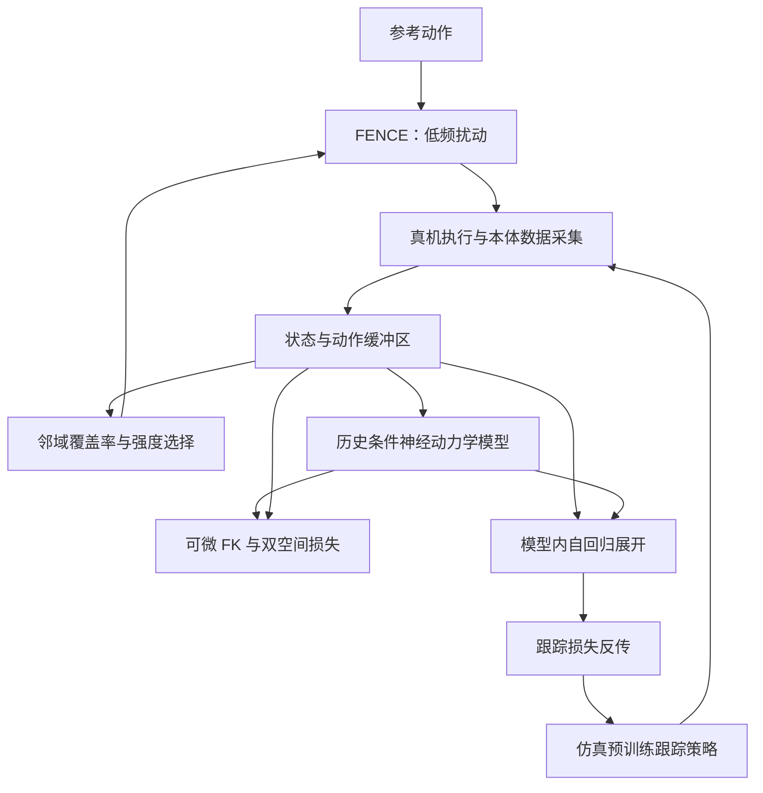

# HumanoidNDM：以真机神经动力学模型微调动作跟踪

## 一句话定义

用参考轨迹的低频扰动采集真机数据，训练只依赖本体信号的历史条件可微动力学模型（NDM），再通过模型梯度微调仿真训练的人形跟踪策略。

## 英文缩写速查

| 缩写 | 英文全称 | 简要说明 |
|------|----------|----------|
| NDM | Neural Dynamics Model | 根据历史状态和动作预测下一步本体状态的神经动力学模型 |
| FENCE | Frequency-domain Exploration via Neighborhood Coverage Estimation | 按策略邻域覆盖率自适应调整低频参考扰动强度的探索方法 |
| FK | Forward Kinematics | 用关节配置计算各连杆位姿，本文用其把损失映射到欧氏空间 |
| MoCap | Motion Capture | 外部动作捕捉系统；本文方法在训练和部署时都不依赖它 |
| PPO | Proximal Policy Optimization | 在仿真中训练初始跟踪策略所用的强化学习算法 |
| MAB | Multi-Armed Bandit | 多臂老虎机；本文用 UCB 形式在相邻扰动强度之间选择 |
| MJX | MuJoCo-JAX | 本文初始策略训练所用的 JAX 版 MuJoCo 仿真器 |
| PD | Proportional-Derivative | 比例-微分关节控制器，把策略输出转为关节力矩 |

## 核心信息

| 项 | 内容 |
|----|------|
| 论文 | [arXiv:2610.34126v1](https://arxiv.org/abs/2610.34126)（2026-10-25），已被 CoRL 2026 接收 |
| 机构 | 北京大学计算机学院前沿计算研究中心、中国科学院自动化研究所、Galbot、北京智源人工智能研究院、清华大学 |
| 机器人 | Unitree G1；初始策略在 MJX 中使用 PPO 训练 |
| 开放状态 | 项目页 [pku-epic.github.io/HumanoidNDM](https://pku-epic.github.io/HumanoidNDM) 在 2026-10-30 返回 404，2026-11-06 复核时可访问（HTTP 200），页面 Code 按钮指向 `github.com/shenbiachao/HumanoidNDM`。本次 GitHub 访问返回 403，**仓库内容、可运行入口、权重与数据是否公开均未能核实**，故不写入 frontmatter `code:`。 |
| 核对范围 | 已通读 arXiv v1 原文全文，含方法（§4）、仿真与真机实验（§5）、结论与局限（§6）以及附录 A–I（实现细节、基线、仿真与真机任务设定、跳跃运动扩展、超参数表）。参考文献未逐条核对。 |

## 为什么重要

人形机器人的仿真训练策略部署到真机时，会遇到负载、摩擦、执行器增益和未建模弹性或晃动等训练-部署差距。已有做法要么依赖高频噪声或被动随机性，前者会在真机上引起抖动，后者的覆盖率不足；要么依赖 MoCap 等外部位姿测量，部署成本高；在有限在线数据下，策略微调也容易出现不稳定。HumanoidNDM 把这三个环节串成一条只用本体信号的在线适配流程，使真机数据可以直接用于修正已有跟踪策略。

## 流程总览

## 核心原理

每轮迭代分三步：采集、建模、微调。

1. **采集（FENCE）：** 对参考关节轨迹做 DFT，在低频分量（$0 < k \le k_c$，最高 1.0 Hz）上加复高斯噪声，零频分量置零以避免姿态塌陷，再用 IDFT 得到扰动后的参考 $Q'$，并由它重新推导参考速度。策略在 $Q'$ 上滚动采集数据。扰动强度 $\sigma$ 从离散集合 $\{\sigma_1,\dots,\sigma_K\}$ 中选择：用策略邻域覆盖率 $\bar C$（以各步全局位置误差加权的加权覆盖率）作为奖励，在相邻强度之间用 UCB 形式的 MAB 选择。覆盖率在状态-动作拼接向量 $x_t=[s_t^\top,a_t^\top]^\top$ 周围按径向和方向划分的分箱上统计。
2. **建模（历史条件 NDM）：** 输入为长度 $H=10$ 的本体状态与动作历史，预测下一步状态 $\hat s_{t+1}=w(s_{t-H+1:t},a_{t-H+1:t})$。状态包含关节角、关节速度、重力投影、角速度和根高度；根高度由关节与重力估计，并假设持续地面接触。模型用共享 Transformer 编码历史，5 个预测头做 bootstrap 集成。关节位置由预测速度一阶积分得到，重力投影映射到 roll-pitch 空间预测。损失分两部分：配置空间误差与可微 FK 得到的局部重力对齐坐标系下连杆位置、旋转（测地距离）误差。
3. **微调（梯度法策略更新）：** 从缓冲区采样一段真实历史作为初值，在 NDM 内做长度 $L_\pi=128$ 的自回归展开，用关节、根姿态、连杆跟踪以及关节空间平滑损失反传到策略参数。模型展开长度 $L_w=8$。论文称这样比基于模型强化学习的短展开更不容易产生贪心更新。

**输入、机制与输出：** 输入为真机上的本体历史与参考轨迹；机制为“低频扰动采集 + 历史条件可微模型 + 模型梯度微调”；输出为修正后的跟踪策略，策略动作经 PD 控制器转为关节力矩。

## 工程实践

| 项 | 论文设定（Table 6 与附录） |
|----|------|
| 采集扰动 | 最高频率 $k_c$ 为 1.0 Hz；径向分箱 2，方向分箱 16；MAB 探索系数 $\beta=0.05$；roll-pitch 终止阈值 1.0 |
| 模型训练 | $H=10$，$L_w=8$，集成头 $M=5$，mini-batch 512，每轮 32 个 mini-batch，学习率 $2\times10^{-3}$，bootstrap 概率 0.8，回放缓冲区保留 100 个 episode；$\Delta t=0.02$ s |
| 策略微调 | 学习率 $10^{-4}$，最终学习率 $10^{-7}$，$L_\pi=128$，mini-batch 512 |
| 真机耗时 | 单张 RTX 4090；每轮约 3 s 训练，10 s 采集（含回位），200 轮约 1 小时；偶发碰撞或电机过热时恢复最近检查点 |
| 真机数据量 | 套笔 50 条轨迹，其余 5 个任务 200 条 |
| 部署约束 | 仅使用本体信号（无 MoCap）；论文限定为时不变扰动；带飞行相的跳跃需去掉根高度输入（附录 G） |
| 源码运行时序图 | **不适用**（项目页 Code 按钮指向 `github.com/shenbiachao/HumanoidNDM`，但本次 GitHub 访问返回 403，无法确认仓库是否公开、是否含可运行的训练或部署入口） |

## 源码运行时序图

**不适用**：见上表。待仓库可访问后，复核 README 运行步骤再补充时序图。

## 实验与评测

**仿真（MuJoCo，Unitree G1 模型）。** 5 个动作（Walk、Balance、Squat、Swing、Stride）× 3 类扰动（额外质量、刚度 $K_p$ 改变、小摩擦）。HumanoidNDM、ASAP、RWM 各用 200 条部署环境轨迹训练，5 次随机试验。论文报告在 60 项指标中有 40 项最佳，相对直接迁移，平均连杆位置和旋转误差分别降低 30% 和 47%。这不是每项指标都最优：部分平衡与跨步动作与基线接近。与 ASAP（连杆误差 -23%、-27%）和 RWM（-9%、-35%）相比，本文在欧氏空间指标上的降幅最大。论文认为这得益于训练模型和微调时对欧氏空间的显式优化。

**消融。** 双空间目标优于仅配置空间目标；带历史的 NDM 优于单帧模型；FENCE 在微调效果与 Action OU 噪声相当，但平滑性显著更好（表 5 真机对比见下）；FENCE 也可替换 ASAP 与 RWM 的默认探索方式（表 3）；自适应扰动强度与最佳固定强度表现接近，真机上优于固定强度。附录 H 报告预训练的 NDM 在真机任务上未带来收益。

**真机（Unitree G1）。** 6 个任务分两类：增加质量（Swallow Balance 绑腿、Arm Swing 手持重物、Pen Capping 单手加重）与难建模扰动（Lateral Raise 弹力带、Walking 持水桶、Bowing 电机损坏）。每项重复 3 次，未出现失败运行。

- Swallow Balance 的单腿悬空时间从直接迁移的 0.00 s 升至 1.90 ± 0.61 s；仿真中 PPO 直接训练加扰动的基线为 0.40 ± 0.11 s。
- Walking 的偏航角从直接迁移的 38 ± 17° 降至 5 ± 3°。
- Lateral Raise 的手臂高度从 1.06 ± 0.07 m 升至 1.35 ± 0.06 m。
- 表 5（Lateral Raise 探索方法对比，$S_{\mathrm{qpos}}$ 越小越平滑）：FENCE 为 0.099 ± 0.018，Action Gaussian Noise 为 1.275 ± 0.313，Action OU Noise 为 0.707 ± 0.180，Obs Gaussian Noise 为 1.151 ± 0.315，No Noise 为 0.076 ± 0.005。FENCE 的 roll-pitch 抖动 $S_{\text{roll-pitch}}$ 为 0.126，几乎与无噪声相当。

## 结论

**一句话总判：** 在所测的时不变扰动下，用真机数据做局部模型修正，并以模型梯度微调已有跟踪策略，是一条可行且数据效率较高的路线；其价值主要来自探索方式的平滑性和欧氏空间的训练目标，而非无条件的通用保证。

1. **探索要同时看覆盖率与平滑度。** 直接加高频噪声会在真机上引起抖动，FENCE 用低频参考扰动加自适应强度，在覆盖率与稳定性之间取得折中。
2. **模型要带历史并在欧氏空间里监督。** 论文消融显示，仅配置空间的目标与单帧模型都会显著降低跟踪效果。
3. **梯度微调需要较长的展开。** 微调使用 128 步策略展开，并从真实缓冲区历史段初始化，避免只看单步误差。
4. **数字要按任务读。** 仿真中 5 个动作的基线比较不是逐项全胜，真机实验每项仅 3 次重复，不能外推为通用安全保证。
5. **超出时不变扰动的情况需另行处理。** 论文只验证了时不变扰动；带飞行相的跳跃需去掉根高度输入，附录 G 的验证是仿真。

## 与其他工作对比

论文实验中的基线是下表前四行；后两行为本站其他页面的编者归纳，论文未与之对比。

| 对象 | 差异 |
|---|---|
| 仿真策略直接迁移（论文基线） | 不使用真机数据；论文中 HumanoidNDM 相对直接迁移平均降低连杆位置 / 旋转误差 30% / 47% |
| PPO w/ Disturb.（论文基线，oracle） | 用精确扰动在仿真中直接训练；论文称 HumanoidNDM 在仿真中与之相当，真机上在三个增重任务中接近或更优（如 Swallow Balance） |
| [ASAP](./paper-notebook-asap-aligning-simulation-and-real-world-physics.md)（论文基线） | 用真机转移数据训练 delta action 模型对齐仿真动力学；论文中连杆位置误差降幅为 23%，本文为 30% |
| [RWM](./paper-sa-2504-16680-rwm-o-offline-robotic-world-model-learning-robot.md)（论文基线） | 另一种基于模型的方法，三个阶段均不同；论文中连杆位置误差降幅为 9%，本文为 30% |
| [BeyondMimic](../methods/beyondmimic.md)（编者归纳） | 论文仅将其作为运动跟踪相关工作引用，未作为基线比较 |
| [YAHMP](./paper-yahmp.md)（编者归纳） | 论文未引用；本页将其作为同一主题的相关页面，两者关注的训练与部署环节不同 |

## 局限与风险

- **扰动假设：** 论文明确限定为时不变扰动。随时间变化的扰动需要另行验证。
- **地面接触假设：** 根高度依赖持续地面接触估计。在有飞行相的跳跃中，论文去掉了根高度输入，并只在仿真中验证。
- **任务与硬件范围：** 真机结果来自 Unitree G1 上的 6 个特定动作与扰动，每项 3 次重复，不能视为普遍安全保证。
- **基线调参：** ASAP 与 RWM 按论文做了每个设定下的网格搜索，但其结果仍受所用调参方式影响。
- **开源状态未核实：** 项目页的 Code 按钮指向 GitHub 仓库，但本次复核时仓库访问被拒（403），仓库内容、可运行入口、权重和数据均未能核实，不应据此假定可以直接复现。

## 关联页面

- [YAHMP：人形运动跟踪消融](./paper-yahmp.md)
- [BeyondMimic](../methods/beyondmimic.md)
- [ASAP：仿真与真实物理对齐](./paper-notebook-asap-aligning-simulation-and-real-world-physics.md)
- [RWM：离线机器人世界模型](./paper-sa-2504-16680-rwm-o-offline-robotic-world-model-learning-robot.md)

## 参考来源

- [论文归档](../../sources/papers/humanoidndm_arxiv_2610_34126.md)
- [项目页归档](../../sources/sites/humanoidndm.md)
- [论文全文 v1（HTML）](https://arxiv.org/html/2610.34126v1)

## 推荐继续阅读

- [HumanoidNDM 论文（arXiv）](https://arxiv.org/abs/2610.34126)
- [HumanoidNDM 项目页](https://pku-epic.github.io/HumanoidNDM/)
