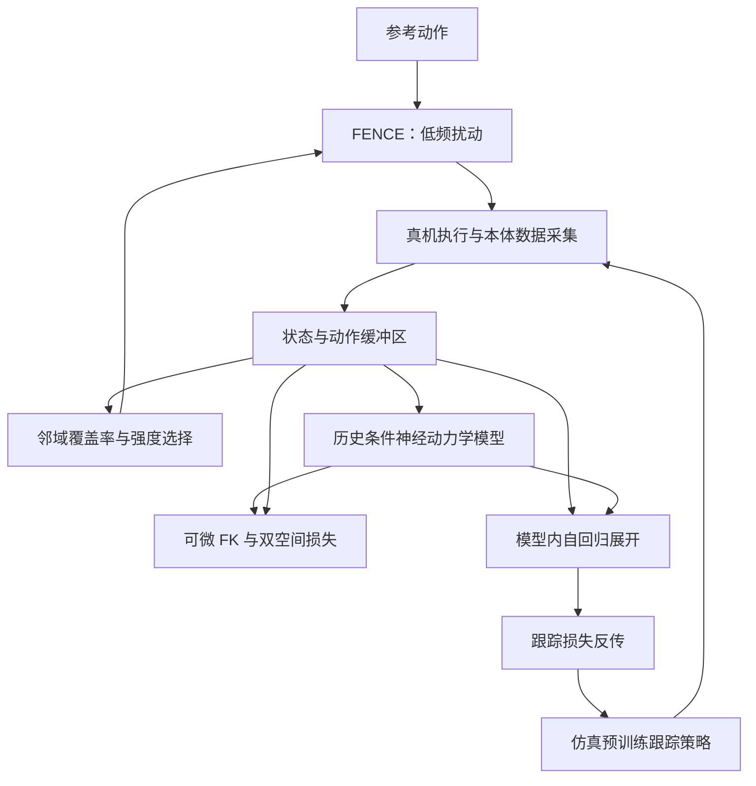

# HumanoidNDM：以真机神经动力学模型微调动作跟踪

## 一句话定义

用参考轨迹的低频探索采集真机数据，训练可微动力学模型，再通过模型梯度微调仿真训练的人形跟踪策略。

## 英文缩写速查

| 缩写 | 英文全称 | 简要说明 |
|------|----------|----------|
| NDM | Neural Dynamics Model | 根据历史状态和动作预测动力学 |
| FENCE | Frequency-domain Exploration via Neighborhood Coverage Estimation | 按策略邻域覆盖自适应调整低频参考扰动 |
| FK | Forward Kinematics | 用关节配置计算连杆位姿 |
| MoCap | Motion Capture | 外部动作捕捉系统 |
| PPO | Proximal Policy Optimization | 仿真初始策略训练方法 |

## 核心信息

| 项 | 内容 |
|----|------|
| 论文 | [arXiv:2610.34126v1](https://arxiv.org/html/2610.34126v1)，CoRL 2026 |
| 机构 | 北京大学计算机学院前沿计算研究中心、中国科学院自动化研究所、Galbot、北京智源人工智能研究院、清华大学 |
| 机器人 | Unitree G1；初始策略在 MuJoCo-JAX 中使用 PPO 训练 |
| 开放状态 | 2026-10-30 访问论文所列项目页返回 404；代码和数据是否开放尚不能确认 |
| 核对范围 | 已核对摘要、方法、主要实验、结论和部分附录；全文及其余附录尚待完整复核 |

## 流程总览

## 核心机制

1. **采集：** FENCE 对参考关节轨迹频域加低频噪声，重新计算参考速度；用策略附近的数据覆盖率和多臂老虎机调整扰动强度。
2. **建模：** 模型使用本体状态和动作历史预测下一状态；可微 FK 将预测与实测配置映射为局部重力对齐坐标系下的连杆位姿，并同时优化配置空间和欧氏空间误差。根高度估计依赖持续地面接触假设。
3. **微调：** 从缓冲区采样真实历史初始化模型展开，利用关节、姿态、连杆跟踪及平滑损失，通过可微模型反传更新策略。论文配置历史长度 10、5 个集成头，模型展开 8 步，策略展开 128 步。

## 源码运行时序图

**待核实：** 论文项目页当前无法访问，尚未确认有可运行官方实现，因此不能依据源码绘制运行时序图。

## 实验与评测

- 仿真：5 个动作、3 类动力学差异，200 条部署环境轨迹；论文报告 60 项指标中 40 项最佳，相对直接迁移，平均连杆位置和旋转误差分别降低 30% 和 47%。并非每一指标都最优。
- G1 真机：六种动作和负载、弹力、水晃动、损坏电机等情形，每项重复三次；套笔 50 条轨迹，其余 200 条。持水行走偏航角从 38±17° 降至 5±3°；单腿平衡悬空时间从 0 增至 1.90±0.61 秒。
- 单张 RTX 4090：论文报告每轮约 3 秒优化、10 秒采集（含回位），200 轮可在一小时内完成；偶发碰撞或电机过热中断时恢复检查点。

## 与其他工作对比

| 对象 | 差异 |
|---|---|
| 仿真策略直接迁移（论文基线） | 不使用真机数据；论文中 HumanoidNDM 相对直接迁移平均降低连杆位置 / 旋转误差 30% / 47% |
| [BeyondMimic](../methods/beyondmimic.md) | 在仿真中训练跟踪策略后部署；HumanoidNDM 以此类仿真预训练策略为起点，再用真机数据训练的可微动力学模型做局部微调 |
| [YAHMP](./paper-yahmp.md) | 系统消融仿真训练的设计选择并零样本上真机；HumanoidNDM 关注部署后利用真机数据修正残余动力学差异 |

## 结论

真机数据可用于局部适配已有跟踪策略，论文结果支持在所测扰动下改善任务完成度。

1. 真机探索需要同时观察覆盖率和关节、机身平滑度。
2. 历史条件与欧氏空间损失在论文消融中均有帮助。
3. 轨迹数、硬件和耗时应结合具体动作理解；不能直接外推到所有任务。

## 局限与风险

- 原文明确限定时不变扰动；跳跃飞行阶段的高度估计需改造，附录验证为仿真。
- 项目页返回 404，开放状态和源码入口待复核；全文及其余附录尚待完整复核。
- 结果来自特定 G1 动作及扰动，真机实验每项三次，不能视为普遍安全保证。

## 关联页面

- [YAHMP：人形运动跟踪消融](./paper-yahmp.md)
- [BeyondMimic](../methods/beyondmimic.md)

## 参考来源

- [论文归档](../../sources/papers/humanoidndm_arxiv_2610_34126.md)
- [项目页归档](../../sources/sites/humanoidndm.md)
- [论文全文 v1](https://arxiv.org/html/2610.34126v1)

## 推荐继续阅读

- [HumanoidNDM 论文](https://arxiv.org/abs/2610.34126)
