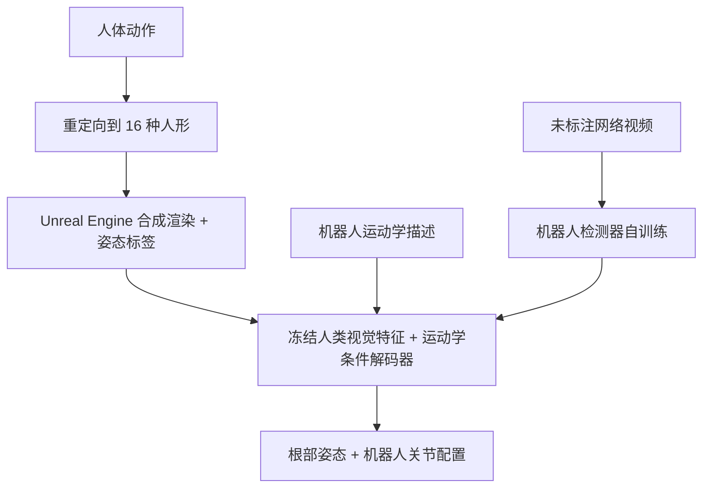

# HumanoidPose：从视频估计人形机器人姿态

**HumanoidPose**（*Vision as Proprioception: Estimating Humanoid Robot Pose from Video*，[arXiv:2610.25288](https://arxiv.org/abs/2610.25288)）由 **苏黎世联邦理工（ETH Zürich）计算机科学系与机械和过程工程系**提出：将普通视频当作视觉本体感知，结合人类预训练视觉特征与机器人运动学描述，估计不同人形机器人的全身关节配置和根部姿态；作者报告在 Unitree G1、EngineAI PM01、Fourier N1 上，关节角误差较各自最佳基线降低 18–32%。

## 一句话定义

用单目视频恢复机器人关节与根部姿态，以运动学条件化的共享模型跨越多种人形形态，并从无标注公开视频中改进机器人检测。

## 英文缩写速查

| 缩写 | 英文全称 | 简要说明 |
|------|----------|----------|
| RGB | Red-Green-Blue | 视频输入的彩色图像通道 |
| 2D | Two-Dimensional | 自训练阶段的机器人图像姿态/检测表示 |
| 3D | Three-Dimensional | 模型最终恢复的机器人空间配置 |
| MJCF | MuJoCo XML Model | 项目仓库说明中作为机器人运动学描述的输入格式 |
| DoF | Degrees of Freedom | 项目页用于描述机器人关节自由度数量 |

## 为什么重要

- **视频补上关节状态缺口：** 公开视频通常没有编码器日志；从画面恢复机器人配置，可把宣传片、真实交互视频和生成视频变为动作分析与学习候选数据。
- **共享模型适配多种形态：** 把机器人的运动学描述作为输入，而非为每个机器人单独固化一套权重；论文用合成数据覆盖 16 种人形 embodiment。
- **降低真实视频标注成本：** 项目通过未标注网络视频的自训练更新 2D 机器人检测器，减少手工框标注依赖。
- **结果有实机参考：** 三个平台评测显示关节角误差相对各自最佳基线降低 18–32%；这是论文报告值，不能直接当作每个视频、每台机器人都保证达到的精度。

## 核心方法栈

1. **合成监督数据：** 将人体动作重定向到多种人形机器人，并在 Unreal Engine 渲染；合成帧天然带有对应的机器人配置标签。项目页称姿态估计器的训练不使用真机数据。
2. **人类视觉先验：** 逐帧提取在人类姿态任务上预训练的视觉特征，保留冻结的视觉/相机编码器。
3. **运动学条件化解码：** 把机器人描述中的关节信息交给共享解码器，使其按目标机器人输出关节角和根部姿态；更换形态时可提供新的运动学描述。
4. **无标注视频自训练：** 先用合成数据训练检测器，再在网络视频上为高置信预测生成伪标签，以缩小合成图像与真实视频的域差。

## 评测与结果

- **三种真机平台：** Unitree G1、EngineAI PM01 与 Fourier N1。作者报告 HumanoidPose 在每个平台上较表现最好的基线降低 **18–32% 关节角误差**。
- **其他指标：** 项目页与论文摘要称关节位置准确度、全局定位和未见 embodiment 泛化均有改善；具体设置与误差定义应以论文表格为准。
- **视频来源：** 展示合成数据、真机录制、互联网公开视频和 AI 生成视频上的恢复。公开视频和生成视频没有对应的编码器真值，因此可用于展示泛化，不应与带编码器参考的实机定量评测混为一谈。
- **坐标系核对：** 项目页摘要称恢复世界坐标配置，仓库 README 的解码器描述则称根部姿态位于相机坐标系；使用结果前应以论文中具体评测定义和后续代码说明为准。

## 与其他工作对比

| 路线 | 输入与输出 | 主要侧重 |
|------|------------|----------|
| **HumanoidPose** | 机器人视频 → 根姿态与关节配置 | 从机器人自身视频恢复关节状态，跨 embodiment，共享运动学条件解码 |
| [BeyondRetarget](paper-beyondretarget-monocular-humanoid.md) | 人类单目视频 → 可执行人形动作 | 直接把人类运动映射到目标机器人，目标是可跟踪的机器人动作 |
| [GMR](../methods/motion-retargeting-gmr.md) | 已有骨架动作 → 目标机器人关节轨迹 | 运动学重定向；本身不负责从视频估计输入动作 |

HumanoidPose 与 BeyondRetarget 都处理视频和人形动作，但问题设置不同：前者读出视频中**机器人自己的姿态**，后者将**人的动作转成机器人轨迹**。前者可补机器人状态观测和数据整理，后者更直接面向人类示范迁移。

## 工程实践与开源状态

| 项 | 当前核查 |
|----|----------|
| 项目页 | [ETH SIPLAB HumanoidPose](https://siplab.org/projects/HumanoidPose) |
| 论文 | [arXiv:2610.25288](https://arxiv.org/abs/2610.25288) |
| 官方代码仓 | [eth-siplab/HumanoidPose](https://github.com/eth-siplab/HumanoidPose)，MIT 许可证 |
| 可运行代码 | **待发布**（截至 2026-10-24）；仓库 README 标注代码与模型即将发布，当前没有训练或推理入口 |
| 推荐数据流 | 视频帧与机器人运动学描述 → 逐帧检测/姿态估计 → 时序对齐与置信度筛选 → 人工抽查后再作为动作数据使用 |

当前可核查论文与项目演示，但不能从官方仓库复现模型。落地到视频数据清洗时，应另行处理遮挡、快速动作模糊、相机运动、机器人外观域差及根部坐标系对齐；姿态估计结果不能直接视为可执行控制轨迹。

## 结论

**HumanoidPose 的核心价值是把公开视频变成可读的机器人状态观测；它当前证明了跨形态姿态估计的潜力，尚未提供可复现的软件交付。**

1. **适合做状态读取和数据挖掘：** 公开视频没有关节日志时，可用视觉恢复的关节配置做动作检索、分析和候选伪标签。
2. **跨形态靠机器人描述条件化：** 新形态无需把整套网络权重重新定义成专属模型，但仍需提供正确的运动学模型并验证关节映射。
3. **读 18–32% 时看清比较对象：** 该范围是三个真机平台各自相对最佳基线的误差改善，不是绝对误差，也不是跨数据集统一承诺。
4. **区分两类视频任务：** 估计画面中的机器人关节，与从人类视频生成人形运动是不同问题；HumanoidPose 对应前者。
5. **复现状态仍受代码发布限制：** MIT 许可和已建仓库并不表示实现已公开；截至 2026-10-24，运行代码和模型仍待发布。

## 局限与风险

- 无编码器标注的公开视频难以直接做严谨定量验证；需避免将定性可视化等同于测量精度。
- 模型输出的是估计姿态，不自动保证动力学可行、足端接触正确或轨迹可执行。
- 视频拍摄视角、遮挡、压缩和运动模糊会影响检测；部署时应保留置信度门限和人工抽查。
- 项目页与仓库 README 对根部姿态坐标表述不完全一致，应以论文定义和实际代码为准。

## 关联页面

- [GMR：通用动作重定向](../methods/motion-retargeting-gmr.md)
- [BeyondRetarget：从人类单目视频生成可执行人形动作](paper-beyondretarget-monocular-humanoid.md)
- [HTD-Refine：单目 HMR 轨迹的动力学精炼](paper-htd-refine-monocular-hmr.md)

## 参考来源

- [HumanoidPose arXiv 论文归档](../../sources/papers/humanoidpose_arxiv_2610_25288.md)
- [ETH SIPLAB 官方项目页归档](../../sources/sites/siplab-humanoidpose.md)
- [官方代码仓状态归档](../../sources/repos/eth-siplab-humanoidpose.md)

## 推荐继续阅读

- [HumanoidPose 官方项目页](https://siplab.org/projects/HumanoidPose)
- [HumanoidPose 论文](https://arxiv.org/abs/2610.25288)
