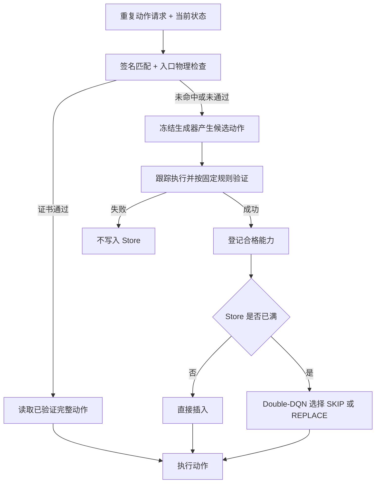
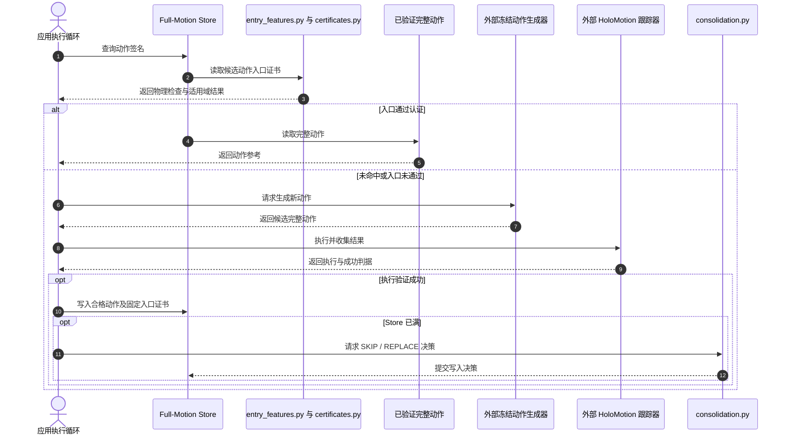

# HumanoidTTT：让人形机器人复用完整动作

**HumanoidTTT**（arXiv:2610.00198）面向重复出现的人形动作请求：系统只在当前机器人入口状态通过该完整动作的适用性认证时才重放已验证动作，并在存储容量受限时学习保留哪些动作。

## 英文缩写速查

| 缩写 | 英文全称 | 简要说明 |
|------|----------|----------|
| TTT | Test-Time Training | 本文在部署期根据复用结果调整能力保留策略 |
| FSM | Full-Motion Store | 存放已验证完整动作及其入口证书的有限容量动作库 |
| DQN | Deep Q-Network | 为满库写入选择跳过或替换动作的价值网络 |
| OOD | Out-of-Distribution | 入口状态偏离规则开发分布的测试条件 |
| G1 | Unitree G1 Humanoid | 论文真机 A–B–A 动作复用演示平台 |

## 为什么重要

机器人持续运行时，相同动作请求可能重复到来，但中间动作会改变姿态、速度和接触状态。简单缓存只依据请求 ID 命中，可能把旧轨迹从不合适的状态直接重放；完全重新生成则每次付出完整推理成本。HumanoidTTT 将“能否安全复用”和“有限内存里保留什么”分成读侧认证与写侧整合两项任务。

## 核心原理

### 1. 认证入口状态后再复用动作

每项能力由完整动作、能力签名和入口适用性证书组成。45 维入口特征包含候选动作相对的关节/根部偏差与速度、足部接触、物理裕度及短时执行历史。候选动作必须匹配请求及运行时签名，并通过稳定性、接触、穿透、关节限位、历史长度等固定物理检查；状态描述还须落在该动作单独记录的适用域内。

首次生成的候选动作只有在执行验证成功后才写入 Store。已接受的复用直接读取完整运动并跳过生成器；不满足条件就走冻结生成器和执行验证的回退路径。适用性证书在该能力入库后不随在线学习改变。

### 2. 在线整合有限容量能力

Store 未满时，成功验证的新动作直接插入。Store 已满且出现新的合格动作时，Double-DQN 根据当前 Store 和候选动作特征在 SKIP 与 REPLACE(j) 中选择。策略通过两次满库决策之间观察到的成功复用比例得到延迟奖励并更新。

这里的测试时学习只改变哪些已验证动作留在库里；论文冻结动作生成器、入口接受条件和已存证书。接受复用与轻量整合在 CPU 执行，只有未命中后的新动作生成才启用主要 GPU 路径。

## 流程总览

## 源码运行时序图

官方仓库提供 entry_features.py、certificates.py、consolidation.py 等可安装组件；它不包含完整生成器、跟踪器和机器人应用循环，图中的应用侧模块需由部署者接入。

运行时中，entry_features.py 与 certificates.py 支持入口过滤，consolidation.py 仅在满库且出现待写入能力时触发；外部应用负责接入生成器、tracker、动作资产及执行资格验证。

## 方法、评测与对比

### 方法栈

这不是新的动作生成模型或全身跟踪控制器，而是围绕生成器—跟踪器栈增加完整动作能力缓存、入口安全门和在线保留策略。论文实验固定 OMG 生成器与执行栈，真机用 Unitree G1 和 HoloMotion 跟踪器；部署期只适配 Store 整合策略。

### 实验与评测

| 评测 | 论文报告 | 应如何解读 |
|------|----------|------------|
| 入口安全 | 200 个测试入口接受 180 个；不安全接受 0；887 个 OOD 条件误接受 0；540/540 次接受后重放成功 | 在论文固定判据与测试集合上，认证入口门明显优于按任务 ID 或最近入口直接复用 |
| 命中准备延迟 | 中位数 29.514 ms，Fresh OMG 为 5057.996 ms；P95 63.115 ms | 只统计已确认命中的入口检查与动作读取 |
| 端到端时延 | 固定 200 请求高复用轨迹平均 268.66 ms，Fresh OMG 4415.82 ms | 论文报告 16.4 倍加速，依赖测试轨迹中的复用率 |
| 容量 10 的整合 | 每 200 请求平均避免 131.4 次生成调用；冻结同一预训练策略为 118.2 次 | 在线更新多避免 13.2 次调用；15 条匹配请求流 |

真机部分展示机器人先执行 A、再执行 B、再从新的有效入口复用 A 的连续序列。仿真测试把入口接受覆盖率与安全结果分开报告，因此不应把“0 次不安全接受”读成无条件安全保证。

### 与相关工作的对比

- **Fresh generation：** 每个请求都重新生成，不需要动作记忆，但重复请求的延迟与计算成本较高。
- **普通动作缓存：** 按任务 ID 命中或按最近入口匹配可能误收当前不可执行的轨迹；HumanoidTTT 先匹配，再过物理检查和动作专属证书。
- **DiT Cache / 中间特征缓存：** 复用生成过程中的中间计算；HumanoidTTT 在认证通过后复用完整动作，命中可跳过整个生成器。
- **有限容量缓存策略：** LRU/LFU 等规则依据访问历史淘汰；HumanoidTTT 用后续成功复用效用在线更新 Store 写入选择。

可与 [TWIST2](./paper-twist2.md) 的全身跟踪/数据采集栈及 [YAHMP](./paper-yahmp.md) 的可复现全身动作跟踪框架并读：它们可作为执行侧能力基础，HumanoidTTT 关注上层已验证动作如何安全重用与保留。

## 结论

**一句话总判：HumanoidTTT 的主要贡献是给“完整动作缓存”增加入口适用性认证，并用部署反馈改进有限容量淘汰；性能收益取决于请求重复度和入口判据。**

1. 只有动作签名、物理约束与动作专属入口证书都通过，才应绕开新生成；相同任务 ID 本身不足以证明可安全复用。
2. 16.4 倍是固定高复用 200 请求轨迹上的端到端平均加速；171.4 倍只对应已确认复用命中的准备延迟。
3. 能力整合策略依据延迟到来的后续成功复用率更新，生成器、入口判据和入库证书均保持固定。
4. 落地要先定义可观测入口特征、物理安全检查及成功执行判据；否则代码组件无法独立给出可靠的复用认证。
5. 证书当前不适应持续动力学或环境变化；长期使用需处理证书失效与安全重新认证。

## 局限与风险

- 入口证书固定于动作首次成功执行时刻；持续变化的动力学、环境或适用区域尚未纳入证书在线适配。
- 仿真安全判据与有限 OOD 集上未观察到不安全接受，不能外推为对所有状态分布的形式化安全保证。
- 项目代码仓库公开方法组件和初始整合权重，但应用需自行接入生成器、HoloMotion、动作资产、资格检查和执行循环；仓库根目录未发现 LICENSE 文件，许可需进一步核实。
- 端到端收益依赖动作请求会重复出现；复用率较低时，存储和资格检查的收益可能减小。

## 关联页面

- [TWIST2：人形全身数据采集与跟踪](./paper-twist2.md)
- [YAHMP：通用人形动作跟踪实证框架](./paper-yahmp.md)
- [SONIC 全身运动跟踪](../methods/sonic-motion-tracking.md)
- [Behavior Foundation Model](../concepts/behavior-foundation-model.md)

## 参考来源

- [HumanoidTTT 论文摘录](../../sources/papers/humanoidttt_arxiv_2610_00198.md)
- [HumanoidTTT 项目页核查](../../sources/sites/humanoidttt-project.md)
- [官方代码库核查](../../sources/repos/humanoidttt.md)

## 推荐继续阅读

- [论文：HumanoidTTT](https://arxiv.org/abs/2610.00198)
- [项目主页](https://aigeeksgroup.github.io/HumanoidTTT/)
- [官方实现与模型权重说明](https://github.com/AIGeeksGroup/HumanoidTTT)
