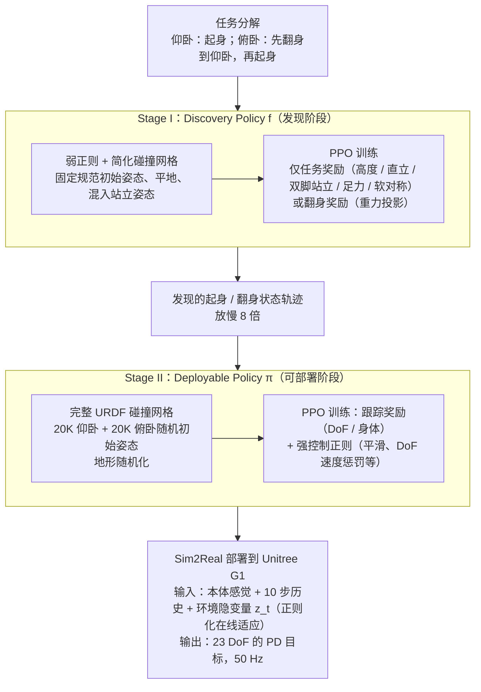

# HUMANUP

**HUMANUP**（Learning Getting-Up Policies for Real-World Humanoid Robots）在 [Light Origins · Light REACT：面向规模化部署的全身韧性智能](https://www.lightorigins.com/blog/light-react) 中被引用。

## 一句话定义

**两阶段 RL：先发现起身轨迹再 refine 为可部署策略；G1 六地形俯卧/仰卧起身 78.3% 成功率。**

## 英文缩写速查

| 缩写 | 英文全称 | 简要说明 |
|------|----------|----------|
| VLM | Vision-Language Model | 视觉-语言多模态模型 |
| VLN | Vision-and-Language Navigation | 视觉-语言导航 |
| ER | Embodied Reasoning | 具身推理；LightNav 第一阶段中期训练 |
| RL | Reinforcement Learning | 强化学习 |
| R2S2R | Real-to-Sim-to-Real | 真场景→仿真合成→真机部署 |

## 为什么重要

- Light REACT 韧性金字塔 L2「跌倒后起身恢复行走」的直接前序。
- 博客 ingest 独立节点（非重复 stub）；见 [3 篇技术地图](../overview/lightorigins-3blogs-technology-map.md)。

## 流程总览

图依据：论文 §III（Fig.2、§III-A Policy Architecture、§III-B Two-Stage Policy Learning、§III-C Stage I to Stage II Curriculum）与 §IV Implementation Details。

## 核心信息

| 项 | 内容 |
|----|------|
| **类型** | paper |
| **出处** | RSS 2025 |
| **开源** | **待核实** |
| **arXiv** | [2502.12152](https://arxiv.org/abs/2502.12152) |

## 源码运行时序图

**不适用**（截至入库日无官方可运行实现，或仅有博客/论文叙述）。

## 实验与评测

- **本体与设定：** Unitree G1，**六种地形** 上的俯卧/仰卧起身，报告 **78.3% 成功率**（原文口径）。
- **两阶段的评测含义：** 第一阶段只负责 **发现** 可行起身轨迹（允许不可部署的探索设定），第二阶段把它 refine 成 **真机可执行** 策略——因此中间阶段的成功率与最终部署成功率不是同一个数。
- **在 Light REACT 中的位置：** 被 [Light REACT](./light-react.md) 引作「全身韧性智能」的能力锚点之一，用于说明跌倒后自恢复是部署闭环的必需项而非加分项。
- **数值口径：** 本页为博客 ingest 级摘要，**未复核逐项分数**；地形分项与消融 **以 [原文](https://arxiv.org/abs/2502.12152) 为准**。

## 与其他工作对比

| 维度 | HUMANUP（本页） | 人工设计起身轨迹 / 脚本化恢复 | 通用全身 tracking 策略 |
|------|------------------|------------------------------|------------------------|
| 轨迹来源 | **RL 自发现**，再 refine | 人工示教或手写关键帧 | 参考动作跟踪 |
| 地形泛化 | 六地形评测 | 通常只在平地标定 | 取决于参考动作覆盖 |
| 对硬件的要求 | 需承受接触与自碰撞的可部署力矩 | 同左，但动作更保守 | 同左 |
| 典型失效 | 第一阶段发现的轨迹真机不可执行 | 换地形即失效 | 跌倒姿态不在参考集中 |

- **起身不是 locomotion 的子问题：** 起身过程包含 **大面积接触与构型剧变**，与站立行走的假设（近似点接触、姿态连续）不同，把 locomotion 策略直接外推到起身通常不成立。
- **读成功率的口径：** 78.3% 是 **特定本体 + 特定六地形** 下的数，换 G1 之外的本体或换地形集都需重测，不能当作「起身问题已解」的通用结论。

## 结论

**HUMANUP 在 Light Origins 三篇 Tech Blog 引用链中承担「Light REACT 韧性金字塔 L2「跌倒后起身恢复行走」的直接前序。…」角色——部署前以 arXiv/项目页与开源状态为准。**

1. 开源：**待核实**；勿凭博客脚注臆断可复现性。
2. 与 [Light REACT](./light-react.md) / [LightNav-0](./paper-lightnav-0.md) / [Light-Loco-Parkour](./paper-light-loco-parkour.md) 按能力轴交叉阅读。
3. 定量指标以原文 PDF 为准；本页为博客 ingest 级摘要。

## 关联页面

- [亮源新创（Light Origins）](./light-origins.md)
- [lightorigins-3blogs-technology-map](../overview/lightorigins-3blogs-technology-map.md)
- [LightNav-0](./paper-lightnav-0.md)
- [Light REACT](./light-react.md)

## 参考来源

- [humanup_getting_up_arxiv_2502_12152.md](../../sources/papers/humanup_getting_up_arxiv_2502_12152.md)
- [lightorigins_light_react_2026-09-09.md](../../sources/blogs/lightorigins_light_react_2026-09-09.md)
- [Tech Blog](https://www.lightorigins.com/blog/light-react)
- [arXiv PDF](https://arxiv.org/pdf/2502.12152)：已通读方法部分（实验与附录以略读为准）：§III HumanUP（A–C）、§IV 实现细节、§V-A/B 任务与基线设置

## 推荐继续阅读

- [Light Origins 官网](https://www.lightorigins.com/)
- [3 篇技术地图](../overview/lightorigins-3blogs-technology-map.md)
