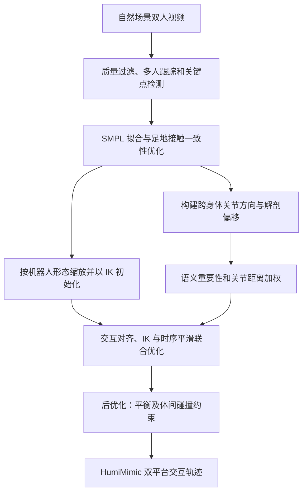

# HumiMimic：从自然视频迁移人类—人形交互行为

## 一句话定义

**HumiTransfer** 将双人视频中的一人重定向到人形机器人，同时优化两人的相对关系；**HumiMimic** 是由此构建的交互动作数据集。

## 英文缩写速查

| 缩写 | 英文全称 | 简要说明 |
|------|----------|----------|
| IK | Inverse Kinematics | 逆运动学，用于把人体姿态映射到机器人关节角 |
| SMPL | Skinned Multi-Person Linear Model | 参数化人体模型，论文用其拟合视频中的人体网格 |
| MPJPE | Mean Per Joint Position Error | 平均关节位置误差（cm），衡量单人姿态重定向误差 |
| IRD | Inter-Relative Distance（论文正文未展开全称） | 体间关节相对距离误差（cm），即两人成对关节距离的平均绝对误差 |
| CF1 | F1 score for contact preservation | 接触保持的 F1 分数，距离阈值 20 cm |
| ZMP | Zero Moment Point | 零力矩点，用作足地接触的平衡正则项 |
| CoM | Center of Mass | 质心，用于检查自平衡与仿真稳定性 |
| SSM | Static Stability Margin | 静态稳定裕度，论文定义为投影质心到支撑多边形的带符号距离 |
| FID | Fréchet Inception Distance | 分布距离指标；论文用 FIDk（关节轨迹）与 FIDcd（成对关节距离）评估生成动作 |
| DoF | Degree of Freedom | 自由度，文中 R1 Edu 为 26 DoF、Mini-hi 为 23 DoF |

## 核心信息

| 项 | 内容 |
|----|------|
| 论文 | [HumiMimic: Mimetic Embodiment Transfer of Human–Humanoid Interaction from In-the-Wild Videos](https://arxiv.org/html/2610.36615v2)，arXiv v2，2026-10-29；本页全文核对基于 [v3 PDF](https://arxiv.org/pdf/2610.36615)（PDF 页眉 arXiv stamp 2026-10-31，共 9 页含参考文献，无附录） |
| 作者 | Nghia Le、Khang Nguyen、Ba Long Tran、Thi Quynh Nhu Pham、Binh X. Nguyen、Tuong Do、Erman Tjiputra、Hoan Nguyen、Tung D. Ta、Baoru Huang、Hai-Nguyen Nguyen、Anh Nguyen |
| 机构 | AIOZ、穆罕默德·本·扎耶德人工智能大学、皇家墨尔本理工大学越南校区、利物浦大学、台湾清华大学、越南胡志明市国家大学信息技术大学、庆应义塾大学 |
| 项目页 | [HumiMimic](https://aioznetwork.github.io/HumiMimic/)；2026-11-06 可访问。页面 Code 按钮标注 **Code (TBD)**，但链接到官方仓库；Dataset 链接为 Hugging Face `aiozai/HumiMimic`，未登录访问返回 HTTP 401（数据集是否公开未核实） |
| 官方仓库 | [AIOZNetwork/HumiMimic](https://github.com/AIOZNetwork/HumiMimic)。2026-11-03 记录 main 分支仅含占位 README、许可证和 gitignore；本次会话无法通过 GitHub 复核（未挂载该仓库），以下按 2026-11-03 记录处理 |

## 为什么重要

握手或拥抱不仅要求机器人复现单人姿态，还要求保留与伙伴之间的方向、距离和接触。单人动作重定向的关节对齐误差不足以衡量这些关系。

## 流程总览

依据论文 v3 Fig. 2 与 §III。后优化目标是改善物理可行性，不代表消除所有碰撞或保证真机安全。

## 核心原理

**输入**：一段自然场景双人互动视频（两人、无额外标定）。**输出**：每帧一个机器人关节轨迹，使目标人形替代其中一人，并保留与伙伴的相对方向、距离与接触。

### 数据与重建（HumiTransfer-A）

- 数据：从 1,200 段双人互联网视频（YouTube、TikTok、Facebook 等）得到约 50 万帧、约 4.6 小时的处理后序列，每段 100–1,000 帧；覆盖共同移动（29%）、社交交流（21%）、双人运动（17%）和对练（13%）等。低质量帧过滤后保留约 73%。
- 跟踪与拟合：多人跟踪器检测每帧人框，关键点检测器给出关键点，再拟合 SMPL。拟合能量为重投影误差加姿态与形状先验（式 1）。
- 接触一致性：式 (2) 为 $E_{\text{contact}}=E_{\text{consist}}+\lambda_{\text{zmp}}E_{\text{zmp}}$。$E_{\text{consist}}$ 对足关节施加“着地时不滑动”与“足部贴地”两项约束，$E_{\text{zmp}}$ 为 ZMP 正则。

### 交互建模与迁移（HumiTransfer-B）

- 暖启动：目标人形按比例缩放人体姿态后，在约束与关节限位下做 IK 初始化。
- 相对方向矩阵：对人形 $R$ 与伙伴 $P$ 的关节对 $(i,j)$，$r^{R\to P}_{ij,t}=J^R_{i,t}-J^P_{j,t}$ 组成 $n\times n$ 矩阵 $J^{R\to P}_t$。
- 解剖偏移矩阵：每个关节指向其父关节的单位向量，相对伙伴 $P$ 表示，组成 $A^{R\to P}_t$（式 5）。
- 语义权重：关节 $i$ 的权重由 MotionCLIP 嵌入的余弦相似度经 softmax 得到，$w^H_{\text{sem},i}=\dfrac{\exp(\alpha_i)}{\sum_j \exp(\alpha_j)}$，$\alpha_i=\cos(z_{\text{poses}},z_{\text{joint},i})$。
- 距离权重：$w_{\text{dis},ij,t}=\exp\!\left(-\lVert r^{H\to P}_{ij,t}\rVert^2/2\sigma^2\right)$，近距离关节对权重大。
- 交互能量（式 8 的结构）：以 $W^{H\to P}_{\text{sem}}\odot W^{H\to P}_{\text{dis},t}$ 对相对方向差与解剖偏移差做元素加权平方和。具体范数写法以原文为准（PDF 抽取中公式排版有损）。
- 逐帧求解（式 9）：

$$\hat R_t=\arg\min_{R_t}\; E_{\text{interact}}(R_t,P_t,H_{\text{SMPL},t})+E_{\text{IK}}(R_t,H_{\text{SMPL},t})+E_{\text{smooth}}(R_t,R_{t-1})$$

  论文用 mink 求解器，加入 Tikhonov 正则 $E_{\text{smooth}}$。

### 后优化（HumiTransfer-C）

- 自平衡：沿用全身顺应的人-人形交互平衡机制（引用 [49]）。
- 体间碰撞：约束两人对应关节间距不小于安全距离 $d_{\min,ij}$，同时保留有意图的接触。论文正文未见 $\lambda$、$\sigma$、$d_{\min}$ 的具体取值（未核实）。

### 数据集形态

- 机器人：26 DoF Unitree R1 Edu 与 23 DoF HighTorque Mini-hi。
- 动作表示为可直接用于控制的机器人关节序列，并附人类与机器人 CoM 轨迹对照（论文图 7）。

## 源码运行时序图

**不适用，待复核**：官方仓库在 2026-11-03 记录时只有占位 README，未发现可运行实现；本次未能复核仓库当前状态。项目页标注 Code (TBD)，因此暂无可辨识的训练、推理或部署入口。

## 工程实践

| 环节 | 论文设置或要点 |
|------|----------------|
| 视频过滤 | 去除图像质量失真、相机抖动和场景复杂的低质量帧，保留约 73% 帧（引用 [40]） |
| 跟踪与关键点 | 多人跟踪器检测人框；预训练关键点检测器（引用 [42]） |
| 人体拟合 | SMPL 拟合（引用 [43]）；足地一致性与 ZMP 正则联合微调 |
| 机器人 IK 暖启动 | 按机器人比例缩放后，在关节限位下 IK 初始化 |
| 联合优化 | mink 求解器，加 Tikhonov 平滑项（引用 [47][48]） |
| 接触评估 | CF1 的距离阈值为 20 cm |
| 人形数据覆盖 | R1 Edu（26 DoF）与 Mini-hi（23 DoF） |
| 仿真训练 | mjlab，4096 并行环境，RTX 3090 约 30,000 次迭代，26 维动作；采样初始相位、扰动初始姿态与速度、随机化足底摩擦与关节动力学 |
| 部署 | 策略导出 ONNX，C++ mimic 控制器内用 ONNX Runtime 以 50 Hz 执行；读取 26 个电机状态与 IMU；按固定映射对应到 Unitree SDK 电机 ID |
| 真机范围 | 仅 R1 Edu 的拥抱与握手演示，基于预定义序列 |

**调试指标**：足滑动误差 $E_{\text{foot}}$（cm/frame）、穿地误差 $E_{\text{ground}}$（cm/frame）、SSM、MPJPE、IRD、CF1、FIDk、FIDcd、$f_{\text{contact}}$、多样性分数。这些是离线代理指标，不替代真机成功率。

## 实验与评测

- **足地一致性（表 II）**：足滑动误差由 2.6125 降至 0.6765 cm/frame，地面穿透误差由 36.3547 降至 0.9282 cm/frame；SSM 由 −1.9336 升至 2.0402。
- **重定向比较（表 III）**：HumiTransfer+ 在 R1 Edu / Mini-hi 的 MPJPE 为 6.31 / 7.58 cm，IRD 为 2.84 / 3.67 cm，CF1 为 81.97 / 78.15。对照组为 Naive IK、GMR、PAIR 与去掉权重的 HumiTransfer−。该指标衡量重定向质量，不等于真机任务成功率。
- **多样性（表 IV）**：HumiMimic 多样性分数 6.2427（R1 Edu）与 6.2285（Mini-hi），高于 AMASS 的 5.4834 / 5.4859、3DPW 的 4.0173 / 3.9130。
- **生成基准（表 V）**：按 8:2 划分训练与测试，比较 ComMDM、InterFormer、InterGen、ReMos、Duolando。论文称 Duolando 总体最佳（R1 Edu 的 FIDk 24.96、FIDcd 9.07、$f_{\text{contact}}$ 51.75%；Mini-hi 的 FIDk 27.24、FIDcd 11.53、$f_{\text{contact}}$ 46.77%）。ReMos 的接触频率较高（46.79% / 47.56%），InterGen 在 Mini-hi 上 FIDcd 为 10.86。不同指标最优方法不完全相同。
- **仿真平衡**：两种人形在测试集上的 CoM 高度相对人类的差异分别为 2.9573 cm（R1 Edu）与 3.2021 cm（Mini-hi）。
- **真机**：R1 Edu 拥抱与握手两段预定义序列，论文称交互安全、人形未对人造成伤害，但未报告量化成功次数。

## 与其他工作对比

| 维度 | 本页 HumiMimic | [OmniInteract](./paper-omniinteract-dual-humanoids.md) | [CoDance](./paper-codance.md) |
|------|----------------|------|------|
| 人类数据来源 | 1,200 段自然场景双人视频，重建后构成数据集 | InterHuman、Inter-X 双人交互动作 | 单段双人舞视频 |
| 核心贡献 | 交互关系加权的重定向（HumiTransfer）与数据集 | 表面接触感知联合重定向 + 冻结 SONIC 上的伙伴条件残差策略 | 双手顺应增强 + PPO，学习对舞伴拉力让步 |
| 交互对象 | 人与人形（以单台人形替换双人中的一人） | 两台人形之间 | 人与人形（真机用 Vicon 读取舞伴） |
| 真机 | R1 Edu 拥抱、握手演示，基于预定义序列 | 双 G1 High-Five / Hug / Shoulder，报告各任务成功次数 | G1 与人持续双手接触跳舞 |
| 代码与数据 | 项目页标注 Code (TBD)；数据集 HF 链接未登录返回 401；2026-11-03 仓库为占位 README | 项目页未列可运行代码 | 已公开训练、部署代码与检查点 |

- **怎么选**：要大规模交互动作数据或检查重定向质量指标（MPJPE、IRD、CF1）看 HumiMimic；要双人形协同控制看 OmniInteract；要真机对伙伴实时响应与受力顺应看 CoDance。
- **读法**：HumiMimic 的指标衡量重定向质量，不等于另两篇报告的控制成功率。

## 结论

**交互关系加权可改善论文评测中的跨形态动作迁移，但真机展示仍基于预定义序列。**

1. 同时检查关节误差、体间距离与接触指标，不能只看单人姿态。
2. 依据目标机器人形态审查任务可达性：论文指出 Mini-hi 肩宽臂短，无法像 R1 Edu 一样完成拥抱。
3. 生成模型基准中的伙伴条件响应，不等同于论文真机部署已根据人类实时动作闭环适应。
4. 项目页标注代码 TBD，数据集链接未登录返回 401，截至本次核对未确认可运行代码与数据公开；复现前需检查实际发布版本。

## 局限与风险

- **形态限制**：论文明确指出人与人形的形态差异会使某些动作运动学不可行。Mini-hi 的宽肩与短臂使其无法像 R1 Edu 那样完成拥抱。
- **真机闭环**：当前真机部署依赖预定义序列，未显式考虑人类实时动作；论文将其列为未来工作。
- **指标性质**：MPJPE、IRD、CF1、FID 等都是离线代理指标；论文未报告真机任务成功率，也未给出多次试验的统计。
- **物理可行性**：后优化针对平衡与碰撞，但 $d_{\min}$ 等约束的具体取值与违反量在正文中未见（未核实）。穿地与滑步指标仅在数据集上统计，不代表每一帧在真机上都安全。
- **数据来源**：训练数据来自 YouTube、TikTok、Facebook 等互联网视频。论文未讨论视频的版权、授权与人脸/人像隐私问题（论文未讨论）。发布或商用数据前需自行评估。
- **数据可得性**：论文称代码与数据将公开；截至本次核对，Hugging Face 数据集链接未登录访问返回 401，GitHub 仓库状态未能复核。
- **生成基准**：基线为作者按“以伙伴 3D 姿态为条件预测跟随者运动”改造，结果不同指标排名不一，不宜作为通用排行榜。

## 关联页面

- [人形与四足周报技术地图](../overview/senlanke-weekly-2026-10-26-30-humanoid-quadruped-technology-map.md)
- [人形运动](../tasks/humanoid-locomotion.md)
- [强化学习](../methods/reinforcement-learning.md)

## 参考来源

- [论文来源归档](../../sources/papers/humimic-human-humanoid-interaction-video_arxiv_2610_36615.md)
- [周报来源归档](../../sources/blogs/wechat_senlanke_weekly_humanoid_quadruped_2026-10-26_30.md)
- [论文全文 v3 PDF](https://arxiv.org/pdf/2610.36615)：2026-11-06 核对正文方法、实验、局限与参考文献（无附录）。
- [论文 v2 HTML](https://arxiv.org/html/2610.36615v2)：早期版本，保留作参照。
- [官方仓库](https://github.com/AIOZNetwork/HumiMimic)：2026-11-03 记录为占位 README，本次未能复核。

## 推荐继续阅读

- [项目主页](https://aioznetwork.github.io/HumiMimic/)：2026-11-06 可访问，标注 Code (TBD)。
- [arXiv 摘要页](https://arxiv.org/abs/2610.36615)：版本与引用信息。
- [Hugging Face 数据集页](https://huggingface.co/datasets/aiozai/HumiMimic)：未登录返回 401（公开状态未核实）。
