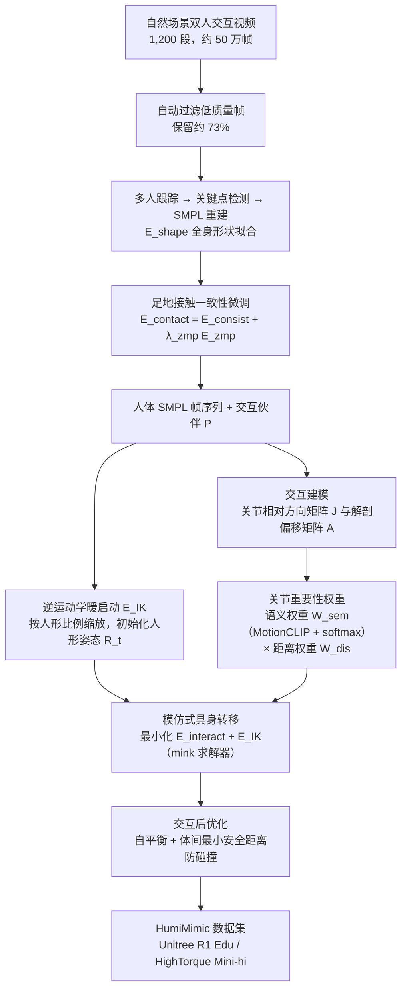

# HumiMimic：从自然场景视频迁移人类—人形交互行为

**HumiMimic**（*HumiMimic: Mimetic Embodiment Transfer of Human-Humanoid Interaction from In-the-Wild Videos*，[arXiv:2610.36615](https://arxiv.org/abs/2610.36615)）收录于 senlanke「具身运控lab」10-26–10-30 前沿论文动态（人形/四足）。本页依据**周报条目 + arXiv 摘要页**整理，未逐页核对正文 PDF；指标与结论以论文为准。

## 一句话定义

**HumiMimic：从自然场景视频迁移人类—人形交互行为——从自然视频重建双人三维动作，再通过关节相对方向、解剖偏移和交互关键权重完成跨形态转移；构建约 50 万帧、支持两种人形平台的 HumiMimic 数据集。**

## 英文缩写速查

| 缩写 | 英文全称 | 简要说明 |
|------|----------|----------|
| RL | Reinforcement Learning | 强化学习 |
| WBC | Whole-Body Control | 全身控制 |

## 为什么重要

- 周报所述待解决的问题：将拥抱、握手和双人舞等动作迁移到机器人时，既要保持单人动作，还要保持双方距离、朝向、接触和节奏。

## 流程总览

图依据：论文 §III-A–C / Fig. 2。

## 核心机制

| 项 | 内容 |
|----|------|
| **arXiv** | [2610.36615](https://arxiv.org/abs/2610.36615) · [PDF](https://arxiv.org/pdf/2610.36615) |
| **作者（arXiv）** | Le, Nghia, Nguyen, Khang, Tran, Ba Long, Pham, Thi Quynh Nhu, Nguyen, Binh, Do, Tuong, Tjiputra, Erman, Nguyen, Hoan et al. |
| **机构（周报所述，未逐条核实）** | AIOZ、穆罕默德·本·扎耶德人工智能大学、RMIT 大学、利物浦大学、台湾清华大学、越南国家大学信息技术大学、庆应义塾大学 |
| **arXiv 评论栏** | （无） |
| **开源** | arXiv 摘要页与评论未见代码或项目页链接（仅核对 arXiv 摘要页，不代表未发布）（2026-11-02） |
| **周报所述创新点** | 从自然视频重建双人三维动作，再通过关节相对方向、解剖偏移和交互关键权重完成跨形态转移；构建约 50 万帧、支持两种人形平台的 HumiMimic 数据集。 |

### arXiv 摘要节选（英文原文）

> Enabling a humanoid to interact naturally with human partners requires preserving not only individual motions but also the spatial, semantic, and contact relationships underlying the interaction (i.e., hugging, dancing, hand-shaking, etc.). Furthermore, a practical solution should generalize across various humanoid embodiments with distinct morphologies and kinematic constraints.

## 源码运行时序图

**不适用**：arXiv 摘要页与评论未见代码或项目页链接（仅核对 arXiv 摘要页，不代表未发布），无可对齐的官方代码流程。

## 实验与评测

- 周报与摘要给出的数字/场景已写入上表「创新点」与摘要节选；其余实验细节、基线与成功率定义请回到论文正文。
- 读法：先对齐任务设定、传感器与成功定义（仿真/真机），再解读 headline 数字，勿跨论文直接比较。

## 与其他工作对比

| 维度 | 读法 |
|------|------|
| **同周对照** | 见 [人形/四足周报技术地图](../overview/senlanke-weekly-2026-10-26-30-humanoid-quadruped-technology-map.md)，按方向浏览同期论文 |
| **开源状态** | arXiv 摘要页与评论未见代码或项目页链接（仅核对 arXiv 摘要页，不代表未发布） |

## 结论

**HumiMimic：从自然场景视频迁移人类—人形交互行为。**

1. 本页是入库级摘要，复现前请核对论文正文、附录与代码仓库。
2. 指标须连同实验条件解读。
3. 关注 arXiv 版本更新与代码发布。

## 关联页面

- [senlanke-weekly-2026-10-26-30-humanoid-quadruped-technology-map](../overview/senlanke-weekly-2026-10-26-30-humanoid-quadruped-technology-map.md)
- [humanoid-locomotion](../tasks/humanoid-locomotion.md)
- [reinforcement-learning](../methods/reinforcement-learning.md)

## 参考来源

- [humimic-human-humanoid-interaction-video_arxiv_2610_36615.md](../../sources/papers/humimic-human-humanoid-interaction-video_arxiv_2610_36615.md)
- [wechat_senlanke_weekly_humanoid_quadruped_2026-10-26_30.md](../../sources/blogs/wechat_senlanke_weekly_humanoid_quadruped_2026-10-26_30.md)
- [arXiv:2610.36615](https://arxiv.org/abs/2610.36615)
- [arXiv PDF](https://arxiv.org/pdf/2610.36615)：已通读全文：HumiTransfer 三阶段方法 §III-A–C 与实验 §IV-A 的重定向评测设定

## 推荐继续阅读

- [arXiv PDF](https://arxiv.org/pdf/2610.36615)
