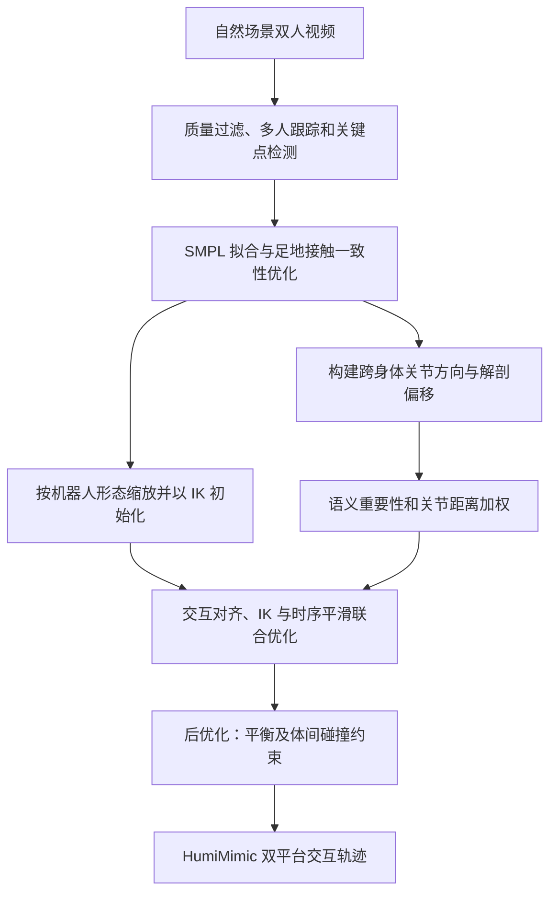

# HumiMimic：从自然视频迁移人类—人形交互行为

## 一句话定义

**HumiTransfer** 将双人视频中的一人重定向到人形机器人，同时优化两人的相对关系；**HumiMimic** 是由此构建的交互动作数据集。

## 英文缩写速查

| 缩写 | 英文全称 | 简要说明 |
|------|----------|----------|
| IK | Inverse Kinematics | 逆运动学 |
| SMPL | Skinned Multi-Person Linear Model | 参数化人体模型 |
| MPJPE | Mean Per Joint Position Error | 平均关节位置误差 |
| IRD | Inter-Relative Distance | 体间关节相对距离误差 |
| ZMP | Zero Moment Point | 零力矩点 |

## 核心信息

| 项 | 内容 |
|----|------|
| 论文 | [HumiMimic: Mimetic Embodiment Transfer of Human–Humanoid Interaction from In-the-Wild Videos](https://arxiv.org/html/2610.36615v2)，arXiv v2，2026-10-29 |
| 作者 | Nghia Le、Khang Nguyen、Ba Long Tran、Thi Quynh Nhu Pham、Binh X. Nguyen、Tuong Do、Erman Tjiputra、Hoan Nguyen、Tung D. Ta、Baoru Huang、Hai-Nguyen Nguyen、Anh Nguyen |
| 机构 | AIOZ、穆罕默德·本·扎耶德人工智能大学、皇家墨尔本理工大学越南校区、利物浦大学、台湾清华大学、越南胡志明市国家大学信息技术大学、庆应义塾大学 |
| 项目页 | [HumiMimic](https://aioznetwork.github.io/HumiMimic/)；本次访问失败，资源开放状态待核对 |
| 官方仓库 | [AIOZNetwork/HumiMimic](https://github.com/AIOZNetwork/HumiMimic)，截至 2026-11-03 的 main 分支仅含占位 README、许可证和 gitignore；论文称代码和数据将公开 |

## 为什么重要

握手或拥抱不仅要求机器人复现单人姿态，还要求保留与伙伴之间的方向、距离和接触。单人动作重定向的关节对齐误差不足以衡量这些关系。

## 流程总览

依据论文 v2 Fig. 2 与 §III。后优化目标是改善物理可行性，不代表消除所有碰撞或保证真机安全。

## 核心机制

- 数据：从 1,200 段双人互联网视频得到约 50 万帧、约 4.6 小时的处理后序列；覆盖共同移动、社交、双人运动和对练等。低质量帧过滤后保留约 73%。
- 重建：跟踪和关键点检测后拟合 SMPL，通过足地接触一致性与 ZMP 正则降低滑步及穿地。
- 迁移：对目标机器人做受限 IK 暖启动；用关节间相对方向与解剖偏移表征交互，语义与距离权重突出交互关键关节，再联合 IK 和时间平滑逐帧求解。
- 后处理：针对平衡与跨身体碰撞优化。数据覆盖 26 自由度 Unitree R1 Edu 与 23 自由度 HighTorque Mini-hi。

## 源码运行时序图

**不适用，待复核**：官方仓库目前只有占位 README，未发现可运行实现；项目页未能访问，因此不能排除其他发布入口。

## 实验与评测

- 在数据集上，足地一致性优化使论文表 II 的足部滑动误差由 2.6125 降至 0.6765 cm/frame，地面穿透误差由 36.3547 降至 0.9282 cm/frame。
- 重定向比较中，HumiTransfer+ 在 R1 Edu / Mini-hi 的 MPJPE 为 6.31 / 7.58 cm，IRD 为 2.84 / 3.67 cm，接触 CF1 为 81.97 / 78.15；CF1 使用 20 cm 距离阈值。该指标衡量重定向质量，不等于真机任务成功率。
- 生成基准按 8:2 划分训练与测试，比较 ReMos、InterFormer、ComMDM、InterGen 和 Duolando；不同指标最优方法不完全相同。
- 真机只报告 R1 Edu 的拥抱和握手演示：mjlab 中 4096 环境、RTX 3090 约 30,000 次迭代训练，导出 ONNX 后以 50 Hz 执行。

## 与其他工作对比

| 维度 | 本页 HumiMimic | [OmniInteract](./paper-omniinteract-dual-humanoids.md) | [CoDance](./paper-codance.md) |
|------|----------------|------|------|
| 人类数据来源 | 1,200 段自然场景双人视频，重建后构成数据集 | InterHuman、Inter-X 双人交互动作 | 单段双人舞视频 |
| 核心贡献 | 交互关系加权的重定向（HumiTransfer）与数据集 | 表面接触感知联合重定向 + 冻结 SONIC 上的伙伴条件残差策略 | 双手顺应增强 + PPO，学习对舞伴拉力让步 |
| 交互对象 | 人与人形（以单台人形替换双人中的一人） | 两台人形之间 | 人与人形（真机用 Vicon 读取舞伴） |
| 真机 | R1 Edu 拥抱、握手演示，基于预定义序列 | 双 G1 High-Five / Hug / Shoulder，报告各任务成功次数 | G1 与人持续双手接触跳舞 |
| 代码与数据 | 仓库仅占位 README | 项目页未列可运行代码 | 已公开训练、部署代码与检查点 |

- **怎么选**：要大规模交互动作数据或检查重定向质量指标（MPJPE、IRD、CF1）看 HumiMimic；要双人形协同控制看 OmniInteract；要真机对伙伴实时响应与受力顺应看 CoDance。
- **读法**：HumiMimic 的指标衡量重定向质量，不等于另两篇报告的控制成功率。

## 结论

**交互关系加权可改善论文评测中的跨形态动作迁移，但真机展示仍基于预定义序列。**

1. 同时检查关节误差、体间距离与接触指标，不能只看单人姿态。
2. 依据目标机器人形态审查任务可达性：论文指出 Mini-hi 肩宽臂短，无法像 R1 Edu 一样完成拥抱。
3. 生成模型基准中的伙伴条件响应，不等同于论文真机部署已根据人类实时动作闭环适应。
4. 项目页、数据和可运行代码开放情况仍待核验；复现前需检查实际发布版本。

## 关联页面

- [人形与四足周报技术地图](../overview/senlanke-weekly-2026-10-26-30-humanoid-quadruped-technology-map.md)
- [人形运动](../tasks/humanoid-locomotion.md)
- [强化学习](../methods/reinforcement-learning.md)

## 参考来源

- [论文来源归档](../../sources/papers/humimic-human-humanoid-interaction-video_arxiv_2610_36615.md)
- [周报来源归档](../../sources/blogs/wechat_senlanke_weekly_humanoid_quadruped_2026-10-26_30.md)
- [论文全文 v2](https://arxiv.org/html/2610.36615v2)：核对正文方法、实验和局限。
- [官方仓库](https://github.com/AIOZNetwork/HumiMimic)

## 推荐继续阅读

- [项目主页](https://aioznetwork.github.io/HumiMimic/)
