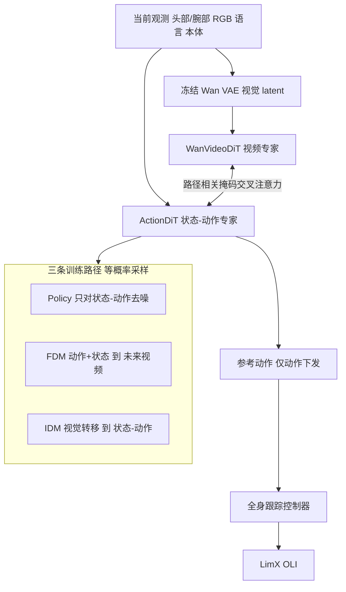

# HWAM：联合状态–动作生成的人形世界动作模型

**HWAM**（*Humanoid World Action Model With Joint State–Action Generation*，arXiv:2610.12026，逐际动力 LimX Dynamics / 南方科技大学）是面向层级人形系统的[世界动作模型](../concepts/world-action-models.md)：模型不仅生成高层参考动作，还把**低层全身控制器执行后的本体状态**作为显式预测目标联合生成，用来弥合“参考动作 ≠ 实际执行”的差距。

## 英文缩写速查

| 缩写 | 英文全称 | 简要说明 |
|------|----------|----------|
| HWAM | Humanoid World Action Model | 本文模型 |
| WAM | World Action Model | 联合预测未来视觉与动作的生成式策略 |
| FDM | Forward Dynamics Model | 路径之一：由动作+执行后状态预测未来视频 |
| IDM | Inverse Dynamics Model | 路径之一：由视觉转移重构联合状态–动作轨迹 |
| DiT | Diffusion Transformer | 视频专家 WanVideoDiT 与动作专家 ActionDiT 的结构 |
| VAE | Variational Autoencoder | 冻结的因果 Wan VAE 产生视觉 latent |
| OLI | LimX OLI | 实验平台：全尺寸人形，31 维全身动作空间 |

## 为什么重要

- **层级人形系统的真问题**：高层只输出参考动作，经平衡、动力学和接触后实际身体响应与之不同；论文测得 OLI 的动作–执行差距（MAE）直接 4.420°、稳态 2.885°（ALOHA 为 0.648° / 0.402°），人形远大于固定基座双臂。
- **让预测模型“看见身体响应”**：把执行后状态放进生成目标，使动作、身体响应与视觉后果三者在同一模型内对齐。
- **无需额外机器人预训练**：与 π0.5、GR00T N1.5、Cosmos3-Edge 等带机器人预训练的基线相比仍有竞争力（见评测）。

## 方法栈 / 流程总览

## 方法

- **骨干**：冻结的因果 Wan VAE 产生当前/未来视觉 latent（论文 §4.2 为 Wan2.2）；WanVideoDiT 作视频专家；ActionDiT 作状态–动作专家，每个时间 token 把执行后状态与动作在特征维拼接后投影；语言用 UMT5-XXL 嵌入；两专家参数独立，以依赖路径的掩码交叉注意力交换信息。
- **三条路径（均匀采样，λ = 1）**：
  - FDM：由动作与执行后状态预测未来视频，仅未来视频 token 被加噪并监督；
  - IDM：由视觉转移重构联合状态–动作轨迹，轨迹 token 被加噪并监督；
  - Policy：只条件于当前观测、语言、本体，隐藏未来视频 token，仅对状态–动作去噪，这就是部署时的路径。
- **损失**：L_HWAM = ⅓(L_F + L_I + L_P)，flow-matching MSE，无额外通道/时间步加权。
- **推理**：预测状态参与联合去噪，但**只有动作**发给低层控制器；OLI 诊断使用 4 步去噪。
- **平台与数据**：LimX OLI，31 维全身动作空间，双 7-DoF 臂 + BrainCo 灵巧手，头部与腕部 RGB；Candy Picking 1,783 条（另 422 条留出验证）、Object Collection 4,220 条、Plush-Toy Picking 404 条；6 epoch，AdamW lr 1e-4，全局 batch 128，16 张 A800。
- **未披露**：时域长度 H、状态/动作维度 d_s/d_a、token 数、噪声调度。

## 源码运行时序图

**不适用**：[项目页](../../sources/sites/hwam-project.md) 的 Code / Dataset / Video 均为 “Coming soon”，截至 2026-10-12 无官方仓库，无法对齐真实脚本。

## 实验与评测

**OLI 真机成功率（%）**

| 方法 | 机器人预训练 | Candy Picking | Object Collection | Plush-Toy |
|------|-------------|---------------|-------------------|-----------|
| Cosmos3-Edge | 是 | 15.8 | 0.0 | 56.7 |
| GR00T N1.5 | 是 | 40.5 | 42.5 | 60.0 |
| π0.5 | 是 | 62.5 | 45.0 | 60.7 |
| Fast-WAM | 否 | 43.3 | 0.0 | 60.0 |
| DiT4DiT | 否 | 52.5 | 15.0 | — |
| **HWAM** | 否 | **70.6** | **46.7** | **73.3** |

- Candy Picking 试验数与 95% Wilson 区间：HWAM 84/119 [61.9, 78.0]，π0.5 75/120 [53.6, 70.6]，Fast-WAM 52/120，GR00T N1.5 49/121；区间假定试验独立、不含种子方差；其余两任务试验数原文未报告。相对 π0.5 的领先（+8.1、+1.7、+12.6）在 Object Collection 上仅 1.7 点，区间重叠，不宜视为显著。
- 分方向（HWAM，Candy）：CH 82.8、CV 63.3、X-P 76.7、X-S 60.0；分工作区：L1 83.3、L2 95.8、C 66.7、B2 65.2、B3 41.7。
- **Plush-Toy 消融**：Action + VGM/Policy 60.0；联合状态–动作 + VGM/Policy 45.5；Action + FDM/IDM/Policy 55.0；联合状态–动作 + FDM/IDM/Policy（HWAM）73.3。
- **开环诊断（Candy 留出集）**：32 步 chunk、31 关节动作 MAE：HWAM 3.816°，仅动作的 FDM/IDM/Policy 4.024°；未来视频 PSNR 在预测条件下无优势（HWAM 20.501，范围 20.345–20.844），真值条件下 23.336 vs 20.559。
- **ALOHA 叠衣**（640 条示范，任务专用）：HWAM 86.00，GR00T N1.5 78.75，π0.5 77.00，Fast-WAM 66.25，π0 65.00，GR00T N1.7 58.75，SmolVLA 51.25。

## 结论

**HWAM 的收益来自“联合状态–动作目标 + FDM/IDM 辅助路径”的组合，单独加状态目标反而变差。**

1. **组合才有效** — Plush-Toy 上联合目标在 VGM/Policy 下从 60.0 降到 45.5，加上 FDM/IDM 后升到 73.3。
2. **执行差距是人形特有痛点** — OLI 直接 MAE 4.420° 对 ALOHA 0.648°，值得为人形单独建模。
3. **部署仍只下发动作** — 预测状态不回传控制器，收益来自训练期表征而非推理期反馈。
4. **视频质量不是关键** — 预测条件下 PSNR 无优势，说明提升来自动作/状态侧。
5. **对比条件不齐** — 部分基线带机器人预训练，HWAM 不带，但各基线调参投入未知。
6. **证据强度有限** — 真机试验数少，区间不含种子方差，且未做路径级消融。

## 工程实践

- 复刻时先确认低层是全身跟踪控制器，且能记录**执行后本体状态**（训练时需成对 (参考动作, 执行后状态) 数据）。
- 训练配置公开：6 epoch、AdamW 1e-4、batch 128、16×A800；无需机器人预训练。
- **开源状态（核查日 2026-10-12）**：项目页 Code/Dataset/Video 全为 “Coming soon”，arXiv 无链接，**待发布**，无 `sources/repos/`。

## 局限与风险

- 不显式建模低层动力学；预测状态不进入控制。
- 路径与架构选择未分别消融。
- 真机置信区间不含种子方差；Fast-WAM、Cosmos3-Edge 在 Object Collection 得 0%，说明任务对基线很敏感。
- ALOHA 结果是任务专用训练，非零样本迁移。
- 无代码、数据，难以独立验证。

## 与其他工作对比

- [Fast-WAM](./paper-fast-wam.md)：同为 WAM，评测中 Candy 43.3% 对 70.6%，Object Collection 0.0% 对 46.7%。
- [DiT4DiT](./paper-dit4dit-video-action-model.md)：视频–动作 DiT 路线，Candy 52.5%、Object Collection 15.0%。
- [π0.5](./paper-pi05-open-world-vla.md) 与 [GR00T N1.5](./paper-gr00t-n1-5.md)：带机器人预训练的 VLA 基线，π0.5 在 Candy 与 Object Collection 上最接近 HWAM。

## 关联页面

- [人形/四足周报汇总（2026-10-05~10-09）](../overview/frontier-humanoid-quadruped-2026-10-05-10-09.md)
- [世界动作模型](../concepts/world-action-models.md)
- [生成式世界模型](../methods/generative-world-models.md)
- [操作任务页](../tasks/manipulation.md)

## 参考来源

- [HWAM 论文归档](../../sources/papers/hwam_arxiv_2610_12026.md)
- [HWAM 项目页归档](../../sources/sites/hwam-project.md)
- [人形/四足周报来源](../../sources/blogs/frontier_humanoid_quadruped_2026_10_05_10_09.md)
- 论文：<https://arxiv.org/abs/2610.12026>

## 推荐继续阅读

- [HWAM 项目页](https://hwam.vercel.app/)
- [arXiv HTML 全文](https://arxiv.org/html/2610.12026v1)
