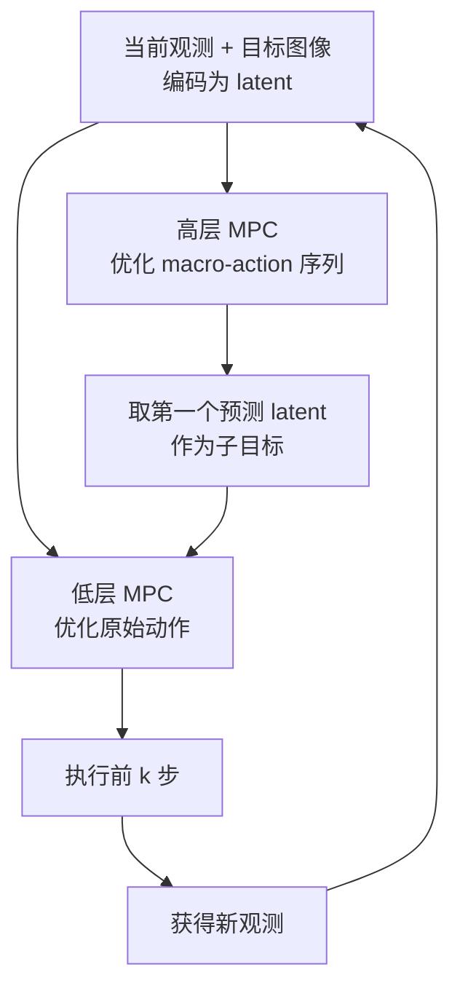

# Hierarchical Planning with Latent World Models（HWM）

## 一句话定义

**Hierarchical Planning with Latent World Models**（[arXiv:2604.03208](https://arxiv.org/abs/2604.03208)）提出 HWM：在冻结或预训练好的视觉 latent world model 上做分层 MPC。同一 latent 空间里训练高、低两个时间尺度的预测器，高层用由动作片段压缩出的 latent macro-action 规划到最终目标，其第一个预测状态当作低层 MPC 的子目标；整套系统不用任务奖励、技能学习或层级策略（论文 §1、§2.3）。

## 英文缩写速查

| 缩写 | 英文全称 | 简要说明 |
|------|----------|----------|
| HWM | Hierarchical Planning with Latent World Models | 本论文提出的分层规划框架 |
| MPC | Model Predictive Control | 每次优化候选动作、执行前 k 步、再重新规划 |
| CEM | Cross-Entropy Method | 论文 Franka 与 Push-T 的采样式动作优化器（附录 C） |
| MPPI | Model Predictive Path Integral | 论文迷宫任务的采样式轨迹优化器（附录 C） |
| VJEPA2-AC | V-JEPA 2 Action-Conditioned | 论文 Franka 实验的低层世界模型与单层基线 |
| PLDM | Planning with Latent Dynamics Models | 论文迷宫实验的低层世界模型 |
| DINO-WM | DINO World Model | 论文 Push-T 实验的低层世界模型 |
| OOD | Out-of-Distribution | 迷宫实验的留出布局 |
| DROID | Distributed Robot Interaction Dataset | 世界模型训练数据之一（约 96 小时） |

## 为什么重要

- 单层 latent MPC 在两类任务上失败：需要先远离目标的「非贪心」任务（目标匹配代价非单调，优化器落入贪心捷径），和时程很长、误差累积的任务（§1）。HWM 给出的做法是不训练层级策略，只在推理时叠加一个更粗时间尺度的世界模型。
- 作者自述：HWM 是首个直接从像素、用单张目标图像在真机上解决 pick-and-place 的 world-model 规划器（v2 §1，作者原话是 to our knowledge）。
- 对「世界模型 + 规划」路线的启示：同一个基线模型在加了人工子目标图像后可达 80%，说明失败来自规划结构而非世界模型表征（v2 §4.1，Table 4）。

## 核心原理与流程总览

两个时间尺度共用编码器 E 与 latent 空间（§2.3）：

- 低层 P(1)：zt+1 = P(1)(zt, at)，用 teacher forcing 加多步 rollout 损失训练（附录 B.1，式 2–4）。实验里直接复用 V-JEPA 2-AC、DINO-WM、PLDM 各自的训练配方，使收益归因于分层（§2.4）。
- 高层 P(2)：在 N 个 waypoint（Franka 为 N=3，Push-T 为 5，迷宫用固定 stride 10 的 6 个）之间预测下一个 waypoint；动作编码器 Aψ（transformer，CLS token 经 MLP）把 waypoint 间的动作片段压成 macro-action，不假设固定高层步长（§2.3、§2.5、附录 B）。
- 规划：高层最小化 ‖z_g − P(2)(l;z_1)‖1，取展开后的第一个预测 latent 作子目标；低层最小化到子目标的 L1 距离；执行后重观测并滚动重规划（§2.3）。

## 工程实践

- **Franka 真机（§3.1、附录 B.2/C/J）**：7-DoF Franka Panda + Robotiq 夹爪，输入 RGB 与末端位姿，动作为末端 delta pose，经逆运动学转关节位移。世界模型约 130 小时无标注数据（DROID 96h + RoboSet 30h），低层沿用 V-JEPA 2-AC（冻结 ViT-g/16 编码器，约 300M 参数预测器）。高层 4 维 macro-action、3000 个 CEM 样本；低层 800 个样本；每步重规划（附录 B/C）；单层基线为 2400 个样本、视野 6。
- **子目标可达性与 macro-action 维度（v2 §4.4、Fig. 7）**：维度太低高层出不了有效计划，太高则子目标更难被低层执行；Franka 取 4 维。这是论文自己的消融，仅在 Franka 离线评测上做（附录 I）。
- **算力（§3.2、§3.3、Fig. 5、附录 D）**：通过扫描 CEM/MPPI 的样本与迭代数得到成功率—规划时间帕累托曲线，Push-T 约 3×、迷宫 4× 更少规划时间达到相当成功率；此类曲线对比的是各自调出的最好配置，不等于固定预算下的逐点优势。
- **接口依赖**：要求有同一 latent 空间下的两级世界模型、可重复的相机视角与可由 IK 跟踪的末端 delta 动作；论文真机仅在 Franka 上验证（推测：换平台须重做世界模型训练，非论文结论）。

## 实验与结果

| 任务 | 世界模型 | 论文报告（v2） | 出处 |
|------|----------|----------------|------|
| Franka pick-and-place 杯 / 盒 | V-JEPA 2-AC | HWM 70% / 60%（各 50 次）；单层 0% / 0% | §3.1、Table 1、Table 17 |
| Franka 抽屉 7 任务 | V-JEPA 2-AC | HWM 70%（25/35）；单层 30%（10/35） | Table 1、Table 17 |
| 手动子目标对照 | V-JEPA 2-AC | 单层 + 人工子目标 80% / 80% | §4.1、Table 4 |
| Push-T d=25 / 50 / 75 | DINO-WM | 单层 84 / 55 / 17%；HWM 89 / 78 / 61% | §3.2、Table 2 |
| Diverse Maze D∈[5,8] / [9,12] / [13,16] | PLDM | 单层 100 / 84 / 44%；HWM 100 / 95 / 83% | §3.3、Table 3 |
| 迷宫 macro-action 对照 | PLDM | 拼接原始动作 52 / 37%；学习的 macro-action 95 / 83% | §4.3、Table 5 |
| Franka 离线动作对齐 | V-JEPA 2-AC | 余弦 0.88 ± 0.03（macro-action）vs 0.80 ± 0.02（delta pose） | §4.3、Table 6 |
| 真机 VLA 对照 | 见右 | Octo 0 / 0%（抽屉 43%）；π0-FAST-DROID 52 / 18%；π0.5-DROID 68 / 36% | Table 1、附录 J.1 |

## 与清单说法的核对

清单（Glen Berseth 的 CoRL 2026 阅读清单，第 040 条，P1，World Models & World Action Models 分组；摘要由 LLM 据论文摘要起草，排序是作者按自己的兴趣模型打分，不是论文质量评价）写道：「Hierarchical MPC on visual latent world models learned at multiple temporal scales for long-horizon zero-shot control.」

- **分层 MPC、视觉 latent、多时间尺度**：与 §1、§2 一致。
- **「zero-shot」**：论文含义是不用任务奖励、不训练策略，推理时对新目标做 MPC；世界模型本身仍用约 130 小时（Franka）或各任务的离线数据训练，测试场景为新环境 / 未见布局 / 未见物体（§3.1、§3.3）。不是「无需任何训练数据」。
- **「long-horizon」**：有两种含义。真机是「非贪心的多阶段」任务（取放、抽屉），单次任务不长；长时程的量化证据来自仿真（Push-T 最多 75 步，迷宫最难档），不是长时程真机操作。
- **缺失的信息**：清单没有提真机具体结果（杯 70%、盒 60%）、没有区分真机与仿真，也没有提论文把单层基线失败归因于「非贪心」而不只是「长」。论文还承认所有方法的成功率随时程下降（v2 §7）。
- **版本提示**：库内旧版归档引用 v2（2026-06-16）；v1（2026-04-03）与 v2 在若干对照上措辞和数字不同，见来源归档的「v1 与 v2 的差异」。

## 局限

论文自己承认的（v2 §7、§3.1）：

- 所有评估方法的成功率都随时程变长而下降。
- 各层共用单一 latent 空间，更长时程或更开放环境可能需要分层专用的抽象。
- 子目标质量受 waypoint 采样方式（随机或定步长）限制；低层规划器的反馈没有传回高层优化。
- 失败主要来自感知不精确（如深度估计）或差一点的执行，说明粗子目标丢失了精细引导所需的细节。

我阅读时看到的未验证之处（不是论文结论）：

- 真机仅 Franka 一台、10 组起止配置（含重复布局的盒子任务）；PnP 0 与 PnP 8 对 HWM 为 0/5（v2 Table 17），说明提升不是处处成立。
- VLA 对照目标接口不同（HWM、Octo 用图像，π 系列用语言），π 系列提示词经人工挑选后才用盘子作目标标记（附录 J.1）；论文自己在 v2 把「outperforms」改成「competitive」。
- 算力 3× / 4× 的对比建立在各方法分别扫描超参后的帕累托前沿上，且迷宫的平坦基线数字在 v1 与 v2 间由 63% 变为 84%（中档），论文未说明原因；Table 3 的 84% 与 Table 16 的 85% 也差 1 个点。
- 论文称离线评测与真机成功「strongly correlates」，论文内没有给出相关系数（附录 I）。
- 迁移到人形或浮动基座平台属于推测，论文没有任何此类实验。

## 关联页面

- [V-JEPA 2](./paper-vjepa2.md) — Franka 低层世界模型和单层基线
- [DINO-WM](./paper-sa-2411-04983-dino-wm-world-models-on-pre-trained-visual-featu.md) — Push-T 的低层世界模型
- [Puppeteer：层级世界模型作视觉全身控制](./paper-sa-2405-18418-puppeteer-hierarchical-world-models-as-visual-wh.md) — 论文对比表中的层级 model-based RL
- [LeWorldModel](./paper-lewm.md) — 同一 latent 动力学路线的相邻工作
- [H-JEPA（arXiv:2610.06805）](./paper-h-jepa-visual-planning.md) — 对照共享潜空间的 HWM 与逐层学习独立潜表示的层级规划
- [V-JEPA 2.1](./paper-sa-2603-14482-v-jepa-2-1-unlocking-dense-features-in-video-sel.md) — 视频特征 backbone 相关工作（不是本文使用的版本）
- [VideoDB JEPA 长文](./article-videodb-jepa-world-models.md) — 对 JEPA、动作后果预测与 HWM 的观点型综述
- [Model-based RL](../methods/model-based-rl.md)
- [Model Predictive Control](../methods/model-predictive-control.md)
- [分层强化学习](../methods/hierarchical-reinforcement-learning.md)
- [Manipulation](../tasks/manipulation.md)

## 参考来源

- [论文来源归档（通读核对）](../../sources/papers/hierarchical_planning_latent_world_models_arxiv_2604_03208.md)
- [arXiv:2604.03208](https://arxiv.org/abs/2604.03208)
- [项目主页](https://kevinghst.github.io/HWM/)
- [代码仓库](https://github.com/kevinghst/HWM_PLDM)

## 继续阅读

- 被扩展的三个基础世界模型：V-JEPA 2（arXiv:2506.09985）、DINO-WM（arXiv:2411.04983）、PLDM（arXiv:2502.14819）。
- 同类层级世界模型规划：[H-JEPA](./paper-h-jepa-visual-planning.md)、[Puppeteer](./paper-sa-2405-18418-puppeteer-hierarchical-world-models-as-visual-wh.md)。
- 论文 §5 提到的并行工作：高层世界模型加目标条件扩散策略，以及通过学习的高低层动作映射抬升冻结低层模型（v2 §5）。
