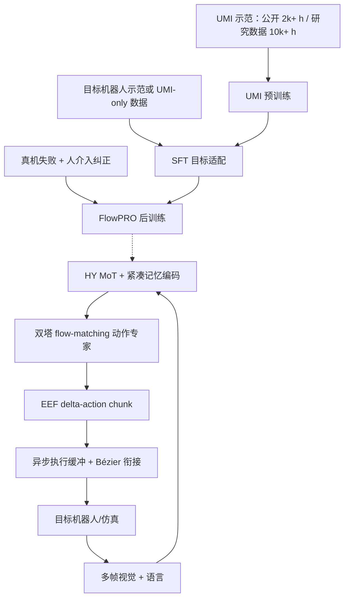
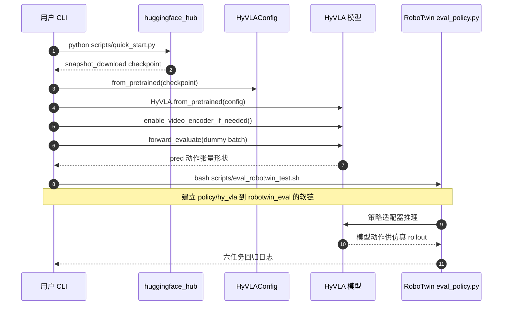

# Hy-Embodied-0.5-VLA：从数据采集到真机闭环的 VLA 学习栈 / From VLA Models to a Real-World Robot Learning Stack

## 一句话定义

**Hy-Embodied-0.5-VLA（HyVLA-0.5）** 是腾讯 Robotics X 与混元团队的完整机器人学习系统：以具身 MoT VLM、多帧压缩记忆与双塔 flow-matching 专家预测 EEF 增量动作，衔接 UMI 数据收集、SFT、干预式后训练和异步部署。

## 英文缩写速查

| 缩写 | 英文全称 | 简要说明 |
|---|---|---|
| VLA | Vision-Language-Action | 视觉语言条件连续机器人动作模型 |
| MoT | Mixture of Transformers | 不同模态使用分路计算的 Transformer |
| UMI | Universal Manipulation Interface | 非机器人本体依赖的人手持操作示范 |
| SFT | Supervised Fine-Tuning | 目标任务示范监督微调 |
| EEF | End Effector | 采用 delta chunk 表示的机械臂末端 |
| RL | Reinforcement Learning | 本文后训练覆盖偏好/纠正反馈 |
| FlowPRO | Flow-matching Preference Optimization | 用成对成功/失败样本优化连续 flow 策略 |

## 为什么重要

同一机器人模型的工程投入不仅是预训练参数量，还包括高质量数据采集、跨本体动作映射、模型后训练与不断顿的动作下发。HyVLA 的公开入口覆盖这些环节，适合研究数据到部署的闭环，而非孤立比较单一 VLA 网络。

## 核心原理

1. **骨干与动作专家：** HY-Embodied-0.5 MoT (~4B) 负责视觉语言编码；双塔 flow action expert 建模连续动作；紧凑时空注意力把 K 帧历史压成有限 token。
2. **表示：** 使用前后帧之间的 EEF delta-chunk，不把不同机器人关节维度强行当同义数值；目标机器人仍需执行坐标系与 IK/控制转换。
3. **数据与训练：** 10k+ 小时 UMI 规模预训练 → Track A 目标机器人 SFT / Track B UMI-only 跨本体适配 → FlowPRO 基于干预/纠正配对样本进一步优化。
4. **执行：** 生产者（模型推理）与消费者（伺服下发）两个线程通过缓冲解耦，使用三次 Bézier 连续衔接 chunk 末端，避免等模型推理期间动作卡顿。

## 流程总览

虚线代表训练产物，而非每个 servo tick 在线执行 FlowPRO。

## 源码运行时序图

根据官方 `scripts/quick_start.py`（最小前向验证）与 `scripts/eval_robotwin_test.sh`（六任务 RoboTwin 回归）源码构造；二者不等价于真机生产部署。

## 实验与评测

| 项目 | 论文/官方报告 | 限制 |
|---|---|---|
| RoboTwin 2.0 Clean / Random | **90.9% / 90.1%** | 50 tasks × 每任务 100 rollouts；作者报告 |
| 去掉紧凑记忆 | **88.8% / 88.6%** | 在相同 RoboTwin 表内对照 |
| 再去掉 UMI 预训练 | **88.1% / 87.9%** | 不能直接当作所有任务的泛化因果 |
| Hy-UMI-10K vs 公开数据 | 训练 **10k+ h**；公开 **2k+ h** | 公开子集不是完整预训练集 |
| FlowPRO | 真实机器人失败干预与偏好后训练 | 不以单任务改善外推所有真机 |

## 结论

**这是一套重在数据、后训练与真机工程衔接的 VLA 学习栈；公开 checkpoint 与完整实验数据并非同一开放程度。**

1. 使用公开 UMI 子集与训练全部 UMI 数据时，必须分别标注实验规模。
2. 跨本体迁移时先校核 EEF 坐标、臂长/姿态与延迟补偿，再讨论模型泛化。
3. 要核对异步生产者/消费者队列与 Bézier chunk stitching，而非只看策略单次 latency。
4. FlowPRO 是成对干预数据优化，区别于传统纯在线带 critic 的 PPO。
5. 将 SFT 和实际 RoboTwin/真机适配示例分别复现，不能把 smoke test 视为真机验证。

## 与其他工作对比

- [LingBot-VLA 2.0](./lingbot-vla-v2.md)：同关注大规模异构数据与跨本体，但架构与数据开放范围不同。
- [OpenWAM](./paper-openwam.md)：重模块化世界–动作预训练实验，而非同样的干预式数据到部署链。
- [2026 VLA 三条路线](../comparisons/vla-open-source-ecosystem-2026-three-shifts.md)

## 工程实践

官方有可下载模型、部分 UMI 数据、`scripts/quick_start.py`、RoboTwin 评测及 UMI/SFT 训练脚本。项目 `Quick Start` 仅验证网络前向，不代表已经完成安全真机控制；配套机器人部署需要本体运动学映射与硬件时延测试。

## 局限与风险

公开数据只是总训练集的一部分。论文一些真机任务、偏好数据与专有平台控制细节不能从单次开源仓库执行完整重现。处理 UMI 和真实机器人动作时须核实坐标系统和安全闭环。

## 关联页面

- [HY-Embodied 基础骨干项目](./cn-os-hy-embodied.md)
- [公开数据集](./dataset-hy-embodied-0-5-vla-data.md)
- [VLA](../methods/vla.md)
- [2026 对比](../comparisons/vla-open-source-ecosystem-2026-three-shifts.md)

## 参考来源

- [HyVLA 论文原文核对](../../sources/papers/hy_embodied_05_vla_arxiv_2606_14409_full_reading.md)
- [官方源码导航](../../sources/repos/hy-embodied-05-vla.md)

## 推荐继续阅读

- [arXiv:2606.14409](https://arxiv.org/html/2606.14409)
- [官方 GitHub](https://github.com/Tencent-Hunyuan/Hy-Embodied-0.5-VLA)
