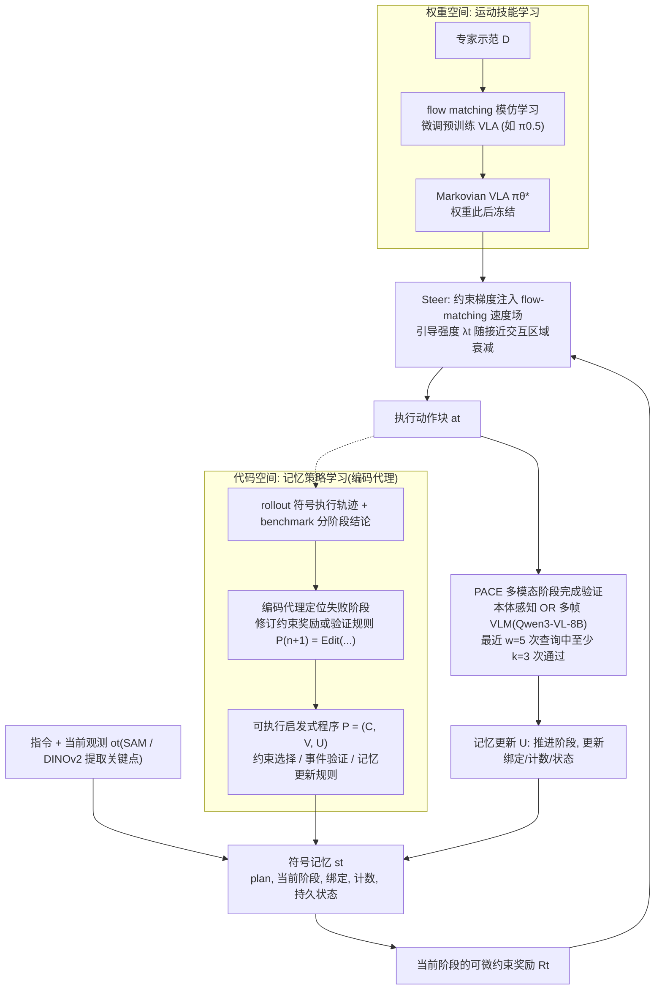

# HyMeS（arXiv:2608.09410）

**HyMeS**（[arXiv:2608.09410](https://arxiv.org/abs/2608.09410)）收录于 [多模空间 · 一周 VLA 研究趋势简析（2026.08.10–08.16）第一篇](../../sources/blogs/wechat_duomo_vla_weekly_trends_2026-08-10_part1.md) **类 Agent、长程记忆** 段。

## 一句话定义

**Skills in Weights, Memory in Code：VLA 学低层可复用动作，coding agent 学高层记忆管理规则，结合本体与多帧 VLM 判断阶段完成并更新记忆，完成多种长期记忆依赖任务。**

## 英文缩写速查

| 缩写 | 英文全称 | 简要说明 |
|------|----------|----------|
| VLA | Vision-Language-Action | 视觉–语言–动作策略 |
| VLM | Vision-Language Model | 视觉–语言多模态模型 |
| VLN | Vision-Language Navigation | 视觉–语言导航 |
| WAM | World Action Model | 联合未来与动作生成的具身策略 |
| TTT | Test-Time Training | 部署阶段无标注数据的在线适配 |

## 为什么重要

- Skills in Weights, Memory in Code：VLA 学低层可复用动作，coding agent 学高层记忆管理规则，结合本体与多帧 VLM 判断阶段完成并更新记忆，完成多种长期记忆依赖任务。
- 开源状态：**待核实**（步骤 2.5，入库日 2026-09-19）。
- 与 [vla weekly trends 2026 08 10 part1 technology map](../overview/vla-weekly-trends-2026-08-10-part1-technology-map.md) 同批工作可横向对照。

## 流程总览

图依据：论文 Method 各节（Motor-Skill Learning / Memory-Strategy Learning / Memory-Conditioned Action Steering / PACE）/ Fig.2、Eq.(1)–(15)

## 核心机制

| 项 | 内容 |
|----|------|
| **arXiv** | [2608.09410](https://arxiv.org/abs/2608.09410) |
| **开源** | **待核实** |
| **文内评测** | RoboMemArena；实机 LeRobot SO 101 |

## 源码运行时序图

**不适用**（截至入库日未提供可运行官方代码入口，或仓库尚未公开）。

## 实验与评测

- **文内口径：** RoboMemArena；实机 LeRobot SO 101
- **读法：** 本页为 [公众号策展](../../sources/blogs/wechat_duomo_vla_weekly_trends_2026-08-10_part1.md) 摘要；逐项指标以 **原文 PDF** 为准。

## 与其他工作对比

> 下表只做**定位对照**：本页与下列同批各页均为 [公众号策展](../../sources/blogs/wechat_duomo_vla_weekly_trends_2026-08-10_part1.md) 的索引级摘要，未逐条核对原文实验表，彼此**不共享同一评测协议**，不可据此横比数字。

| 对照 | 差异读法 |
|------|----------|
| [OnEvoMemory](./paper-onevomemory.md) | 同批两条长程记忆路线，分界在**记忆存在哪里**：HyMeS 把记忆放进 coding agent 维护的**显式代码 / 规则**，OnEvoMemory 放进策略内的**价值引导记忆模块**。前者可读、可改、可审计，代价是多带一个 agent；后者与策略同栈，可直接加在已有预训练策略上 |
| [VANE](./paper-vane.md) | 同批同为部署期自适应，改的对象不同：VANE 改**权重**（试用区验证有效才启用），HyMeS 改**记忆内容**而权重里的技能不动。VANE 的风险是更新破坏控制闭环，HyMeS 的风险在高层规则误判阶段完成 |
| [Action Chunking](../methods/action-chunking.md) | 「技能在权重」那半边正是 chunk 级可复用动作；该页给这层的执行语义，HyMeS 加的是它之上的阶段判定与记忆更新，两层的失败模式要分开归因 |
| [VLA](../methods/vla.md) | 该页默认单模型端到端；HyMeS 明确**拆成两个学习主体**（VLA 学低层动作 + coding agent 学高层记忆管理）。选型先确认任务是否真的依赖跨 episode 的长期记忆，否则这层拆分只是额外复杂度 |

## 结论

**HyMeS 适合作为本期「类 Agent、长程记忆」路线的快速索引页。**

1. 核心贡献：Skills in Weights, Memory in Code：VLA 学低层可复用动作，coding agent 学高层记忆管理规则，结合本体与多帧 VLM 判断阶段完成并更新记忆，完成多种长期记忆依赖任务。
2. 开源结论：**待核实** — 以项目页/仓库实际链接为准。
3. 横向对照见 [技术地图](../overview/vla-weekly-trends-2026-08-10-part1-technology-map.md)，避免与同 arXiv 重复造页。

## 关联页面

- [VLA（Vision-Language-Action）](../methods/vla.md)
- [一周 VLA 趋势技术地图](../overview/vla-weekly-trends-2026-08-10-part1-technology-map.md)
- [Generative World Models](../methods/generative-world-models.md)

## 参考来源

- [wechat_duomo_vla_weekly_trends_2026-08-10_part1.md](../../sources/blogs/wechat_duomo_vla_weekly_trends_2026-08-10_part1.md)
- [arXiv:2608.09410](https://arxiv.org/abs/2608.09410)
- [arXiv PDF](https://arxiv.org/pdf/2608.09410)：已通读方法部分（实验与附录以略读为准）：Introduction、Problem Formulation、Method（权重空间运动技能学习、代码空间记忆策略学习、记忆条件动作 steering、PACE 多模态进度验证）、Experiments 实验设定

## 推荐继续阅读

- [VLA 方法页](../methods/vla.md)
- [arXiv PDF](https://arxiv.org/pdf/2608.09410)
