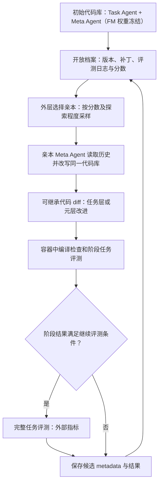
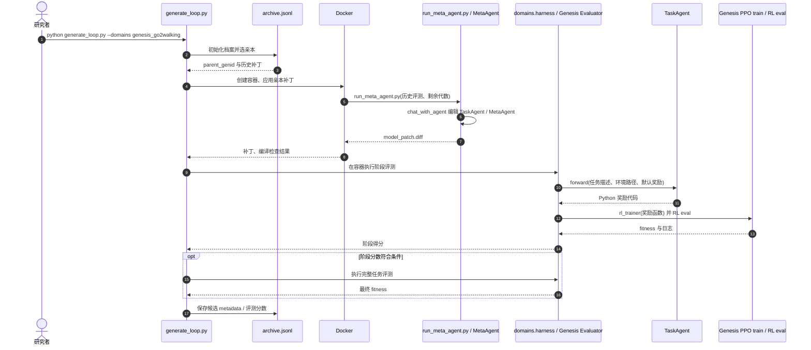

# Hyperagents（DGM-H）：超智能体——可递归自修改元改进机制

**论文：** [*Hyperagents*（arXiv:2603.19461v2）](https://arxiv.org/abs/2603.19461v2)，2026-11-01 修订；**作者：** Jenny Zhang、Bingchen Zhao、Wannan Yang、Jakob Foerster、Jeff Clune、Minqi Jiang、Sam Devlin、Tatiana Shavrina；**官方代码：** [facebookresearch/Hyperagents](https://github.com/facebookresearch/Hyperagents)。

## 一句话定义

**Hyperagents（DGM-H）把完成目标任务的 Task Agent 和负责修改智能体程序的 Meta Agent 放进同一个可编辑代码库，让下一代不仅能做得更好，还可能改进“如何让自己变好”的流程。** 外部任务、评估与计算预算仍受研究者控制。

## 英文缩写速查

| 缩写 | 英文全称 | 简要说明 |
|---|---|---|
| DGM-H | Darwin Gödel Machine–Hyperagents | 将 DGM 扩展到可修改元改进者的自指 Agent |
| DGM | Darwin Gödel Machine | 基于代码自修改、经验评测与开放档案的先前系统 |
| RSI | Recursive Self-Improvement | 系统自身参与改善后续改进能力的过程 |
| FM | Foundation Model | 实验中通过 API 调用、权重保持冻结的基础模型 |
| PPO | Proximal Policy Optimization | Genesis Go2 奖励设计候选通过 RL 训练评测时使用的优化算法 |
| RL | Reinforcement Learning | 仿真中利用生成奖励函数训练运动策略的环节 |

## 为什么重要

- **修改对象从任务程序延伸到元程序。** 编程 Agent 的编码能力与自修改能力部分重合，但机器人奖励设计、论文评审等任务不一定如此。DGM-H 显式将两者放在同一可修改系统中。
- **研究“如何改进”的积累。** 作者检查演化出的持久记忆、性能跟踪等元层改动，讨论其跨运行、跨领域可复用性，而非只报告单次任务分数。
- **机器人意义是研发闭环自动化。** Go2 例子由 Agent 生成奖励 Python，再以 Genesis/PPO 训练和仿真 fitness 作为外部反馈；不是部署期端到端控制策略，也不代表已完成安全的真机自动自修改。

## 流程总览

**不变边界：** 主实验外部领域与评分器不由候选自改；代码实现中运行结束前会复原 `domains/`。开放档案允许探索不止一个最优分支，不意味着每个候选都有效或性能单调上升。

## 核心原理

1. **自指式双层 Agent。** `TaskAgent.forward(inputs)` 调用 FM 解决当前任务；`MetaAgent.forward(repo_path, eval_path)` 利用代码与历代评测记录调用可使用工具的 FM 进行修改。它可以编辑原本负责改进任务 Agent 的代码，包括自身元层实现。
2. **版本继承与分支探索。** `generate_loop.py` 复原选定亲本的历史补丁，调用 MetaAgent 产生 `model_patch.diff`；保存 `archive.jsonl` 和 `metadata.json`，按 performance 与探索程度选择后续亲本。
3. **阶段门控与外部目标。** 生成候选先经有限样本评测，达到进一步评测条件才执行完整任务评测。候选的保留和可作为亲本的资格依据执行/得分而定，非由 Agent 单方面宣告成功。
4. **冻结模型 vs 可编辑程序。** 改变的是代理代码、工具、记忆及元层工作流，不是基础 FM 参数；主实验的外层任务、评价与部分搜索调度仍然固定。

## 源码运行时序图

下图基于官方 README 与已核对的 `generate_loop.py`、`run_meta_agent.py`、`meta_agent.py`、`domains.harness`、`domains.genesis.evaluator`、`task_agent.py` 的静态调用关系。图以 Go2 仿真奖励设计为例，**未在本次运行完整 GPU 实验**。

**实际入口：** [代码归档](../../sources/repos/hyperagents.md) 所列 `generate_loop.py` / `domains.harness`，Genesis 进一步调用 `domains.genesis.genesis_train.rl_trainer`。该时序反映**静态源码关系**，并非动态采样的真实运行轨迹。

## 实验与评测

| 实验领域 | 被改进/评测的任务 | 论文 v2 的作者报告结果 |
|---|---|---|
| Polyglot | 编码 Agent 的任务表现 | DGM-H 由 0.084 → 0.267（与原始 DGM 的设置及起点应分开比较） |
| 论文评审 | 对论文内容进行质量相关判断 | 初始 0.000 → DGM-H 0.710 |
| **Genesis / Unitree Go2** | 自动编写奖励，训练仿真运动策略并评估新任务 | **初始 0.060 → DGM-H 0.372**；定制版 DGM 0.348，论文没有证实 DGM-H 对定制版有显著优势 |
| 奥赛数学判分 | 从其他领域迁移演化过的元 Agent，再执行改进过程 | 支持元层改动可跨域复用的证据；特定模型、任务与预算限制推广 |

### Go2 实验读法

Go2 训练任务涉及速度跟踪，测试任务涉及跳跃/躯干高度；Task Agent 在输入中接收环境源码路径、默认奖励与任务说明，输出奖励函数，由 RL trainer 使用该奖励训练策略并计算 Genesis 仿真 fitness。**评价的是“自动设计奖励再训练”的效果，不是 DGM-H 直接在机器人 1 kHz 控制环输出电机命令。** 论文具体训练、测试与统计口径参见 [v2 归档](../../sources/papers/hyperagents_arxiv_2603_19461v2.md)。

## 结论

**Hyperagents 的贡献是把“生成改进”的元程序也作为可继承、可修改的搜索对象；其自改效果必须通过独立评测证实，不能从任务分涨直接推出通用递归加速。**

1. **分清可变层与固定层：** FM 权重及外部评测没有随 meta agent 一起改写。
2. **保存代码 lineage：** 若关注元层效果，须记录亲本、可继承补丁、性能和失败历史，不只存最终 Agent。
3. **隔离评测器：** 不允许候选修改测试集和评分代码；真实机器人还需独立安全审查与 reset/verify。
4. **区别仿真研发与部署：** Go2 结果是 reward design + PPO 的仿真表现，不是真机 Sim2Real 结论。
5. **比较有统计边界：** Go2 上 DGM-H 与定制 DGM 差异没有达到论文所需的显著证据，不能只比 0.372 和 0.348 就宣称方法优越。

## 与其他工作对比

| 方法 | 可修改对象 | 决定性区别 |
|---|---|---|
| [Darwin Gödel Machine](paper-darwin-godel-machine.md) | 编码任务 Agent 自身 | DGM 的外层产生改进过程主要固定；Hyperagents 也可编辑 Meta Agent |
| [MetaRSI-v1](paper-metarsi-v1.md) | 数据、harness、模型等不同算子 | 强调多类 RSI 算子编排；DGM-H 主要聚焦任务/元 Agent 程序共同可编辑 |
| [SelfImprove-Bench](paper-selfimprove-bench.md) | 用跨任务泛化层级评测多个自修改系统 | 评测研究而非 Hyperagents 机制本身；不能混同两者的实验设置 |

## 工程实践

1. 参照 [官方 README](https://github.com/facebookresearch/Hyperagents#setup) 使用 Python 3.12、安装依赖并准备模型 API Key 与 Docker。运行前审查容器权限和敏感挂载。
2. 使用 `python generate_loop.py --domains paper_review` 验证最小研究流程；若做 Go2，额外准备 Genesis、RSL-RL、PyTorch/CUDA 并指定 `--domains genesis_go2walking`。
3. 审阅代码可从 `generate_loop.py::generate_loop`、`::generate` 到 `run_meta_agent.py` → `meta_agent.py` → `domains/genesis/evaluator.py`；分别监控代码 patch、阶段通过率、最终 fitness、API token 与 GPU 消耗。
4. 复现或迁移实验时固定外部评分器、种子、任务分布和运行预算；保存初始与进化后版本，并单独测试分布外任务。
5. **源码开放：已开源（代码与可运行入口）**；许可证为 **CC BY-NC-SA 4.0（非商业）**，不应默认可用于商业机器人系统。

## 局限与风险

- **未证明无限自加速：** 可修改元层是能力条件，不等于已证明任何可计算任务都稳定改善。
- **奖励/指标取巧：** 如果评测目标与真实物理安全脱节，可能进化出高 fitness 但不安全的奖励。元级改代码需隔离。
- **环境与成本：** Docker、外部 FM API、模拟/训练开销不小；本文报告结果来自作者实验，未做独立复现。
- **真机证据缺失：** 本论文的 Go2 案例在 Genesis 仿真，不提供真实 Go2 机体部署成功率或实机安全证明。
- **许可和执行风险：** 仓库 `LICENSE.md` 是非商业协议；模型生成代码可能破坏文件系统，README 已发出明确警告。

## 关联页面

- [Darwin Gödel Machine](paper-darwin-godel-machine.md) — 只演化任务代理的近邻方法。
- [SelfImprove-Bench](paper-selfimprove-bench.md) — 检验自改进的跨任务泛化是否成立。
- [递归自我改进](../concepts/recursive-self-improvement.md) — 从持久自改到可信外部验证的层级边界。
- [RSI 纵深路线（Stage 4）](../../roadmap/depth-rsi.md) — 同类 harness / 元层演化的学习顺序。

## 参考来源

- [arXiv:2603.19461v2 论文原文阅读归档](../../sources/papers/hyperagents_arxiv_2603_19461v2.md)
- [facebookresearch/Hyperagents 源码阅读归档](../../sources/repos/hyperagents.md)

## 推荐继续阅读

- [Hyperagents 原始论文 v2 PDF](https://arxiv.org/pdf/2603.19461v2)
- [官方 README、实验脚本与源码](https://github.com/facebookresearch/Hyperagents)
- [Genesis 仿真奖励设计复现指南（源码 README）](https://github.com/facebookresearch/Hyperagents/blob/main/domains/genesis/README.md)
