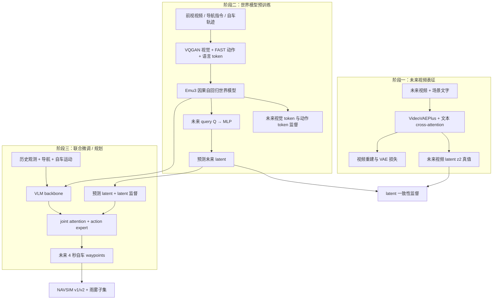

# HyWorldVLA：面向自动驾驶的混合世界建模 VLA / A Vision-Language-Action Model with Hybrid World Modeling for Autonomous Driving

## 一句话定义

**HyWorldVLA**（[arXiv:2607.20988](https://arxiv.org/abs/2607.20988)，比亚迪汽车新技术研究院）是**训练阶段用像素级未来帧预测帮助学习结构化潜变量、规划阶段用未来潜变量条件动作专家**的自动驾驶 VLA：用像素监督补几何，用 latent 预测提高雨雾与照度扰动下的稳定性，输出未来自车轨迹而非直接控制转向或油门。

## 英文缩写速查

| 缩写 | 英文全称 | 简要说明 |
|---|---|---|
| HyWorldVLA | Hybrid World Vision-Language-Action | 本文结合像素与隐状态监督的驾驶 VLA |
| VLA | Vision-Language-Action | 从视觉、语义导航与运动历史预测动作/轨迹 |
| VAE | Variational Autoencoder | 压缩未来视频并提供潜变量监督真值 |
| WAM | World Action Model | 本文的像素级未来预测对照范式 |
| LWM | Latent World Model | 仅在潜空间预测未来的对照范式 |
| FAST | Frequency-space Action Sequence Tokenization | 预训练时将连续轨迹离散成动作 token |
| NAVSIM | Non-reactive Autonomous Vehicle Simulation | 作者采用的非反应式驾驶规划评测 |
| PDMS / EPDMS | Predictive / Extended Predictive Driver Model Score | NAVSIM v1 / v2 的不同综合得分 |

## 为什么重要

- **像素监督与抗噪性取舍：** 纯未来图像重建提供稠密空间约束但易被天气/光照扰动影响；纯 latent 预测省去逐像素依赖，却可能失去几何锚点。本文通过**阶段性分离**取两者长处，而不是在车端每个时刻生成视频。
- **未来信息有明确作用位置：** 学习式 query 预测未来视频潜变量，并以 joint attention 条件化动作专家，避免「加世界模型但动作头用不到未来」。
- **有可诊断的鲁棒性消融：** 除 NAVSIM v1/v2 常规分数，论文还给出 655 个自然雨雾案例与 latent loss 权重对照，揭示**正常工况与扰动鲁棒性不是同一最优点**。

## 核心信息

| 字段 | 论文核对结果 |
|---|---|
| 作者 | Quanfu Yu, Xian Wu, Hao Xu, Liulong Ma |
| 机构 | 比亚迪汽车新技术研究院（Automotive New Technology Research Institute, BYD Company Limited） |
| 论文版本 | arXiv:2607.20988v1；2026-07-23 |
| 视觉输入 | **仅单目前视相机**，当前及历史图像；历史自车位置和航向、导航指令 |
| 规划输出 | 未来 **4 秒**自车 waypoints（x, y, heading）；历史窗 **1 秒** |
| 预训练 backbone | Emu3；VQGAN 图像 token、FAST 动作 token、学习式未来 latent query |
| 视频表征 | VideoVAEPlus 初始化，空间压缩 8 倍、时间压缩 4 倍；Flan-T5 文字先验 |
| 训练语料 | NuPlan 视频（VAE）；OpenScenes 大于 120 h（世界预训练）；NAVSIM trainval（联合微调） |
| 评测 | NAVSIM v1、v2；655 例 OpenScenes 雨雾扰动测试 |
| 开源状态（核查 2026-11-19） | arXiv 论文未列 HyWorldVLA 官方项目页、公开实现或权重；**不能宣称已可完整复现** |

## 核心原理

### 1. 文字引导的视频压缩器（§3.2）

从视频片段构造未来状态真值：VideoVAEPlus 的空间编码器将 H×W 下采样到 H/8×W/8，再用时序编码器将 T 压缩至 T/4；使用 Flan-T5 文本特征做 cross-attention，训练目标为重建、对抗和 KL 项。这个 video VAE 的潜变量是后续世界模型 **Q query** 预测的目标，不是用于直接控制车辆的外部输入。

### 2. 世界模型预训练：像素与 latent 同时监督（§3.3）

- **像素路径：** 前视视频片段经 VQGAN 离散化成视觉 token；未来图像 token 自回归预测提供密集结构化约束。
- **动作/指令路径：** FAST 将自车相对 waypoint 序列变成动作 token，驾驶导航指令映射为文本 token，与图像序列因果交织。
- **潜变量路径：** 在序列中加入可学习 query Q，经 MLP 预测未来视频 VAE latent z2；由预测 latent 与编码真值的平方误差监督。
- **总损失：** 语言/动作 token CE + 加权视觉 token CE（λ1）+ latent MSE（λ2）。不是把视频重建结果直接当未来轨迹。

### 3. 联合微调：让预测未来进入 action expert（§3.4）

VLM 与 action expert 通过 joint attention 融合历史视觉、导航、车辆运动及预测未来 latent；输出候选轨迹评分（KL）或以 flow matching 回归轨迹生成场。**联合微调阶段不再预测完整未来像素帧**，继续约束 latent 以免训练目标向动作坍缩；这种「训练时双重监督，规划时 latent-only」是方法关键。

## 流程总览

**注意：** 上图为论文方法阶段和监督信号流，不是运行时源码调用图；预训练中的未来帧/未来轨迹是真值监督，部署侧不能读取未来真值。

## 源码运行时序图

**不适用（截至 2026-11-19 未发现作者发布的 HyWorldVLA 训练/推理源码或入口）**。因此不凭论文结构推造可执行脚本、调用栈或复现日志。本文相关的 [NAVSIM 官方仓库](https://github.com/autonomousvision/navsim) 是**评测基准**，并非 HyWorldVLA 模型实现。

## 工程实践

| 工程环节 | 论文配置 / 使用边界 |
|---|---|
| VAE 数据与训练 | NuPlan；每段 8 帧、216×216；100K steps；对抗损失从 50K 开始。 |
| 世界预训练 | OpenScenes >120 h；1 s 历史、4 s 未来、1 s chunk；4000 steps，λ1=0.5、λ2=0.1。 |
| 联合微调 | NAVSIM trainval >100,000 帧；4000 steps，batch 96、latent 权重 λ3=0.1。 |
| Action expert | 同框架适配 selection-based 与 flow-matching 两类动作头；两种结果不可混写。 |
| 评测对齐 | NAVSIM v1 使用 PDMS，v2 使用 EPDMS；比较须确认传感器数量和评分协议。 |
| 扰动回归 | 除干净集外，测试自然雨雾、照度变化、局部模糊；监控 NC / DAC / TTC / EP 等分项。 |
| 复现边界 | 无官方模型代码/权重入口；只能复核论文损失与实验设定、使用公开 NAVSIM 进行基准搭建。 |

## 实验与评测（作者报告；并非独立复现）

| 实验 | HyWorldVLA | 对照与含义 |
|---|---:|---|
| NAVSIM v1，Table 1 | **PDMS 90.59** | DriveVLA-W0 90.2；ReCogDrive-8B 90.5；本文单目前视 |
| NAVSIM v2，Table 2 | **EPDMS 89.71** | ExploreVLA 88.8；DriveWorld-VLA 86.8；不可与 v1 PDMS 混比 |
| v1 模型结构消融，Table 3 | **90.59** | Pure WAM 89.91，Pure LWM 87.50 |
| 去 language-guided latent / latent 条件动作头 | 90.35 / 90.29 | 文本引导与 future latent 条件化均有贡献 |
| 去联合微调 latent 监督 | 90.17 | 预训练时学到的 latent 需持续约束 |
| 雨雾子集 655 例，Table 6 | **PDMS 86.87** | DriveVLA-W0 61.18、DriveLaW 67.49、Pure WAM 69.95 |
| Flow-matching 动作头，Table 7 | **PDMS 88.76** | 同设置 DriveVLA-W0(fm) 87.2 |

**反直觉结果（Appendix B，Table 8）：** 在受噪声扰动集把 λ3 从 0.1 加到 1.0，PDMS **86.87→92.94**；但在干净 NAVSIM 上 λ3=1.0 只有 **89.75**，低于 λ3=0.1 的 **90.59**。**不要将「更高 latent 权重更抗雨雾」误读为所有工况都该加到最大。**

## 与其他工作对比

| 对照 | 差异与可迁移思路 |
|---|---|
| [S²-VLA](./paper-s-squared-vla.md) | 两者都关注驾驶轨迹所需的空间表征；S²-VLA 通过**绕过 LM 的语义/空间双流**保几何，HyWorldVLA 通过**预训练的未来像素监督 + latent 规划**保几何且抗噪，实验协议不应只凭分数排名。 |
| [DriveTeach-VLA](./paper-driveteach-vla.md) | DriveTeach 用 DVD 视觉蒸馏 + 2D-TGP/GRPO 教「看哪里」；本论文用未来世界模型 latent 条件化动作生成。 |
| [WAM 概念](../concepts/world-action-models.md) | HyWorldVLA 的预训练含自回归图像/动作序列，联合微调推理只依赖 latent；不可简单标为部署时持续视频生成的 pixel WAM。 |
| DriveVLA-W0（原文对照） | 像素级世界预测提供结构监督，但扰动子集 PDMS 61.18 低于本文 86.87；需区分各自数据与评测设置。 |

## 结论

**对驾驶 VLA 来说，像素级未来监督更适合当训练阶段的结构锚点，压缩的未来 latent 更适合当规划阶段的抗扰动条件；但结果仍局限于论文的 NAVSIM 协议与单目观察。**

1. **不要二选一像素或 latent：** 同样的 NAVSIM v1 消融，Hybrid 90.59 > Pure WAM 89.91 > Pure LWM 87.50。
2. **动作专家必须消费未来特征：** 移除 latent conditioning 后从 90.59 降到 90.29。
3. **噪声要单独评测：** 655 例雨雾子集的 86.87 对比干净集 90.59，量纲虽相同但分布不同，不能单看常规榜单。
4. **正常/受扰动权重需折中：** 大 λ3 有利于噪声子集，却会降低干净集成绩。
5. **真车前先补盲区和时延：** 单前视相机在转弯与小型交通线索上仍失败，论文未给出车端实时部署或道路安全证据。
6. **复现状态需明确：** 当前论文没有官方模型代码链接；不要将作者报告当成本地已跑通。

## 局限与风险

- **关键细节失效：** 附录 Figure 8 中红灯/刹车灯线索过小，预测模型将排队车误判缓行并尝试绕过。
- **单目视野盲区：** 附录 Figures 9–10 展示左转越过双黄线、右转漏掉前车甚至追尾等失败，表明更强 latent 抗噪不等于转弯时有完整环境信息。
- **开放性：** 官方未提供可核对源码、权重、车端推理实现；不能画实际调用时序图，也不能复现论文数字。
- **评价边界：** NAVSIM 非反应式基准不是实车闭环路测；雨雾子集有限，不支持外推到全恶劣天气、多传感器或安全认证。
- **误差来源：** 文字短描述由自动生成模型产生，潜变量监督依赖视频 VAE 的表征质量；可能带来语义偏差或小目标信息丢失，需要进一步测量。

## 关联页面

- [S²-VLA：语义与空间双流驾驶 VLA](./paper-s-squared-vla.md)
- [DriveTeach-VLA：DVD / 2D-TGP](./paper-driveteach-vla.md)
- [视觉–语言–动作方法](../methods/vla.md)
- [World Action Models](../concepts/world-action-models.md)
- [自动驾驶核心算法技术地图](../overview/autonomous-driving-core-algorithms-series.md)
- [视觉–语言导航](../tasks/vision-language-navigation.md)
- [VLA 纵深路线 Stage 5](../../roadmap/depth-vla.md)

## 参考来源

- [HyWorldVLA arXiv:2607.20988v1 论文通读归档](../../sources/papers/hyworldvla_arxiv_2607_20988.md)
- [arXiv HTML 全文（方法、表格与附录）](https://arxiv.org/html/2607.20988v1)

## 推荐继续阅读

- [NAVSIM 官方评测基准](https://github.com/autonomousvision/navsim)
- [论文原始 HTML 与附录](https://arxiv.org/html/2607.20988v1)
- [DriveTeach-VLA（同为驾驶 VLA，区别是显式几何轨迹提示）](https://arxiv.org/abs/2607.01658)
