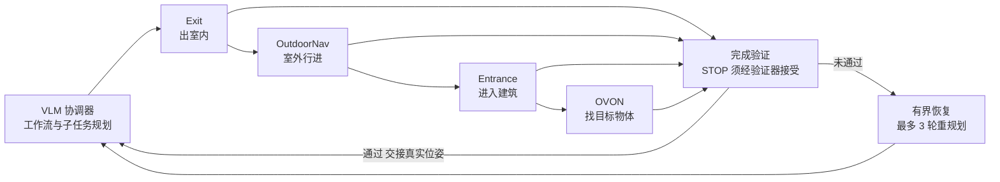

# I2O2I-Nav：把导航拆成阶段再接起来的长程基准

**I2O2I-Nav 是一个"室内出门 → 室外行进 → 进入另一栋楼 → 找物体"的长程导航基准，每一阶段都从上一阶段实际到达的位置开始；配套的 MODULAR-Agent 用 VLM 协调冻结的导航策略，靠完成验证、阶段交接和有界恢复来串联。**

论文 *I2O2I-Nav: A Benchmark with a Modular Agent for Long-Horizon Indoor-to-Outdoor-to-Indoor Navigation*（[arXiv:2610.18307](https://arxiv.org/abs/2610.18307)，[项目页](https://i2o2i-nav.github.io/)，[仓库](https://github.com/i2o2i-nav/i2o2i_nav)）。

## 英文缩写速查

| 缩写 | 英文全称 | 简要说明 |
|------|----------|----------|
| I2O2I | Indoor-to-Outdoor-to-Indoor | 室内到室外再到室内的四阶段全任务 |
| OVON | Open-Vocabulary Object Navigation | 最后一阶段：进入室内后按开放词汇找目标物体 |
| FSR / CSR | Full / Conditional Stage Rate | FSR 为全部阶段成功比例；CSR 为按顺序完成阶段前缀的平均比例（项目页定义） |
| 3DGS | 3D Gaussian Splatting | 场景视觉渲染表示，与对齐的碰撞几何配合 |

## 为什么重要

- 现有导航评测多把"出门""走路""进门""找物"拆开测；这里强制衔接，暴露**阶段间误差累积**。
- 数字上能看到差距：单阶段原语成功率 40.5%–76%，全任务仅 4.02%。
- 评测对象是"协调层"而非新策略：策略保持冻结，只比较验证、交接与恢复逻辑。

## 核心信息

| 项 | 内容 |
|----|------|
| **机构** | 香港大学、上海交通大学、南京大学、NeoWa Robotics、独立研究者（项目页；作者与单位的逐一对应未核实）；通讯作者 Jia Pan、Ruigang Yang |
| **场景** | 20 个真实复合场景（学校、办公、住宅、商业区、公园），标注面积 115,602.9 m²；3DGS 渲染 + 对齐碰撞几何 |
| **回合** | 共 1,374：Level 1 四原语各 200，Level 2 两组合各 200，Level 3 全任务 174 |
| **仿真** | Isaac Sim，碰撞约束的运动学智能体（非关节动力学） |
| **开源** | **待发布**（2026-10-17 核查）：仓库 README 称目前只含论文与项目文档，评测代码与 MODULAR-Agent 代码"将发布"，场景数据计划走 Hugging Face |

## 核心原理

### 流程总览

三级评测从原语到全任务逐级加长；MODULAR-Agent 在每个阶段用执行反馈判断是否完成，失败时在预算内重规划。

- 阶段间不重置仿真器，下一阶段从实际终点开始；评测器确认阶段后才交接。
- 冻结策略：Exit / Entrance / OVON 由 OmniNav 承担，OutdoorNav 由 SocialNav 承担（组合任务中）；对比还包括 Uni-NaVid、LightNav-0。
- 每个工作流的恢复预算为 3 轮重规划（不含初次规划）；预算耗尽仍验证失败则终止。

## 源码运行时序图

**不适用**：截至 2026-10-17 仓库仅含 README、`docs/` 下论文 PDF 与示意图，无评测或智能体代码，没有可对齐的运行入口。待代码发布后补此节。

## 与其他工作对比

| 维度 | I2O2I-Nav（本文） | [HM3D-OVON](./paper-hm3d-ovon.md) | [VLN-CE](./paper-vln-02-vln-ce.md) | [LightNav-0](./paper-lightnav-0.md) |
|------|------|------|------|------|
| 类型 | 基准 + 协调层智能体（MODULAR-Agent） | 开放词汇目标导航设定 | 连续环境 VLN 基准 | 单一导航策略（VLM 空间意图 + 动作 tokenizer） |
| 任务跨度 | 室内 → 室外 → 室内 → 找物四阶段，阶段按真实终点接续 | 单阶段室内找物 | 单段指令跟随 | 在 10 个导航仿真上评测 |
| 场景 / 仿真 | 20 个真实复合场景，3DGS + Isaac Sim 运动学智能体 | HM3D 室内场景 | Habitat 连续 3D 环境 | 2K+ 场景数据，跨本体零样本真机 |
| 主要指标 | FSR / CSR / 条件完成率 C_k | 成功率等单阶段指标 | 单阶段导航指标 | 单目成功率 |

- **相对 HM3D-OVON：** OVON 只是 I2O2I-Nav 的最后一个阶段；本文显示即便有智能体协调，进入建筑后的 OVON 条件成功率仍仅约 21%。
- **相对 VLN-CE：** 二者都在连续空间评测，但 VLN-CE 测单段指令跟随，I2O2I-Nav 不重置仿真器、把上一阶段误差带入下一阶段。
- **相对 LightNav-0：** LightNav-0 是被比较的冻结策略之一，I2O2I-Nav 不训练新策略，而是比较协调层的完成验证、交接与恢复逻辑。
- 各基准场景、阶段定义与成功判定不同，单阶段成功率与本文 FSR 不可横比。

## 工程实践

| 项 | 建议 |
|----|------|
| 复现状态 | 暂无法复现；先关注仓库是否出现评测代码与 Hugging Face 数据 |
| 用作评测模板 | 借鉴"阶段按真实终点接续 + 条件成功率 C_k"的口径，可直接移植到自家导航栈 |
| 协调层设计 | 完成验证、阶段交接、有界恢复三件事分开记录，便于定位掉点阶段 |
| 注意口径 | 仿真是运动学智能体，真实机器人的动力学与控制误差不在此基准内 |

## 实验与评测

- **Level 1（SR）：** MODULAR-Agent(O) 在 Exit 45.50（OmniNav 29.00）、Entrance 51.00（14.50）、OVON 40.50（38.00）；OutdoorNav 中 SocialNav 74.00，MODULAR-Agent(S) 76.00。
- **Level 2：** I2O 的 FSR 14.00 → 30.50；O2I 的 FSR 12.50 → 32.50（对比固定链 OmniNav + SocialNav）。
- **Level 3 全任务：** FSR 1.15 → 4.02，CSR 14.22 → 26.15；条件完成率 C4（OVON）仅 21.21。
- 以上数字来自项目页表格，论文 HTML 摘要与之一致。

## 结论

**长程导航的难点在阶段执行与"是否真的完成"的判断，而不在单个原语的能力；协调层能把链式成功率翻倍，但全任务仍然很低。**

1. **看 FSR 与 C_k，不看单阶段 SR** — 单阶段最高 76%，全任务 4.02%，差距来自串联。
2. **验证 + 恢复有效** — I2O 与 O2I 的 FSR 都超过翻倍。
3. **末端阶段是瓶颈** — 即便有智能体，OVON 条件成功率约 21%。
4. **评测口径更接近部署** — 不重置仿真器，错误位姿会带入下一阶段。
5. **复现需等待** — 代码与数据未发布，不要把基准数字当作可对照的公开榜单。

## 局限与风险

- 作者自述：场景为手工构建，规模与多样性受限；重建伪影会影响感知与碰撞检测；仅 20 个场景；仅测运动学智能体。
- 全任务成功率绝对值很低（4.02%），区分度主要靠 CSR 与条件指标。
- 代码、数据、许可证均未公开（2026-10-17），无法独立验证。

## 关联页面

- [视觉语言导航（VLN）](../tasks/vision-language-navigation.md) — 指令驱动导航的任务背景
- [零样本物体导航](../tasks/zero-shot-object-navigation.md) — 与 OVON 阶段相关
- [具身大模型评测基准选型闭环](../queries/embodied-eval-benchmark-selection-loop.md) — I2O2I-Nav 属「策略任务成功率」层的长程复合基准；阶段接续让单阶段成功率无法直接外推到全任务
- [Isaac Sim](isaac-sim.md) — 评测所用仿真平台
- [分层四足导航栈](../concepts/hierarchical-quadruped-navigation-stack.md) — 分层协调的工程对照

## 参考来源

- [i2o2i_nav_arxiv_2610_18307.md](../../sources/papers/i2o2i_nav_arxiv_2610_18307.md) — 论文摘录与开源核查
- [i2o2i-nav-project.md](../../sources/sites/i2o2i-nav-project.md) — 项目页归档
- [i2o2i-nav.md](../../sources/repos/i2o2i-nav.md) — 仓库归档
- [arXiv:2610.18307](https://arxiv.org/abs/2610.18307)

## 推荐继续阅读

- [I2O2I-Nav 项目页](https://i2o2i-nav.github.io/)
- [论文 HTML](https://arxiv.org/html/2610.18307)
