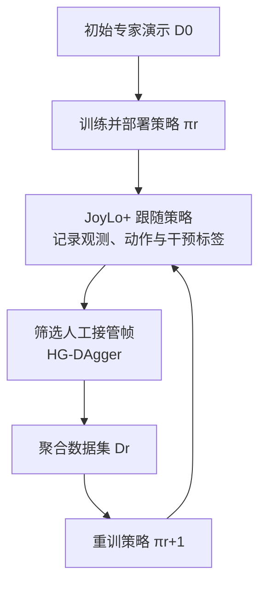

# I3L：机器人犯错后，怎样用纠正数据提升全身移动操作

**I3L**（*Iterative Interactive Imitation Learning for Whole-Body Mobile Manipulation*，arXiv:2610.17748）把部署时的人工接管和多轮模仿学习更新放进一个闭环：机器人自主执行时，JoyLo+ 跟随策略的手臂动作；操作者在错误状态触摸接管，系统记录纠正，再训练策略处理下一轮部署中暴露的问题。

## 一句话定义

**策略先自主执行，人只在关键失败状态纠正；每一轮把纠正样本并入训练集，再重新部署。**

## 英文缩写速查

| 缩写 | 英文全称 | 简要说明 |
|------|----------|----------|
| I3L | Iterative Interactive Imitation Learning | 本文的迭代式交互模仿学习系统 |
| JoyLo+ | JoyLo Plus | 跟随策略动作、支持触发式接管的全身遥操作接口 |
| HG-DAgger | Human-Gated Dataset Aggregation | 由人决定是否接管、筛选纠正样本的数据聚合协议 |
| DAgger | Dataset Aggregation | 在策略访问到的状态上收集专家监督并迭代训练 |
| VLA | Vision-Language-Action | R1 Pro 实验使用的预训练视觉-语言-动作策略 |
| DP | Diffusion Policy | Franka 与 A1 实验使用的扩散策略 |

## 为什么重要

- **采集部署分布中的纠正：** 离线示范很少覆盖策略自己造成的状态偏移；I3L 直接在实际部署 rollout 中收集这些纠正。
- **把操作员时间集中在薄弱环节：** 人不必重做策略已经掌握的全流程，只在需要时接管。
- **能覆盖全身协调：** R1 Pro 接管可共同控制双臂、躯干、底盘和夹爪，适用于长时序移动操作。
- **同时观察策略效果和干预负担：** 除自主成功率外，论文还跟踪接管时长、干预比例和不同身体部位的纠正占比。

## 核心信息

| 项 | 内容 |
|----|------|
| 机构 | 斯坦福大学（Stanford University）；Lambda Inc.（Jianwen Xie） |
| 论文 | arXiv:2610.17748，v1 提交于 2026-10-13 |
| 项目页 | [i-3l.github.io](https://i-3l.github.io/) |
| 任务与平台 | 8 项任务、29 个子任务、3 种本体；仿真、Franka 固定基座与 R1 Pro 全身移动操作 |
| 硬件接口 | JoyLo+ 电机驱动 leader arm、触摸检测和柔顺接管 |
| 策略 | Franka / A1 使用 Diffusion Policy；R1 Pro 使用预训练 π0.5 |
| 开放状态 | 论文称 JoyLo+ 接口开源；代码仓库与项目页资料的实际开放状态尚未核实 |

## 核心原理

### JoyLo+ 接管接口

自主执行时，leader arm 电机跟踪策略的手臂目标，使操作者保持与机器人状态同步。操作者触摸握把即可触发接管；接管期间系统切换到柔顺操控，并记录实际执行动作、策略提出的动作和干预标签。释放后策略从修正后的状态重新规划。

R1 Pro 上，握把触摸或 JoyCon 输入会协调接管双臂、躯干、移动底盘和夹爪；Franka 配置使用单个七关节 leader arm 处理桌面操作。

### 多轮纠正学习闭环

每一轮的数据由初始演示和历轮主动纠正构成；HG-DAgger 选择接管帧进入训练集，更新后的策略再接受下一轮部署测试。

## 源码运行时序图

**不适用**：截至 2026-10-19，本次核查未能从项目页确认可运行训练或部署代码仓库；论文全文未链接代码仓库。若项目页后续提供运行代码，再补运行时序图。

## 工程实践

| 环节 | 论文做法 / 实践启示 |
|------|---------------------|
| 接管触发 | 握把电容触摸触发；R1 Pro 也支持 JoyCon 输入控制全身 |
| 数据标签 | 每帧记录干预状态、观测、实际执行动作和策略提出动作 |
| 样本筛选 | HG-DAgger 只将主动接管帧用于选择性纠正训练；其他策略在仿真中对比 |
| 训练初始化 | 每轮从一致的策略初始化或相同 VLA 预训练 checkpoint 开始训练 |
| 任务安排 | 将昂贵真实机器人评估用于验证所选协议，系统性的纠正策略对比主要在仿真中完成 |
| 安全边界 | 真机 rollout 需要可快速接管的硬件、协调切换逻辑和稳定的释放后重规划；具体延迟与安全认证不在此条目推断 |

## 实验与评测

- **仿真草莓采摘放置：** 初始策略成功率 53.2%；追加 100 条完整演示为 55.6%；相同 100 条纠正轨迹经四轮 HG-DAgger 后为 92.8%。
- **仿真开冰箱并取收音机：** 初始策略为 39.6%；追加演示为 30.4%；四轮 HG-DAgger 后为 90.0%。
- **Franka 挂杯真机：** 初始策略 6/25；追加演示后 17/25；纠正训练后 23/25。
- **整体结果：** 论文摘要报告 8 项任务在相同轨迹预算下平均提升 35.6 个百分点，所有任务至少达到 90% 自主成功率；四轮后每回合接管时长下降 72%。
- **解读限制：** 仿真数据和真实数据来自不同任务组；总体摘要数字与单项 Table II 数字应分开读，不应把仿真提升直接当作跨本体真机收益。

## 与其他工作对比

| 工作 | 何时介入 | 纠正如何进入训练 | 与 I3L 的差异 |
|------|----------|------------------|---------------|
| [DAgger](../methods/dagger.md) | 专家回标策略访问到的所有状态 | 全部回标数据聚合 | I3L 采用 HG-DAgger：由人决定接管，只收集接管帧 |
| [AutoIntervene](./paper-autointervene.md) | 用 visual-action memory 自动判断切入与交回 | 选择性干预数据 | AutoIntervene 自动化“何时接管”；I3L 由操作者触摸触发，重点在全身接管接口 |
| SIRIUS / residual policy（论文对照） | 人工干预 | 加权回放或残差修正 | 论文控制实验中 HG-DAgger 优于这两类方案及“使用全部数据” |
| 追加完整示范（论文对照） | 不依赖部署失败 | 新增整段演示 | 相同 100 条轨迹预算下，纠正轨迹在两项仿真任务中明显优于追加示范 |

I3L 的差异化在于把 JoyLo+ 全身接管硬件与多轮 HG-DAgger 协议一起交付；比较时应同时报告自主成功率与接管时长，而非只看最终成功率。

## 结论

**I3L 的重点是让部署纠正成为可重复的数据采集与策略更新闭环。**

1. 关键评测指标是自主任务成功率和接管负担，论文报告四轮纠正同时改善成功率并降低平均接管时长。
2. 与追加完整示范相比，部署时只收集失败附近的纠正轨迹，在两项仿真任务和一项 Franka 真机任务中都取得更明显提升。
3. JoyLo+ 的关键系统贡献是策略跟随、触摸触发和全身协调接管；但运行代码开放状态仍需通过项目页核实。
4. HG-DAgger 在论文控制实验中优于使用全部数据、SIRIUS 和 residual policy 等方案；多轮纠正的收益依赖样本筛选方式。
5. 结果覆盖 8 项任务但真实世界规模有限，系统性算法比较主要在仿真中完成，外推到更广泛家庭任务仍需额外验证。

## 关联页面

- [DAgger](../methods/dagger.md) — 策略诱导状态上的专家纠正与数据聚合
- [Imitation Learning](../methods/imitation-learning.md) — 交互模仿学习的范式背景
- [Behavior Cloning](../methods/behavior-cloning.md) — 每轮策略监督训练的基础范式
- [Action Chunking](../methods/action-chunking.md) — 可与本文对照的动作块策略部署干预路线
- [Manipulation](../tasks/manipulation.md) — 接触丰富操作任务的背景
- [AutoIntervene](./paper-autointervene.md) — 在线检测何时切入、何时交回的选择性干预对照

## 参考来源

- [I3L 论文摘录与核查](../../sources/papers/i3l_arxiv_2610_17748.md)
- [arXiv:2610.17748](https://arxiv.org/abs/2610.17748) — 论文与摘要
- [I3L 项目页](https://i-3l.github.io/) — 论文提供的视频、可视化和 CAD 模型入口；本次未能读取页面内容

## 推荐继续阅读

- [DAgger 原论文](https://arxiv.org/abs/1011.0686) — 理解在策略访问状态上聚合专家标注的理论起点
- [AutoIntervene](./paper-autointervene.md) — 对比动作块策略的监控触发与双向控制权切换
