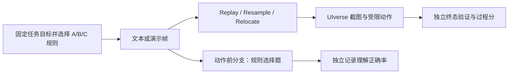
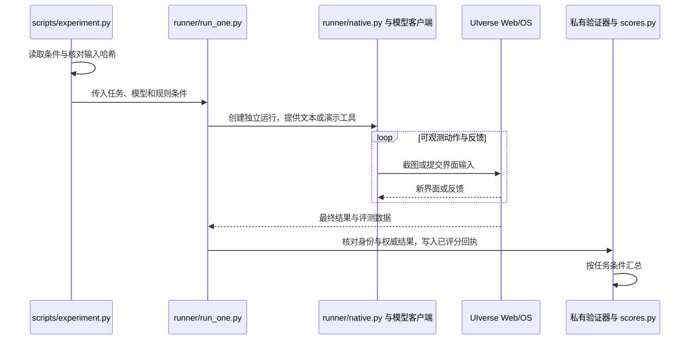

# ICLWorld：跨数字与物理世界的情境学习评测 / Benchmarking In-Context Learning of Agents from Digital to Physical Worlds

## 一句话定义

ICLWorld 让智能体在不更新参数的前提下，从文本或演示视频学习一条现场规则，再用屏幕与可用动作完成任务；机器人端的执行统计来自仿真。

## 英文缩写速查

| 缩写 | 英文 | 含义 |
|---|---|---|
| ICL | In-Context Learning | 在上下文中学新规则，不更新参数 |
| CUA / RUA | Computer-Use / Robot-Use Agent | 计算机操作 / 机器人操作智能体 |
| GUI | Graphical User Interface | 软件原生界面或机器人控制面板 |
| MCP | Model Context Protocol | 评测环境向智能体开放的工具协议 |
| QA | Question Answering | 首次动作前的规则理解诊断 |

## 为什么重要

目标不变时，正确动作仍由用户指定的规则决定。只让策略重放同一个演示，可能把动作模仿误作规则学习；只让模型答题，又会看不出它在抓取、对齐和完成判断上失败。

## 核心原理与方法

论文作者构建 **30 个环境、630 段演示（10 小时以上）和 160 个任务族**（75 Web、35 OS、50 Robot）。每个任务有 A/B/C 三份规则，例如同样给陈列架补货，规则分别按颜色、形状或全置上层改变合法动作。UIverse 暴露截图、输入与规则相关工具；数字域用原生界面的点击/拖动/按键，机器人域以面板操作机械臂并提交步长/角度。智能体看不到裁判状态。

| 级别 | 保留与变化 | 测量重点 |
|---|---|---|
| Replay | 恢复演示中的情景 | 相同场景执行，也可能只是照着演示重做 |
| Resample | 同一环境同分布，独立采出新实例 | 同域迁移而非动作轨迹复用 |
| Relocate | 目标与规则不变，进入对应新环境 | 界面布局变化，或本体、台面与仿真参数发生变化 |

不是所有任务都有 Replay/Resample。例如某些复杂软件演示只覆盖规则相关片段，某些机器人任务没有可替换物件；Relocate 适用于全部任务。真实演示是输入之一，既不等于真实执行，也不等于这里评了仿真到真机迁移。

## 实验与评测

表 3 均为 C 规则，同一任务分别测试文本/视频。计算机分母 **110**（均 Resample）；机器人分母 **50**（42 Resample、8 Replay，后者无模型成功）。论文总体分对两域等权，不能将两个分母简单合并视为同一域。

| 模型 | 计算机 文本 / 视频 | 仿真机器人 文本 / 视频 |
|---|---:|---:|
| Claude Opus 5.5 | 81.8% / 81.8% | 26.0% / 28.0% |
| GPT-6 Astra | 75.5% / 77.3% | 24.0% / 28.0% |

- **规则理解不是动作成功。** 图 5 把 17 个机器人任务的三个视频规则合并成 51 对。GPT-6 Astra 首次动作前在独立分支答对 **50/51（98.0%）**，相应运行完成 **10/51（19.6%）**；答案不会回流到执行上下文。
- **单规则与稳定遵从不同。** 表 5 的 37 个计算机任务上，GPT-6 Astra 在 C 视频规则成功 75.7%，三规则都成功的是 37.8%。目标不带规则时，消融中三模型计算机成功率最多 8.1%，机器人为 0%，不能推广为六模型在 160 个任务上的结果。
- **泛化的分母。** 表 4 计算机先用同 13 项配对 Replay/Resample，再用同 37 项配对 Resample/Relocate。机器人在 17 个子集任务中，三个级别分别有 14、15、17 项；机器人跨列原始百分比不宜直接当作同一组样本的性能变化。

## 与其他工作对比

[Embodied Playground](./paper-embodied-playground.md) 偏向长时程、多阶段仿真操作与权限/评分；ICLWorld 的控制变量是同目标下局部规则及示例，设计了从原场景到新实例、对应环境的迁移，并对比软件与仿真机器人。二者的成功率受观测、控制界面、任务组成和预算影响，不应横向排名。

## 工程实践：源码运行时序

以下是 [公开提交 2ce5316](https://github.com/ICLWorld/ICLWorld/tree/2ce5316c33da9b2eeb2cb22164e40ab02ea6b044) 的 Web/OS 入口静态阅读。机器人分支独立走 `robot/scripts/prepare.py` 和 `robot/harness/pool_verified.py`（IsaacSim/IsaacLab 与 GUI）；不是同一个 Docker 执行器或软件 runner。未在本地发起模型请求或运行仿真。

## 局限与常见误区

- 对照保持模型及界面范式，但两域本身的控制精度和任务复杂度不等；成功差距不能单独归因于感知或推理。
- 机器人操作只在仿真完成，且没有把软件操作和机器人操作串成同一任务；自制素材降低污染风险，不是对所有模型训练集的独立审计。
- 开源代码 MIT，模型端点与额度自备；不能自动转授第三方资源或数据媒体。不要将复现协议、运行结果与实际 API 输出的确定性混同。

## 结论

先在未见实例上验证新规则是否真能执行，再用动作前理解诊断、终态验证和过程进度定位瓶颈。答对规则可以说明有理解线索，但不能替代实际闭环评测。

## 关联页面

- [具身智能评测基准选型枢纽](../overview/hub-embodied-eval-benchmark.md)

- [具身评测基准选型](../queries/embodied-eval-benchmark-selection-loop.md) · [仿真评测基础设施](../concepts/simulation-evaluation-infrastructure.md)
- [VLA](../methods/vla.md) · [机器人操作](../tasks/manipulation.md)

## 参考来源

- [论文原文归档（v1）](../../sources/papers/iclworld_arxiv_2611_32649.md)
- [发布仓与执行入口](../../sources/repos/iclworld.md) · [数据卡与元数据](../../sources/datasets/iclworld.md)

## 推荐继续阅读

- [论文表 3–5 与附录 C/D](https://arxiv.org/html/2611.32649v1) · [官方项目页](https://iclworld.github.io/)
