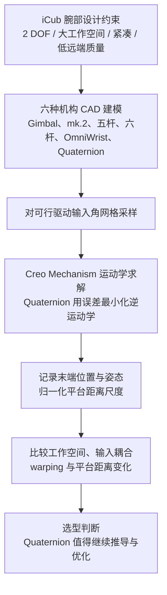

# iCub 人形机器人腕部机构实现比较（A Comparison of Robot Wrist Implementations for the iCub Humanoid）

**Shah, Wu, Scalzo, Metta 与 Parmiggiani**，*Robotics* **2019**, 8(1), 11，[DOI:10.3390/robotics8010011](https://doi.org/10.3390/robotics8010011)，[官方全文](https://www.mdpi.com/2218-6581/8/1/11)，[PDF](https://www.mdpi.com/2218-6581/8/1/11/pdf)。研究机构为**意大利技术研究院（IIT）**、**热那亚大学**与**博洛尼亚大学**。本文比较腕部 **2-DOF pitch/yaw** 机构的 CAD 工作空间与驱动耦合，不是实机优胜率评测。

## 一句话定义

**在 iCub 腕部的体积和低远端惯量约束下，用统一 CAD 运动学工作空间分析比较六种腕部构型，解释为何 Quaternion Joint 比同样达到半球工作空间的 OmniWrist-III 更值得继续开发。**

## 英文缩写速查

| 缩写 | 英文全称 | 简要说明 |
|---|---|---|
| iCub | iCub humanoid robot | 意大利技术研究院开发的人形研究平台；本论文的腕部改型对象 |
| DOF | Degree of Freedom | 两个腕部定向自由度；前臂 roll 在论文比较范围之外 |
| CAD | Computer-Aided Design | 通过 Creo 的结构装配和运动学求解采样工作空间 |
| ROM | Range of Motion | 末端 pitch/yaw 或 tilt 的可达角度范围 |
| PKM | Parallel Kinematic Mechanism | 通过多支链形成闭链姿态机构 |
| UU | Universal–Universal | OmniWrist / Quaternion 所用串接双万向节支链 |
| T&T | Tilt and Torsion | OmniWrist / Quaternion 的姿态参数化形式 |

## 为什么重要

- **质量与功耗权衡：** 远端电机质量会提高上游关节的运动负担；电机近端布置虽有利于减轻腕部，但绳索会引入弹性和控制难度。
- **不只看最大角度：** 两个方案都能达到 90° 倾斜，并不意味着驱动输入、输出位姿和控制增益的关系同样规整。
- **机构选型的依据：** 五/六杆的受限 yaw、OmniWrist 的空间畸变，以及 Quaternion 的平台距离变化，都是将论文结论迁移到其他人形手腕时必须重新核对的约束。

## 核心信息

| 项目 | 论文事实 |
|---|---|
| 论文类型 | CAD 机构建模和工作空间比较（非真实机器人的控制实验） |
| 对象 | 2-DOF 腕部姿态机构；iCub roll 由前臂机构提供 |
| 基准 | 串联 Gimbal；原 iCub mk.2 绳传动腕 |
| 候选 | 球面五杆、球面六杆、OmniWrist-III（4-UU）、Quaternion Joint |
| 工具 | PTC Creo Parametric 4.0，Mechanism 模块 |
| 设计容积 | 截锥近似：端部直径 70 / 50 mm，高度 150 mm |
| 源码 | 论文未提供公开 CAD/求解器/脚本下载入口；不适用运行时序图 |

## 核心原理与方法

### 从旧腕到新腕的设计问题

原 iCub mk.2 用两台 Faulhaber 直流电机、159:1 行星减速箱与绳轮传动实现腕部 pitch/yaw，电机到关节的映射写成：

\[
\begin{bmatrix}\theta_1\\\theta_2\end{bmatrix}
=\begin{bmatrix}1.38&0\\1.38&1.38\end{bmatrix}
\begin{bmatrix}q_1\\q_2\end{bmatrix}.
\]

因此它不是两个彼此独立的电机角到腕角映射，原始关节 ROM 约为 pitch ±56°、yaw ±38°（原文 §3、Table 1）。新的结构目标包括全半球工作空间、较少奇异点、较高映射规整性、紧凑包络与低远端质量（§4）。

### 流程总览：如何做六构型可比评测

作者用 CAD 运动学仿真遍历可行驱动角组合；求解失败可能涉及奇异点。对 Quaternion Joint，由于理想球面滚动只是高精度近似，采用逆运动学误差最小化以适配 CAD 求解容差（原文 §5）。**这是作者的研究分析流程，不是公开源码运行流程。**

## 实验与评测

原论文的 **Table 2** 将六种设计汇总如下：

| 机构 | 解耦 | ROM | 半球工作空间 | Warping | 平台距恒定 |
|---|---|---|---|---|---|
| Gimbal | 完全 | ±90° | 完整 | 无 | 是 |
| iCub mk.2 | 部分 | Pitch ±56°；Yaw ±38° | 部分 | 无 | 是 |
| 球面五杆 | 部分 | Pitch ±90°；Yaw ±30° | 部分 | 无 | 是 |
| 球面六杆 | 部分 | Pitch ±90°；Yaw ±45° | 部分 | 无 | 是 |
| OmniWrist-III | 无 | Tilt 90° | 完整 | **有** | 是 |
| Quaternion Joint | 无 | Tilt 90° | 完整 | 无 | **否** |

- **半球覆盖：** 仅 Gimbal、OmniWrist 与 Quaternion 可达到完整半球；五杆、六杆的 yaw 受限（Figure 5–6）。
- **耦合与形变：** 只有 Gimbal 完全解耦；OmniWrist 出现不对称 warping，意味着同样的输入在不同配置会产生不同输出，增加配置依赖的控制难度（Figures 6–8、§7）。
- **控制量级：** OmniWrist 与 Quaternion 的驱动端约 ±45° 对应输出倾角最高 90°，但该“放大”不代表力矩性能也会放大（§7）。
- **代价：** Quaternion 平台与基座的距离不恒定；不能只摘录“全半球”而忽略这项几何差异（Table 2）。

## 与其他工作对比

与串联 Gimbal 相比，并联候选的动机是**将质量向近端布置并保持腕部包络**；与原 iCub mk.2 绳传动相比，目标是减少绳弹性和传动复杂度。球面五/六杆具有一定角度线性与规整性，但 yaw 有限制；OmniWrist 有广工作空间却出现不对称映射；Quaternion 兼有广工作空间与较规整映射，但**不**具有完全驱动解耦且平台距离随姿态变化。讨论的是特定 iCub 改型约束，并非一般机械腕排行。

## 结论

**论文最重要的选型结论不是“并联腕必然更好”，而是在 iCub 的空间和控制要求下，Quaternion Joint 在广工作空间与映射规整性之间给出了值得继续研发的候选。**

1. **先量工作空间再谈控制** — ROM 与完整半球覆盖应分开看；五/六杆有大 pitch 但 yaw 限制。
2. **把输入映射作为验收项** — OmniWrist 的 warping 使固定控制增益难以覆盖全部配置。
3. **不要误写完全解耦** — Quaternion 也需要考虑两路驱动耦合。
4. **记录几何代价** — Quaternion 的平台距离并非恒定，集成与干涉分析需要纳入这一点。
5. **严守证据级别** — 结论来自 CAD 工作空间比较；下一步仍是解析运动学与参数优化，并未给出新 iCub 手腕真机验证。

## 工程实践

- **参数化六种 CAD 机构：** 统一输出平台距离尺度，分离机构参数、输入角可行域、末端姿态坐标约定。
- **做姿态和电机角映射图：** 对可行输入角均匀采样，画归一化工作空间与角度等值线，分别检查奇异区、耦合与配置依赖。
- **下游移植前补做：** 结构干涉、质量/惯量、刚度、负载、效率、力矩、传动与实际加工误差评估；这篇论文的 CAD ROM 结果不能代替上述验证。
- **源码运行时序图：** **不适用**。论文的作者贡献部分提及内部 Quaternion 运动学求解器，但正式发布页未附可运行官方代码、README 入口或公开 CAD 源文件，不能据此编造训练/仿真时序。

## 局限与风险

- 六构型评价侧重**运动学工作空间与映射**，并未统一完成机电动力学、真实负载、刚度、摩擦与寿命实验。
- Quaternion 是**候选方案**而非 2019 年已交付的 iCub 新硬件；结论不应扩大成实机性能优于其他腕。
- Gimbal 的 pitch/yaw 与 OmniWrist/Quaternion 的 tilt/azimuth 是不同姿态参数化；直接比较单轴角度时注意这一边界。
- 静态几何仿真中出现的求解失败不能无额外证据地全部判定为机械奇异点。

## 关联页面

- [人形机器人并联/闭链关节运动学](../concepts/humanoid-parallel-joint-kinematics.md) — 驱动与关节空间的耦合和映射
- [操作任务（Manipulation）](../tasks/manipulation.md) — 手腕姿态范围对末端执行操作的影响
- [移动操作（Loco-Manipulation）](../tasks/loco-manipulation.md) — 上肢与整机共同受惯量/布局约束
- [轨迹优化（Trajectory Optimization）](../methods/trajectory-optimization.md) — 以机构可行域约束轨迹设计
- [人形整机硬件设计纵深路线 Stage 1](../../roadmap/depth-humanoid-hardware-design.md)

## 参考来源

- [Shah et al.（2019）原文通读归档](../../sources/papers/icub_wrist_mechanisms_robotics_2019.md)
- [MDPI 正式出版版本](https://www.mdpi.com/2218-6581/8/1/11) — §2–8、Figures 1–8、Tables 1–2

## 推荐继续阅读

- [论文官方 PDF：A Comparison of Robot Wrist Implementations for the iCub Humanoid](https://www.mdpi.com/2218-6581/8/1/11/pdf)
- [作者 Divya Shah 论文页面](https://divyashah.github.io/publication/mdpi-robotics-2019/)
