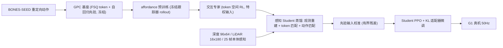

# iGPC：面向物体感知人形交互的生成式动作先验

**iGPC**（[arXiv:2610.08120](https://arxiv.org/abs/2610.08120)）在 Generative Pretrained Controller（GPC）这一人形运动先验之上，学习以物体/接触状态为条件的交互专家（够取栏杆、抓扶手稳身、推箱子），再把专家蒸馏成只用深度、LiDAR 与本体感知的 Student，在 Unitree G1 上落地。

## 一句话定义

**冻结 GPC 的运动 token 词表与解码器，只训练任务适配器去利用物体/支撑信息，并通过结构化感知蒸馏让特权专家变成可部署的机载传感器策略。**

## 英文缩写速查

| 缩写 | 英文全称 | 简要说明 |
|------|----------|----------|
| GPC | Generative Pretrained Controller | 以 FSQ 运动 token 和自回归先验构成的 G1 运动基础模型 |
| FSQ | Finite Scalar Quantization | 运动 token 的量化方式 |
| DoRA / FiLM | Weight-Decomposed Low-Rank Adaptation / Feature-wise Linear Modulation | 条件低秩适配器，用于任务特化 |
| KL | Kullback–Leibler Divergence | 蒸馏与适配中约束 Student 贴近特权参考 |
| LiDAR | Light Detection and Ranging | 机载 Livox MID-360，栅格 16×180 |
| PPO | Proximal Policy Optimization | Student 控制下的适配器微调 |

## 为什么重要

- 纯人体动作先验不知道「手要碰哪、哪里能撑」；iGPC 展示了在不重训先验的前提下加入物体条件的路径。
- 感知蒸馏的消融显示：直接 MLP 蒸馏触顶仅 46.53%，结构化观测/token/先验校准三项加起来才到 95.95%。
- 受推稳定性大幅优于仅腿 GPC，说明「借手支撑」是人形抗扰的有用动作。

## 核心信息

| 项 | 内容 |
|----|------|
| 机构 | 穆罕默德·本·扎耶德人工智能大学（MBZUAI）；麻省理工学院（MIT）；Minerva Humanoids |
| 平台 | Unitree G1（29 DoF，50 Hz）+ Dex3 手；Isaac Lab 200 Hz |
| 数据 | G1 重定向 BONES-SEED；第三阶段 1,024 条（约 2.24 h） |
| 开源 | **未发现**项目页/代码（截至 2026-10-12） |

## 流程总览

## 方法

- **基座：** 每个控制步由先验生成 M=8 个运动 token，解码 u_t=D_ψ(s_t,z_t)，a_t=q_off+q_scale⊙tanh(u_t)；仅适配器与条件投影可训练。
- **交互专家：** 三个任务；支持描述符含 6 个手/腕/肘位移向量、6 个归一化接触量、有效标志；稳定性描述符含躯干朝向、离地高度、线/角运动。奖励在原文中只被概括为任务进度、有效接触、稳定执行及对不良物理交互的惩罚（具体系数未给）。
- **Student 输入：** 深度 96×64、LiDAR 16×180、25 帧本体感知历史；结构化估计器预测表面/接触特征，循环估计器预测躯干高度与基座局部速度，经前向运动学重建身体状态。
- **损失：** L=λ_o·L_obs+λ_z·L_tok+λ_a·L_act；token 项含 teacher/student 前缀 KL 与专家交叉熵。
- **手部：** Dex3 的 14 个指关节单独控制，掌心接触栏杆力超 1 N 即规则闭指。

## 实验与评测

| 实验 | iGPC | 对比 |
|------|------|------|
| 专家栏杆触顶 | 99.32%（终点 p50 1.35 cm） | MaskedMimic 0.20%；GPC 无交互 31.30%；无 affordance 48.63% |
| Student 触顶 / 身体碰撞 | 95.95% / 5.22% | Student MLP 46.53% / 50.73% |
| 推速 2.5–3.0 m/s 摔倒率 | 专家 22.66%，Student 17.19% | GPC 仅腿 40.43% |
| 推箱子 60 s 前进距离 | Student 67.59 m（横向漂移 13.77 m） | VisualMimic 45.17 m（漂移 36.29 m） |

- 蒸馏消融：去观测损失 93.41%、去 token 损失 90.14%、去先验校准 91.02%；二者皆去仅 25.39%。
- 评测为 2,048 次匹配试验/策略（4 seed×512，10.24 s），关闭传感器噪声、延迟、动力学随机化与外推。
- 推箱对比跨仿真器（Isaac Lab 对 MuJoCo）、各用原生接口，不完全同条件。
- 真机：约 18 ms/更新（RTX 5090），>50 Hz；够栏杆、推箱 10 s、抓栏杆稳身、借手扶沙发坐/起，均为定性演示，无试验次数与成功率。

## 源码运行时序图

不适用：论文与 arXiv 页面均未提供项目页或代码仓库，截至 2026-10-12 无可对齐的运行入口。

## 工程实践

| 项 | 建议 |
|----|------|
| 先验复用 | 冻结词表/解码器，仅训练适配器，可重用同一基座 |
| 感知迁移 | 先做观测重建与 token 匹配，再加先验输入校准；直接 MLP 蒸馏明显不足 |
| 传感器 | D435i 30 Hz + MID-360 10 Hz + 50 Hz 控制环，推理约 18 ms |
| 复现 | 无官方代码；GPC 基座与奖励细节需前作与自行实现 |

## 结论

**在保留生成式运动先验的前提下加入物体/接触条件，是让人形做交互的可行路径，但真机证据仍偏定性。**

1. **交互条件是触顶率的决定因素：** 99.32% 对 GPC 无交互 31.30%。
2. **affordance 预训练有独立贡献：** 去掉后专家降至 48.63%。
3. **Student 需要结构化蒸馏：** 三项缺一都下降，MLP 仅 46.53%。
4. **借手支撑降低摔倒：** 2.5–3.0 m/s 推力下 17.19–22.66% 对 40.43%。
5. **读数时留意条件：** 评测关闭噪声/延迟/随机化，箱体对比跨仿真器。
6. **开源：** 暂无代码，当前只能借鉴设计。

## 与其他工作对比

| 对照 | 差异读法 |
|------|----------|
| [MaskedMimic](./paper-bfm-17-maskedmimic.md) | 同属动作先验路线，本文报告其手部目标够取仅 0.20% |
| [VisualMimic](./paper-notebook-visualmimic.md) | 视觉 loco-manip 基线；推箱前进 45.17 m 对 67.59 m（跨仿真器） |
| [Scaling BFM](./paper-scaling-bfm-humanoid.md) | 规模化行为基础模型；iGPC 是在基座上加物体条件 |

## 局限与风险

- **开源状态：** 截至 2026-10-12 未发现项目页、GitHub 或权重。
- 真机无量化结果；固定栏杆/箱体，未测新物体；评测关闭扰动。
- 闭指为规则触发；奖励系数原文未报告。

## 关联页面

- [人形/四足前沿周报 2026-10-05~10-09](../overview/frontier-humanoid-quadruped-2026-10-05-10-09.md)
- [Loco-manipulation 任务页](../tasks/loco-manipulation.md)
- [MaskedMimic](./paper-bfm-17-maskedmimic.md)
- [Unitree G1](./unitree-g1.md)

## 参考来源

- [igpc_arxiv_2610_08120.md](../../sources/papers/igpc_arxiv_2610_08120.md) — 论文来源归档
- [人形/四足周报来源](../../sources/blogs/frontier_humanoid_quadruped_2026_10_05_10_09.md)
- [arXiv:2610.08120](https://arxiv.org/abs/2610.08120)

## 推荐继续阅读

- [arXiv HTML 全文](https://arxiv.org/html/2610.08120v1)
- [BONES-SEED 数据集](https://bones.studio/datasets/seed)
