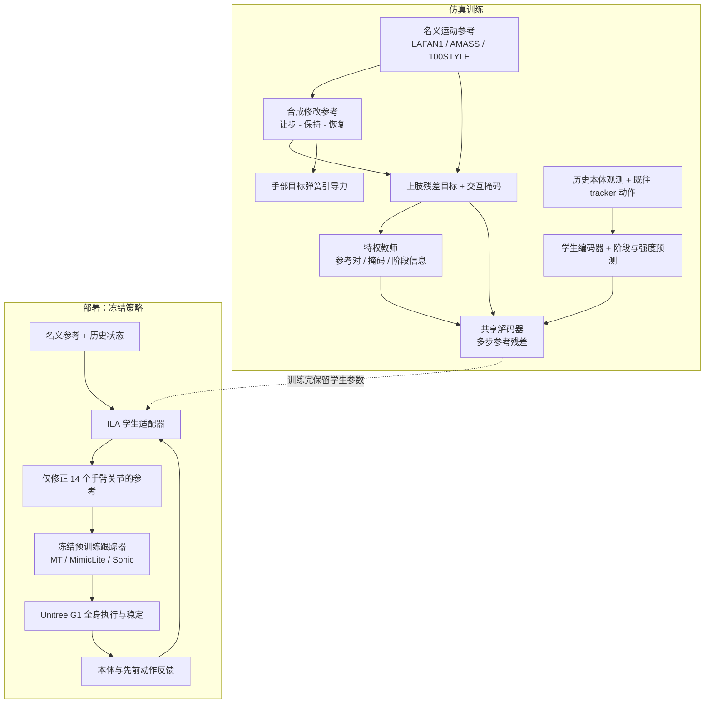

# ILA：面向柔顺人形运动跟踪的可迁移接口级适配器（A Transferable Interface-Level Adapter for Compliant Humanoid Motion Tracking）

## 一句话定义

**ILA（Interface-Level Adapter）** 是哈尔滨工业大学（深圳）与新加坡国立大学研究者提出的柔顺人形运动跟踪方法（[arXiv:2611.14985v1](https://arxiv.org/html/2611.14985)，2026-11-11）：它**在动作参考接口上学习交互残差**，把修正参考交给已经预训练、参数冻结的全身跟踪策略，形成无需专用交互传感器或显式外力估计的被动引导响应。

## 英文缩写速查

| 缩写 | 英文全称 | 简要说明 |
|------|----------|----------|
| ILA | Interface-Level Adapter | 位于参考动作输入侧的可迁移适配器 |
| MT | Motion Tracking | 论文使用的源跟踪策略（MT-Std）及对比配置 |
| WBT | Whole-Body Tracking | 已有全身策略执行修正后的跟踪参考 |
| HRI | Human–Robot Interaction | 人与机器人接触引导的使用场景 |
| RMSE | Root Mean Square Error | 跟踪、未参与手臂和恢复误差 |
| ONNX | Open Neural Network Exchange | G1 CPU 部署时使用的推理模型格式 |

## 为什么重要

- **参考层与控制层分工：** 预训练跟踪器已学会全身平衡和轨迹执行。ILA 只更改上游的“要跟什么”，而不是更换低层策略或在输出力矩上加残差。
- **让步与恢复并重：** 在人推/拉机器人手臂时响应引导，不被引导的手和下肢继续维持工作；接触解除后回到名义运动。
- **跨策略复用：** 同一 MT-Std 上训练的 ILA，在不微调适配器和目标跟踪器的前提下，通过确定性关节/坐标/参考时序映射迁移到 MimicLite 和 Sonic。

## 核心信息

| 字段 | 原文核对 |
|------|----------|
| 论文 | Zhuochang Cai、Zihao Yan、Jinxuan Zhu、Yanjie Li、Hao Xiong；arXiv:2611.14985v1（2026） |
| 机构 | 哈尔滨工业大学（深圳）（Harbin Institute of Technology, Shenzhen）；新加坡国立大学（National University of Singapore） |
| 场景 | 人形跟踪器在有物理引导时的上肢柔顺、任务保持与释放后恢复 |
| 输入 | 名义参考运动、因果本体感知历史与先前跟踪动作；**不输入特权教师信息** |
| 输出 | 未来 H 步的 14 个手臂关节参考残差（论文部署 H=32，50 Hz） |
| 执行策略 | 冻结的 MT-Std / MimicLite / Sonic；仍负责整机控制和平衡 |
| 训练 | 仿真中合成 nominal–modified reference pairs，特权 teacher 蒸馏 student |
| 代码 | 截至 2026-11-15，**未在论文与公开检索材料中找到可确认的 ILA 官方实现链接** |

## 核心原理

### 1. 在参考运动接口插入残差

依据论文式 (1)，适配器与跟踪器分离：

\[
\Delta r_t=A_{\phi}(h_t,r_t),\quad
\hat r_t=r_t+M\Delta r_t,\quad
a_t=\pi_{\theta}(o_t,\hat r_t),\quad \theta\text{ 固定}。
\]

其中 \(h_t\) 为历史本体感知和先前动作，\(r_t\) 为名义参考，\(M\) 只将预测的手臂关节修正插回参考运动。腿部、躯干名义参考不被适配器直接修改，协调动作仍可由原跟踪器产生。输出零残差时回到原名义参考。

### 2. 合成交互配对监督与历史推断

从 LAFAN1、AMASS、100STYLE 等动作采样名义轨迹，构造手臂先偏移、维持、再返回名义轨迹的修改参考；仿真用手部目标弹簧外力匹配该修改参考。监督信号为两种参考的上肢差，并受交互时间掩码约束。

Teacher 额外见到修改参考、残差、交互掩码与时间占比；student 只从可部署的因果历史推断 latent。两者共享 decoder；辅助输出将交互分为**无交互 / 让步 / 保持 / 恢复**四阶段，并分别预测左右臂修正强度。损失联合残差回归、潜变量蒸馏、阶段/强度监督、平滑与恢复约束。

### 3. 不依赖策略参数迁移

同一 adapter 在 MT-Std 上训练，部署到 MimicLite / Sonic 时使用关节排列、坐标约定和参考时间的**确定性接口映射**。迁移时 adapter 和 tracker 两边权重均保持不变，但不同 tracker 最终全身行为与无力跟踪精度不一定完全相同。

## 流程总览

**注意：** 图描述论文算法模块与数据流，**不是**对未发布 ILA 源码的调用链复原。

## 实验与评测

原文 Table II：相同引导协议、同一在 MT-Std 上训练的 ILA，三种 tracker 的目标误差如下（厘米，越小越好）：

| 原跟踪器 | 原始误差 | +ILA 误差 | 降低 |
|----------|---------:|----------:|-----:|
| MT-Std | 17.801 | 5.684 | 68.1% |
| MimicLite | 10.182 | 3.705 | 63.6% |
| Sonic | 14.871 | 3.663 | 75.4% |

**无外力跟踪 RMSE（度，越低越好）**：MT 4.379→4.400；MimicLite 3.519→3.591；Sonic 5.362→5.849。说明提高交互柔顺性存在不同程度的名义跟踪代价，不宜笼统宣称“零退化”。

**基线取舍（Table I）**：GentleHumanoid 的引导目标误差 2.569 cm，比 ILA 的 5.684 cm 更低；ILA 则在本评测的未扰动手臂误差、释放后恢复方面有优势。与 native MT compliance、MCC、CHIP-R 或 full-policy finetuning 的比较以论文控制变量和预算为限。

**G1 真机（Table III）**：三个冻结 tracker 原版本在单臂受扰/连续握手中均为 0/10，接入同一 ILA 后分别达到 10/10；侧抬牵拉目标也在 10/10 次到达，所需力为 MT 16.88 N / MimicLite 10.72 N / Sonic 18.64 N。每方法每任务只有 10 次物理试验，不是大规模部署安全论证。

**消融（Table IV）**：成对参考残差监督的目标误差 7.99±0.32 cm，优于直接几何 14.83±0.08 cm 与局部 IK 11.86±0.12 cm；这是另一 checkpoint / 五种运动 / 三个随机种子的对照设置，不能与主表混排。

## 结论

**总判：** ILA 用“参考端残差 + 冻结全身跟踪器”解耦交互意图与稳定执行，为已有 humanoid motion tracker 增加可迁移上肢柔顺性提供了可用样例，而不是新的一整套跟踪策略。

- 手头已有稳定 tracker 时，先评估插入 reference adapter 而非直接改策略输出，减少重新训练底层控制的成本。
- 将**引导目标误差、未扰动手臂误差、释放恢复、跌倒率、无外力 RMSE**一起评估，不能只看“被推得动”。
- 迁移前核对关节顺序、根/关节坐标、参考 horizon/控制频率；这些映射不是即插即用的省略项。
- 论文的改善是在 G1、三种 tracker 与限定的物理引导任务上观察到，其他机型、腿部接触操作与安全保证仍需单独验证。

## 工程实践

- **准备条件：** 可接受上肢关节参考窗口的预训练全身跟踪器；其本体历史、上一动作与 nominal reference 要能映射到 ILA 训练接口。
- **训练关键点：** 让步/保持/恢复式参考配对、交互掩码、目标弹簧扰动；64 维学生 latent、32 步窗口、50 Hz 为论文所报配置，而非通用超参数。
- **部署测量：** G1 ARM aarch64、ONNX Runtime 1.19.2；论文报告 ILA 单独 batch-1 推理 0.51 ms，另有冻结 tracker 单次 0.75 ms；ILA 在独立异步轨迹进程运行，主控制周期 20 ms。需自行测量排队、数据对齐、总链路时延。
- **代码状态：** 论文列出的 MotionTracking、MimicLite、Sonic 是对照/复用的**外部跟踪器**，目前不可据此宣称 ILA 训练、推理或 G1 部署源码公开。

## 源码运行时序图

**不适用（截至 2026-11-15）**：未发现可确认的 ILA 官方训练 / 推理 / 部署代码与 README 运行入口。上面的 Mermaid 是根据论文 Fig. 2 / §III 归纳的**算法流程图**，不能替代源码调用时序；待官方可运行实现发布并逐文件核对后再补时序图。

## 局限与风险

- **不等于力控安全保证：** 无专用交互传感器只表示不依赖这类输入；论文没有提供被动性、接触力上界或碰撞安全的形式化保证。
- **覆盖范围有限：** 参考残差只修改 14 个手臂关节；研究没有证明腿部/躯干引导或任意环境中的柔顺安全性。
- **跨 tracker 有接口前提：** 需要关节名、坐标系、时间对齐的确定性映射；第三种 Sonic 的无力跟踪误差增幅比另两种大。
- **评测与代码边界：** 训练引导来自合成目标弹簧；实机任务和次数有限；ILA 的官方可运行实现暂无可确认链接，因此本文为论文级技术分析而非复现实测。

## 关联页面

- [GentleHumanoid：上半身柔顺全身运动跟踪](../methods/gentlehumanoid-motion-tracking.md) — 在策略训练内部学柔顺，适合与 ILA 的接口级 retrofit 对照。
- [SONIC：规模化运动跟踪](../methods/sonic-motion-tracking.md) — 论文验证的可迁移目标 tracker。
- [Teleoperation](../tasks/teleoperation.md) — 人工引导与跟踪数据采集应用。
- [Whole-Body Tracking Pipeline](../concepts/whole-body-tracking-pipeline.md) — 将参考意图与全身执行分层的位置。
- [BFM 纵深路线 Stage 4](../../roadmap/depth-bfm.md) — 冻结策略的适配与分层接口。

## 参考来源

- [ILA arXiv v1 原文通读归档](../../sources/papers/ila_arxiv_2611_14985.md)
- [arXiv:2611.14985 论文全文（HTML，含实现说明）](https://arxiv.org/html/2611.14985)
- [arXiv PDF（v1）](https://arxiv.org/pdf/2611.14985)

## 推荐继续阅读

- [GentleHumanoid 原论文](https://arxiv.org/abs/2511.04679) — 策略内学习柔顺的对照。
- [Minimalist Compliance Control 原论文](https://arxiv.org/abs/2603.00913) — 显式估计外力并依据导纳模型修改参考的对照。
- [SONIC 原论文](https://arxiv.org/abs/2511.07820) — 被 ILA 复用的强基线跟踪器。
