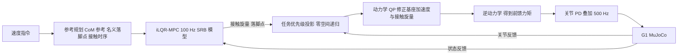

# Online iLQR-MPC + 全身控制的鲁棒人形运动（arXiv:2611.04204）

*Online iLQR-MPC with Whole-Body Control for Robust Humanoid Locomotion*，[arXiv:2611.04204](https://arxiv.org/abs/2611.04204)（v1，2026-11-03），Xiang Li、Linlin Ou、Ruihan Wu、Xinyi Yu（通讯），**浙江工业大学**（论文首页脚注）。本页依据对 arXiv v1 HTML 全文的通读，归档见 [来源归档](../../sources/papers/ilqr-mpc-wbc-humanoid_arxiv_2611_04204.md)。

## 一句话定义

**一个纯模型驱动的人形控制栈：单刚体（SRB）模型上的 iLQR-MPC 把接触力与落脚位置放进同一个滚动时域问题联合求解，再由 500 Hz 的全身控制器（零空间任务优先级 + 动力学 QP + 逆动力学）把规划变成关节力矩；结果仅来自 MuJoCo 仿真中的 Unitree G1。**

## 英文缩写速查

| 缩写 | 英文全称 | 简要说明 |
|------|----------|----------|
| MPC | Model Predictive Control | 滚动时域优化控制 |
| iLQR | iterative Linear-Quadratic Regulator | 迭代线性二次型调节器，DDP 的 Gauss–Newton 近似 |
| DDP | Differential Dynamic Programming | 微分动态规划 |
| SRB | Single Rigid Body | 单刚体模型，保留姿态动力学与完整接触旋量 |
| WBC | Whole-Body Controller | 全身控制器，把规划映射为关节力矩 |
| AL | Augmented Lagrangian | 增广拉格朗日，本文用于摆动脚零旋量等式 |
| ReB | Relaxed Barrier | 松弛对数屏障，本文用于不等式约束 |
| ZMP | Zero-Moment Point | 零力矩点，本文以力矩界形式写入约束 |
| QP / HQP | Quadratic Program / Hierarchical QP | 二次规划 / 分层二次规划 |
| CoM | Center of Mass | 质心 |

## 为什么重要

- 它给出「人形受推后靠 MPC 改落脚点、WBC 补全身可行性」的完整、可解释的模型驱动实现，可与 [MPC 与 RL 对比](../comparisons/mpc-vs-rl.md)、[MPC + WBC 集成](../concepts/mpc-wbc-integration.md) 对照阅读。
- 论文自述的新颖点：据作者所知，此前没有双足人形控制器在在线滚动时域 MPC 内运行 AL + ReB 组合（§I，作者声明，本页未独立核实）。
- 适合当作基线读物，但结论只在仿真、0.1 m/s 慢速行走下成立（见「局限」）。

## 核心原理与方法栈

流程对应论文图 1 与 §I、§IV。

**MPC 层（§II–§III）**

- 模型：SRB，状态 18 维（姿态、位置、角速度、速度、左右脚位置），控制 18 维（左右脚力与力矩、脚速度）；Δt = 5 ms，N = 10，即时域仅 50 ms（§II-A、§V-A）。
- 落脚点进状态：摆动脚位置由脚速度积分，并受步态门门控（式 16）；落脚盒约束以屏障项入代价，所以一次求解同时得到接触力与落脚点，无独立步态规划器（§III-C，贡献 1）。
- 约束：摆动脚零旋量等式用 AL；单边接触、摩擦金字塔（ρμ = μ/2）、ZMP（以力矩界等价表达）、偏航力矩界、落脚盒用 ReB（p = 2），解析梯度与 Hessian 进入反向传播（§III-A、§III-B）。
- 求解：每个周期 3 轮 AL/ReB 外迭代（§V-D）。

**WBC 层（§IV）**

- 零空间递归（位置 / 速度 / 加速度共用式 19）处理基座姿态、脚轨迹、手臂摆动等任务的优先级。
- QP 变量为 6 维基座加速度修正 + 12 维接触旋量修正（共 18 维），只强制浮动基动力学块与接触可行性，关节加速度保持任务递归值（式 20）。
- 力矩 τff 由逆动力学得到，再叠加关节 PD（式 22、23）。

**作者自述 vs 本页判断**

- 作者自述：模型显式、扰动响应可追溯到具体模型项，无需平台特定的策略训练（贡献 3）。
- 本页判断：可解释性在论文中是论述而非实验结论，文中没有消融（如去掉落脚点优化、去掉 AL 或 ReB 对比）；各组件的必要性未被实验检验。

## 实验结果（均为 MuJoCo 仿真，G1）

| 项 | 论文数值 | 出处 |
|----|----------|------|
| 重规划 / WBC 频率 | 100 Hz / 500 Hz | §V-A |
| MPC 单次求解 | 平均 8.93 ms，推力瞬态最高 13.56 ms | 表 III、§V-D |
| WBC 总耗时 | 0.183 ms | 表 III |
| 稳态行走 | 0.1 m/s，约 40 s，X 轴 RMSE 0.231 m，俯仰 0.016 rad | 表 I |
| 最大可恢复推力 | +x 245 N，−x 205 N，+y 80 N，−y 175 N | 表 II |
| 推力形式 | 躯干 0.12 s 力脉冲，80 N 起递增至失败 | §V-C |

- +x 245 N：俯仰约 0.20 rad，角速度峰值约 1.1 rad/s，约 1.0 s 内被抑制（§V-C1，图 3）。
- −y 175 N：CoM 横向位移约 0.34 m，恢复约 1.0–1.5 s（§V-C2，图 4）。
- 侧向不对称：作者归因于推力相对支撑腿的方向与窄横向站距（§V-C2）；这是作者的解释，论文未做对照实验。

## 工程实践要点

- 软件栈：MPC 用 CasADi，热路径用原生 C++ 加速；WBC 的 QP 用 qpOASES；Intel i5-12400F、16 GB（§V-A）。
- 计算预算：代价二次化占一次内迭代的 54%（表 III），是优化实现时的首要热点。
- 仿真设定：MuJoCo 惩罚式软接触；仿真与 WBC 同步 500 Hz（§V-A）。
- 复现性：论文没有提供代码，只在脚注给了匿名视频页（本页未核查其内容），所以复现需要自行实现式 2、11–17、19–23。

## 局限

**论文自己承认（§VI）：** 行走速度低；推力瞬态中 MPC 求解偶尔超过控制周期；扰动旋量假设已知而非测量。作者还说 +x 超过 245 N 的失败归因于 MPC 在可用落脚时域内减速能力有限（§V-C1，属作者推断）。

**本页看到的未验证之处：**

- 只有仿真，没有硬件；没有仿真到真机的任何评估，仿真中接触为软约束惩罚模型（§V-A）。
- 推力测试是在已知扰动旋量的条件下做的（§III-D：wext 每周期刷新并视为已知），推力响应因此可能比真实未知扰动乐观；论文没有展示未知扰动下的结果。
- 只测 0.1 m/s 行走；时域仅 50 ms（N = 10、Δt = 5 ms）。
- 无基线对比：没有与 RL 策略、其他 MPC+WBC（如凸 MPC）或去掉联合落脚优化的版本比较推力阈值；「鲁棒」的相对水平因此无法判断。
- 推力阈值为单次扫描所得，未见多次重复或随机化；图 2 角标 RMSE（如 x 0.063 m）与表 I（x 0.231 m）不同，论文未说明统计口径差异（本页判断：前者为预测对参考，后者为闭环对参考）。
- 「推测」：MPC 最高 13.56 ms 超过 10 ms 周期时，零阶保持下一周期沿用旧解的影响，论文未量化。

## 与周报说法的对照

周报（具身运控lab，eiBI 来源）写机构「浙江工业大学」「100 Hz 重规划、500 Hz 全身控制」「单刚体模型联合优化接触力与脚步位置」，均与论文一致。需补充：AL 只管摆动脚零旋量等式，屏障管所有不等式；结果仅仿真。详见来源归档的核对表。

## 关联页面

- [LQR / iLQR](../methods/lqr-ilqr.md)
- [模型预测控制（MPC）](../methods/model-predictive-control.md)
- [非线性 MPC](../methods/nonlinear-model-predictive-control.md)
- [全身控制（WBC）](../concepts/whole-body-control.md)
- [MPC 与 WBC 集成](../concepts/mpc-wbc-integration.md)
- [质心动力学](../concepts/centroidal-dynamics.md)
- [落脚点规划](../concepts/footstep-planning.md)
- [零空间控制](../concepts/null-space-control.md)
- [HQP](../concepts/hqp.md)
- [浮动基动力学](../concepts/floating-base-dynamics.md)
- [LIP 与 ZMP](../concepts/lip-zmp.md)
- [MPC vs RL](../comparisons/mpc-vs-rl.md)
- [Unitree G1](unitree-g1.md)
- [MuJoCo](mujoco.md)

## 参考来源

- [ilqr-mpc-wbc-humanoid_arxiv_2611_04204.md](../../sources/papers/ilqr-mpc-wbc-humanoid_arxiv_2611_04204.md)
- [arXiv:2611.04204](https://arxiv.org/abs/2611.04204)

## 推荐继续阅读

- [arXiv HTML 全文](https://arxiv.org/html/2611.04204v1)
- [arXiv PDF](https://arxiv.org/pdf/2611.04204)
- [Crocoddyl（DDP 工具链）](crocoddyl.md)
- [质心 NMPC + WBC 栈](../methods/centroidal-nmpc-wbc-stack.md)
