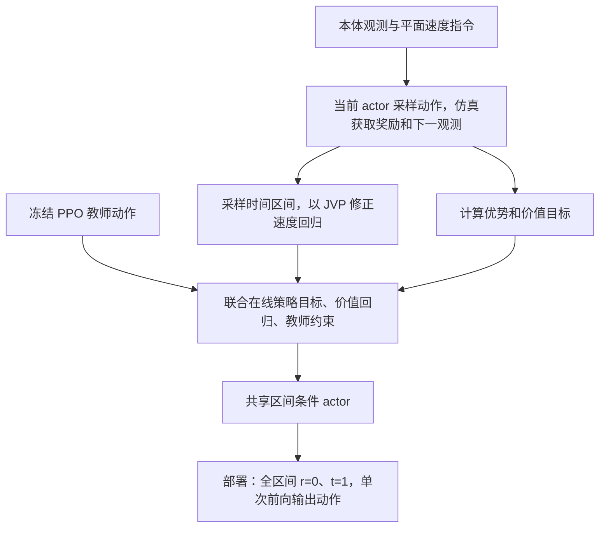
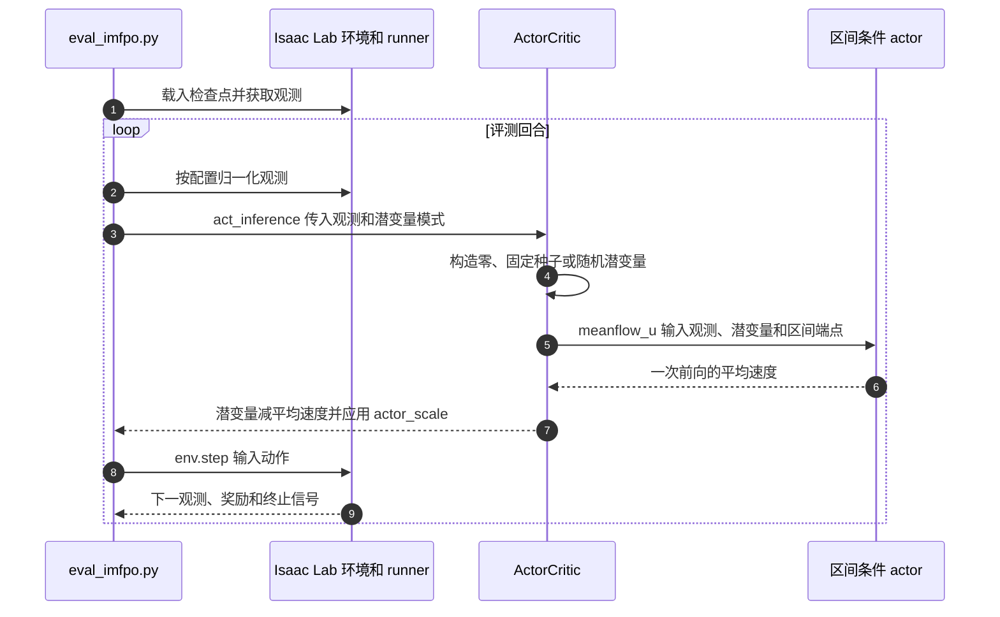

# iMFPO：以漂移感知速度对齐改进具身控制的平均流策略优化 / iMFPO: Improving Mean Flow Policy Optimization with Drift-Aware Velocity Alignment for Embodied Control

## 一句话定义

iMFPO 在在线强化学习中共同训练一个区间条件的速度网络，部署时用一次前向预测整个去噪区间的平均速度，直接把初始潜变量变成连续动作。

## 英文缩写速查

| 缩写 | 英文全称 | 含义 |
| --- | --- | --- |
| MFPO | Mean Flow Policy Optimization | 将平均流预测用于策略优化 |
| JVP | Jacobian-Vector Product | 雅可比向量积，用于沿输运路径修正速度回归 |
| PPO | Proximal Policy Optimization | 近端策略优化，此处提供冻结的教师策略 |
| NFE | Number of Function Evaluations | 一次动作生成所需的网络前向次数 |
| ONNX | Open Neural Network Exchange | 官方代码提供的部署模型交换格式 |

## 核心信息

| 项目 | 内容 |
| --- | --- |
| 作者 | Lisiyu Pan、Ting Huang、Zeyu Zhang、Hao Tang |
| 机构 | 北京大学 |
| 版本 | arXiv:2611.33922v1，2026-11-25 |
| 评测平台 | Isaac Lab：Go2、G1-29DoF、H1、Spot；另有 MuJoCo 导航集成与 Go2 真机演示 |

## 为什么重要

把按多步积分训练的策略在部署时硬砍成一步，不一定能保持控制质量。在线强化学习又会持续改变动作样本分布，让用于策略学习的瞬时速度和部署依赖的区间速度产生偏差。iMFPO 训练时显式对齐两者，使单步生成成为策略本身所优化的对象。

## 核心机制

- **同模型，两种区间**：共享 actor 接收观测、插值动作状态及区间端点；零长度区间学习瞬时速度，非零区间预测平均速度。部署使用全区间，按论文记号直接输出 `a = ε − u(o, ε, 0, 1)`。
- **漂移感知对齐**：从在线 rollout 动作与噪声间采样插值，使用 JVP 补偿沿流路径的变化，以修正速度回归目标。论文的 regression-induced surrogate 用速度回归误差构造策略更新比率，结合优势与不对称的信赖域约束；它不是显式计算生成模型的精确动作似然。
- **动作级教师约束**：冻结的 PPO 教师只在训练时提供目标动作；优化共同包含在线奖励项、价值回归及教师动作正则。部署只用学生 actor，可以用零或高斯初始潜变量，既不迭代积分，也不查询教师。

## 流程总览

## 实验与评测

| 协议 | 作者结果 |
| --- | --- |
| Isaac Lab 四平台，零初始潜变量；表 1 | Go2 35.69、G1 34.44、H1 416.23、Spot 29.86；64-NFE RFPO 分别 35.58、32.55、416.06、28.19 |
| 同样四平台、高斯随机初始化；表 1 | iMFPO 分别 35.34、30.79、406.77、30.15。G1 的 1-NFE RFPO 随机条件为 17.71，零条件为 33.59 |
| Go2 推理开销；表 2 | iMFPO 1 NFE / 0.41 ms；RFPO 64 NFE / 15.57 ms、1 NFE / 0.39 ms；报告 batch 1 GPU actor p50，排除仿真 step |
| Go2 消融；表 3 | 去掉 JVP–iMF 后，零/随机潜变量为 29.21/26.24；移除区间损失为 21.00/18.91（完整 35.69/35.34） |

表 1–3 的分数是平均回合回报，各平台的奖励定义和刻度不同。作者另在 Isaac Lab 以 50 Hz 回放三条 Go2 指令轨迹，并展示冻结的 Go2 控制器和 NaVILA 组合；这不是单一跨平台共享权重的验证。

## 与相关工作对比

对照论文同环境下的 MFPO，iMFPO 重点是 Mean Flow 训练目标和单步生成的动作分布，而非叠加更多推理积分步。选型时分开比较单步动作采样、闭环任务表现与部署链路的端到端时延。

## 结论

在作者使用的速度跟踪场景中，一步生成可保留多步方法量级的回报；优势取决于训练时直接约束单步映射，不是少用积分步数本身。

- 将 NFE、同批大小的 actor 开销、任务回报及整机闭环周期分别报告。
- 比较同为 1 NFE 的 RFPO/MFPO，避免把对 64 步 RFPO 的约 38 倍延迟比当作普遍增益。
- 分开复核零潜变量和随机潜变量，尤其留意形态之间的性能差。
- 上机前先闭环检查关节顺序、控制频率、观测归一化和失效保护。

## 源码运行时序图

按公开代码静态核对：`scripts/fpo/eval_imfpo.py` 按配置归一化并分别计时 actor 与仿真步；`modules/actor_critic.py` 的 MeanFlow 分支在 `act_inference` 中调用 `meanflow_one_step`。如需从训练检查点导出，优先核对 `scripts/fpo/play.py` 的任务配置与观测归一化；未运行该导出路径、训练或真机。

## 工程实践

- [源码归档](../../sources/repos/imfpo.md)记录冻结教师训练、iMFPO 训练、评测、回放与 ONNX 导出入口。官方代码为 Apache-2.0，模型权重另见作者 Hugging Face 页面；仓库本身不打包 Isaac Sim/Lab、机器人资产或真机部署栈。
- 官方 README 给 Go2 的接口为 45 维观测、12 维关节位置动作及 50 Hz。不能只按维数直接上机，仍需对应关节顺序、默认位姿、动作缩放、归一化和 PD 配置。
- **导出边界：** 当前独立 `export_onnx.py` 未显式选择 MeanFlow，默认单时间嵌入；按标准 Go2 iMFPO 配置计算，首层输入应为 73 而不是默认 flow 的 65。把采样步数改为 1 不会改变 actor 结构。作者发布的 ONNX 可独立做 I/O 冒烟检查；不等同于验证 checkpoint 转换。
- 复现前保留 `task`、教师检查点、学生检查点、随机种子、推理模式及依赖版本；先对照 Python 和 ONNX 输出，再跑闭环。

## 局限与风险

作者的量化范围主要是仿真平地速度跟踪，未系统改变地形或施加扰动，结果来源于选定的检查点。Go2 真机为定性展示，不能当成真机导航成功率、端到端延迟或复杂地形鲁棒性的证据。

## 关联页面

- [扩散与流匹配策略纵深路线](../../roadmap/depth-robotics-diffusion-dit-flow.md)

- [具身策略的流匹配](../concepts/flow-matching-embodied-policy.md)：对照生成步数、采样区间与策略训练方式。
- [PPO](../methods/ppo.md)：对照经典概率比率的更新与 iMFPO 的回归型 surrogate。
- [机器人移动](../tasks/locomotion.md)：理解速度跟踪任务与平地以外的验证维度。
- [Sim2Real 迁移流程](../methods/sim2real-transfer-workflow.md)：校对关节语义和输入输出。

## 参考来源

- [论文全文归档](../../sources/papers/imfpo_arxiv_2611_33922.md)
- [官方项目页归档](../../sources/sites/imfpo.md)
- [源码归档](../../sources/repos/imfpo.md)

## 推荐继续阅读

- [Mean Flows for One-step Generative Modeling](https://arxiv.org/abs/2505.13447)：平均流和区间位移的原始推导。
