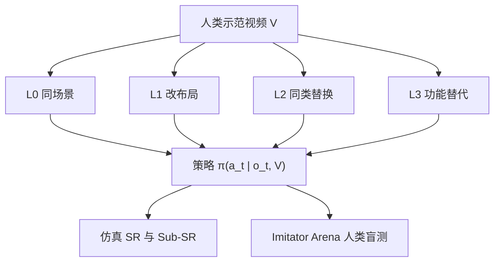
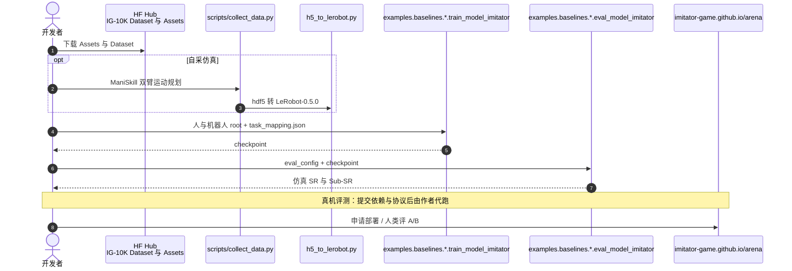

# The Imitator Game：用场景失配分级衡量人类视频模仿

**The Imitator Game**（*Benchmarking Robot Imitative Ability Beyond Action Prediction*，[arXiv:2608.22301](https://arxiv.org/abs/2608.22301)，[项目页](https://imitator-game.github.io/)，[代码](https://github.com/imitator-game/The-Imitator-Game)，[IG-10K](https://huggingface.co/datasets/imitator-game/IG-10K-Dataset)）由 **香港大学（HKU）**、**超忆（TranscEngram）**、**复旦大学（Fudan）** 与 **浙江大学（ZJU）** 提出：四级场景失配把人类示范与机器人现场逐步拉开，配套 IG-10K 配对数据与开放盲测平台 Imitator Arena。本页依据 arXiv v1 全文通读（归档见 [来源归档](../../sources/papers/imitator_game_arxiv_2608_22301.md)）。

## 一句话定义

**一个按「示范场景与机器人场景差多远」分 L0–L3 四级的人类视频模仿基准：策略只看示范视频与自身观测，不给任务描述与层级标签，用仿真谓词与人类盲测判断它是否复现了示范的目的（论文 §3.1、§3.2.2）。**

## 英文缩写速查

| 缩写 | 英文全称 | 简要说明 |
|------|----------|----------|
| IG-10K | Imitator Game 10K | 20,000+ 组环境对齐人–机配对数据集（§3.2.1） |
| L0–L3 | Level 0–3 | 同场景 → 改布局 → 同类替换 → 功能替代（Table 1） |
| VLA | Vision-Language-Action | 视觉–语言–动作模型；本基准经固定 captioner \(T(V)\) 给它语言提示（§3.2.2） |
| VA | Vision-Action | 视频条件视觉动作策略（ACT / DP / VQ-BeT） |
| P+FT | Pretrain + Fine-Tune | IG-10K 预训练后再用 10 条未见任务配对微调（§4.1） |
| Scr. / ZS | Scratch / Zero-Shot | 仅 10 条示范从零训 / 预训练后不更新直接做未见任务（§4.1） |
| SR | Success Rate | 仿真为全部目标谓词成立；真机为人类 SUCCESS 判断（附录 B.3） |
| Sub-SR | Sub-goal Success Rate | 有序子目标完成比例（仅仿真） |
| Q / WR | Imitation score / Win Rate | 人类 0–10 模仿质量均分 / Arena 盲测 A/B 胜率 |

## 为什么重要

- **把「示范与执行错位」显式分级。** 作者称现有泛化基准（COLOSSEUM、REALM）测训练见过场景的扰动，视频条件策略多在近分布评（§1）；本基准让同一个人类 clip 对应四种机器人侧场景（§3.2.1）。
- **数据接口统一。** 仿真与真机同为 LeRobot-0.5.0 格式，含多视角、MANO（仅真机人类 clip）、分割掩码与三层语言标注（§3.2.1、附录 B.1）。
- **有人类盲测校准。** 同一批仿真 rollout 上，自动 SR 与 Arena 人类 SR 相关 r=0.858，Sub-SR 与 Q 相关 r=0.861（附录 C.7）；真机无自动指标，全靠人类判断（附录 B.3）。
- **可复现栈已落地（来自仓库与数据集归档，非论文正文）：** 2026-09-02 再核时 MIT 仓与 HF 数据/资产已公开，可在 ManiSkill 上自训基线。

## 核心原理与流程总览

场景写成 \(S=(\{O_i=(A_i,G_i,S_i)\},P)\)：A 外观、G 几何、S 语义类别、P 空间配置；作者用操作性假设 \(S\)变 ⇒ \(G\)变 ⇒ \(A\)变（§3.1.1）。每升一级，示范轨迹还能直接复用的部分更少：

| 级 | 保真上限（作者表述） | P | A/G | S | 论文例子 |
|----|----------|---|-----|---|----------|
| L0 | 轨迹匹配 | 保 | 保 | 保 | 同场景泡茶包 |
| L1 | 物体终态 | 改 | 保 | 保 | 茶包摆在前方而非右侧 |
| L2 | 语义任务 | n/a | 改 | 保 | 茶包换散茶叶 |
| L3 | 意图（经再利用 affordance） | n/a | 改 | 改 | 无茶，用抹茶粉搅拌（Figure 2） |

P 在物体集不同时没有一一对应，故标 n/a 而非「改」（附录 A.1）。四级是作者自己的综合，发展心理学构念只作标签，不主张机器人有心智状态（附录 A.2）。

### 流程总览

### 基线与数据

- **IG-10K：** 真机 11.7K（Realman 双臂 VR 遥操作）+ 仿真 10K（双臂 Franka，ManiSkill3，OMPL 规划手工路点）；50+ 基础任务、6 域、200+ 变体，每个任务–级别只用一种替换模式（§3.2.1）。仿真配对复用同任务的真机人类 clip（附录 B.2）。
- **三族基线共用 \(\pi(V,o_t)\) 接口，冻结视觉 / VLM 骨干、只训动作模块**（§3.2.3）：VLA（GR00T-N1.6、RDT-1B、π0.5、OpenVLA）走固定 captioner；技能族（XSkill、UniSkill）；视频条件 VA（ACT / DP / VQ-BeT × DINOv2 / SigLIP2 / VideoMAE），共 15 个变体。
- **协议：** 10 个任务（5 seen + 5 unseen）× 四级；预训练语料 15 ⊂ 30 ⊂ 45 任务，每任务 50 条；few-shot 为 10 条机器人示范；仿真每对 10 次、真机 5 次（§4.1、附录 B.2）。

### 主要结果

| 设定 | 结果（出处） |
|------|------|
| 仿真 seen SR | ACT/DINOv2 **0.81**、XSkill **0.79**、π0.5 **0.73**（Table 3） |
| 仿真未见任务零样本 | 最高 **0.13**（VQ-BeT/DINOv2），π0.5 为 0.09（Table 3） |
| 仿真 P+FT vs 从零 | 12/15 变体 P+FT 更高；15→45 预训练任务时 14/15 上升（Table 3、§4.3） |
| 真机（四模型，人类判断）XSkill | seen **0.63**、ZS 0.29、Scr. 0.28、P+FT **0.49**，P+FT 的 WR **0.95**（Table 4） |
| 真机 P+FT 按级（四模型均值） | SR L0/L1/L2/L3 = 0.42/0.42/0.39/**0.29**；Q 6.26/6.22/6.17/5.62（Table 5） |
| 真机零样本随语料 15→45 | 三个视频条件模型上升（如 XSkill 0.24→0.33），π0.5 约 0.04 不变（附录 C.3） |
| 示范互换（仿真 seen，45 任务） | 换成相似任务视频后 ACT 0.81→0.31、DP 0.67→0.03、π0.5 0.73→0.15、XSkill 0.79→0.31（Table 10） |

## 工程实践

- **读榜：** 先看真机 P+FT 的 L3 与未见任务零样本，不要只报 L0 seen（Table 5、§4.4）。仿真汇总不按级拆开：作者说明仿真 L2 同时换了执行手臂，且有限资产与规则规划让替换物体仍可沿用近似策略，故仿真的级别曲线非单调，层级判断以 Arena 为主（附录 C.5）。
- **微调预算：** 10 条配对能拉开 P+FT 与 Scr.，收益随预训练任务数增长（15→45），但是否有利因模型而异，RDT-1B、VQ-BeT 部分变体为负（Table 3）。
- **编码器与动作头不能分开选：** DINOv2 与 SigLIP2 总体优于 VideoMAE，VideoMAE 让 DP 的 seen SR 从 0.67 掉到 0.14，对 ACT 只掉 0.09（附录 C.2）。
- **接口选型（作者读法）：** seen 任务上视频 / 技能族更强，π0.5 在仿真 few-shot 上领先（Scr. 0.80、P+FT 0.85）；但真机零样本 π0.5 约 0.04，视频族更强（§4.2、附录 C.3）。
- **复现路径（来自仓库归档，非论文正文）：**

  最短路径：`uv sync` → 下 Assets 与 Dataset → 选 `examples/baselines/act` 或 DP 按 README 训评。Dataset 约 747 GB，建议先下单任务子集；README 要求给上游 lerobot 的 `lerobot_dataset.py` 打补丁，Vulkan 按 ManiSkill 文档配（[数据集归档](../../sources/datasets/ig-10k.md)、[仓库归档](../../sources/repos/the-imitator-game.md)）。真机权重未上 HF，仓内无上传接口，第三方无法本地复核真机数字（归档，推测此为现状）。

## 与清单说法的核对

清单（Glen Berseth 的 CoRL 2026 阅读清单，P1 / Learning from Human Video，作者称一句话摘要为 LLM 据摘要起草）写道：「Four-level benchmark testing whether robots imitate the intent of a human demonstration rather than replaying its trajectory.」逐项核对：

| 清单措辞 | 论文里的对应 | 核对 |
|----------|-------------|------|
| Four-level benchmark | L0–L3（Table 1，§3.1.2） | 对。 |
| testing whether robots imitate the intent | L3 才是意图级；L0 明确要求轨迹匹配，L1 看物体终态，L2 看语义任务（Table 1） | 部分对：四级是由低到高的保真梯度，不是四级都测「意图」。 |
| rather than replaying its trajectory | 作者称问题是现有方法多在近似场景复现轨迹（§1）；L0 本身就奖励轨迹复现 | 对作者动机；但对 L0 不成立。 |
| 没写到的限定 | 评测用仿真手工谓词与人类 Arena 判断，不直接度量「意图推断」；被评模型是适配到本游戏的现有策略而非意图模仿方法（§5） | 清单未提：这是基准论文，没有提出新策略，也没有任何模型达到意图级模仿。 |
| 没写到的结果 | 真机 L3 下降（Table 5），但仿真级别曲线非单调（附录 C.5）；未见任务零样本仿真最高 0.13（Table 3） | 清单只给基准定义，未涉及结果；若有人读成「已能测出意图模仿」，需补这几点。 |

## 局限

作者在 §5 与附录承认：

- IG-10K 有限且人工设计；每个任务–级别只有一种替换模式，不测替换方差。
- 层级只分级场景失配，具身差距近似固定，与 RHyME 等具身差距层级正交（附录 A.2）。
- 有限资产与规则规划使仿真 L3 结果有偏（§5、附录 C.5）。
- 被评策略是适配到本游戏的，不是为意图级模仿设计；骨干冻结，比的是动作接口而非全量微调（§3.2.3、§5）；附录 B.4 说解冻早期试验收益相当，但没给数字。
- 未见任务应读作部分泛化，真机少样本数据仍太小（附录 G）。

我读到的未验证之处（本页判断，不是作者自述）：

- 主协议只有 10 个任务、真机只评 4 个模型、每格 5 次试验，小样本下级别间差异（如 L0–L2 的 0.42/0.42/0.39）未报置信区间。
- Arena 每屏仅一名评估者，未报告评估者间一致性，作者列为计划扩展（附录 B.3）；相关系数 r≈0.86 只在仿真上算。
- 仿真级别曲线 L2 凹陷、L3 回升（附录 C.5），与摘要「L3 处崩溃」的措辞不能直接搬到仿真；摘要的「所有模型零样本低于 13%」与 Table 3 的 0.13 刚好踩线。
- 论文内部有小的不一致：Figure 4 与 Table 7 的未见任务名单不完全对应，seen 任务描述在 §4.1 与附录 B.2 不一致（见来源归档）。
- 示范互换检验（Table 10）显示换成无关视频后 ACT 仍有 0.30，说明部分成功可由场景本身推断，不全是读视频（推测此为场景中任务线索所致）。

## 关联页面

- [模仿学习](../methods/imitation-learning.md)
- [VLA](../methods/vla.md)
- [LeRobot](./lerobot.md) — IG-10K 发布格式
- [ManiSkill2](./maniskill2.md) — 仿真操作泛化前身；本基准仿真栈为 ManiSkill3 / SAPIEN
- [Indi](./paper-indi.md) — 蒸馏局部目标进 VLA；本页评「目标等价」本身
- [Manipulation](../tasks/manipulation.md)
- [具身评测基准枢纽](../overview/hub-embodied-eval-benchmark.md)
- [评测基准选型闭环 Query](../queries/embodied-eval-benchmark-selection-loop.md)
- [48ms WAM / 编排 10 篇地图](../overview/glancewam-vla-crew-10-papers-technology-map.md)
- [HOST](./paper-host-one-shot-human-video.md) — 单条人视频 one-shot 方法（arXiv:2607.20033）；不按 L0–L3 报
- [ACT](./paper-act.md)、[Diffusion Policy](./paper-diffusion-policy.md)、[OpenVLA](./paper-openvla.md)、[RDT-1B](./paper-rdt-1b.md)、[π0.5](./paper-pi05-open-world-vla.md) — 被评基线族
- [X-Sim](./paper-sa-2505-07096-x-sim-cross-embodiment-learning-via-real-to-sim.md) — 论文引用的跨本体学习相关工作

## 参考来源

- [imitator_game_arxiv_2608_22301](../../sources/papers/imitator_game_arxiv_2608_22301.md)
- [项目页归档](../../sources/sites/imitator-game-github-io.md)
- [官方仓库](../../sources/repos/the-imitator-game.md)
- [IG-10K 数据集](../../sources/datasets/ig-10k.md)
- [具身智能小站 10 篇盘点](../../sources/blogs/wechat_embodied_station_10_papers_glancewam_vla_crew_2026-08-30.md)

## 继续阅读

- [arXiv:2608.22301](https://arxiv.org/abs/2608.22301)
- [项目页 / Arena](https://imitator-game.github.io/)
- [官方仓 README](https://github.com/imitator-game/The-Imitator-Game)
- [IG-10K on Hugging Face](https://huggingface.co/datasets/imitator-game/IG-10K-Dataset)
