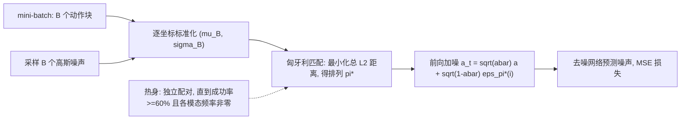

# Immiscible Diffusion Policy

**Immiscible Diffusion Policy**（arXiv:2610.09369，Berkeley / Princeton / UT Austin 作者单位）指出 Diffusion Policy 即使在示范模态均衡时也常坍缩到单一模态，原因是训练时动作与噪声独立配对导致扩散路径混合；它在每个 mini-batch 内用匈牙利算法重新分配噪声，让各动作的噪声来源互不“混溶”，是一个**不改网络、不改推理、无需模态标签**的训练插件。

## 英文缩写速查

| 缩写 | 英文全称 | 简要说明 |
|------|----------|----------|
| DP | Diffusion Policy | 以去噪扩散生成动作块的模仿学习策略 |
| DP3 | 3D Diffusion Policy | 以点云为观测的 Diffusion Policy，本文点云任务的基线 |
| TV | Total Variation distance | 模态频率分布与目标（均匀）分布之间的距离，越小越均衡 |
| Hungarian | Hungarian algorithm | 求二分图最小代价完美匹配的 O(n³) 算法，用于噪声指派 |
| ε-pred | noise prediction loss | 预测所加噪声的 MSE 损失 |

## 为什么重要

- **多模态是模仿学习的卖点，却会悄悄丢失**：论文在均衡数据上仍观察到 vanilla DP 非主导模态仅占 2.40%–4.44%，意味着“数据里有、策略里没有”。
- **改动极小**：只改训练中噪声与动作的配对，推理流程和架构不变，可叠加到已有 DP / DP3 训练代码。
- **对泛化与可控性有意义**：能恢复 vanilla 完全不生成的第 4 种模态，对需要多解（左右手、多种放置位姿）的操作很关键。

## 方法栈与流程总览

## 方法

- **输入/输出**：输入仍是 DP 的观测（状态、RGB 或点云）与动作块；输出同 vanilla，推理时不使用匹配。
- **关键设计**：(1) 展平动作块并用 mini-batch 均值/标准差逐坐标标准化后再算 L2 距离；(2) 匈牙利求最优排列 π*，噪声 ε_π*(i) 取代独立采样的噪声；(3) 损失为所匹配噪声与预测噪声的 MSE；(4) 激活准则：先按独立配对训练，首个评测检查点任务指标 ≥ 60% 且每种示范模态 rollout 频率非零后才打开指派。
- **机理分析**：在分离噪声水平下，解析去噪器的模态响应范围 4.29，vanilla 仅 0.24，Immiscible 为 1.93；vanilla 去噪输出平均只覆盖 2.6 个不同专家动作块，而解析去噪器为 174。
- **未报告**：批大小 B 的具体数值、匈牙利求解器实现、训练额外耗时。

## 实验与评测

- **任务**：仿真每任务 206 条专家示范——Push-T（状态，2 模态）、RoboTwin 2.0 的 Stack Blocks、Place Bread（2 模态）、Place Shoe、Rotate QR Code（4 模态）；真机为 Unitree G1 人形的 Fruit-to-Plate 与 Can-to-Bin（各 80 条遥操作示范，左/右手两种模态）。基线 vanilla DP / DP3，指标为模态频率、TV 与任务成功率（Push-T 为覆盖率）。
- **两模态**：非主导模态占比 Push-T 2.40% → 35.00%，Stack Blocks 3.33% → 20.00%，Place Bread 4.44% → 33.33%（6.0×–14.6×，平均 +26.05 个百分点）；任务指标基本持平（Push-T 覆盖率 95.16 → 95.39，Place Bread 100 → 97.78）。
- **四模态**：vanilla 从不出现第 4 模态；Immiscible 在 Place Shoe 达 16.03%、Rotate QR Code 达 11.10%，该模态成功率分别 85.71 与 40.00；但总成功率下降（100 → 93.33；86.67 → 73.33）。
- **真机（G1，单 seed）**：非主导模态由 0 → 50%；成功率 Fruit-to-Plate 75 → 60，Can-to-Bin 100 → 90。
- **激活时机消融（Push-T）**：第 0 / 50 / 100 轮激活的覆盖率 90.26 / 95.39 / 95.82，过早激活损害精度。

## 源码运行时序图

不适用：截至 2026-10-12 arXiv 页、HTML 均未列出项目页或代码仓库，无可对齐的官方入口。算法本身（批内标准化 + 匈牙利匹配）可按上文流程图在现有 DP 训练循环中自行实现（推测，未经官方实现验证）。

## 工程实践

- 复现路径：在 DP / DP3 的训练 loop 里，把独立采样噪声换成批内匹配噪声；先热身再激活，不要从第 0 轮开启。
- 批内匹配要求 batch 内含多种模态，否则不起作用（推测）；论文用镜像增广保证模拟任务内对称。
- 开源状态：**未发布**（核查 2026-10-12，无项目页、无仓库）。

## 与其他工作对比

| 对照 | 差异读法 |
|------|----------|
| [Diffusion Policy](./paper-diffusion-policy.md) | 本文是其训练插件，目标是保模态而非提精度 |
| [ESP](./paper-esp-energy-score-policy.md) | 同样关注多模态，但 ESP 换损失并走单步生成；本文保持多步扩散，只改噪声配对 |
| 一般 OT / minibatch 配对流匹配 | 思路相近（推测，论文未逐一对比），本文强调机器人低维稠密动作空间的模态坍缩 |

## 结论

**Immiscible DP 是一个低成本的“保模态”训练技巧，真影响指标是非主导模态占比而非任务成功率。**

1. **看 TV 与模态频率，不只看成功率** — vanilla 成功率常更高却模态严重坍缩。
2. **激活时机重要** — 先让策略学好再切换指派，第 0 轮激活 Push-T 覆盖率掉到 90.26。
3. **恢复出的新模态质量不一** — Rotate QR Code M(4) 成功率仅 40.00。
4. **真机证据弱** — 单 seed，成功率下降 10–15 个百分点。
5. **开销未量化** — 采用前自行测批内匈牙利的训练耗时。

## 局限与风险

- 总成功率在多个任务上略降（四模态任务降 6–13 个百分点）；作者自述被恢复模态的质量仍需提升。
- 无代码与项目页（未发布）；批大小等关键超参未给。
- 对照对象仅为 vanilla DP / DP3，未与其他多模态保留方法做系统对比。

## 关联页面

- [Manipulation 周报汇总（2026-10-05 至 10-09）](../overview/frontier-manipulation-2026-10-05-10-09.md)
- [Manipulation 任务页](../tasks/manipulation.md)
- [Diffusion Policy 方法页](../methods/diffusion-policy.md)
- [Action Chunking](../methods/action-chunking.md)

## 参考来源

- [immiscible_dp_arxiv_2610_09369.md](../../sources/papers/immiscible_dp_arxiv_2610_09369.md) — arXiv 摘要与 HTML 全文抽取
- [frontier_manipulation_2026_10_05_10_09.md](../../sources/blogs/frontier_manipulation_2026_10_05_10_09.md) — 周报线索
- 论文：<https://arxiv.org/abs/2610.09369>

## 推荐继续阅读

- [Diffusion Policy（Chi et al.）](https://diffusion-policy.cs.columbia.edu/)
- [arXiv HTML：Immiscible Diffusion Policy](https://arxiv.org/html/2610.09369v1)
