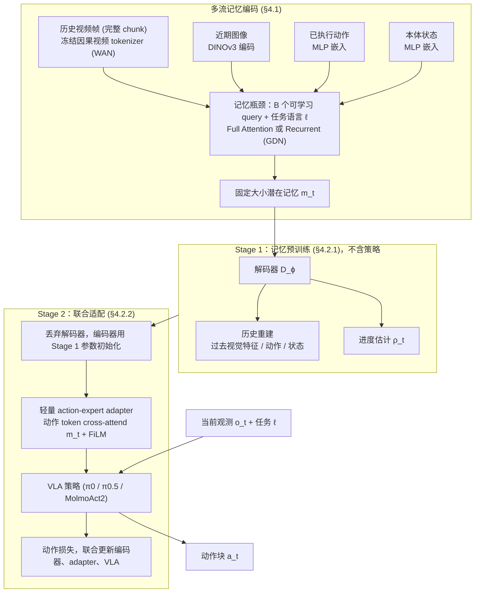

# IMPRINT（arXiv:2610.14406）

**IMPRINT**（*Memory Without Curation: Learning Multi-Stream Latent Memory for Robot Policies*，[arXiv:2610.14406](https://arxiv.org/abs/2610.14406)，[项目页](https://yilin-wu98.github.io/imprint_website/)）来自 [具身智能小站 2026-10-14 盘点](../../sources/blogs/wechat_embodied_station_41_papers_streamingwam_2026-10-14.md)，属「世界模型与记忆」组。

## 一句话定义

**联合记忆观察、动作与本体信息：先训练历史重建与进度估计，再与策略联合微调；推理增量更新潜在记忆。**

## 英文缩写速查

| 缩写 | 英文全称 | 简要说明 |
|------|----------|----------|
| TTT | Test-Time Training | 测试时训练 |
| IL | Imitation Learning | 模仿学习 |
| Proprio | Proprioception | 本体感知 |

## 为什么重要

- 长历史带来延迟与视觉捷径学习；需要无需人工挑选的增量记忆。
- 开源结论：**项目页未列 GitHub**（步骤 2.5，2026-10-14）。项目页入库日未列 GitHub。
- 同期同组工作见 [流式动作块与世界模型记忆：具身智能小站 10-14 期 41 篇阅读坐标](../overview/embodied-station-2026-10-14-41-papers-technology-map.md)。

## 流程总览

图依据：论文 §4.1、§4.2 / Fig.1

## 核心机制

| 项 | 内容 |
|----|------|
| **arXiv** | [2610.14406](https://arxiv.org/abs/2610.14406) |
| **开源** | **项目页未列 GitHub** |
| **要点** | 多流潜在记忆 + 重建/进度预训练。 |
| **文内指标** | 以原文为准。 |

## 源码运行时序图

**不适用（项目页未列 GitHub）** — 项目页入库日未列 GitHub。 不编造运行脚本；代码公开后再补。

## 实验与评测

- 以原文为准。
- **读法：** 本页为索引级摘要，依据公众号转述的官方摘要与仓库信息整理；逐项数字与 baseline 以原文 PDF 为准。

## 与其他工作对比

- 横向索引见 [流式动作块与世界模型记忆：具身智能小站 10-14 期 41 篇阅读坐标](../overview/embodied-station-2026-10-14-41-papers-technology-map.md)；同 arXiv 不重复造页。

## 结论

**策略记忆的训练信号可以来自历史重建与进度，而非人工标注。**

1. 开源边界：**项目页未列 GitHub** — 项目页入库日未列 GitHub。
2. 核心机制：多流潜在记忆 + 重建/进度预训练。
3. 复现与选型前核对任务协议、硬件与基准口径，勿直接横比公众号摘录数字。

## 关联页面

- [imitation-learning](../methods/imitation-learning.md)
- [manipulation](../tasks/manipulation.md)
- [paper-ttt-rm-residual-memory](./paper-ttt-rm-residual-memory.md)
- [embodied-station-2026-10-14-41-papers-technology-map](../overview/embodied-station-2026-10-14-41-papers-technology-map.md)

## 参考来源

- [imprint_multi_stream_latent_memory_arxiv_2610_14406.md](../../sources/papers/imprint_multi_stream_latent_memory_arxiv_2610_14406.md)
- [wechat_embodied_station_41_papers_streamingwam_2026-10-14.md](../../sources/blogs/wechat_embodied_station_41_papers_streamingwam_2026-10-14.md)
- [arXiv:2610.14406](https://arxiv.org/abs/2610.14406)
- [arXiv PDF](https://arxiv.org/pdf/2610.14406)：已通读方法部分（实验与附录以略读为准）：§1 引言、§3 问题定义、§4 方法（§4.1、§4.2.1、§4.2.2）

## 推荐继续阅读

- [arXiv PDF](https://arxiv.org/pdf/2610.14406)
- [项目页](https://yilin-wu98.github.io/imprint_website/)
