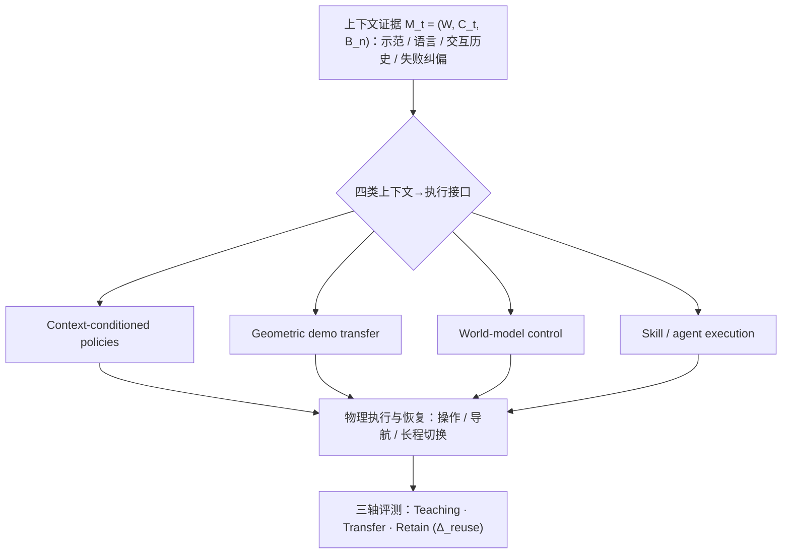

# In-Context Learning for Robots（Methods and Applications）

**In-Context Learning for Robots: Methods and Applications**（[arXiv:2609.36012](https://arxiv.org/abs/2609.36012)，2026）由 **Knowin AI、香港科技大学（广州）、香港中文大学** 等联合撰写（共 40 作者；通讯 Ying-Cong Chen、Yinchuan Li）。arXiv v1（2026-09-28）全篇 **100 页、26 图、25 表、412 篇参考文献（含 260 篇方法论文）**；配套网站与 GitHub 持续更新（2026-11 修订版扩至 115 页 / 690 篇引用，实时索引 **724** 项工作），系统梳理机器人 **In-Context Learning（ICL）** 的形式化框架、四类方法族、数据构建、物理恢复与评测议程。

## 一句话定义

机器人 ICL 是在 **部署时不更新神经网络权重** 的前提下，仅凭借推理上下文与外部非参数经验把既有能力引导到新任务与新情境；本综述用公式 **M_t = (W, C_t, B_n)** 刻画固定参数 `W`、当前片段上下文 `C_t` 与跨任务外部库 `B_n` 的协作，并将方法按 **上下文→执行接口** 分为四族、将研究问题拆为 **Acquire / Transfer / Retain** 三轴。

## 英文缩写速查

| 缩写 | 英文全称 | 简要说明 |
|------|----------|----------|
| ICL | In-Context Learning | 上下文内适应；部署期主网络权重 `W` 固定不变 |
| VLA | Vision-Language-Action | 视觉-语言-动作策略；仅用文本/目标图作选择不等同于可教学 ICL |
| WM | World Model | 四大接口族之一：先预测未来状态演化再规划或解码动作 |
| TTT | Test-Time Training | 测试时对快权重做梯度更新；部署期写参数，机制不同于纯 ICL |
| RSI | Physical Recursive Self-Improvement | 第 8 章提出的前沿议程：跨任务积累使后续学习能力本身变强 |

## 为什么重要

- **名词过载的「接口对照表」：** 2026 年文献把 metadata 条件化、历史记忆、快权重 TTT 与 **真 ICL** 混称为「上下文」。本综述 §2–§3 从「哪些参数可改、证据经由什么中间接口变成控制」给出统一判定，直接支撑 [机器人 ICL 概念页](../concepts/robot-in-context-learning.md) 的论文级索引。
- **反捷径与可复现评测议程（§7）：** 指出现有基准只测单任务成功率，容易掩盖「根本没读上下文」或「过拟合常见物体先验」的假象；明确提出必须用 **对比上下文干预（同画面配不同/冲突示范）、教学响应（teaching）、物理迁移（transfer）与经验留存（retain / `Δ_reuse`）** 分层度量。
- **活文档文献底座：** 配套仓库 [`JethroJames/awesome-robots-icl`](https://github.com/JethroJames/awesome-robots-icl) 附 `DESIGN.md` 与 `MAINTENANCE.md`，按四类接口与操作/导航/恢复主题持续增补条目（截至 2026-11 已收 724 项），是 `depth-icl` 路线最全的一手目录入口。

## 核心信息

| 项 | 内容 |
|----|------|
| **机构** | Knowin AI；香港科技大学（广州）；香港中文大学；同济大学；清华大学；哈尔滨工业大学（深圳）；西湖大学；天津大学 等（共 40 位作者） |
| **出处** | arXiv:2609.36012v1（2026-09-28，100 页 / 412 篇引用）；项目页已同步 2026-11 修订版（115 页 / 690 篇引用） |
| **开源** | **部分开源（文献与基准策展仓）** — GitHub 仓库与项目页公开 724 篇工作索引及分类元数据；**无**统一策略训练或真机部署代码 |

## 核心原理

### 四类上下文→执行接口（§3）

综述指出决定 ICL 泛化上限的核心不是上下文长度本身，而是 **教学证据如何经由中间表示转换为动作**：

| 方法家族 | 核心机制与中间量 | 关键代表与强假设 |
|----------|------------------|------------------|
| **Context-conditioned policies** | 将示范、语言或交互历史直接编码进冻结策略输入（交错 token、交叉注意力、KV-cache、chunk/subgoal 条件） | 代表：VIMA、KAT、BPP、[StellaVLA](./paper-stellavla-structured-icl-vla.md)、[HOST](./paper-host-one-shot-human-video.md)；假设语义/运动表征能保留「为什么」而不仅是像素轨迹 |
| **Geometric demonstration transfer** | 利用特征对应、位姿/关键点、螺旋/接触几何对齐示范与当前物体场景 | 代表：DOME、ODIL、Instant-Policy、Point Policy；假设刚体或关键点几何对应可建立且满足初始进入条件 |
| **World-model-based control** | 条件预测未来图像、潜状态或视频-动作联合展开，再通过规划或逆动力学/动作头执行 | 代表：UniSkill、[Zero-WAM](./paper-zero-wam.md)、ICWM；假设物理/交互演化模型在未见情境与跨具身下仍保持一致性 |
| **Skill- and agent-based execution** | 将上下文转化为高层任务图、代码/子技能调用、恢复策略与跨回合经验记忆库 `B_n` | 代表：DROC、IntroPlan、ENPIRE、GPT-Policy、MTP；假设底层技能原语稳定且接口可组合验证 |

### 三类学习问题与六级时间尺度（§2 & §7）

1. **三类核心学习问题：** **Acquire（学新任务）** — 辨别示范指定的目标、顺序与接触约束；**Transfer（迁新情境）** — 在物体替换、视角变化、跨具身甚至物理阻力改变下保持所教语义；**Retain（留给下一任务）** — 通过外部经验库 `B_n` 而非重训主权重，让已有成功与纠偏在后续任务直接起效。
2. **六个时间尺度（S1–S6）：** 综述从瞬时反应与动作块（S1–S2）、单回合长程/多阶段（S3）、跨回合在线适应（S4）、频繁换线任务切换（S5）一路扩展到跨会话持续累积（S6），把「单次 one-shot 示范」和「多回合纠错恢复」放进同一张动力学坐标系。
3. **教学–执行配对构造原则（§4–§5）：** 训练数据必须覆盖「同一观测对应不同合法示范」的对比样本，否则策略只学场景到动作的静态先验而忽略上下文；部署期遇到遮挡、掉抓或选错目标时，需分别依赖多视角补充、接触验证与重查指令对应（§5 Fig. 18）。

### 流程总览

## 实验与评测读法（§6–§7）

- **四类核心评测信号（§7 Table 14–19）：** ① **教学响应性（Responsiveness to teaching）**——强制考察不同/空/错误示范下的切换率，拆穿忽略上下文的先验偏置；② **物理与意图迁移（Physical & intent transfer）**——检验物体替换、手→机跨具身及阻力变化后是否保序保接触；③ **记忆留存增益（`Δ_reuse`）**——对比带外部经验库 `B_n` 与无库冷启动在后续任务上的试错减少量与成功率提升；④ **切换摊销成本**——统计任务换线时采集示范与前缀编码的总耗时。
- **应用二维约束（§6 Fig. 20）：** 按「任务意图是否变化 × 物理响应是否变化」将场景分成基线执行、意图适应（重排/选物）、物理适应（阻力/摩擦/本体漂移）与联合适应（可变形体折叠/工具使用），强调纯几何与纯语言各自失效的边界。

## 与其他工作对比

| 维度 | 本综述（arXiv:2609.36012） | 对照节点 |
|------|-----------------------------|----------|
| 文献形态 | 100 页综述 + 724 项文献库，建立统一接口分类学与评测协议 | [StellaVLA](./paper-stellavla-structured-icl-vla.md)：单点方法论文，聚焦离线 VLM 结构化示范与双专家训练 |
| 权重边界 | 严格把 **部署期主参数 `W` 固定** 作为纯 ICL 定义门槛 | [RoboTTT](./paper-robottt-test-time-training-vla-context.md)、[WAM-TTT](./paper-wam-ttt-human-video-test-time-steering.md)：通过内循环梯度写入快权重记忆，属 TTT 路线 |
| 世界模型视角的收敛条件 | 在接口地图中指出 WM 路线依赖情境外推保真度（§3.3） | [ICL Emergence](./paper-sa-2509-22353-icl-emergence-context-and-diversity-matter-the-e.md)：从理论上给出世界模型从识别（ER）跃迁到真正环境学习（EL）所需的环境多样性与长上下文上界 |
| 站内概念定位 | 提供按 **四族接口 + 六时间尺度 + 三学习轴** 的论文细索引 | [机器人 ICL 概念页](../concepts/robot-in-context-learning.md)：提供「映射选择 / 状态估计 / 映射学习」三类不确定性判别口诀 |

## 结论

**这是目前机器人上下文学习方向最完整、分类边界最清晰的框架级综述，最适合用作文献路线图、论文归类词典与实验对比核查清单，而不是直接照搬单篇算法的复现指南。**

1. 判断一篇论文是不是「真机器人 ICL」，先看部署时主权重是否真冻结、同一画面换另一条示范后行为是否会跟着改变。
2. 四族接口没有绝对优劣：短程几何对齐看 **Geometric transfer**，跨形态通用执行看 **Context-conditioned / WAM**，跨阶段故障纠错与经验留存必须补上 **Skill/agent + `B_n`**。
3. 训练时若缺少「同观察、不同教学目标」的反事实对比样本，增加上下文长度很容易退化成伪上下文先验记忆。
4. 评测必须把 **首次教学生效**（Teaching）、**换物/换场景保留约束**（Transfer）和 **跨任务 `Δ_reuse` 复利**（Retain）拆开报告。
5. 物理递归自改进（RSI）是综述提出的第 8 章核心前沿：如何让外部经验安全进入下一轮策略能力，而不只停留在静态 prompt 检索。

## 源码运行时序图

**不适用** — 开源仓库 [awesome-robots-icl](https://github.com/JethroJames/awesome-robots-icl) 仅包含结构化论文文献表、BibTeX 与网站构建规范（`README.md`、`DESIGN.md`、`MAINTENANCE.md`），不提供策略模型训练、仿真评测或真机部署代码入口。

## 工程实践

| 项 | 说明 |
|----|------|
| 文献与 BibTeX 检索 | 通过 [项目页](https://jethrojames.github.io/awesome-robots-icl/) 或 GitHub `README.md` 按操作 / 导航 / 运动 / 恢复目录索引 724 项条目，并对照 `DESIGN.md` 核查分类口径 |
| 构建对比实验基线 | 设计新的 ICL 基线时，参考 §7 三项必测探针：**No-context / Wrong-context 消融**、**Cross-embodiment transfer**、以及 **Retention across episodes** |
| 与站内体系衔接 | 读具体代表论文前先过 [机器人 ICL 概念页](../concepts/robot-in-context-learning.md) 三类不确定性表，再用 [四路线对比](../comparisons/wam-ttt-robottt-stellavla-zero-wam-embodied-icl.md) 对齐是否使用快权重 |

## 局限与风险

- **综述滞后于周级发刊速度：** arXiv v1 截止 2026-09，虽有项目页 2026-11 增量修订（690–724 篇），具体算法超参数、开源协议和改动细则仍须回查各自一手论文与代码仓。
- **无统一跨论文同骨干评测表：** 综述明确指出各代表方法采用不同底座、传感器与成功判据，表中指标无法跨篇直接做榜单排名。
- **无统一代码栈：** 策展库不托管可运行脚本，工程复用价值主要在分类 taxonomy 与评测检查表设计。

## 与其他页面的关联

- [机器人 In-Context Learning（概念）](../concepts/robot-in-context-learning.md) — 概念界定与三类不确定性判别口诀
- [纵深路线：ICL](../../roadmap/depth-icl.md) — Stage 0–5 全路线总入口
- [Embodied ICL 四路线对比](../comparisons/wam-ttt-robottt-stellavla-zero-wam-embodied-icl.md) — 具体方法在 2026-08 轴上的横向实测定位
- [ICL Emergence（arXiv:2509.22353）](./paper-sa-2509-22353-icl-emergence-context-and-diversity-matter-the-e.md) — 第三类世界模型接口的理论涌现条件
- [模仿学习](../methods/imitation-learning.md) — 示范条件化与 one-shot IL 传统基石
- [VLA](../methods/vla.md) — 视觉-语言-动作主干如何承载示范上下文
- [操作任务（Manipulation）](../tasks/manipulation.md) — 接触、重排与可变形体等核心场景需求
- [视觉语言导航（VLN）](../tasks/vision-language-navigation.md) — §6.2 梳理的四类导航上下文需求（路线/环境/指令示例/结果反馈）

## 参考来源

- [in_context_learning_robots_arxiv_2609_36012.md](../../sources/papers/in_context_learning_robots_arxiv_2609_36012.md)
- [awesome-robots-icl 项目页](../../sources/sites/awesome-robots-icl.md)
- [awesome-robots-icl 仓库](../../sources/repos/awesome-robots-icl.md)

## 推荐继续阅读

- 论文原文：<https://arxiv.org/abs/2609.36012>
- 项目主页（活文档索引）：<https://jethrojames.github.io/awesome-robots-icl/>
- GitHub 文献库：<https://github.com/JethroJames/awesome-robots-icl>
