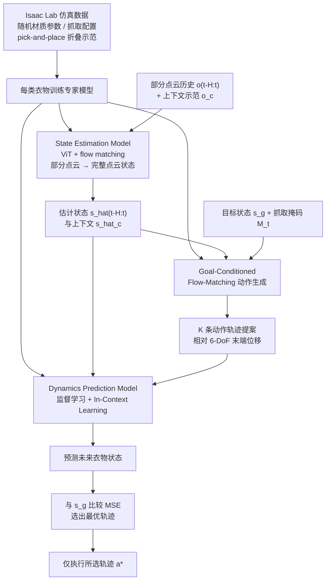

# In-Context Garment WM：面向部分可观测柔性衣物双臂操作的上下文学习世界模型

**In-Context Garment WM**（*In-Context Learning World Models for Robot Dual-Arm Manipulation of Soft Garment with Partial Observations*，[arXiv:2610.30988](https://arxiv.org/abs/2610.30988)）收录于 senlanke「具身运控lab」10-19–10-23 前沿论文动态（Manipulation）。本页依据**周报条目 + arXiv 摘要页**整理，流程图依据论文方法部分（见参考来源），未逐页核对实验数字；指标与结论以论文为准。

## 一句话定义

**In-Context Garment WM：面向部分可观测柔性衣物双臂操作的上下文学习世界模型——将 In-Context Learning 引入柔性衣物世界模型，研究如何利用上下文中的交互信息预测衣物状态变化，并支持部分可观测条件下的双臂操作。**

## 英文缩写速查

| 缩写 | 英文全称 | 简要说明 |
|------|----------|----------|
| VLA | Vision-Language-Action | 视觉–语言–动作模型 |
| IL | Imitation Learning | 模仿学习 |

## 为什么重要

- 周报所述待解决的问题：柔性衣物的形状会随接触动作持续变化。相机只能观察部分布料表面，遮挡区域的状态难以直接估计，使双臂操作规划更加复杂。

## 流程总览

图依据：论文 §IV / Fig.2 / Fig.3

## 核心机制

| 项 | 内容 |
|----|------|
| **arXiv** | [2610.30988](https://arxiv.org/abs/2610.30988) · [PDF](https://arxiv.org/pdf/2610.30988) |
| **作者（arXiv）** | Hengyi Sim, Quentin Rouxel, Dennis Hong, Darwin Caldwell, Fei Chen |
| **机构（周报所述，未逐条核实）** | 待核实（作者：Hengyi Sim、Quentin Rouxel、Dennis Hong、Darwin Caldwell、Fei Chen）。 |
| **arXiv 评论栏** | （无） |
| **开源** | arXiv 摘要页与评论未见代码或项目页链接（仅核对 arXiv 摘要页，不代表未发布）（2026-10-26） |
| **周报所述创新点** | 将 In-Context Learning 引入柔性衣物世界模型，研究如何利用上下文中的交互信息预测衣物状态变化，并支持部分可观测条件下的双臂操作。 |

### arXiv 摘要节选（英文原文）

> Robust manipulation of soft objects, such as garments, is a critical skill for service and household robots to adopt, but remains challenging due to its high-dimensional state space, and material-dependent deformations. Humans address this challenge by using mental world models that "imagine" the shape and material properties from partial observations, which enables them to predict how actions affect future states.

## 源码运行时序图

**不适用**：arXiv 摘要页与评论未见代码或项目页链接（仅核对 arXiv 摘要页，不代表未发布），无可对齐的官方代码流程。

## 实验与评测

- 周报与摘要给出的数字/场景已写入上表「创新点」与摘要节选；其余实验细节、基线与成功率定义请回到论文正文。
- 读法：先对齐任务设定、传感器与成功定义（仿真/真机），再解读 headline 数字，勿跨论文直接比较。

## 与其他工作对比

| 维度 | 读法 |
|------|------|
| **同周对照** | 见 [Manipulation周报技术地图](../overview/senlanke-weekly-2026-10-19-23-manipulation-technology-map.md)，按方向浏览同期论文 |
| **开源状态** | arXiv 摘要页与评论未见代码或项目页链接（仅核对 arXiv 摘要页，不代表未发布） |

## 结论

**In-Context Garment WM：面向部分可观测柔性衣物双臂操作的上下文学习世界模型。**

1. 本页是入库级摘要，复现前请核对论文正文、附录与代码仓库。
2. 指标须连同实验条件解读。
3. 关注 arXiv 版本更新与代码发布。

## 关联页面

- [senlanke-weekly-2026-10-19-23-manipulation-technology-map](../overview/senlanke-weekly-2026-10-19-23-manipulation-technology-map.md)
- [manipulation](../tasks/manipulation.md)
- [vla](../methods/vla.md)

## 参考来源

- [in-context-world-model-dual-arm-garment_arxiv_2610_30988.md](../../sources/papers/in-context-world-model-dual-arm-garment_arxiv_2610_30988.md)
- [wechat_senlanke_weekly_manipulation_2026-10-19_23.md](../../sources/blogs/wechat_senlanke_weekly_manipulation_2026-10-19_23.md)
- [arXiv:2610.30988](https://arxiv.org/abs/2610.30988)
- [arXiv PDF](https://arxiv.org/pdf/2610.30988)：已通读方法部分（实验与附录以略读为准）：摘要、§I–III（问题设定）、§IV Methodology（A 状态估计 / B 上下文学习动力学 / C 目标条件动作生成）、§V-A 仿真数据与实机平台设定

## 推荐继续阅读

- [arXiv PDF](https://arxiv.org/pdf/2610.30988)
